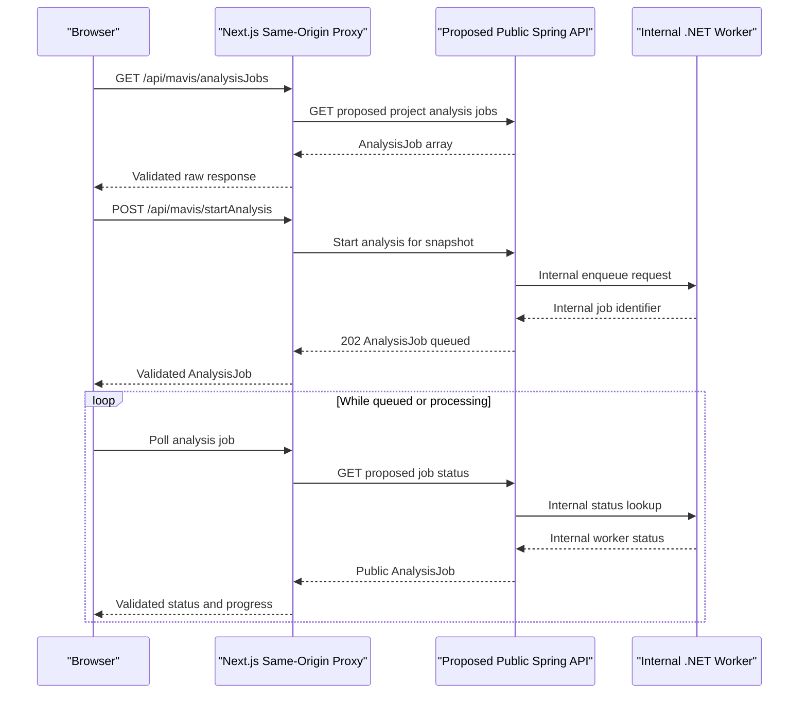

# MAVIS Frontend–Backend API Contract (Draft)

**Status:** Draft for FE–BE review. All proposed public endpoints below are `PROPOSED`; none has been tested against a running backend.
**Evidence reviewed:** Stage 2 operation/domain schemas, adapters, permission map, UI operation call sites and API integration checklist; Spring Boot controllers/security/configuration; .NET Worker controllers/contracts/configuration.
**Scope:** The existing frontend is the consumer of record. This specification preserves its current operation inputs, outputs and workflows, and marks required future capabilities separately.

## 1. Executive summary

The frontend defines 39 typed operations (38 public-facing operations plus the mock-only `mockLogin`) and runs in mock mode by default. Its backend adapter targets a same-origin Next.js proxy at `/api/mavis/[operation]`; no upstream operation mapping is configured. The repository currently has no compatible public MAVIS API set: a Spring upload endpoint returns a server filesystem path and starts analysis as a side effect, while the .NET job and analysis endpoints are worker-facing contracts.

The recommended public API is a versioned JSON REST API behind the Spring Boot application. It should return the raw domain shapes currently validated by the frontend (or the proxy must explicitly unwrap/map the existing Spring `ApiResponse<T>` envelope). All paths and schemas in the OpenAPI draft are proposed, not evidence of implementation.

## 2. Evidence and status vocabulary

### Statuses

| Status | Meaning |
|---|---|
| `DEFINED` | A frontend request/response shape or behavior exists in repository code. |
| `AGREED` | FE and BE have explicitly accepted the wire contract. None found. |
| `IMPLEMENTED` | The public endpoint is implemented with a compatible contract. None found. |
| `VERIFIED` | A real request/response has been exercised against a running backend. None found. |
| `MISSING` | The frontend operation has no matching backend endpoint. |
| `CONFLICT` | An existing endpoint/behavior conflicts with the frontend contract. |
| `PROPOSED` | Suggested public path/behavior for review; not implemented or agreed. |
| `TBD` | Repository evidence does not decide the requirement. |

For backend comparison: `EXACT MATCH`, `PARTIAL MATCH`, `INTERNAL ONLY`, `CONTRACT CONFLICT`, `NOT FOUND`, `UNKNOWN`.

### Key transport boundaries

- The browser calls only the same-origin `/api/mavis/[operation]` proxy. This proxy is frontend-owned and is not a backend public API.
- The proxy forwards only allowlisted session cookies. Writes require an exact same-origin `Origin`; backend authorization and CSRF protection remain mandatory.
- The proxy operation mapping is unset. It can flatten GET operation inputs into query parameters and forward writes, but it does not interpolate path parameters or unwrap arbitrary response envelopes. Parameterized REST routes therefore require an explicit proxy translation.
- `BackendAdapter` currently expects raw response objects/arrays validated against `src/types/domain.ts`. Existing Spring `ApiResponse<T>` wrappers are incompatible unless deliberately unwrapped.
- `MAVIS_API_MODE=mock` is the default. Mock success is simulated data, not backend evidence.

## 3. Service catalog and observed API surface

| Service/module | Port | Category | Purpose / evidence |
|---|---:|---|---|
| `mavis-bootstrap` | 8080 (configured) | API/composition | Spring Boot executable entry point; composes `mavis-platform` and `mavis-analyzer`, initializes persistence/migrations. |
| `mavis-platform` | In-process module | API/business | Spring MVC/security module. Exposes the system ping controller; no separate port or executable configuration found. |
| `mavis-analyzer` | In-process module | Business/API | Spring MVC upload endpoint and source-analysis orchestration/event publisher; no separate port found. |
| `mavis-common` | None | Shared library | Shared entities, DTOs, exception handling and repositories; not independently deployable. |
| `MAVIS.Worker.Api` | 5082 HTTP; 7175 HTTPS in development launch profile | Internal API/worker | ASP.NET Core 8 API for queued analysis and direct analysis; development launch settings only, not a production port guarantee. |
| Next.js frontend | Deployment-specific | BFF/proxy | Same-origin `/api/mavis/[operation]` proxy; it is not a public backend service contract. |

The Maven root POM does not declare a reactor module list. The catalog treats the bootstrap artifact as the executable Spring application based on its Spring Boot plugin and module dependencies; deployment topology still needs confirmation.

### Existing controller endpoints

| Service | Method | Existing path | Request / response | Classification and reason |
|---|---|---|---|---|
| Spring `UploadController` | `POST` | `/api/v1/analyzer/upload` | multipart `file`, `projectId`; `ApiResponse<String>` containing stored file path | `CONTRACT CONFLICT` for `importSource`: no stable snapshot DTO or validation result; upload also publishes an analysis event, unlike the separate frontend `startAnalysis` step. Never expose the path. |
| Spring `PingController` | `GET` | `/api/v1/system/ping` | No input; `ApiResponse<String>` | `NOT FOUND` for frontend operations. Operational ping only; not a truthful platform-summary or health contract. |
| Worker `JobsController` | `POST` | `/api/Jobs/submit` | `AnalysisRequest`; `202` with `jobId`, message and project ID | `INTERNAL ONLY`; can contribute to a future Spring analysis-job adapter, but is not a public frontend contract and does not return the frontend job shape. |
| Worker `JobsController` | `GET` | `/api/Jobs/{jobId}` | Job ID; worker-defined status object | `INTERNAL ONLY`; status DTO has not been shown compatible with `analysisJob`. |
| Worker `AnalysisController` | `POST` | `/api/analysis` | `AnalysisRequest`; `AnalysisResult` | `INTERNAL ONLY`; documented as a Spring-to-Worker endpoint. Its result is not the frontend architecture model. |

No other Spring MVC or ASP.NET Core API controller routes were found in the inspected application sources. Do not infer public APIs from service classes, entities, repositories, or Swagger dependencies.

## 4. Current frontend contract inventory and proposed public mapping

The operation column preserves the frontend's current operation names. Wire request/response shapes are defined by `contracts.ts` and `domain.ts`; types below summarize those schemas, not a new frontend redesign. “Raw response” means the response must match the frontend schema directly unless the proxy performs an explicit, tested translation.

| Screen / user action | FE operation | Proposed public endpoint | Request → response | Auth / authorization | Current status and version behavior |
|---|---|---|---|---|---|
| App shell: load current identity | `session` | `GET /api/v1/session` | none → `{ user: { id, name, role } \| null }` | Session cookie; anonymous result allowed | `DEFINED`; public backend `MISSING`; `PROPOSED`. Frontend also treats 401 as anonymous. |
| App shell: sign out | `signOut` | `POST /api/v1/session/logout` | `{}` → `{ ok: true }` | Authenticated session; invalidate cookie | `DEFINED`; `MISSING`; `PROPOSED`. No refresh-token contract. |
| Project selector: list accessible projects | `projects` | `GET /api/v1/projects` | none → `Project[]` | Student/Individual Learner: owned/assigned; Lecturer: authorized workspace; Admin: platform scope | `DEFINED`; `MISSING`; `PROPOSED`. |
| Project overview: open selected project | `project` | `GET /api/v1/projects/{projectId}` | `projectId` → `Project` | Same ownership/workspace rule | `DEFINED`; `MISSING`; `PROPOSED`. |
| Project source screen: list source versions | `snapshots` | `GET /api/v1/projects/{projectId}/snapshots` | `projectId` → `Snapshot[]` | Project read access | `DEFINED`; `MISSING`; immutable snapshot ID required. |
| Import screen: upload ZIP | `importSource` | `POST /api/v1/projects/{projectId}/snapshots` | multipart `file`, `projectId`, `name` → `Snapshot` | Project write access; upload validation and size limits | `DEFINED`; `CONFLICT` with existing Spring upload; `PROPOSED`. No GitHub/branch/commit UI operation exists. |
| Analysis history: list project jobs | `analysisJobs` | `GET /api/v1/projects/{projectId}/analysis-jobs` | `projectId` → `AnalysisJob[]` | Project read access | `DEFINED`; `MISSING`; asynchronous lifecycle required. |
| Source analysis: start analysis | `startAnalysis` | `POST /api/v1/projects/{projectId}/analysis-jobs` | `{ projectId, snapshotId }` → `AnalysisJob` (`202 Accepted`) | Project write access; snapshot must be valid | `DEFINED`; `MISSING`; snapshot-bound asynchronous job. |
| Analysis history: poll job | `analysisJob` | `GET /api/v1/analysis-jobs/{jobId}` | `jobId` → `AnalysisJob` | Job/project read access | `DEFINED`; Worker has an internal status route, but public contract is `MISSING`. |
| Architecture: list model versions | `models` | `GET /api/v1/projects/{projectId}/models` | `projectId` → `Model[]` | Project read access | `DEFINED`; `MISSING`; models refer to immutable source snapshots. |
| Architecture: open model version | `model` | `GET /api/v1/models/{modelId}` | `modelId` → `Model` | Model/project read access | `DEFINED`; `MISSING`; graph is embedded in current schema. |
| Architecture editor: save element description | `saveModel` | `POST /api/v1/models/{modelId}/revisions` | `{ modelId, expectedRevision, elementId, description }` → new `Model` | Project write access | `DEFINED`; `MISSING`; stale expected revision returns `409`; new immutable ID and revision greater than expected. |
| Runtime setup: read eligibility/configuration | `runtimeConfiguration` | `GET /api/v1/projects/{projectId}/runtime-configuration` | `projectId` → `RuntimeConfiguration` | Project read access | `DEFINED`; `MISSING`; must not include secret values. |
| Runtime setup: select a profile | `saveRuntimeConfiguration` | `PUT /api/v1/projects/{projectId}/runtime-configuration` | `{ projectId, profileId, expectedRevision }` → `RuntimeConfiguration` | Project write access; profile must be enabled/eligible | `DEFINED`; `MISSING`; `409` on stale revision. Frontend does not currently preserve historical config revisions. |
| Runtime scenarios: list scenarios | `scenarios` | `GET /api/v1/projects/{projectId}/scenarios` | `projectId` → `Scenario[]` | Project read access | `DEFINED`; `MISSING`; list schema contains current revision only. |
| Runtime scenarios: save scenario | `saveScenario` | `POST /api/v1/scenarios/{scenarioId}/revisions` | `{ scenarioId, expectedRevision, name, steps[] }` → `Scenario` | Project write access | `DEFINED`; `MISSING`; `409` on stale revision. Historical immutable scenario revisions are not represented in current response schema. |
| Runtime: list sessions for project | `runtimeSessions` | `GET /api/v1/runtime-sessions?projectId={projectId}` | `projectId` (`*` is used for Admin view) → `RuntimeSession[]` | Owner/project access; Admin may list platform scope | `DEFINED`; `MISSING`; traces are scenario/session-specific. `*` scope needs explicit Admin authorization. |
| Runtime: inspect a session | `runtimeSession` | `GET /api/v1/runtime-sessions/{sessionId}` | `sessionId` → `RuntimeSession` | Session/project access | `DEFINED`; `MISSING`; completed result should be immutable. |
| Runtime: approve and start run | `startRuntime` | `POST /api/v1/runtime-sessions` | `{ projectId, snapshotId, scenarioId, configurationRevision, scenarioRevision, approved: true }` → `RuntimeSession` (`202`) | Project write access and explicit approval | `DEFINED`; `MISSING`; `409` for stale revisions; `422` if ineligible. Does **not** currently send `modelVersionId` or `executionProfileId`, although the requested runtime contract calls for exact model/config/profile references. |
| Runtime: cancel or terminate | `stopRuntime` | `POST /api/v1/runtime-sessions/{sessionId}/actions` | `{ sessionId, action: "cancel" \| "terminate" }` → `RuntimeSession` | Owner can cancel; Admin-only termination is a proposed policy | `DEFINED`; `MISSING`; only cancel/terminate exist in FE; no separate `STOP` operation. |
| Impact view: calculate dependencies | `impact` | `POST /api/v1/models/{modelId}/impact-analyses` | `{ modelId, targetId }` → `Impact` | Project read access | `DEFINED`; `MISSING`; current response only provides paths and limitations. It does not include evidence/runtime refs or a guaranteed-failure claim. |
| Explain view: explain selected element | `explain` | `POST /api/v1/models/{modelId}/elements/{elementId}/explanations` | `{ modelId, elementId }` → `Explanation` | Project write permission in current UI permission map; backend policy TBD | `DEFINED`; `MISSING`; response includes text, evidence IDs and `sample`; AI must not mutate model. |
| Workspace screen: list visible workspaces | `workspaces` | `GET /api/v1/workspaces` | none → `Workspace[]` | Membership; lecturer/admin scope | `DEFINED`; `MISSING`. |
| Assignments: list workspace assignments | `assignments` | `GET /api/v1/workspaces/{workspaceId}/assignments` | `workspaceId` → `Assignment[]` | Workspace membership; student sees assigned work | `DEFINED`; `MISSING`. |
| Reference versions: list published references | `referenceVersions` | `GET /api/v1/workspaces/{workspaceId}/reference-versions` | `workspaceId` → `{ id, workspaceId, snapshot, model }[]` | Lecturer-authorized workspace; student read only where assigned | `DEFINED`; `MISSING`; published references must be immutable. |
| Submission list: view own/reviewable work | `submissions` | `GET /api/v1/submissions` | none → `Submission[]` | Student sees own; Lecturer sees authorized assignment scope | `DEFINED`; `MISSING`; role-filtered results required. |
| Submission review: open frozen result | `submission` | `GET /api/v1/submissions/{submissionId}` | `submissionId` → `Submission` | Owner or authorized Lecturer/Admin | `DEFINED`; `MISSING`; must return frozen model/source/runtime references. |
| Submission composer: submit selected work | `submit` | `POST /api/v1/submissions` | `{ assignmentId, modelId, snapshotId, runtimeSessionId: string \| null }` → frozen `Submission` (`201`) | Student/Individual Learner; assignment membership/deadline rules TBD | `DEFINED`; `MISSING`; server must verify matching model/source/runtime and freeze references. |
| Submission review: add feedback | `feedback` | `POST /api/v1/submissions/{submissionId}/feedback` | `{ submissionId, modelId, text }` → updated `Submission` | Lecturer on assigned submission | `DEFINED`; `MISSING`; feedback must match submitted model ID. No update-feedback UI. |
| Accounts: list and search users | `accounts` | `GET /api/v1/admin/accounts` | none → `Account[]` | Admin only | `DEFINED`; `MISSING`; search is local in current UI. |
| Accounts: lock/unlock | `setAccountLock` | `PATCH /api/v1/admin/accounts/{accountId}/lock` | `{ accountId, locked }` → `Account` | Admin only; audited | `DEFINED`; `MISSING`; FE schema has no expected account revision. |
| Integrations: list safe status | `integrations` | `GET /api/v1/admin/integrations` | none → `Integration[]` | Admin only | `DEFINED`; `MISSING`; response contains no secrets. |
| Integrations: enable/disable | `configureIntegration` | `PATCH /api/v1/admin/integrations/{integrationId}` | `{ integrationId, enabled, expectedRevision }` → `Integration` | Admin only; audited | `DEFINED`; `MISSING`; `409` on stale revision. Credential editing/testing is not in the current UI. |
| Runtime profiles: list profiles | `profiles` | `GET /api/v1/admin/runtime-profiles` | none → `Profile[]` | Admin only | `DEFINED`; `MISSING`. |
| Runtime profiles: enable/disable | `configureProfile` | `PATCH /api/v1/admin/runtime-profiles/{profileId}` | `{ profileId, enabled, expectedRevision }` → `Profile` | Admin only; audited | `DEFINED`; `MISSING`; `409` on stale revision. Create/edit/validate/test UI is absent. |
| Audit: view records | `audit` | `GET /api/v1/admin/audit-records` | none → `AuditRecord[]` | Admin only | `DEFINED`; `MISSING`; filter/pagination are not sent by current UI. |
| Admin jobs: monitor all jobs | `adminJobs` | `GET /api/v1/admin/analysis-jobs` | none → `AnalysisJob[]` | Admin only | `DEFINED`; `MISSING`; isolated from student project visibility. |
| Admin summary: view telemetry | `platformSummary` | `GET /api/v1/admin/platform-summary` | none → `{ health, message, projects, users, runningSessions, analysisJobs }` | Admin only | `DEFINED`; `MISSING`; health must come from real telemetry; never infer healthy from ping alone. |

### Frontend-only or not currently required

| Capability | Current UI/contract finding |
|---|---|
| Login initiation / identity-provider callback / user profile update | No real login operation or profile-update operation exists. `/login` selects sample roles in mock mode; backend mode discloses the missing session/login contract. Profile update is **NOT REQUIRED BY CURRENT UI**. OIDC/SSO and logout destination behavior are `TBD`. |
| Project create/update/archive/delete | No current operation or UI mutation. Do not invent an enabled API. |
| GitHub import, branch/commit selection | No current operation. Only ZIP upload is contracted. |
| Dedicated graph, evidence, diagram generation/export, diagram validation | Current model embeds `elements`, `edges` and their evidence. No diagram API/diagram version contract exists. Current UI has no generation/export action. |
| Model-version comparison | No operation or current screen action exists. |
| Workspace CRUD and membership management | Current operation only lists workspaces with nested member summaries; there is no add/remove membership mutation. Do not enable membership UI before contract approval. |
| Assignment create/update/publish | Current operation only lists assignments. |
| Reference import/publish | Current operation only lists reference versions. |
| Submission export | No frontend export operation exists. Any future export must redact secrets and be separately authorized. |
| Feedback edit/review status/element annotation | Current operation creates text feedback for a submitted model; update, status and element anchoring are absent. |
| Account detail and lock revision | Current UI lists account summaries and sends only `{ accountId, locked }`; no detail or optimistic revision field. |
| Integration credential editing / connection test | Current UI only toggles `{ enabled }` using `expectedRevision`; credential values are server-side. |
| Runtime profile CRUD/validation/test | Current UI only toggles `{ enabled }` using `expectedRevision`. |
| Platform summary service health | Current schema supports `available`, `degraded`, `unknown`; only real telemetry may produce the first two. |

## 5. Public API requirements and wire conventions

### Public vs internal

**Public frontend API:** only the proposed `/api/v1/...` resources in this document, exposed by the Spring application and consumed through the Next.js same-origin proxy. For the upload route, the proxy must forward `file`, `projectId`, and `name` as multipart fields. The browser must not call the .NET Worker, runtime runner, telemetry collector, GitHub, AI provider, storage path or database directly.

**Internal APIs:** `/api/Jobs/submit`, `/api/Jobs/{jobId}`, and `/api/analysis` are Worker endpoints. Spring-to-Worker and Spring-to-GitHub/AI/runtime calls are internal integrations, not frontend routes. The repository contains an upload event publisher/listener, but the inspected sources do not establish a verified Spring-to-Worker HTTP call or production runtime-runner API.

### Request and response conventions

- JSON request/response unless explicitly multipart. UTF-8. IDs are opaque stable strings at the frontend boundary; existing mock IDs are not evidence of production UUID format.
- Return raw contract payloads expected by frontend validation. If retaining Spring `ApiResponse<T>`, the proxy must unwrap `data` and verify transport/business status; do not assume current frontend accepts the envelope.
- `importSource`: multipart fields `file` (ZIP), `projectId`, and `name`. The Next.js proxy currently forwards these names. Validate size, ZIP signature/content, archive paths, supported project type, secret exposure and malware policy server-side. Never return a filesystem path. Frontend local max is 200 MiB; deployment max is `TBD`.
- Snapshot validation enum: `valid`, `invalid`, `unsupported`; response includes stable `id`, `projectId`, `name`, timestamp and evidence completeness. Warning arrays/language profile are not in the current schema and require a frontend contract extension before they can be surfaced.
- Analysis start is asynchronous and returns a job representation; `queued`/`processing` progress is polled every 1.5 seconds. Terminal states currently are `completed`/`failed`; job output links to `modelId` or null. Unsupported/incomplete evidence must not be disguised as success.
- Graph model response is currently one object with embedded arrays of elements and edges. No graph pagination/chunking contract exists. Large graphs need a coordinated schema/client change before production-scale use.
- All current collection responses are arrays. To preserve those response schemas, proposed pagination uses `page` + `size` query parameters and `Link` / `X-Total-Count` headers. Defaults/limits and sortable/filterable fields remain `TBD`. Current UI does only local filtering/pagination; it does not send these parameters. API pagination cannot be enabled without a coordinated frontend and proxy update.
- GET inputs are flattened by the current proxy; dynamic path construction and array/query serialization require explicit tested proxy translation. Writes are sent by the browser to the proxy as POST, with the upstream method selected by mapping configuration; parameterized path substitution is not currently implemented.
- No mutation is automatically retried by the frontend. Avoid side-effect replay; define idempotency keys before adding retries or client retries.

### Proposed public error contract

All errors should use `application/problem+json` with a stable MAVIS extension. This is `PROPOSED PUBLIC ERROR CONTRACT`; the current frontend reads HTTP status and generic messages and does not parse server error bodies.

```json
{
  "type": "https://mavis.example/problems/model-version-conflict",
  "title": "Model version conflict",
  "status": 409,
  "code": "MODEL_VERSION_CONFLICT",
  "detail": "The selected model revision is no longer current.",
  "fieldErrors": [],
  "requestId": "opaque-request-id"
}
```

| HTTP status | Required meaning |
|---:|---|
| 400 | Malformed request / invalid syntax |
| 401 | No valid session; do not return credential details |
| 403 | Authenticated but not authorized for resource/action |
| 404 | Missing resource (avoid leaking cross-tenant existence) |
| 409 | Stale revision, duplicate state transition or immutable-version mismatch |
| 413 | Upload/body exceeds configured size limit |
| 422 | Valid JSON but domain validation failed; `fieldErrors` may identify fields |
| 429 | Rate limit; include `Retry-After` seconds or HTTP date |
| 500 | Generic server failure; no stack trace or sensitive internals |
| 503 | Temporary dependency/service unavailability; include `Retry-After` when known |

Do not expose raw exception text, filesystem paths, stack traces, upstream secrets or sensitive payloads. Existing Spring exception handling currently uses `400` for validation/business exceptions and a wrapper object; align or translate before enabling frontend operations.

## 6. Authorization matrix

This matrix is a proposed backend policy based on current frontend roles and permission groups. UI visibility is not authorization.

| Resource/action | Student | Individual Learner | Lecturer | Administrator |
|---|---|---|---|---|
| Read own project, snapshots, jobs, models, runtime results | Own/assigned only | `TBD`: role is not in current frontend enum | Only authorized workspace/project; read-only unless separately granted | Platform read scope only if explicitly granted |
| Create source snapshot / start analysis / edit model / configure own runtime / explain | Own project | `TBD` | Not enabled by current frontend permission map | Not implied by admin role; explicit policy needed |
| Start/cancel runtime | Own project, explicit approval | `TBD` | Not enabled in current UI | Admin monitoring/termination policy to be defined |
| Read workspaces/assignments/reference versions | Assigned/member scope | `TBD` | Managed/assigned workspace scope | Platform scope |
| Create submission | Own assignment before allowed deadline | `TBD` | No | No |
| Read submission | Own only | `TBD` | Assigned workspace submissions | Platform scope if justified/audited |
| Add feedback | No | No | Assigned submission only | `TBD`; not granted by current FE permission model |
| Manage membership / assignment / reference publication | No | No | Only lecturer-owned workspace, after these APIs are designed | `TBD` |
| Admin accounts, integrations, profiles, audit, all jobs, platform summary | No | No | No | Yes, audited |

The frontend roles are exactly `student`, `lecturer`, `admin`. **Individual Learner is not represented** by the current enum or permission grants; do not map it to Student without product approval. Admin's frontend grants are not equivalent to blanket project access. Every backend check must include tenant/workspace/project ownership, resource version and operation authorization.

## 7. Versioning, immutability and concurrency

| Artifact | Required behavior |
|---|---|
| Source snapshot | Immutable stable `snapshot.id`; analysis/runtime/submission reference exact ID. |
| Analysis job/result | Job bound to project and source snapshot; successful result refers to a newly created model ID. |
| Architecture model revision | `saveModel` uses `expectedRevision`; stale save returns `409`; successful save returns a new model ID and revision, leaving prior model readable. |
| Runtime configuration revision | A run pins exact approved configuration revision. Current FE save operation updates a current config; preserving history requires backend snapshots plus a revised FE response/identifier. This gap blocks claiming immutable revisions today. |
| Scenario revision | A run pins exact scenario revision. Current FE schema/list does not expose historical revision IDs; backend must not silently overwrite history, and FE contract needs a version-aware response to select old revisions. |
| Runtime session/result/traces | Start binds exact source, scenario and config versions plus explicit approval. Completed run/trace evidence is immutable and scenario-specific. Current FE start request is missing model and profile IDs required by the requested exact-reference policy. |
| Published reference version | Immutable once referenced by an assignment/submission; new publication creates new ID. Current UI only lists composite snapshot/model references. |
| Submission | Freeze assignment, source snapshot, model version, optional completed runtime result and timestamp. Current schema includes those source/model/runtime objects; server must reject cross-project/version references. |
| Feedback | Anchored to exact `submissionId` and submitted `modelId`; historical feedback remains readable even if later project versions change. |
| Mutable admin settings | Integration/profile toggles use `expectedRevision` and `409` on mismatch. Account lock currently lacks expected revision and needs a concurrency policy. |

Model revision comparison is based on current schema behavior and existing mock tests; it is not evidence of a persisted backend implementation.

## 8. Security and privacy requirements

- Use a server-managed, `HttpOnly`, `Secure`, appropriately `SameSite` session cookie; exact OIDC/SSO, domain, lifetime and logout behavior are `TBD`. Never put access/refresh tokens or session identifiers in `NEXT_PUBLIC_*` or browser storage.
- If cookie-authenticated writes are used, agree backend CSRF defense (token/header and Origin policy). The proxy's same-origin check is defense-in-depth, not a backend replacement. Spring currently disables CSRF and permits every request; this is incompatible with production access control.
- Enforce role, workspace membership, project ownership and exact submitted resource authorization at every endpoint. A frontend permission check does not protect APIs.
- Limit CORS to deployed origins if cross-origin use is unavoidable; prefer same-origin proxy. Do not allow wildcard credentials.
- Validate uploads by size/type/content and archive extraction safety. Redact secrets from logs/evidence. Expose stable snapshot/evidence IDs, not server paths.
- Never return passwords, access/refresh tokens, session cookies, GitHub tokens, AI API keys, runtime secrets, DB passwords or protected integration settings. Use configured/updated timestamps and masked metadata.
- Keep AI context limited to authorized, selected model/evidence IDs; strip credentials and protected runtime configuration. AI output is explanatory only and must not mutate model state.
- Require explicit user approval and eligibility checks before runtime execution; isolate runs and enforce resource/time limits. The actual runtime runner and limits are `TBD`.
- Audit account locks, integration/profile changes, runtime start/stop/terminate, submission review/feedback and privileged exports. Exclude secrets and sensitive payloads from audit metadata.
- Do not export secrets, cookies, credentials or protected integration configuration.

## 9. Communication patterns and service technology

| Service | Web | Data access | Discovery | Gateway | Health/actuator | Cache | Metrics |
|---|---|---|---|---|---|---|---|
| `mavis-bootstrap` | Spring Boot / MVC composition (based on dependencies) | JPA via `mavis-common` | None evidenced | Intended public Spring boundary; no API gateway product found | No actuator endpoints found; `/api/v1/system/ping` is a basic controller response | No API cache evidenced | No custom metrics found |
| `mavis-platform` | Spring MVC + Spring Security dependency | JPA shared module | None evidenced | No separate gateway implementation found | No actuator endpoint evidenced | None evidenced | None evidenced |
| `mavis-analyzer` | Spring MVC; WebFlux dependency present | Shared storage/repository services; no direct frontend store contract | None evidenced | Not a gateway | No actuator endpoint evidenced | None evidenced | None evidenced |
| `mavis-common` | Shared Spring web/validation dependencies, library only | Spring Data JPA entities/repositories | N/A | No | N/A | No API cache evidenced | None evidenced |
| `MAVIS.Worker.Api` | ASP.NET Core Web API | Infrastructure through application interfaces; worker internals | No service discovery evidenced | Internal worker API, not a browser gateway | Swagger enabled only in Development; no health endpoint found | None evidenced | No custom metrics found |

Observed communication:

- Frontend data operations use same-origin HTTP through the Next.js proxy. Queries poll active jobs/runtime sessions every 1.5 seconds; mutations are not retried automatically.
- Spring `UploadController` stores a ZIP and publishes an in-process `AnalyzeRequestEvent`; `AnalyzerOrchestrator` listens for that event. This is an event-based intra-process path. The inspected code does not establish a verified Worker HTTP call or durable broker.
- The .NET Worker has an asynchronous `JobsController` queue (`202 Accepted` then status GET) and a direct `/api/analysis` route. These are internal Worker endpoints. No retry/circuit-breaker/timeout/service-discovery policy was evidenced in the inspected caller code.
- No public Spring controller for session, project, model, runtime, education or administration operations was found. No backend role authorization is configured: `SecurityConfig` permits all requests and disables CSRF.

### Proposed primary flow (not live-verified)

<!-- mermaid-checked: every participant uses `participant Id as "Label"`, no \n in aliases/messages/notes, every alt/opt/loop closed by end, no `:` inside any alias -->


The Spring-to-Worker arrows above are an architectural proposal, not a code-verified production call. The current source upload event path must be reconciled with this separate asynchronous start/poll workflow.

## 10. FE–BE traceability and backend gap report

### Operation-to-endpoint traceability

Every current public-facing operation is mapped in §4. `mockLogin` is intentionally excluded from public APIs: it is a sample-role selector, and the backend proxy explicitly rejects it. The following action groups identify which screens require those operations:

| Screen / action | FE operation(s) | Proposed endpoint(s) | Status |
|---|---|---|---|
| App shell: identity, logout | `session`, `signOut` | `GET /session`; `POST /session/logout` | `PROPOSED` |
| Project selector and overview | `projects`, `project` | `GET /projects`; `GET /projects/{projectId}` | `PROPOSED` |
| Source snapshots / ZIP import | `snapshots`, `importSource` | `GET /projects/{projectId}/snapshots`; `POST` same collection | `CONFLICT` for existing upload path; proposed replacement |
| Analysis history and run | `analysisJobs`, `startAnalysis`, `analysisJob` | `GET/POST /projects/{projectId}/analysis-jobs`; `GET /analysis-jobs/{jobId}` | `PROPOSED`; Worker queue is internal only |
| Architecture list, details, edit | `models`, `model`, `saveModel` | `GET /projects/{projectId}/models`; `GET /models/{modelId}`; `POST /models/{modelId}/revisions` | `PROPOSED` |
| Impact and explanation | `impact`, `explain` | `POST /models/{modelId}/impact-analyses`; `POST /models/{modelId}/elements/{elementId}/explanations` | `PROPOSED` |
| Runtime configuration, scenario, session | `runtimeConfiguration`, `saveRuntimeConfiguration`, `scenarios`, `saveScenario`, `runtimeSessions`, `runtimeSession`, `startRuntime`, `stopRuntime` | Runtime configuration, scenarios and runtime-session resources in §4 | `PROPOSED`; missing immutable revision references block full parity |
| Workspace and assignment | `workspaces`, `assignments`, `referenceVersions` | `GET /workspaces`; workspace assignment/reference-version collections | `PROPOSED` |
| Submission create/read/review | `submissions`, `submission`, `submit`, `feedback` | `GET /submissions`; `GET /submissions/{id}`; `POST /submissions`; `POST /submissions/{id}/feedback` | `PROPOSED` |
| Admin accounts/integrations/profiles | `accounts`, `setAccountLock`, `integrations`, `configureIntegration`, `profiles`, `configureProfile` | `/admin/accounts`, `/admin/integrations`, `/admin/runtime-profiles` | `PROPOSED` |
| Admin audit/jobs/summary | `audit`, `adminJobs`, `platformSummary` | `/admin/audit-records`, `/admin/analysis-jobs`, `/admin/platform-summary` | `PROPOSED` |

### APIs already usable

**None of the 38 public-facing frontend operations is currently evidenced as an exact-match public Backend API.** The ping endpoint does not satisfy a frontend operation and cannot establish real platform telemetry.

### APIs requiring translation

- Worker `POST /api/Jobs/submit` and `GET /api/Jobs/{jobId}` may be wrapped by Spring for `startAnalysis`/`analysisJob` after defining a stable public job schema, ownership checks, error mapping and result/model creation behavior.
- Existing Spring `ApiResponse<T>` results need unwrapping or a public raw-domain response layer before they can pass the frontend validators.
- The frontend proxy needs explicit path/query/header/body translation for the proposed REST paths; current operation mappings do not interpolate resource IDs into path templates.

### APIs requiring modification

- Spring `POST /api/v1/analyzer/upload`: replace public response with stable snapshot metadata and validation lifecycle; remove the filesystem path from public output and separate upload from analysis start.
- Spring `SecurityConfig`: replace `permitAll`/disabled CSRF with agreed authentication, CSRF and role/ownership policies before any user data endpoint is enabled.
- Spring error handling: map field validation to agreed statuses and the proposed error schema; never leak exception details.
- Runtime configuration/scenario schemas and runtime start input: add immutable revision IDs and exact model/config/profile references before claiming those workflows are version-safe.
- Account lock mutation: define optimistic concurrency or an explicit serialized/idempotent policy.

### Missing public Backend APIs

All public resource endpoints in §4 are missing as frontend-compatible APIs: session/logout; projects; snapshots/import; analysis jobs; models/revisions; runtime configuration/scenarios/sessions; impact/explanation; workspaces/assignments/reference versions; submissions/feedback; and all listed administration resources. Current APIs must not be marked implemented or verified on the basis of mocks, source declarations or Swagger dependencies.

### Internal APIs (never called by browser)

- .NET Worker: `POST /api/Jobs/submit`, `GET /api/Jobs/{jobId}`, `POST /api/analysis`.
- Any future runtime runner, OpenTelemetry collector, AI provider, GitHub integration, storage service or database API.
- The Next.js `/api/mavis/[operation]` route is a same-origin frontend proxy and is not a public MAVIS backend endpoint.

### Unresolved business and integration decisions

1. Select the identity provider/login initiation/callback ownership, session cookie name/attributes/lifetime, anonymous session behavior, logout and CSRF strategy. Do not add refresh-token behavior unless required.
2. Decide whether `Individual Learner` is a distinct role and define exact mappings to current `student` permission semantics.
3. Confirm ownership, workspace membership, lecturer assignment scope, cross-workspace access, administrator project-read scope and non-disclosure behavior for inaccessible resources.
4. Agree project creation/association lifecycle; the current UI only lists projects and has no create/update/archive/delete action.
5. Set upload maximum/deployment limit, ZIP expansion limits, supported languages, secret scanning, validation warnings and evidence completeness semantics.
6. Define Spring-to-Worker durable job lifecycle, idempotency, progress, retries, cancellation, worker error categories and model creation/result retention.
7. Agree model revision identity and conflict response; add config/scenario historical revision identifiers and include `modelVersionId`/`executionProfileId` in runtime start.
8. Confirm whether diagrams, model comparison, runtime trace details, evidence views and export are required; these have no current frontend operations.
9. Define assignment publication/deadlines/resubmission/duplicate submission policy, reference import/publication and frozen historical behavior.
10. Define membership management and lecturer authorization; no membership mutation exists in current UI.
11. Define feedback update/review status and element-level anchoring, account detail/revision, integration settings/testing and runtime profile validation/create/update.
12. Agree standard page/size defaults, maximums, sorting/filter fields and graph pagination/chunking. Existing UI does local list operations and expects arrays.
13. Define idempotency keys for side effects if retries are ever introduced. Current frontend does not retry mutations.
14. Define actual health/usage telemetry sources and which health failures produce `degraded` versus `unknown`.
15. Confirm production deployment topology, public API base path, CORS/origin, TLS, rate limits, retention/audit rules and real service timeouts.
16. Capture a successful and failed real request for every operation before setting `VERIFIED` or enabling backend mode.

## 11. Recommended implementation order

1. **Contract alignment:** review this document and OpenAPI draft; resolve role/session/ID/pagination/error decisions. Update schemas deliberately for runtime revision gaps.
2. **Security foundation:** implement session authentication, CSRF, ownership/workspace/role enforcement, request IDs, audit policy, safe error envelopes and rate limits.
3. **Public read foundation:** projects, snapshots, model/job reads, workspace/assignment/reference reads; add proxy wire mappings and contract tests.
4. **Source and asynchronous analysis:** stable upload snapshots, validation statuses, separate job start/status, Worker adapter and failure/retry/idempotency behavior.
5. **Versioned architecture workflows:** model read/save with immutable revisions and optimistic concurrency; then impact/explanation with provenance and secret-safe context.
6. **Runtime:** immutable config/scenario revision IDs, explicit model/profile pinning, approval, isolated execution, cancellation/termination, trace retention and safe diagnostics.
7. **Education/submissions:** frozen submission creation/read, lecturer authorization, version-scoped feedback, assignment/reference rules and later membership APIs.
8. **Administration/telemetry:** account lock concurrency, integrations/profiles without secret disclosure, audit pagination and telemetry-backed platform summary.
9. **Enablement gate:** test every enabled operation against a running authenticated backend (success, validation, conflict, unauthorized, forbidden, unavailable); only then configure `MAVIS_API_MODE=backend` and operation mappings.

## 12. OpenAPI draft

The companion [`openapi.yaml`](./openapi.yaml) is a proposed OpenAPI 3.1 description of the current frontend operation boundary. Every public route is marked `PROPOSED`; it does not describe an implemented API. `mockLogin` is excluded because it is a mock-only UI operation. Additional workflows absent from the current frontend are intentionally excluded.
