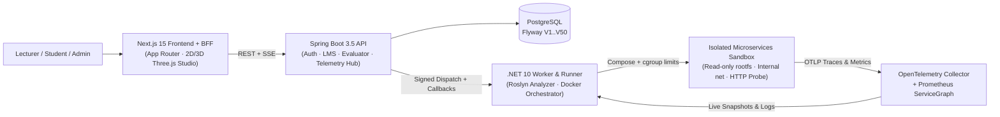

<div align="center">

# MAVIS

**Evidence-Verified Microservices Architecture Learning & Live Chaos Lab Platform**

[](https://maviss.site)
[](MAVIS-Platform/mavis-be)
[](MAVIS.Worker)
[](MAVIS-Frontend)
[](MAVIS-Platform/mavis-be/mavis-bootstrap/src/main/resources/db/migration)

[Live Deployment](https://maviss.site) · [Architecture](#system-architecture) · [Studio Live](#studio-live-easy--ultra-hard-labs) · [Quick Start](#quick-start) · [Documentation](#documentation)

</div>

---

## Overview

**MAVIS** is an end-to-end learning and assessment platform for software architecture and distributed systems. Instead of grading static diagrams or multiple-choice quizzes in isolation, MAVIS connects **real source-code static analysis** (Java & C#/.NET) with **live, isolated Docker Compose microservices sandboxes** instrumented with OpenTelemetry.

- **Lecturers** import polyglot repositories, inspect verified architecture models, author interactive **Easy → Ultra-Hard** fault-injection and SRE labs with deterministic pass criteria, and grade evidence-sealed student submissions in SpeedGrader.
- **Students** explore C4/UML views grounded in actual call sites, diagnose and remediate cascading failures in a live 2D/3D Studio environment, lock root-cause & blast-radius hypotheses, and submit tamper-evident HMAC-SHA256 receipts.

---

## System Architecture



| Layer | Technology | Responsibilities |
| :--- | :--- | :--- |
| **Frontend & BFF** | Next.js 15.5, React 19, TypeScript 5.8, Tailwind CSS, Three.js | Bilingual (EN/VI) LMS, Coursera-style syllabus & Quiz Gates, 2D/3D Studio Live (4 visual themes), visual lab editor, SpeedGrader, Admin Control Center |
| **Core Backend** | Java 21, Spring Boot 3.5.16, Maven, PostgreSQL, Flyway (`V1..V50`) | RBAC (Admin/Lecturer/Student), static Java analyzer, deterministic `StudioExerciseEvaluator`, SSE live telemetry stream, HMAC-SHA256 receipt verification |
| **Worker & Runner** | .NET 10 (`MAVIS.Runner`), Roslyn, Docker Compose, OpenTelemetry | C#/.NET static analysis, cycle-safe Reverse BFS blast-radius engine, isolated container lifecycle, cgroup CPU throttling/saturation telemetry, live HTTP load probe (`1–50 RPS`) |
| **Delivery & Ops** | GitHub Actions, Docker Compose, Nginx | Multi-stage CI verification, real Docker runtime acceptance tests, multi-image builds, zero-downtime production deployment with health checks |

---

## Core Capabilities

### 1. Evidence-Grounded Static Analysis (Java & .NET)
- Extracts **C1–C3 architecture models**, service dependency graphs, and **5 UML diagrams** (Class, Package, Deployment, Activity, State) with Draw.io round-trip support.
- Grounded in **3E call-site evidence** (file path, line range, symbol, HTTP/messaging contract) with cycle-safe **Reverse BFS** blast-radius computation.

### 2. Studio Live: Easy → Ultra-Hard Labs
- **Real Container Execution**: Spins up isolated multi-service Docker Compose topologies with read-only filesystems, internal networks, PID/RAM/CPU cgroup quotas, and live OTLP trace + Prometheus service-graph collection.
- **Bounded SRE Controls**: `START`, `STOP`, `PAUSE`, `RESUME`, `SCALE (1..3)`, `THROTTLE_CPU (10..100%)`, `SET_LOAD (1..50 RPS)`, `SET_ENV`, and `SWAP_VERSION`.
- **Visual Lab Authoring**: Lecturers configure 5 goal templates, pre-seeded compound faults (e.g., stopped downstream + hidden 25% CPU throttle), action budgets, composable pass criteria (error rate, p95 latency, replica/CPU/load targets, verified call paths), and **Root Cause / Blast Radius F1** diagnosis locks.
- **Exam Integrity**: Supports exam mode (hiding automated pass/fail breakdown until the lecturer grades and publishes results) and **HMAC-SHA256 sealed receipts** with Before/After snapshots.

### 3. Course Delivery, Quiz Gates & SpeedGrader
- Passkey class enrollment, ordered module syllabi, and configurable **Quiz Gates** that unlock subsequent labs in sequence.
- **SpeedGrader** with an integrated Studio Verification Assistant (displays sealed receipt status, criterion-by-criterion evaluation, diagnosis F1 score, action log, and container metrics) plus **Gradebook CSV export**.

---

## Repository Structure

```text
mavis-platform/
├── MAVIS-Frontend/          # Next.js 15 App Router, BFF proxy, 2D/3D Studio Live, LMS UI
├── MAVIS-Platform/
│   └── mavis-be/            # Spring Boot 3.5 Maven multi-module backend
│       ├── mavis-common/    # Shared domain primitives & utilities
│       ├── mavis-analyzer/  # Java static analysis & architecture extraction
│       ├── mavis-platform/  # LMS, Studio evaluator, telemetry hub, grading services
│       └── mavis-bootstrap/ # Executable API, Flyway migrations (V1..V50), acceptance tests
├── MAVIS.Worker/            # .NET 10 Roslyn analyzer, Docker Compose runner, Java worker client
├── deploy/                  # Production Docker Compose, Nginx config, CI/CD runbooks
├── docs/                    # Architecture, runtime, setup, and verification documentation
├── scripts/                 # Local bootstrap & operational helper scripts
└── run.bat                  # Windows one-click local stack launcher
```

---

## Quick Start

### Prerequisites
- **Java 21** (JDK) & **Maven 3.9+**
- **.NET 10 SDK**
- **Node.js 20+** & **npm**
- **PostgreSQL 15+**
- **Docker Engine / Docker Desktop** *(required for Studio Live runtime labs)*

### Local Setup
1. **Configure environment**: Copy `.env.backend.example` to `.env.backend.local` and fill in your PostgreSQL credentials and local secrets. Never commit `.env.backend.local` or shared credentials.
2. **Launch the stack**:
   - **Windows**: Double-click `run.bat` (creates `.env.backend.local` on first run if missing).
   - **Manual / Cross-platform**: Follow [docs/CLEAN_CLONE_SETUP.md](docs/CLEAN_CLONE_SETUP.md) and [docs/DEVELOPMENT_RUNBOOK.md](docs/DEVELOPMENT_RUNBOOK.md).

---

## Testing & Verification

```bash
# Backend (Java 21 / Spring Boot)
cd MAVIS-Platform/mavis-be
mvn test

# Worker & Runtime Runner (.NET 10)
cd MAVIS.Worker
dotnet test

# Frontend (TypeScript + Unit/Contract Suite)
cd MAVIS-Frontend
npx tsc --noEmit
npm test
```

---

## CI/CD & Production Deployment

Every push to `main` runs the multi-stage pipeline in [.github/workflows/deploy-production.yml](.github/workflows/deploy-production.yml):

1. **`verify`**: Runs Backend Maven tests, `.NET 10` Worker tests, Frontend TypeScript & test suite, and deployment smoke checks.
2. **`runtime-docker`**: Executes real Docker Java-to-Runner Studio Live acceptance tests against live containers.
3. **`build-images`**: Builds and publishes `backend`, `frontend`, and `worker` container images.
4. **`deploy`**: Applies Flyway migration pre-flights and rolls out the production stack to [maviss.site](https://maviss.site) with post-deploy health verification.

See [deploy/CI-CD.md](deploy/CI-CD.md) for deployment topology and secrets configuration.

---

## Documentation

| Guide | Scope |
| :--- | :--- |
| [docs/README.md](docs/README.md) | Master documentation index |
| [docs/CLEAN_CLONE_SETUP.md](docs/CLEAN_CLONE_SETUP.md) | Fresh-machine setup and environment configuration |
| [docs/DEVELOPMENT_RUNBOOK.md](docs/DEVELOPMENT_RUNBOOK.md) | Local development, debugging, and test workflows |
| [docs/LOCAL_DATABASE_AND_MAIL.md](docs/LOCAL_DATABASE_AND_MAIL.md) | PostgreSQL, Flyway migrations, and SMTP configuration |
| [docs/MAVIS_STUDIO_RUNTIME.md](docs/MAVIS_STUDIO_RUNTIME.md) | Docker sandbox architecture, OpenTelemetry, and Studio Live protocol |
| [docs/PREPARED_LIVE_STUDIO.md](docs/PREPARED_LIVE_STUDIO.md) | Studio authoring model, fault presets, and deterministic evaluation |
| [docs/LECTURER_LAB_AUTHORING_UI.md](docs/LECTURER_LAB_AUTHORING_UI.md) | Lecturer lab authoring UX and Easy → Ultra-Hard design workflow |
| [docs/PROJECT_SOURCE_WORKFLOW.md](docs/PROJECT_SOURCE_WORKFLOW.md) | Polyglot Git/ZIP ingestion and static analysis pipeline |
| [deploy/CI-CD.md](deploy/CI-CD.md) | CI/CD pipeline, container registry, and production operations |
| [docs/MAVIS_DEFENSE_1_1_MASTER_VERIFICATION_REPORT.md](docs/MAVIS_DEFENSE_1_1_MASTER_VERIFICATION_REPORT.md) | End-to-end verification report and acceptance matrix |
