# Bộ Tài Liệu Chuẩn Hóa 9 Loại Sơ Đồ Kiến Trúc & Thiết Kế (MAVIS Standard Diagram Guide)

**Phiên bản:** 2.1 (Hiệu chỉnh ngữ nghĩa, provenance và ví dụ) • **Ngày cập nhật:** 25/10/2026

**Phạm vi áp dụng:** Hệ thống **MAVIS** (*AI-Assisted Microservices Architecture Visualization and Change Impact Analysis*)  
**Chuẩn đối chiếu gốc:** C4 Model (`c4model.com`) & OMG UML 2.5.1 (`formal/2017-12-05`)

> [!IMPORTANT]
> **Nguyên tắc cốt lõi dùng chung cho cả 9 loại sơ đồ trong MAVIS:**
> 1. **Tách biệt Mô hình và Hình vẽ:** `Source / Config / Runtime Trace` $\rightarrow$ `Facts có Evidence` $\rightarrow$ `Canonical Architecture Model (ID ổn định)` $\rightarrow$ `Diagram Projection theo Scope` $\rightarrow$ `Layout & Render`. Việc parser/renderer vẽ ra được hình **không** tự chứng minh mô hình đúng kiến trúc hay đúng mã nguồn.
> 2. **Tách nguồn dữ kiện, thiết kế và xác nhận:** Ba nhóm nguồn được diễn giải trong tài liệu là **Static** (mã nguồn/AST), **Declared** (Docker Compose, OpenAPI, manifest) và **Observed** (trace/span trong kịch bản và khung thời gian cụ thể). **Designed** là nội dung do người dùng chủ động thiết kế, không mạo danh dữ kiện trích xuất. **User-confirmed** là thông tin xác nhận/review riêng, có thể áp dụng cho dữ kiện từ nhiều nguồn; xác nhận không biến dữ kiện thiết kế thành dữ kiện trích xuất hay quan sát runtime. Tuyệt đối không ghi đè mất dữ kiện tĩnh bằng trace runtime.
> 3. **Chính sách Fail-Closed khi thiếu dữ kiện:** Không tự bịa Actor mặc định, không đoán công nghệ/version, không tự thêm Database cho service stateless, không đảo chiều cạnh để làm đẹp bố cục. Phần tử/quan hệ chưa phân giải được phải gắn trạng thái `UNRESOLVED` / `NEEDS_REVIEW` hoặc hiển thị rõ `"Chưa xác định từ source"`.
> 4. **Hệ thống ví dụ xuyên suốt:** Cả 9 tài liệu dưới đây dùng chung bài toán microservice giả định **OrderHub** (gồm `Merchant System`, `Support Operator`, `OrderHub` với `Order API`, `Orders DB`, topic `order-events`, `Billing Worker`, `Billing DB`, và hệ thống ngoài `Payment Provider`) để bảo đảm tính liên kết 100% giữa các góc nhìn.

**Cách đọc chuẩn và quy ước:** Ngữ nghĩa C4/UML, khuyến nghị dễ đọc và chính sách MAVIS là ba phạm vi khác nhau. Những yêu cầu gắn nhãn **Quy ước MAVIS** là lựa chọn của sản phẩm, không phải ràng buộc phổ quát của OMG hoặc C4. Cách liên hệ từng sơ đồ với 4+1 trong tài liệu là cách tổ chức góc nhìn của MAVIS, không phải ánh xạ bắt buộc một-một giữa các chuẩn. Ví dụ OrderHub là **thiết kế minh họa giả định**, không phải bằng chứng rằng mọi chức năng đã được triển khai hoặc nghiệm thu trong phần mềm.

**Ánh xạ provenance khi triển khai:** Các tên nhóm nguồn ở trên không phải một enum dùng chung. Graph API hiện dùng `originLayer` với `STATIC`, `CONFIG`, `DEPLOYMENT`, `RUNTIME`, `STATIC_AND_RUNTIME`; workspace UML dùng `provenance` với `EXTRACTED`, `DESIGNED`, `HYBRID`. Declared config/deployment phải được ánh xạ theo contract producer tương ứng; Observed cần giữ lineage tới runtime evidence. Dữ kiện `EXTRACTED` vẫn cần nguồn/evidence cụ thể, còn `HYBRID` phải phân biệt được phần trích xuất và phần thiết kế. Không gửi nhãn diễn giải `DECLARED`, `OBSERVED` hoặc `USER_CONFIRMED` vào field enum không hỗ trợ chúng, và không tự thêm enum chỉ để khớp câu chữ trong tài liệu.

---

# PHẦN 1. NHÓM SƠ ĐỒ KIẾN TRÚC C4 MODEL (C1 – C3)

> [!NOTE]
> **Vì sao MAVIS chỉ sử dụng C1, C2, C3 và lược bỏ C4 (Code Level)?**  
> Theo tác giả Simon Brown (*Software Architecture for Developers* & `c4model.com`), Level 4 (Code) là tùy chọn và ít khi được vẽ thủ công vì thông tin này biến đổi liên tục và đã có sẵn trong IDE hoặc được biểu diễn trực tiếp qua **UML Class Diagram** (Mục 4 của tài liệu này) khi cần phân tích sâu một module.

| Cấp C4 | Phạm vi được mở (Scope) | Câu hỏi kiến trúc trọng tâm | Đối tượng đọc chính |
| :--- | :--- | :--- | :--- |
| **C1 — System Context** | Một **Software System** (coi như hộp đen) | Hệ thống cung cấp giá trị gì, ai sử dụng, và tương tác với hệ thống ngoài nào? | Cả người làm nghiệp vụ (PO, BA, Giảng viên) và kỹ thuật (Dev, Architect). |
| **C2 — Container** | Bên trong **Software System** đã chọn ở C1 | Những ứng dụng (application) và kho dữ liệu (data store) nào hợp thành hệ thống? Chúng giao tiếp bằng gì? | Developer, Software Architect, DevOps / Vận hành. |
| **C3 — Component** | Bên trong **một Container** đã chọn ở C2 | Trách nhiệm bên trong một container được phân chia thành các component nào và cộng tác ra sao? | Developer, Tech Lead, người học thiết kế nội bộ dịch vụ. |

---

## 1. C4 — System Context Diagram (C1)

### 1.1. Tổng quan & Lý do sử dụng
* **Định nghĩa chuẩn:** Sơ đồ Ngữ cảnh Hệ thống (C1) là góc nhìn cấp cao nhất của mô hình C4, đặt **một Software System** vào trung tâm như một hộp đen (black box) và hiển thị các **Person** (người dùng/vai trò) cùng các **External Software Systems** tương tác trực tiếp với nó.
* **Vị trí trong 4+1 View Model:** Đóng vai trò khung ngữ cảnh tổng thể kết nối **Scenarios (+1)** với biên ngoài của **Logical View**.
* **Tại sao phải dùng & Chức năng chính:**
  * Xác lập rõ **ranh giới trách nhiệm (System Boundary)** và giá trị nghiệp vụ cốt lõi của hệ thống trước khi đi vào chi tiết kỹ thuật.
  * Nhận diện đầy đủ các tác nhân con người và các hệ thống phụ thuộc bên ngoài (cả chiều gọi vào inbound lẫn chiều hệ thống gọi ra outbound).
* **Phạm vi & Giới hạn (Non-goals):**
  * **Không** mở danh sách microservice nội bộ, database/schema nội bộ, message broker/topic nội bộ, class/controller hay cổng mạng (TCP port).
* **Phân biệt C4 System Context Diagram (C1) và Context Diagram truyền thống (DFD Level 0 / SRS):**

| Tiêu chí so sánh | Context Diagram truyền thống (DFD Level 0 / Wiegers SRS) | C4 System Context Diagram (Level 1 — C1) |
| :--- | :--- | :--- |
| **Nguồn gốc & Mục đích** | Phân tích có cấu trúc (*DeMarco/Yourdon DFD Level 0*, *Karl Wiegers SRS*): đặc tả **luồng dữ liệu vào/ra (Input/Output Data Flows)** ở mức yêu cầu phần mềm. | Mô hình kiến trúc C4 (*Simon Brown*): đặc tả **ngữ cảnh kiến trúc phần mềm** và đóng vai trò cấp độ 1 để **zoom-in** trực tiếp xuống Container (C2) và Component (C3). |
| **Ký hiệu Hệ thống đích (Ở giữa)** | **Hình tròn (Circle / Bubble)** duy nhất ở trung tâm đại diện cho toàn bộ hệ thống (Process `0`). | **Hộp chữ nhật (Box)** ở trung tâm có nhãn loại `[Software System]` kèm câu mô tả trách nhiệm/giá trị nghiệp vụ. |
| **Ký hiệu Tác nhân bên ngoài** | Mọi tác nhân bên ngoài (người dùng, phòng ban, cảm biến, hệ thống khác) đều vẽ chung bằng **hình chữ nhật đơn giản (`External Entity / Terminator`)**, không phân biệt người hay máy bằng ký pháp riêng. | Tách bạch rõ 2 loại phần tử chuẩn có nhãn `[type]` và mô tả vai trò: 1. **`[Person]`**: người dùng/vai trò con người. 2. **`[Software System]`**: hệ thống phần mềm bên ngoài. |
| **Bản chất Mũi tên & Nhãn cạnh** | **Luồng dữ liệu (Data Flow):** Tách riêng mũi tên dữ liệu đi vào và mũi tên dữ liệu đi ra; nhãn cạnh là **cụm danh từ chỉ gói thông tin/dữ liệu** (VD: `Menu choices`, `Order confirmation`, `Sales tax data`). | **Quan hệ tương tác / Phụ thuộc (Relationship):** Mỗi cạnh biểu diễn một quan hệ có hướng; chiều và nhãn phải cùng diễn đạt phụ thuộc, tương tác hoặc luồng dữ liệu đã chọn. Với request/response, thường vẽ từ bên gọi tới bên nhận và lược bỏ phản hồi khi đã rõ. Nhãn ưu tiên **cụm động từ cụ thể** (VD: `Gửi đơn hàng`, `Yêu cầu cấp phép thanh toán`). |
| **Liên kết với các sơ đồ cấp dưới** | Phóng to xuống **DFD Level 1, Level 2** (các tiến trình xử lý dữ liệu và kho dữ liệu). | Phóng to trực tiếp chiếc hộp trung tâm ở **C1** thành khung `System Boundary` ở **C2 (Container Diagram)** và giữ nguyên các tác nhân xung quanh để bảo toàn tính nhất quán xuyên cấp. |

### 1.2. Các phần tử cốt lõi & Ký pháp chuẩn

C4 độc lập với ký pháp: hộp, màu, hình trụ, biểu tượng Person và nét khung trong các ví dụ là lựa chọn trình bày của MAVIS. Điều cần giữ là mức trừu tượng, scope, loại phần tử, trách nhiệm và ý nghĩa quan hệ; Legend phải giải thích các ký hiệu được chọn.

| Phần tử / Quan hệ | Ý nghĩa mô hình (Semantics) | Ký pháp trình bày chuẩn | Điều KHÔNG được suy diễn sai |
| :--- | :--- | :--- | :--- |
| **Person** | Vai trò con người sử dụng hệ thống. | Hộp/biểu tượng người: **Tên vai trò**, nhãn `[Person]`, mô tả trách nhiệm ngắn. | Client máy, cronjob hoặc API bên ngoài gọi vào **không** phải là `Person`. |
| **Target Software System** | Hệ thống phần mềm đang xét; đơn vị cung cấp giá trị nghiệp vụ thuộc quyền sở hữu của nhóm/tổ chức. | Hộp trung tâm: **Tên hệ thống**, nhãn `[Software System]`, câu mô tả giá trị nghiệp vụ. | Một Software System không đồng nhất 1-1 với một Git repository hay một microservice đơn lẻ. |
| **External Software System** | Hệ thống phần mềm nằm ngoài ranh giới hệ thống đang xét nhưng có tương tác trực tiếp. | Hộp phụ trợ (thường phân biệt tông màu/nhãn): **Tên**, `[Software System]`, vai trò tương tác. | "External" là ngoài ranh giới của system đang xét, không nhất thiết phải thuộc công ty khác. |
| **Relationship** | Tương tác nghiệp vụ/dữ liệu trực tiếp giữa Person/External System với Target System. | Mũi tên một chiều kèm **cụm động từ cụ thể** (VD: *"Gửi đơn hàng"*, *"Yêu cầu cấp phép thanh toán"*). | Chiều mũi tên phải khớp ý nghĩa nhãn: phụ thuộc/khởi tạo lời gọi hoặc luồng dữ liệu đã chọn. Với lời gọi request/response, phản hồi có thể được ngầm hiểu; không áp đặt quy tắc khởi tạo cho mọi cạnh dữ liệu/messaging. |

### 1.3. Quy trình dựng sơ đồ chuẩn
1. **Chốt System đích:** Chọn đúng 1 `Software System` và viết 1 câu mô tả giá trị nghiệp vụ; đại diện bằng 1 hộp duy nhất, ẩn toàn bộ cấu trúc nội bộ.
2. **Liệt kê Supporting Elements:** Xác định các `Person` và `External Software System` có tương tác trực tiếp với hệ thống đích (kèm căn cứ từ đề bài, cấu hình hoặc mã nguồn).
3. **Xác lập chiều quan hệ:** Vẽ mũi tên theo chiều chủ thể khởi tạo tương tác (hệ thống ngoài gọi webhook/callback vào thì mũi tên đi từ ngoài vào trong).
4. **Đặt nhãn ngữ nghĩa:** Ghi động từ + đối tượng trao đổi trên từng mũi tên; lược bỏ chi tiết giao thức cấp thấp ở C1.
5. **Kiểm tra Tiêu đề & Legend:** Ghi rõ `System Context diagram for <System Name>`, bổ sung bảng chú giải (Legend) giải thích hình khối, màu sắc và trạng thái dữ kiện.

### 1.4. Bộ quy tắc sử dụng & Kiểm chứng
* **Quy tắc bắt buộc:**
  * **[N-C1-01]** Chỉ có đúng một hệ thống đích được xét làm trung tâm ngữ cảnh; mọi phần tử phụ trợ trên hình phải có ít nhất một cạnh nối trực tiếp với hệ thống đích.
  * **[N-C1-02]** Không để lộ Container (API service, worker, DB, queue) hoặc Component nội bộ lên C1.
  * **[M-C1-03] (Quy ước MAVIS):** Giữ nguyên ID của `Software System` và `External System` xuyên suốt C1 $\leftrightarrow$ C2 $\leftrightarrow$ C3. Khi gộp nhiều cạnh cấp C2 lên thành một cạnh ở C1, phải lưu danh sách `underlyingEdgeIds` gốc.
* **Các lỗi thường gặp (Anti-patterns):**

| Lỗi phổ biến (Sai) | Cách hiểu & xử lý đúng (Chuẩn) |
| :--- | :--- |
| Vẽ toàn bộ các microservice nội bộ rồi đặt tên là System Context. | Đó là mức Container (C2). Ở C1, toàn bộ các microservice thuộc hệ thống phải gộp trong 1 hộp `Software System` duy nhất. |
| Tự sinh hộp `User` mặc định khi phân tích repo backend thuần không có dữ kiện người dùng. | Giữ trạng thái thiếu dữ kiện / thông báo số lượng entrypoint chưa rõ caller, hoặc chỉ vẽ `External System` đã xác minh. |
| Dùng nhãn `"Uses"` cho tất cả các mũi tên hoặc ép mọi mũi tên đi từ System ra ngoài. | Ghi rõ động từ nghiệp vụ; nếu hệ thống ngoài chủ động gọi vào (inbound API/webhook), mũi tên phải đi vào System. |
| Biến Database nội bộ thành External System để vẽ lên C1. | Database nội bộ thuộc C2; chỉ vẽ External System khi kho dữ liệu đó thuộc quyền sở hữu của một hệ thống ngoài độc lập. |

* **Checklist nghiệm thu:**
  - [ ] Có 1 hộp `Software System` đích rõ ràng kèm mô tả giá trị nghiệp vụ.
  - [ ] Không xuất hiện bất kỳ database, message queue hay service nội bộ nào trên hình.
  - [ ] Mọi mũi tên đọc thành câu có nghĩa từ nguồn tới đích; không có nhãn `"Uses"` chung chung.
  - [ ] Có đầy đủ Title, Scope và Legend độc lập.

### 1.5. Ứng dụng & Cơ chế trích xuất trong MAVIS
* **Ánh xạ dữ kiện đầu vào:**
  * *Static / Declared:* Các outbound HTTP client, URL config trỏ ra domain ngoài gợi ý ứng viên `External Software System`; các inbound HTTP controller/OpenAPI gợi ý điểm vào (entrypoints).
  * *User Confirmed / Assignment Brief:* Tên hệ thống đích, mục đích nghiệp vụ, danh sách `Person` (Actor) và xác nhận ranh giới sở hữu.
* **Xử lý thiếu dữ kiện:** Nếu chỉ có source code mà chưa có thông tin Actor, MAVIS hiển thị cảnh báo phạm vi (*Scope Warning*: số lượng entrypoint phát hiện được nhưng chưa xác định caller) và yêu cầu người học xác nhận thay vì tự bịa `Person`.

### 1.6. Ví dụ minh họa chuẩn (Bài toán OrderHub)
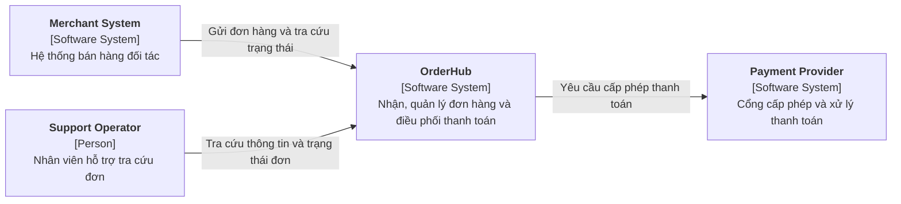
* **Giải thích mẫu:** `OrderHub` là một hộp đen duy nhất. `Orders DB`, `Billing Worker` và topic `order-events` hoàn toàn ẩn bên trong `OrderHub`.

### 1.7. Trích dẫn & Tài liệu tham khảo
* **[S1]** Simon Brown, *C4 Model — System Context Diagram*, `https://c4model.com/diagrams/system-context`
* **[S2]** Simon Brown, *C4 Model — Abstractions (Software System & Person)*, `https://c4model.com/abstractions/software-system`
* **[S3]** Simon Brown, *C4 Model — Notation & Diagram Review Checklist*, `https://c4model.com/diagrams/notation`, `https://c4model.com/diagrams/checklist`
* **[T1]** C4-PlantUML & Structurizr DSL Reference, `https://plantuml-stdlib.github.io/C4-PlantUML/`, `https://docs.structurizr.com/dsl/language`
* **[R1]** Visual Paradigm, *C4 Context Diagram Guide*, `https://www.visual-paradigm.com/guide/c4-context-diagram-the-best-way-for-beginners-to-visualize-software-architecture/`

---

## 2. C4 — Container Diagram (C2)

### 2.1. Tổng quan & Lý do sử dụng
* **Định nghĩa chuẩn:** Sơ đồ Container (C2) phóng to (zoom-in) vào bên trong **Software System** đã chọn ở C1 để hiển thị các **Container** (ứng dụng thực thi độc lập và các kho lưu trữ dữ liệu logic) hợp thành hệ thống đó, cùng công nghệ và cơ chế giao tiếp giữa chúng.
* **Vị trí trong 4+1 View Model:** Kết hợp mức cao của **Development View / Process View** (các đơn vị chạy và kênh giao tiếp liên tiến trình - IPC).
* **Tại sao phải dùng & Chức năng chính:**
  * Trả lời hệ thống gồm những tiến trình ứng dụng nào (`API`, `Worker`, `SPA/Web App`), dữ liệu nằm ở đâu (`Database schema`, `Topic/Queue`, `Bucket`), và chúng gọi nhau qua giao thức gì (`HTTPS/JSON`, `gRPC`, `JDBC`, `Kafka`).
  * Phân định rõ các thành phần nằm **trong** `System Boundary` và các tác nhân/hệ thống ngoài nằm **ngoài** `System Boundary`.
* **Phạm vi & Giới hạn (Non-goals):**
  * **Không** đồng nhất C4 Container với Docker container hay Pod/VM vật lý (một C4 Application Container có thể chạy thành nhiều Docker instance trên thực tế; số replica/host thuộc **UML Deployment Diagram**).
  * **Không** mở sâu vào các class/interface/controller bên trong một ứng dụng (phần đó thuộc C3 hoặc UML Class).

### 2.2. Các phần tử cốt lõi & Ký pháp chuẩn

| Phần tử / Quan hệ | Ý nghĩa mô hình (Semantics) | Ký pháp trình bày chuẩn | Điều KHÔNG được suy diễn sai |
| :--- | :--- | :--- | :--- |
| **System Boundary** | Khung ranh giới bao quanh các Container thuộc quyền sở hữu của Software System đang xét. | Khung ghi **Tên System** và nhãn `[Software System]`; MAVIS chọn nét đứt và giải thích trong Legend. | Không phải là firewall hay network security zone (VPC/Subnet). |
| **Application Container** | Đơn vị ứng dụng có ranh giới thực thi riêng (API service, background worker, web app, CLI). | Hộp: **Tên**, `[Container: Công nghệ]`, mô tả trách nhiệm ngắn. | Một module/package thư viện dùng chung (`common-utils`) không phải là một Container độc lập. |
| **Data Store / Message Channel Container** | Kho lưu trữ dữ liệu logic (DB schema, cache, bucket) hoặc kênh truyền thông điệp (queue/topic). | Hộp hoặc hình trụ/ống: **Tên**, `[Container: Công nghệ]`, mô tả dữ liệu/sự kiện lưu trữ. | Hai service dùng chung một PostgreSQL server nhưng khác schema/ownership vẫn là hai Data Store logic riêng. |
| **IPC / Data Access Relationship** | Giao tiếp liên tiến trình, đọc/ghi dữ liệu, hoặc publish/consume sự kiện giữa các Container. | Mũi tên một chiều kèm **Động từ + `[Công nghệ / Giao thức]`** (khi có bằng chứng). | `Order API -> Orders DB: Reads/writes [JDBC]` không có nghĩa dữ liệu chỉ đi 1 chiều; `depends_on` trong Compose không tự chứng minh có lời gọi HTTP runtime. |

### 2.3. Quy trình dựng sơ đồ chuẩn
1. **Mở System Boundary từ C1:** Giữ nguyên phạm vi hệ thống đã chốt ở C1, vẽ khung `System Boundary` mang tên hệ thống.
2. **Xác định các Container nội bộ:** Liệt kê các Application Container và Data Store / Topic thuộc sở hữu của hệ thống và đặt vào trong khung Boundary.
3. **Đặt Supporting Elements bên ngoài:** Giữ các `Person` và `External Software System` có tương tác trực tiếp ở bên ngoài khung Boundary.
4. **Ghi nhãn hộp đầy đủ 3 thành phần:** `Tên Container` $\rightarrow$ `[Container: Công nghệ]` (hoặc ghi chưa xác định nếu thiếu bằng chứng) $\rightarrow$ `Mô tả trách nhiệm`.
5. **Nối quan hệ IPC & truy cập dữ liệu:** Vẽ mũi tên kèm hành động và `[Giao thức/Công nghệ]` đã xác minh; thống nhất quy ước chiều cho pub/sub (luồng message `Producer -> Topic -> Consumer` hoặc phụ thuộc đăng ký `Consumer -> Topic: Subscribes to`).

### 2.4. Bộ quy tắc sử dụng & Kiểm chứng
* **Quy tắc bắt buộc:**
  * **[N-C2-01]** Mọi Container nội bộ phải nằm trong `System Boundary`; mọi `Person` và `External System` phải nằm ngoài `System Boundary`.
  * **[N-C2-02]** Không nâng các lớp nội bộ (`Controller`, `Service`, `Repository`, `DTO`) thành Container.
  * **[N-C2-03]** Với giao tiếp qua Message Broker (Kafka/RabbitMQ), ưu tiên mô hình hóa từng **Queue/Topic có ý nghĩa kiến trúc** làm Container trung gian thay vì vẽ một hộp "Kafka" duy nhất nối tất cả mọi service làm che khuất luồng sự kiện.
  * **[M-C2-04] (Quy ước MAVIS):** Chỉ gắn `[protocol]` (như `[JDBC]`, `[HTTP]`, `[Kafka]`) lên nhãn cạnh khi có bằng chứng nguồn; không tự bịa giao thức hoặc tự tạo Database cho các service stateless.
* **Các lỗi thường gặp (Anti-patterns):**

| Lỗi phổ biến (Sai) | Cách hiểu & xử lý đúng (Chuẩn) |
| :--- | :--- |
| Áp đặt quy tắc "Mỗi microservice bắt buộc phải có 1 API và 1 Database riêng". | Một microservice có thể gồm nhiều container (API + Worker + DB) hoặc là một stateless service không có DB riêng. |
| Biến thuộc tính `depends_on` trong `docker-compose.yml` thành mũi tên gọi API HTTP. | `depends_on` chỉ là thứ tự khởi động container (`STARTUP_DEPENDENCY`), không phải bằng chứng gọi HTTP/IPC. |
| Trộn lẫn chiều *Message Flow* (`Topic -> Consumer: Delivers to`) và *Dependency* (`Consumer -> Topic: Subscribes to`) không chú giải. | Phải thống nhất và ghi rõ trong Legend (trong MAVIS cần giữ đúng chiều ngữ nghĩa với nhãn hành động tương ứng). |

* **Checklist nghiệm thu:**
  - [ ] Có khung `System Boundary` rõ ràng; phân tách đúng phần tử nội bộ và bên ngoài.
  - [ ] Không có class/controller/method lọt vào sơ đồ C2.
  - [ ] Nhãn cạnh giữa các Container có động từ rõ ràng và `[Giao thức]` có bằng chứng.
  - [ ] Nhất quán danh tính với C1: mọi luồng ra/vào External System ở C1 đều giải thích được qua Container cụ thể ở C2.

### 2.5. Ứng dụng & Cơ chế trích xuất trong MAVIS
* **Ánh xạ dữ kiện đầu vào:**
  * *Entrypoint, build/deploy config (`Dockerfile`, `pom.xml`, `.csproj`, `docker-compose.yml`):* Phát hiện ứng viên `Application Container` (nhưng một module Maven/Gradle con chưa đủ kết luận là tiến trình độc lập).
  * *Datasource, connection string, queue/topic binding:* Phát hiện `Data Store` và `Message Channel` cùng cạnh truy cập dữ liệu/messaging.
  * *HTTP Client / Feign / RestTemplate / HttpClient & Runtime OTLP Spans:* Xác lập quan hệ gọi liên service (`HTTP_CALL`).
* **Xử lý thiếu dữ kiện:** Đích gọi HTTP chưa phân giải được tới service nội bộ thì giữ trạng thái `UNRESOLVED` ngoài boundary (kèm cảnh báo), tuyệt đối không ép nối vào service đầu tiên tìm thấy.

### 2.6. Ví dụ minh họa chuẩn (Bài toán OrderHub)
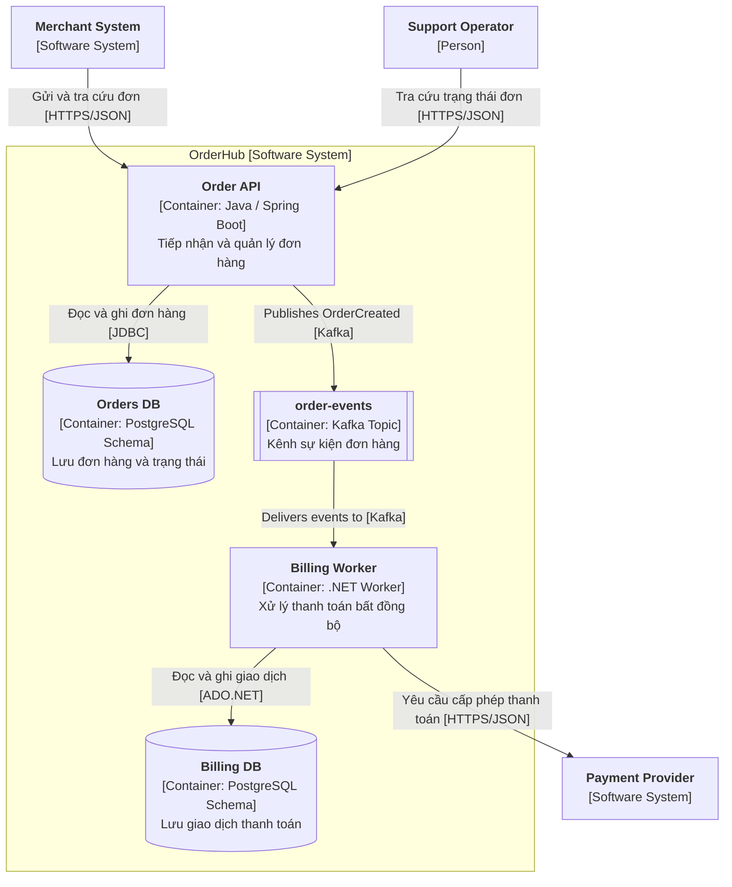

### 2.7. Trích dẫn & Tài liệu tham khảo
* **[S1]** Simon Brown, *C4 Model — Container Diagram & Abstraction*, `https://c4model.com/diagrams/container`, `https://c4model.com/abstractions/container`
* **[S2]** Simon Brown, *C4 Model — Microservices & Queues/Topics*, `https://c4model.com/abstractions/microservices`, `https://c4model.com/abstractions/queues-and-topics`
* **[S3]** Simon Brown, *C4 Model — Review Checklist*, `https://c4model.com/diagrams/checklist`
* **[R1]** Visual Paradigm, *Comprehensive Guide to C4 Container Diagrams*, `https://www.visual-paradigm.com/guide/mastering-software-architecture-visualization-a-comprehensive-guide-to-c4-container-diagrams/`

---

## 3. C4 — Component Diagram (C3)

### 3.1. Tổng quan & Lý do sử dụng
* **Định nghĩa chuẩn:** Sơ đồ Component (C3) phóng to vào bên trong **một Container đơn lẻ** đã chọn ở C2 để hiển thị các **Component** (nhóm chức năng có liên quan chặt chẽ nằm sau một interface rõ ràng) cùng sự cộng tác giữa chúng và với các Container/System bên ngoài.
* **Vị trí trong 4+1 View Model:** Thuộc **Logical View / Development View** ở mức cấu trúc mô-đun bên trong một đơn vị khả triển.
* **Tại sao phải dùng & Chức năng chính:**
  * Giải thích cách một ứng dụng phân chia trách nhiệm nội bộ (inbound boundary, nghiệp vụ, persistence adapter, messaging publisher) mà chưa bị ngập trong chi tiết từng dòng lệnh của Class Diagram.
  * Chỉ cần vẽ cho những Container có độ phức tạp nội bộ đáng kể (C4 gốc khuyến nghị không bắt buộc vẽ C3 cho các data store hoặc service quá nhỏ).
* **Phạm vi & Giới hạn (Non-goals):**
  * **Không** mở đồng thời nội bộ của tất cả các microservice trên cùng một hình C3.
  * **Không** coi C4 Component là một đơn vị triển khai độc lập (ranh giới triển khai là Container).
  * **Không** đồng nhất C4 Component với ký hiệu ball-and-socket / port của UML Component Diagram.

### 3.2. Các phần tử cốt lõi & Ký pháp chuẩn

| Phần tử / Quan hệ | Ý nghĩa mô hình (Semantics) | Ký pháp trình bày chuẩn | Điều KHÔNG được suy diễn sai |
| :--- | :--- | :--- | :--- |
| **Container Boundary** | Khung ranh giới của đúng **1 Container** đang được mở từ C2. | Khung ghi **Tên Container** và nhãn `[Container]`; nét đứt là quy ước trình bày của MAVIS. | Không đặt các Data Store hay Container khác vào bên trong khung này. |
| **Component** | Nhóm chức năng liên quan nằm trong cùng tiến trình Container, thường được cài đặt bởi một hoặc nhiều class/interface. | Hộp: **Tên Component**, `[Component: Công nghệ / Kiểu cài đặt]`, mô tả trách nhiệm. | Không phải mọi class hay mọi annotation `@Component`/`@Service` đều tự động là một hộp C4 Component riêng lẻ. |
| **Supporting Container / External System** | Các Container khác (DB, Topic, Service khác) hoặc Person/External System có tương tác **trực tiếp** với các Component đang xét. | Đặt **bên ngoài** `Container Boundary`, giữ nguyên mức trừu tượng Container/System (không mở ruột). | Các Container trong cùng hệ thống nhưng **không** có kết nối trực tiếp với Container đang mở thì được lược bỏ khỏi C3 này. |
| **In-process & Out-of-process Relationship** | Lời gọi hàm nội bộ giữa các Component hoặc lời gọi IPC từ Component ra Container ngoài. | Mũi tên một chiều kèm động từ. Chỉ gắn `[Giao thức mạng/DB]` cho cạnh đi ra ngoài Container. | Cạnh nối giữa 2 Component trong cùng 1 Container là lời gọi trong bộ nhớ (method call), không gán `[HTTP]` cho nó. |

### 3.3. Quy trình dựng sơ đồ chuẩn
1. **Chọn 1 Container đích theo ID từ C2:** Vẽ khung `Container Boundary` cho đúng Container đó (ví dụ `Order API`).
2. **Gom nhóm mã nguồn thành Component có nghĩa (Grouping):** Nhóm các interface + implementation + mapper/helper phục vụ chung một trách nhiệm kiến trúc thành một Component (ví dụ `OrderController` + mapper $\rightarrow$ `Order HTTP Interface`; `OrderRepository` + JPA adapter $\rightarrow$ `Order Repository`).
3. **Đặt Supporting Elements bên ngoài Boundary:** Chỉ đưa vào các Person/Container/External System có cạnh nối trực tiếp với các Component bên trong.
4. **Vẽ quan hệ nội bộ và ngoại vi:** Phân biệt rõ lời gọi nội bộ (in-process) với lời gọi ra DB/Topic/External API.
5. **Đối chiếu tính nhất quán với C2:** Đảm bảo không làm phát sinh quan hệ với Container/External System mới ở C3 mà chưa hề tồn tại ở C2 (trừ khi cập nhật lại model có bằng chứng).

### 3.4. Bộ quy tắc sử dụng & Kiểm chứng
* **Quy tắc bắt buộc:**
  * **[N-C3-01]** Mỗi sơ đồ C3 chỉ mở duy nhất **một** Container; các Container phụ trợ đứng ngoài khung Boundary.
  * **[N-C3-02]** Không vẽ tràn lan mọi DTO, Entity, Helper thành các hộp riêng biệt (code noise), nhưng cũng không gom tất cả vào một hộp duy nhất tên `"Business Logic"` làm mất ý nghĩa phân rã.
  * **[N-C3-03]** Không tự gắn ký hiệu UML Port (hình vuông trên cạnh) rồi ghi cổng TCP `8080` vào C4 Component (UML Port là interaction point của classifier, không phải network port).
  * **[M-C3-04] (Quy ước MAVIS):** Mỗi Component lưu danh sách code elements/files làm bằng chứng (`evidenceRefs`), bảo toàn khả năng drill-down về mã nguồn.
* **Các lỗi thường gặp (Anti-patterns):**

| Lỗi phổ biến (Sai) | Cách hiểu & xử lý đúng (Chuẩn) |
| :--- | :--- |
| Tách rời `OrderService` (interface) và `OrderServiceImpl` (class) thành 2 hộp Component riêng. | Đó là mức UML Class Diagram. Ở C3, interface và implementation cùng thực hiện một trách nhiệm nên được gom chung thành 1 Component. |
| Ghi nhãn `[HTTP/JSON]` lên mũi tên gọi từ `Controller Component` sang `Service Component` trong cùng một tiến trình. | Giao tiếp nội bộ trong cùng một Container là method call/in-process; chỉ giao tiếp vượt qua biên Container mới dùng giao thức IPC/mạng. |
| Đưa cả `Billing Worker` và `Payment Provider` vào C3 của `Order API` dù `Order API` chỉ gửi sự kiện vào `order-events`. | Ở C3 của `Order API`, chỉ giữ `Orders DB` và `order-events` vì có kết nối trực tiếp; ẩn `Billing Worker` và `Payment Provider`. |

* **Checklist nghiệm thu:**
  - [ ] Scope mở đúng 1 Container từ C2; có khung `Container Boundary` rõ ràng.
  - [ ] Mỗi Component đại diện cho một trách nhiệm kiến trúc rõ ràng, không phải bản sao 1-1 của từng class/DTO.
  - [ ] Phân biệt đúng lời gọi nội bộ (in-process) và giao tiếp ra ngoài biên Container.
  - [ ] Nhất quán hoàn toàn với C1 và C2 theo bảng ánh xạ đối tượng.

### 3.5. Ứng dụng & Cơ chế trích xuất trong MAVIS
* **Ánh xạ dữ kiện đầu vào:**
  * *Static AST / Package / Stereotype Annotations (`@RestController`, `@Service`, `@Repository`, DI Constructor Injection):* Phát hiện các ứng viên Component và quan hệ phụ thuộc code (`CODE_DEPENDENCY`, `CALLS`).
  * *Lưu ý giới hạn:* Dependency Injection (DI) chứng minh phụ thuộc cấu trúc tĩnh, chưa tự chứng minh lời gọi đã xảy ra ở một lần chạy runtime cụ thể.
* **Bảng đối chiếu tính nhất quán C1 – C2 – C3 (chuẩn MAVIS):**

| Đối tượng / Quan hệ | Ở C1 (System Context) | Ở C2 (Container) | Ở C3 (Mở `Order API`) |
| :--- | :--- | :--- | :--- |
| `OrderHub` | 1 hộp `Software System` | Khung `System Boundary` | Ngữ cảnh hệ thống (scope đang mở là `Order API`) |
| `Order API` | Ẩn bên trong `OrderHub` | 1 `Application Container` | Khung `Container Boundary` chứa các Component |
| `Orders DB` & `order-events` | Ẩn nội bộ | Các Container lưu trữ / topic | Supporting Containers nằm ngoài khung `Order API` |
| `Billing Worker` | Ẩn nội bộ | 1 `Application Container` | Ẩn (vì không nối trực tiếp với Component của `Order API`) |
| `Payment Provider` | `External Software System` | Ngoài boundary, nối với `Billing Worker` | Ẩn (không nối trực tiếp với `Order API`) |

### 3.6. Ví dụ minh họa chuẩn (Bài toán OrderHub — Mở `Order API`)
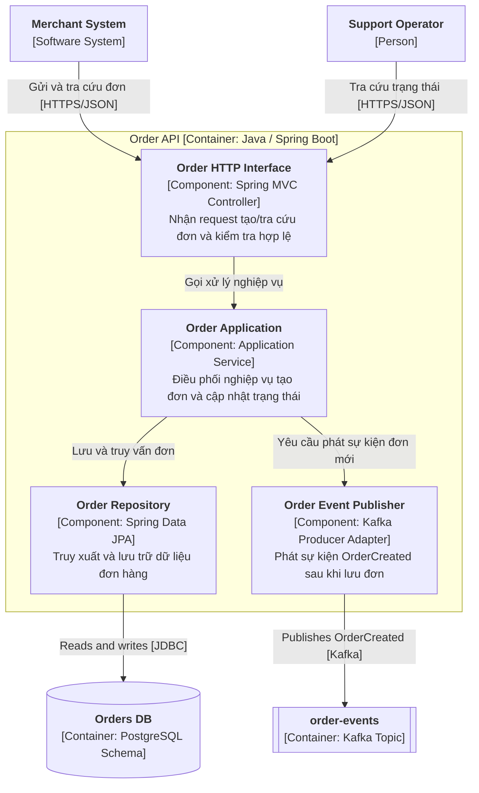

### 3.7. Trích dẫn & Tài liệu tham khảo
* **[S1]** Simon Brown, *C4 Model — Component Diagram & Abstraction*, `https://c4model.com/diagrams/component`, `https://c4model.com/abstractions/component`
* **[S2]** OMG, *Unified Modeling Language (UML) Specification Version 2.5.1* (để phân biệt C4 Component với UML Component & Port), `https://www.omg.org/spec/UML/2.5.1/`
* **[R1]** Visual Paradigm, *C4 Container vs Component Diagrams*, `https://www.visual-paradigm.com/guide/comprehensive-guide-c4-container-vs-component-diagrams/`

---

# PHẦN 2. NHÓM SƠ ĐỒ CẤU TRÚC & HÀNH VI UML 2.5.1 (DIAGRAM 4 – 9)

---

## 4. UML — Class Diagram

### 4.1. Tổng quan & Lý do sử dụng
* **Định nghĩa chuẩn:** Theo OMG UML 2.5.1 (§9.2, §11.4, §11.5), **Class Diagram** là sơ đồ cấu trúc tĩnh mô tả các loại phần tử (Class, Interface, Enumeration), cấu trúc nội bộ của chúng (Attributes, Operations) và các mối quan hệ tĩnh giữa các Classifier.
* **Vị trí trong 4+1 View Model:** Trọng tâm của **Logical View** (mô hình hóa miền nghiệp vụ, thực thể và thiết kế hướng đối tượng). Theo khảo sát thực nghiệm của Dobing & Parsons (2006) và Petre (2013), đây là biểu đồ UML được sử dụng phổ biến nhất (~73%) trong công nghiệp.
* **Tại sao phải dùng & Chức năng chính:**
  * Chốt cấu trúc thực thể miền (Domain Entities), hợp đồng dịch vụ (Interfaces, Services, Repositories) và bội số quan hệ (Multiplicity) trước hoặc trong khi lập trình.
  * Giải thích chi tiết cách một Component ở mức C3 được hiện thực hóa bằng các lớp và interface.
* **Phạm vi & Giới hạn (Non-goals):**
  * **Không** biểu diễn thứ tự gọi hàm theo thời gian (thuộc **UML Sequence Diagram**).
  * **Không** đồng nhất hoàn toàn với sơ đồ bảng vật lý ERD của cơ sở dữ liệu.
  * **Không** gom toàn bộ hàng trăm class của cả repository vào một hình duy nhất gây nhiễu (chỉ vẽ theo module/use case đang xét).

### 4.2. Các phần tử cốt lõi & Ký pháp chuẩn

| Phần tử / Quan hệ | Ý nghĩa mô hình (Semantics) | Ký pháp trình bày chuẩn (OMG UML 2.5.1) | Điều KHÔNG được suy diễn sai |
| :--- | :--- | :--- | :--- |
| **Class** | Classifier mô tả tập đối tượng chia sẻ thuộc tính, operation và quan hệ. | Hình chữ nhật thường có 3 ngăn chính: **Tên Class** (in nghiêng nếu `abstract`), **Attributes**, **Operations**. Có thể ẩn ngăn chưa cần thiết. | Không bắt buộc liệt kê mọi getter/setter tầm thường. Tên gạch chân (`order1:Order`) là Instance thuộc Object Diagram, không phải Class. |
| **Interface & Enumeration** | Hợp đồng hành vi (`«interface»`) và tập giá trị hữu hạn (`«enumeration»`). | Hộp có từ khóa `«interface»` hoặc `«enumeration»` phía trên tên. | Không trộn lẫn kế thừa lớp (`Generalization`) với hiện thực hóa interface (`Realization`). |
| **Attribute & Operation** | Thuộc tính: `visibility name: Type [mult] = default {prop}`. Hành vi: `visibility name(param: Type): ReturnType`. | Visibility: `+` public, `-` private, `#` protected, `~` package. Thành viên `static` được **gạch chân**. Thuộc tính dẫn xuất có dấu `/total`. | `~` (package) cần ánh xạ cẩn thận theo ngôn ngữ (`internal` trong C# khác package-private trong Java). |
| **Association** | Quan hệ cấu trúc tĩnh giữa các instance của hai Classifier. | Đường **nét liền**; có thể gắn **Role name** và **Multiplicity** (`1`, `0..1`, `0..*`, `1..*`) ở mỗi đầu. Mũi tên hở thể hiện *navigability*. | Mũi tên navigability là khả năng truy cập tham chiếu hiệu quả, **không** phải chiều gọi hàm runtime. Không có mũi tên chưa chứng minh là truy cập 2 chiều. |
| **Dependency** | Quan hệ phụ thuộc client $\rightarrow$ supplier (thay đổi ở supplier có thể ảnh hưởng tới client). | Đường **nét đứt**, đầu mũi tên hở trỏ từ **Client** sang **Supplier** (VD: dùng kiểu ở tham số hàm hoặc biến cục bộ). | Không phải mọi Dependency đều là Association lưu giữ trạng thái. |
| **Generalization & Realization** | Kế thừa giữa lớp con – lớp cha (`Generalization`) và thực thi hợp đồng interface (`Realization`). | Tam giác rỗng luôn trỏ về **Superclass** (nét liền) hoặc **Interface** (nét đứt). | Không ghi Multiplicity (`1..*`) lên cạnh Generalization hay Realization. |
| **Shared Aggregation & Composition** | Quan hệ Whole–Part chia sẻ được (`Aggregation` - thoi rỗng) hoặc sở hữu độc점 kèm ràng buộc vòng đời (`Composition` - thoi đặc). | **Hình thoi (rỗng hoặc đặc) luôn đặt ở đầu Whole (tổng thể)**, nối tới Part (bộ phận). Với Composition, xóa Whole kéo theo xóa các Part còn thuộc nó. | Không tự suy ra Composition chỉ từ khóa ngoại (FK) hoặc Garbage Collector; khi chưa rõ nghĩa Whole–Part thì dùng Association thường. |

### 4.3. Quy trình dựng sơ đồ chuẩn
1. **Xác định phạm vi (Scope):** Chọn 1 module, package hoặc kịch bản thiết kế cụ thể (khoảng 5–15 classifier liên quan trực tiếp).
2. **Đưa các Classifier chính lên sơ đồ:** Xác định các Domain Class, Service, Repository Interface, Implementation và Enum cốt lõi.
3. **Điền Attributes & Operations trọng tâm:** Ghi đúng cú pháp UML (`visibility name: Type`), đánh dấu `/derived`, `{readOnly}`, `static` (gạch chân) hoặc `abstract` khi có căn cứ.
4. **Thiết lập quan hệ cấu trúc trước, phụ thuộc sau:** Vẽ Generalization/Realization $\rightarrow$ Composition/Aggregation/Association (kèm Role name & Multiplicity ở hai đầu) $\rightarrow$ Dependency.
5. **Kiểm tra trùng lặp biểu diễn:** Nếu một thuộc tính (ví dụ `- lines: OrderLine[1..*]`) đã được vẽ thành đường Association có role name `lines`, tránh hiểu nhầm thành hai mối quan hệ độc lập.

### 4.4. Bộ quy tắc sử dụng & Kiểm chứng
* **Quy tắc bắt buộc:**
  * **[N-CLS-01]** Hình thoi của Aggregation/Composition **bắt buộc** đặt ở phía `Whole`, tuyệt đối không đặt ở phía `Part`.
  * **[N-CLS-02]** Tam giác rỗng của Generalization/Realization **bắt buộc** đặt ở phía `Superclass` / `Interface`.
  * **[N-CLS-03]** Một Part trong `Composition` chỉ thuộc tối đa **một** Composite (Whole) tại một thời điểm (`0..1` hoặc `1` ở đầu Whole).
  * **[M-CLS-04] (Quy ước MAVIS):** Không tự đoán Multiplicity (`1..*` hay `0..*`) chỉ từ kiểu `List<T>` trong code nếu chưa có bằng chứng ràng buộc nullability/validation (`@NotEmpty`, schema constraint); giữ trống hoặc đánh dấu cần xác nhận khi chưa rõ.
* **Các lỗi thường gặp (Anti-patterns):**

| Lỗi phổ biến (Sai) | Cách hiểu & xử lý đúng (Chuẩn) |
| :--- | :--- |
| Đặt hình thoi đặc (Composition) ở phía `OrderLine` thay vì phía `Order`. | Hình thoi luôn nằm ở đầu `Order` (Whole). Đọc là: `Order` chứa các `OrderLine`. |
| Vẽ mũi tên kế thừa hoặc sở hữu lớp cho một lời gọi HTTP giữa hai microservice. | Hai microservice thuộc hai tiến trình khác nhau (mức C2); không dùng quan hệ kế thừa/composition xuyên tiến trình nếu chúng chỉ gọi REST API. |
| Vẽ nét liền tam giác rỗng khi Class `implements` một Interface. | Hiện thực hóa Interface (`Realization`) phải dùng **nét đứt** + tam giác rỗng; nét liền chỉ dùng cho kế thừa cùng loại (`extends`). |

* **Checklist nghiệm thu:**
  - [ ] Đúng đầu mũi tên / tam giác rỗng / hình thoi cho cả 6 loại quan hệ lớp.
  - [ ] Multiplicity ở hai đầu Association phản ánh đúng ràng buộc nghiệp vụ đã xác nhận.
  - [ ] Không biến HTTP call liên service thành quan hệ kế thừa hoặc sở hữu lớp.

### 4.5. Ứng dụng & Cơ chế trích xuất trong MAVIS
* **Ánh xạ dữ kiện đầu vào:**
  * *Static AST (Java Parser / C# Roslyn):* Trích xuất chính xác `class`, `interface`, `enum`, `extends`, `implements`, kiểu trường (field types), chữ ký phương thức (method signatures) và visibility modifiers.
  * *JPA / EF Core Annotations (`@OneToMany`, `@ManyToOne`, `cascade`, `@NotNull`):* Cung cấp bằng chứng bổ trợ cho Association, Multiplicity và Composition.
* **Xử lý thiếu dữ kiện:** Nếu hệ thống chỉ chạy ở mức Generic Adapter (chưa có AST sâu cho ngôn ngữ đó), MAVIS không tự sinh UML Class Diagram giả tạo từ tên file.

### 4.6. Ví dụ minh họa chuẩn (Bài toán OrderHub — Module `Order`)
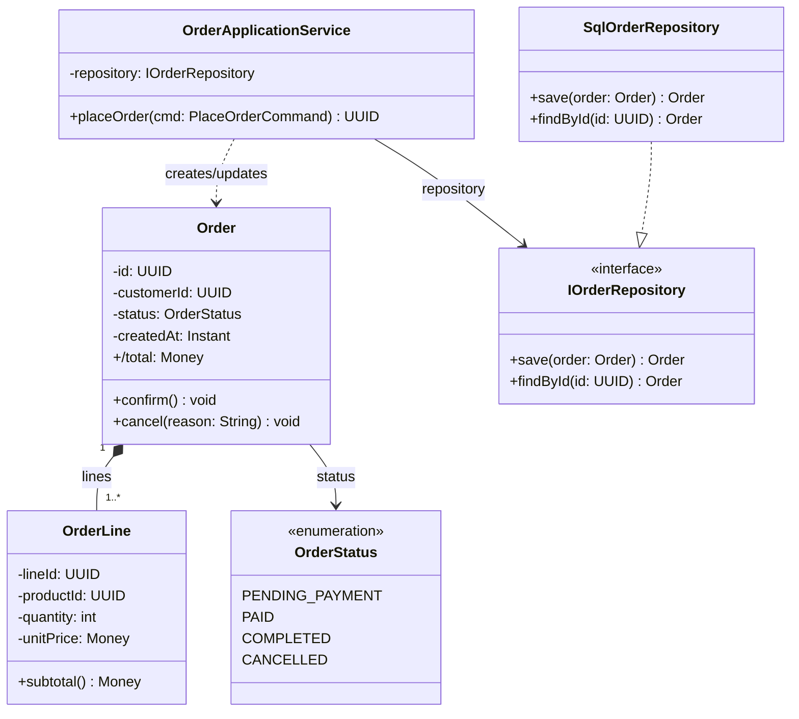

### 4.7. Trích dẫn & Tài liệu tham khảo
* **[S1]** OMG, *UML 2.5.1 Specification* — §7.5 (Multiplicity), §9.2 (Classifiers), §9.5 (Properties), §11.4 (Classes), §11.5 (Associations), `https://www.omg.org/spec/UML/2.5.1/`
* **[A1]** Hassan Gomaa, *Software Modeling and Design (COMET)* — Giáo trình SWD392 Ch07 Static Modeling (slides 7–16).
* **[A2]** Martin Fowler, *UML Distilled (3rd Ed.)*, `https://martinfowler.com/books/uml.html`
* **[T1]** Visual Paradigm & Mermaid Class Diagram Reference, `https://www.visual-paradigm.com/guide/uml-unified-modeling-language/what-is-class-diagram/`

---

## 5. UML — Sequence Diagram

### 5.1. Tổng quan & Lý do sử dụng
* **Định nghĩa chuẩn:** Theo OMG UML 2.5.1 (Chương 17 — Interactions), **Sequence Diagram** là sơ đồ tương tác mô tả trật tự trao đổi thông điệp (Messages) giữa các **Lifelines** (đối tượng, thành phần, hoặc dịch vụ) dọc theo trục dọc trong phạm vi **một kịch bản (Scenario) cụ thể**.
* **Vị trí trong 4+1 View Model:** Trục **Scenarios (+1)** và **Process/Logical View** động; dùng để xác thực cách các phần tử tĩnh phối hợp thực thi một nghiệp vụ.
* **Tại sao phải dùng & Chức năng chính:**
  * Làm rõ luồng gọi đồng bộ (`Synchronous call`), gửi sự kiện bất đồng bộ (`Asynchronous message`), phản hồi (`Reply`) và các nhánh điều kiện/vòng lặp (`alt`, `opt`, `loop`, `par`).
  * Trong MAVIS, Sequence Diagram còn là góc nhìn trực quan hóa trực tiếp các **OpenTelemetry Runtime Traces** thu được từ một kịch bản kiểm thử.
* **Phạm vi & Giới hạn (Non-goals):**
  * Một Sequence Diagram chỉ mô tả **một kịch bản cụ thể**, không chứng minh toàn bộ các nhánh rẽ hoặc vòng đời trạng thái của hệ thống đã được bao phủ.
  * Không bắt buộc phải có Frontend/UI lifeline nếu phạm vi kịch bản chỉ xét từ API Gateway/Backend trở vào.

### 5.2. Các phần tử cốt lõi & Ký pháp chuẩn

| Phần tử / Quan hệ | Ý nghĩa mô hình (Semantics) | Ký pháp trình bày chuẩn (OMG UML 2.5.1) | Điều KHÔNG được suy diễn sai |
| :--- | :--- | :--- | :--- |
| **Lifeline** | Đại diện cho một cá thể tham gia (Participant) trong tương tác (§17.3). | Đầu hình chữ nhật ghi `role:Type` hoặc `:Type` (không bắt buộc gạch chân như UML 1.x), nối với đường dọc nét đứt bên dưới. | Hai lifeline độc lập không có message nối với nhau thì không tự suy ra thứ tự thời gian tuyệt đối từ vị trí cao/thấp bằng mắt. |
| **Execution Specification (Activation)** | Khoảng thời gian một lifeline đang thực thi hành vi hoặc chờ lời gọi con hoàn tất. | Thanh hình chữ nhật mảnh đè lên đường nét đứt của Lifeline; có thể lồng nhau khi gọi `self-message`. | Độ dài hình học của thanh activation trên giấy vẽ **không** đo chính xác số mili-giây CPU hay latency thực tế. |
| **Synchronous Call & Reply Message** | Bên gửi gọi và **chờ** bên nhận hoàn tất xử lý trước khi tiếp tục (§17.4). | Call: Đường **nét liền, đầu mũi tên đặc (filled arrowhead)**. Reply: Đường **nét đứt, đầu mũi tên hở** quay về bên gọi. | Không vẽ đường Reply không có nghĩa là hàm bị treo vĩnh viễn (Reply có thể được lược bỏ khi ngữ cảnh đã rõ). |
| **Asynchronous Message** | Bên gửi phát thông điệp đi và tiếp tục luồng của mình mà không chờ bên nhận xử lý xong theo cơ chế gọi đồng bộ. | Đường **nét liền, đầu mũi tên hở (open arrowhead)**. | Không suy loại message UML chỉ từ `async/await`, HTTP hay tên thư viện. `await` có thể tạm dừng phương thức để chờ kết quả mà không chặn thread; điều này khác với việc xác định `synchCall`, `asynchCall` hay `asynchSignal` của tương tác đang mô hình hóa. Callback, signal và cơ chế bất đồng bộ khác không bắt buộc có broker. Khi thiếu căn cứ về message sort, giữ `UNKNOWN`/cảnh báo và yêu cầu xác nhận theo contract của MAVIS. |
| **Create / Destroy & Found / Lost** | Tạo mới đối tượng (`create`), hủy lifeline (`destroy`), hoặc message không rõ nguồn/đích trong scope (`found`/`lost`). | `create`: nét đứt đầu hở trỏ vào hộp đầu lifeline mới. `destroy`: dấu **X** lớn cuối lifeline. `found`/`lost`: chấm tròn đen ở đầu ngoài phạm vi. | Dấu `X` (destroy lifeline trong bộ nhớ) **không** đồng nghĩa với lệnh `DELETE` xóa một bản ghi trong Database. `Lost message` không mặc định là rớt gói tin mạng. |
| **Combined Fragments (`alt`, `opt`, `loop`, `par`, `ref`)** | Các khung toán tử điều khiển luồng tương tác (§17.6). | Khung chữ nhật có nhãn toán tử ở góc trái trên (`alt`, `opt`, `loop`, `par`), các nhánh ngăn cách bởi đường ngang nét đứt và guard `[condition]`. `ref` là `InteractionUse` tham chiếu sơ đồ khác. | `par` cho phép xen kẽ (interleaving) các sự kiện giữa các operand, không khẳng định chạy song song cùng một xung nhịp CPU vật lý. `critical` không tự động là DB transaction. |

### 5.3. Quy trình dựng sơ đồ chuẩn
1. **Chọn đúng 1 kịch bản (Scenario) & mức trừu tượng:** Quyết định vẽ ở mức Service-to-Service (Microservices) hay mức Component/Class bên trong một Service (không trộn lẫn lộn xộn).
2. **Sắp xếp các Lifelines từ trái sang phải:** Thường đặt bên khởi tạo kịch bản ở bên trái, các dịch vụ/thành phần trung gian ở giữa và kho dữ liệu/kênh sự kiện/hệ thống ngoài ở bên phải.
3. **Vẽ các Messages theo ràng buộc nhân quả (Causal Ordering):** Sự kiện gửi (`sendEvent`) luôn đứng trước sự kiện nhận (`receiveEvent`); phân biệt đúng đầu mũi tên đặc (Sync) và đầu hở (Async).
4. **Đóng khung điều kiện bằng Combined Fragments:** Đặt `[guard]` trong ngoặc vuông cho `alt`, `opt`, `loop`; tuyệt đối không vẽ mũi tên vòng ngược từ dưới lên trên để thay cho khung `loop`.
5. **Kiểm tra giới hạn kịch bản:** Ghi rõ những gì kịch bản đang giả định hoặc lược bỏ (ví dụ: retry, dead-letter queue, compensation).

### 5.4. Bộ quy tắc sử dụng & Kiểm chứng
* **Quy tắc bắt buộc:**
  * **[N-SEQ-01]** Bố cục phải bảo toàn các thứ tự sự kiện mà Interaction quy định: gửi trước nhận và các ràng buộc trên từng lifeline/fragment; vị trí hai sự kiện trên các lifeline độc lập không tự tạo thứ tự toàn cục. MAVIS dùng layout chuyên cho Sequence; bất kỳ thuật toán bố cục nào cũng không được phá các ràng buộc này.
  * **[N-SEQ-02]** Phân biệt rạch ròi đầu mũi tên **đặc** (`Synchronous`) và đầu mũi tên **hở** (`Asynchronous`); đường `Reply` phải là nét đứt và khớp đúng lifeline đã gọi.
  * **[N-SEQ-03]** `alt` chọn một operand có guard đúng; nếu nhiều guard cùng đúng, việc chọn có thể bất định. MAVIS khuyến nghị guard loại trừ nhau khi muốn kịch bản xác định. `opt` có một operand tùy chọn, không thêm operand `else` thứ hai.
  * **[M-SEQ-04] (Quy ước MAVIS):** Phân biệt **Designed Sequence** (người dùng thiết kế), **Static-derived draft** (suy từ phân tích tĩnh, nêu rõ giới hạn) và **Observed Runtime Sequence** (span có lineage trong kịch bản/khung thời gian xác định). Nhãn mode và provenance của mỗi phần tử phải theo contract thực tế; bản thiết kế không được mang danh quan sát runtime.
* **Các lỗi thường gặp (Anti-patterns):**

| Lỗi phổ biến (Sai) | Cách hiểu & xử lý đúng (Chuẩn) |
| :--- | :--- |
| Vẽ mũi tên nét liền đầu đặc khi publish sự kiện vào Kafka Topic rồi kết luận Consumer đã xử lý xong. | Phân biệt lời gọi producer → broker có chờ xác nhận với việc phát signal và xử lý ở consumer. Chọn message sort theo hợp đồng đang mô hình hóa; broker xác nhận nhận/lưu event không chứng minh consumer đã xử lý xong. |
| Dùng mũi tên chéo quay ngược lên trên để biểu diễn vòng lặp retry. | Phải bọc đoạn thông điệp lặp vào trong khung Combined Fragment `loop [min..max, guard]`. |
| Lấy một trace chạy thành công (Happy Path) rồi tuyên bố hệ thống không có nhánh lỗi. | Một runtime trace chỉ chứng minh kịch bản đã quan sát trong lần chạy đó; các nhánh chưa chạy không được xóa khỏi mô hình tĩnh. |

* **Checklist nghiệm thu:**
  - [ ] Mọi Lifeline thuộc cùng một mức trừu tượng rõ ràng.
  - [ ] Đúng kiểu nét và đầu mũi tên cho `Sync`, `Async` và `Reply`.
  - [ ] Thứ tự gọi tuân thủ quan hệ nhân quả (`parentSpanId` / call stack), không chỉ dựa vào đồng hồ lệch giữa các máy.
  - [ ] Các nhánh điều kiện/lặp dùng đúng khung `alt`/`opt`/`loop` kèm `[guard]`.

### 5.5. Ứng dụng & Cơ chế trích xuất trong MAVIS
* **Ánh xạ dữ kiện đầu vào:**
  * *Runtime OpenTelemetry Traces (Ưu tiên cao nhất cho kịch bản thực thi):* `traceId`, `spanId`, `parentSpanId`, `service.name`, `http.method`, `http.status_code`, `duration` $\rightarrow$ dựng `Observed Sequence Diagram`. Nếu thiếu server span hoặc đứt chuỗi `parentSpanId`, MAVIS hiển thị rõ cảnh báo **Missing Span / Gap**.
  * *Static Call Graph + Scenario Definition:* Hỗ trợ dựng bản nháp `Designed/Static Sequence` cho một entrypoint được chọn.

### 5.6. Ví dụ minh họa (OrderHub — kịch bản thiết kế tạo đơn)
Các message sort trong ví dụ là **giả định thiết kế được khai báo**, không suy tự động từ HTTP, JDBC hoặc tên Kafka. Nhánh invalid được kiểm tra trước khi lưu đơn. Nhánh thành công minh họa một thứ tự thực thi hợp lệ: trả 201 trước khi worker nhận sự kiện; hệ thống thực tế có thể giao sự kiện sớm hơn mà không cần đợi phản hồi HTTP.

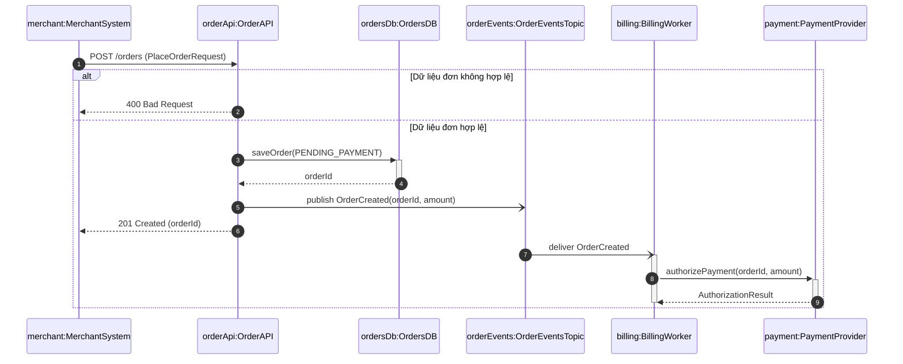
Việc trả 201 xác nhận yêu cầu tạo đơn theo hợp đồng API, không khẳng định thanh toán đã hoàn tất. Retry, lỗi lưu DB, lỗi publish và compensation được lược bỏ trong ví dụ này.

### 5.7. Trích dẫn & Tài liệu tham khảo
* **[S1]** OMG, *UML 2.5.1 Specification* — Chương 17 (Interactions: §17.3 Lifelines, §17.4 Messages, §17.6 CombinedFragments), `https://www.omg.org/spec/UML/2.5.1/`
* **[S2]** OpenTelemetry Specification — *Traces, Spans & Context Propagation*, `https://opentelemetry.io/docs/concepts/signals/traces/`
* **[A1]** Hassan Gomaa, *Software Modeling and Design* — Giáo trình SWD392 Ch09–11 Dynamic Modeling (slides 6–8, 24–25).
* **[S3]** Microsoft Learn, [await operator — asynchronously await a task](https://learn.microsoft.com/en-us/dotnet/csharp/language-reference/operators/await) (để phân biệt chờ kết quả với chặn thread; không thay thế đặc tả message UML).
* **[T1]** PlantUML & Visual Paradigm Sequence Diagram Guide, `https://www.visual-paradigm.com/guide/uml-unified-modeling-language/what-is-sequence-diagram/`

---

## 6. UML — Package Diagram

### 6.1. Tổng quan & Lý do sử dụng
* **Định nghĩa chuẩn:** Theo OMG UML 2.5.1 (Chương 12 — Packages), **Package Diagram** là sơ đồ cấu trúc tĩnh dùng để gom nhóm các `PackageableElement` (Class, Interface, Component, Package con) thành các không gian tên (**Namespaces**) và biểu diễn sự phụ thuộc giữa các gói đó.
* **Vị trí trong 4+1 View Model:** Trung tâm của **Development View (Implementation View)** — phản ánh cách tổ chức cấu trúc mã nguồn, phân tầng kiến trúc (Layered / Clean / Hexagonal Architecture) và quy tắc phụ thuộc giữa các gói.
* **Tại sao phải dùng & Chức năng chính:**
  * Kiểm soát kiến trúc phân tầng (ví dụ: tầng `api` và `infrastructure` được phép phụ thuộc vào `application`/`domain`, nhưng `domain` tuyệt đối không được phụ thuộc ngược ra `infrastructure`).
  * Phát hiện sớm các **phụ thuộc vòng (Cyclic Dependencies)** giữa các package/namespace lớn.
* **Phạm vi & Giới hạn (Non-goals):**
  * Một UML Package là đơn vị tổ chức namespace trong mô hình, **không** mặc định là một tiến trình triển khai độc lập (như C4 Container).
  * Không dùng để biểu diễn luồng gọi hàm theo thời gian.

### 6.2. Các phần tử cốt lõi & Ký pháp chuẩn

| Phần tử / Quan hệ | Ý nghĩa mô hình (Semantics) | Ký pháp trình bày chuẩn (OMG UML 2.5.1) | Điều KHÔNG được suy diễn sai |
| :--- | :--- | :--- | :--- |
| **Package** | Namespace sở hữu các phần tử mô hình (`shop::orders::domain`). | Hình thư mục có tai (tab) ở góc trên trái. Khi mở ruột: tên ghi ở tai; khi đóng ruột: tên ghi ở thân hộp. | Vẽ Package B nằm lồng bên trong Package A biểu diễn **Containment/Ownership** (A sở hữu B), **không** phải A phụ thuộc B. |
| **Dependency** | Một hoặc nhiều phần tử trong Package nguồn phụ thuộc vào phần tử trong Package đích. | Đường **nét đứt, đầu mũi tên hở** từ Package phụ thuộc tới Package được dùng. | Chiều mũi tên là chiều **phụ thuộc biên dịch/mô hình**, không bắt buộc trùng chiều luồng gọi runtime (nhờ Dependency Inversion). |
| **PackageImport (`«import»`)** | Đưa tên các member `public` của package đích vào namespace nguồn với visibility `public` (§7.4.3.3). | Cạnh nét đứt mũi tên hở kèm nhãn từ khóa `«import»`. | Một câu lệnh `import` trong Java hay `using` trong C# ở đầu file code **không** tự động mang nghĩa tái xuất public (`«import»`) của UML. |
| **ElementImport / Private Import (`«access»`)** | Nhập tên member từ package đích vào namespace nguồn với visibility `private` (không tái xuất tiếp). | Cạnh nét đứt mũi tên hở kèm nhãn từ khóa `«access»`. | `«access»` trong UML Package là phạm vi hiển thị tên trong namespace, **không** mang nghĩa quyền đăng nhập (authentication/authorization) hay truy cập DB. |
| **PackageMerge (`«merge»`)** | Kết hợp định nghĩa của package được merge vào receiving package theo quy tắc metamodel UML (§12.2.3). | Cạnh nét đứt mũi tên hở kèm nhãn `«merge»` từ receiving package tới merged package. | Không phải thao tác `git merge` hay gộp thư mục code thông thường; `«merge»` tuyệt đối không được có chu trình. |

### 6.3. Quy trình dựng sơ đồ chuẩn
1. **Xác định quy ước ánh xạ Namespace:** Chốt mức package/namespace cần biểu diễn (ví dụ `com.orderhub.order.api`, `.application`, `.domain`, `.infrastructure`).
2. **Vẽ cấu trúc Containment (Sở hữu):** Nhóm các package con vào package cha hoặc liệt kê các member public (`+ Order`, `+ IOrderRepository`) tiêu biểu bên trong.
3. **Tổng hợp các cạnh Dependency từ phần tử con:** Nếu một class trong package `infrastructure` hiện thực hóa interface trong `application`, vẽ cạnh phụ thuộc từ `infrastructure` $\rightarrow$ `application`.
4. **Chỉ dùng `«import»` / `«access»` / `«merge»` khi có đúng ngữ nghĩa UML:** Với phụ thuộc mã nguồn thông thường, sử dụng đường `Dependency` chuẩn kèm bằng chứng truy nguyên.
5. **Kiểm tra quy tắc kiến trúc phân tầng:** Rà soát chiều mũi tên giữa các tầng và phát hiện chu trình phụ thuộc.

### 6.4. Bộ quy tắc sử dụng & Kiểm chứng
* **Quy tắc bắt buộc:**
  * **[N-PKG-01]** Không dùng ký hiệu của Class Diagram (như Multiplicity `1..*`, hình thoi Composition hay tam giác Generalization) cho các cạnh nối giữa hai Package.
  * **[N-PKG-02]** Phân biệt rõ **Containment** (lồng hộp = sở hữu namespace) và **Dependency** (mũi tên nét đứt = phụ thuộc).
  * **[N-PKG-03]** Quan hệ `«merge»` bắt buộc không có chu trình (acyclic). Việc cấm chu trình trên `Dependency` thông thường là quy tắc kiến trúc tốt (Rule `REL-01` trong MAVIS), không phải ràng buộc cú pháp cứng của mọi mô hình UML.
  * **[M-PKG-04] (Quy ước MAVIS):** Mỗi cạnh phụ thuộc giữa 2 Package phải truy ngược được về danh sách các cặp `Type -> Type` (hoặc `import`/`using` thực sự sử dụng kiểu) làm bằng chứng (`underlyingEdgeIds`).
* **Các lỗi thường gặp (Anti-patterns):**

| Lỗi phổ biến (Sai) | Cách hiểu & xử lý đúng (Chuẩn) |
| :--- | :--- |
| Vẽ mũi tên `application -> infrastructure` vì lúc chạy hàm ở `application` gọi xuống `SqlOrderRepository`. | Trong Clean/Hexagonal Architecture, `IOrderRepository` nằm ở `application`/`domain`, còn `SqlOrderRepository` nằm ở `infrastructure` và `implements` interface đó $\rightarrow$ chiều phụ thuộc tĩnh phải là `infrastructure -> application`. |
| Gắn nhãn `«import»` cho mọi cạnh nối giữa các package Java chỉ vì thấy từ khóa `import`. | Dùng cạnh `Dependency` nét đứt chuẩn; chỉ ghi `«import»` hoặc `«access»` khi mô tả cơ chế nhập và tái xuất namespace theo đúng §7.4 UML. |

* **Checklist nghiệm thu:**
  - [ ] Tên các Package rõ ràng theo phân cấp namespace; không nhầm lẫn lồng hộp (ownership) với phụ thuộc (dependency).
  - [ ] Chiều mũi tên phản ánh đúng phụ thuộc tĩnh của mã nguồn (đặc biệt tại ranh giới interface/implementation).
  - [ ] Không xuất hiện multiplicity hay hình thoi composition trên cạnh nối Package.

### 6.5. Ứng dụng & Cơ chế trích xuất trong MAVIS
* **Ánh xạ dữ kiện đầu vào:**
  * *Static AST (`package` declarations в Java, `namespace` trong C#, type references):* Gom nhóm các `Type` theo package/namespace và tổng hợp cạnh `DEPENDS_ON` từ các tham chiếu kiểu thực tế.
  * *Evaluation Rule (`REL-01` - Layer Violation & Cycle Detection):* MAVIS sử dụng sơ đồ này để kiểm tra vi phạm phụ thuộc tầng (ví dụ: `domain` phụ thuộc ngược lên `api` hoặc `infrastructure`).

### 6.6. Ví dụ minh họa chuẩn (Bài toán OrderHub — Cấu trúc Package của `Order API`)
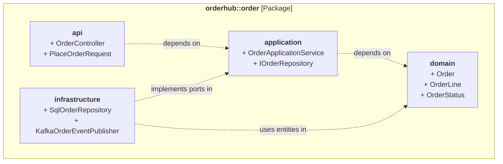

### 6.7. Trích dẫn & Tài liệu tham khảo
* **[S1]** OMG, *UML 2.5.1 Specification* — §7.4.3.3 & §7.4.4.3 (ElementImport & PackageImport), Chương 12 (Packages: §12.2.3 PackageMerge, §12.2.4 Notation), `https://www.omg.org/spec/UML/2.5.1/`
* **[T1]** Visual Paradigm, *UML Package Diagram & Namespace Guide*, `https://www.visual-paradigm.com/guide/uml-unified-modeling-language/what-is-package-diagram/`

---

## 7. UML — Deployment Diagram

> [!TIP]
> **Điểm cập nhật quan trọng:** Trong tài liệu gốc trên Google Docs, tab `UML Deployment Diagram` bị đứt ngang ở dòng *"Mẫu triển khai backend microservice"*. Bản chuẩn hóa dưới đây đã khôi phục đầy đủ quy trình, bộ quy tắc kiểm chứng, ánh xạ MAVIS, ví dụ minh họa hoàn chỉnh cho `OrderHub` và trích dẫn chuẩn OMG UML 2.5.1 Chương 19.

### 7.1. Tổng quan & Lý do sử dụng
* **Định nghĩa chuẩn:** Theo OMG UML 2.5.1 (Chương 19 — Deployments), **Deployment Diagram** là sơ đồ cấu trúc mô tả cách các tài sản phần mềm vật lý (**Artifacts**) được phân bổ và triển khai lên các tài nguyên tính toán (**Nodes**: `Device` hoặc `ExecutionEnvironment`) cùng các đường truyền thông kết nối giữa các Node (**CommunicationPaths**).
* **Vị trí trong 4+1 View Model:** Trực tiếp thể hiện **Physical View (Deployment View)** của Kruchten (1995).
* **Tại sao phải dùng & Chức năng chính:**
  * Chuyển giao thiết kế giữa đội phát triển và DevOps/SRE: chỉ rõ file thực thi nào (`.jar`, `.dll`, container image, config file) chạy trên môi trường nào (`JVM`, `.NET Runtime`, `PostgreSQL Engine`, Linux Host/VM), qua cổng mạng/giao thức nào và có bao nhiêu bản sao (replicas) trong một môi trường xác định (`Production`, `Staging`, `Pilot Lab`).
  * Bổ sung góc nhìn vật lý mà **C4 Container Diagram (C2)** cố ý lược bỏ.
* **Phạm vi & Giới hạn (Non-goals):**
  * **Không** biểu diễn luồng xử lý theo thời gian (thuộc Sequence/Activity) hay danh sách các lớp nghiệp vụ (thuộc Class Diagram).
  * Một hộp Node đơn lẻ không tự chứng minh số lượng máy chủ vật lý thực tế đang chạy nếu chưa ghi rõ mức mô hình (Descriptor vs Instance level) hoặc multiplicity/replicas.

### 7.2. Các phần tử cốt lõi & Ký pháp chuẩn

| Phần tử / Quan hệ | Ý nghĩa mô hình (Semantics) | Ký pháp trình bày chuẩn (OMG UML 2.5.1 §19.2–19.5) | Điều KHÔNG được suy diễn sai |
| :--- | :--- | :--- | :--- |
| **Node (`Device` & `ExecutionEnvironment`)** | Tài nguyên tính toán có khả năng host phần mềm. `«device»`: phần cứng/máy chủ; `«executionEnvironment»`: môi trường phần mềm như OS, Docker Engine, JVM, CLR, DBMS. | Hình khối hộp 3D (cube). Nếu là instance cụ thể thì ghi `app01 : AppServer` và **gạch chân**. Các Node có thể lồng nhau để thể hiện cấu trúc hosting. | Không mặc định gọi mọi Virtual Machine hay Docker Container là một `«device»` vật lý. |
| **Artifact (`«artifact»`)** | Đơn vị thông tin vật lý cụ thể sinh ra từ quá trình build hoặc cấu hình (`.jar`, `.dll`, OCI image, `.sql`, `.yml`). | Hình chữ nhật có từ khóa `«artifact»` hoặc biểu tượng tài liệu gấp góc (ví dụ `order-api.jar`). | `Artifact` là file/image vật lý; `Component` là phần tử logic. Không mặc định 1 file bằng 1 Component. |
| **DeploymentSpecification** | Tập các tham số cấu hình điều khiển cách một Artifact được triển khai lên Node (`«deployment spec»`). | Hộp có nhãn `«deployment spec»` gắn kèm Artifact hoặc quan hệ Deployment. | Không phải mọi file `.properties`/`.json` bất kỳ đều tự động là `DeploymentSpecification` của UML. |
| **Deployment (Triển khai)** | Việc gán một Artifact vào một DeploymentTarget (Node). | Đặt hộp `«artifact»` nằm **bên trong** khối 3D của Node, hoặc vẽ mũi tên nét đứt đầu hở kèm nhãn `«deploy»` từ Artifact tới Node. | Lồng Node vào Node là **Hosting/Containment**; lồng Artifact vào Node là **Deployment**. |
| **Manifestation (`«manifest»`)** | Quan hệ chỉ rõ một Artifact vật lý hiện thực hóa (đóng gói) một hoặc nhiều phần tử mô hình logic (như Component/Package). | Đường **nét đứt, đầu mũi tên hở** đi từ **Artifact** trỏ tới **Component / PackageableElement**, nhãn `«manifest»`. | Chiều `«manifest»` luôn đi từ `Artifact` $\rightarrow$ `Component`, **không** phải đường gọi hàm runtime. |
| **CommunicationPath** | Đường truyền thông vật lý/mạng giữa hai DeploymentTarget (Nodes) cho phép trao đổi tín hiệu/thông điệp. | Đường **nét liền** nối hai khối Node, thường kèm nhãn giao thức/cổng (ví dụ `«TCP/HTTPS :8443»`, `«TCP :5432»`) và multiplicity ở hai đầu. | Không lấy nguyên mũi tên request một chiều của Sequence Diagram để thay cho đường truyền topology giữa các Node. |

### 7.3. Quy trình dựng sơ đồ chuẩn
1. **Chọn rõ môi trường mục tiêu và mức biểu diễn:** Nêu rõ trên tiêu đề đây là môi trường nào (`Declared Compose Topology`, `Staging`, hay `Production`) và đang vẽ ở mức loại (Type/Descriptor) hay mức cá thể (Instance).
2. **Xác định các Nodes và cấu trúc Hosting:** Vẽ các `«device»` / Host / VM bên ngoài và lồng các `«executionEnvironment»` (Docker Engine, JVM, .NET Runtime, PostgreSQL DBMS) vào bên trong.
3. **Đặt các Artifacts vào đúng Deployment Target:** Đưa các file build/image (`order-api.jar`, `billing-worker.dll`) vào đúng Node thực thi và ghi số lượng replica nếu đã xác nhận.
4. **Nối quan hệ `«manifest»` (khi cần liên kết với C2/C3):** Chỉ rõ Artifact nào đóng gói Component/Container logic nào.
5. **Vẽ các `CommunicationPath` giữa các Nodes:** Ghi rõ giao thức mạng, port khai báo và bội số kết nối có bằng chứng từ cấu hình.

### 7.4. Bộ quy tắc sử dụng & Kiểm chứng
* **Quy tắc bắt buộc:**
  * **[N-DEP-01]** Phân biệt rõ 3 khái niệm: **Node** (nơi chạy), **Artifact** (file/image được triển khai), và **Component/Container** (phần tử kiến trúc logic).
  * **[N-DEP-02]** Quan hệ `«manifest»` phải đi từ `Artifact` sang `Component`; quan hệ `«deploy»` (nếu vẽ bằng mũi tên thay vì lồng hộp) đi từ `Artifact` sang `Node`.
  * **[M-DEP-03] (Quy ước MAVIS):** Khi dựng sơ đồ từ `docker-compose.yml` hoặc Kubernetes manifest, sơ đồ phải được gắn nhãn **`DECLARED DEPLOYMENT`** (cấu hình khai báo tại snapshot), không tự tuyên bố là **`LIVE TOPOLOGY`** đang chạy khỏe mạnh nếu không có dữ kiện môi trường thực thi trực tiếp.
* **Các lỗi thường gặp (Anti-patterns):**

| Lỗi phổ biến (Sai) | Cách hiểu & xử lý đúng (Chuẩn) |
| :--- | :--- |
| Lấy nguyên sơ đồ C4 Container đổi hình hộp thành khối 3D rồi gọi là UML Deployment Diagram. | C4 Container mô tả các đơn vị logic; UML Deployment phải chỉ rõ **Node** (môi trường tính toán) và **Artifact** (`«artifact»` file/image) được triển khai lên Node đó. |
| Vẽ mũi tên `Component A -> Artifact B` với nhãn `«manifest»`. | Bị ngược chiều chuẩn UML: **Artifact** mới là bên hiện thực hóa (**manifests**) phần tử logic (`Artifact -> Component`). |
| Thấy khai báo service trong `docker-compose.yml` liền kết luận hệ thống thực tế chạy 3 máy chủ vật lý riêng biệt. | `docker-compose.yml` chỉ khai báo các container/service trên môi trường Compose; nếu không có bằng chứng phân bổ đa host, chỉ mô hình hóa đúng phạm vi declared environment. |

* **Checklist nghiệm thu:**
  - [ ] Tiêu đề nêu rõ môi trường triển khai và nguồn dữ kiện (`Declared` vs `Observed`).
  - [ ] Phân biệt đúng ký hiệu khối 3D cho `Node` (`«device»` / `«executionEnvironment»`) và hộp `«artifact»`.
  - [ ] Các đường `CommunicationPath` nối giữa các `Node` có giao thức/cổng dựa trên cấu hình thực tế.
  - [ ] Nếu có vẽ `«manifest»`, mũi tên nét đứt đi đúng chiều từ `Artifact` tới `Component`.

### 7.5. Ứng dụng & Cơ chế trích xuất trong MAVIS
* **Ánh xạ dữ kiện đầu vào:**
  * *Declared Deployment (`docker-compose.yml`, `Dockerfile`, K8s manifests):* Trích xuất danh sách services, `image`/`build` context ($\rightarrow$ `«artifact»`), runtime base image ($\rightarrow$ `«executionEnvironment»`), `ports`/`expose`/`networks` ($\rightarrow$ `CommunicationPath`).
  * *Build Artifacts (`pom.xml`, `build.gradle`, `.csproj`):* Xác định tên gói đầu ra (`order-api.jar`, `Billing.Worker.dll`) và liên kết `«manifest»` với module code.
* **Xử lý thiếu dữ kiện:** Không tự đoán cấu hình phần cứng vật lý (CPU/RAM/Cloud Region) hoặc số lượng replica khi file manifest trong repo không khai báo.

### 7.6. Ví dụ minh họa chuẩn (Bài toán OrderHub — Môi trường Declared Docker Compose)
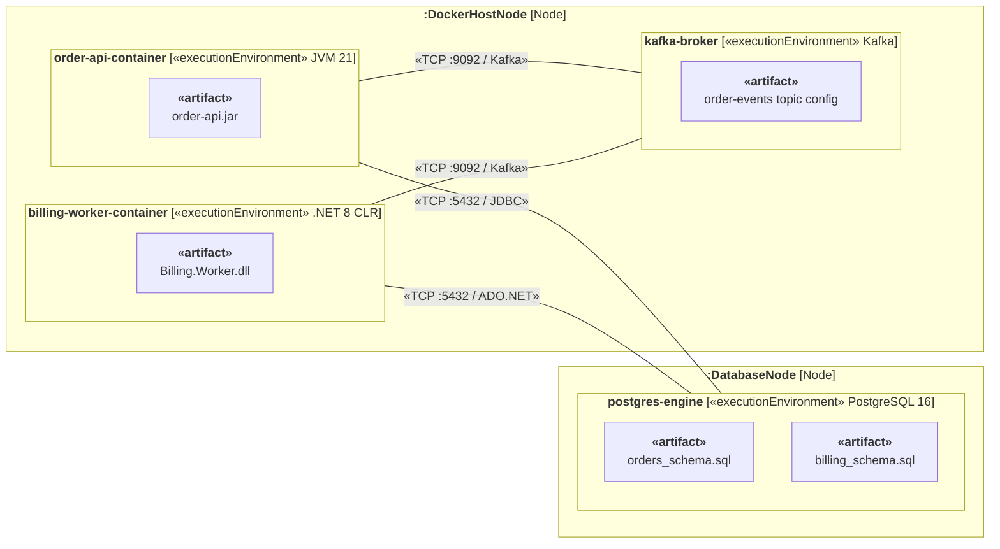

### 7.7. Trích dẫn & Tài liệu tham khảo
* **[S1]** OMG, *UML 2.5.1 Specification* — Chương 19 (Deployments: §19.2 Deployments, §19.3 Artifacts, §19.4 Nodes, §19.5 Notation), `https://www.omg.org/spec/UML/2.5.1/`
* **[A1]** Philippe Kruchten, *Architectural Blueprints—The “4+1” View Model of Software Architecture*, IEEE Software 12(6), 1995 (Physical View), `https://doi.org/10.1109/52.469759`
* **[T1]** Visual Paradigm & Sparx Systems, *UML Deployment Diagram Guide*, `https://www.visual-paradigm.com/guide/uml-unified-modeling-language/what-is-deployment-diagram/`

---

## 8. UML — Activity Diagram

### 8.1. Tổng quan & Lý do sử dụng
* **Định nghĩa chuẩn:** Theo OMG UML 2.5.1 (Chương 15 — Activities), **Activity Diagram** là sơ đồ hành vi mô tả luồng điều khiển (**Control Flow**) và luồng dữ liệu (**Object Flow**) giữa các bước xử lý (**Actions**), hỗ trợ biểu diễn rẽ nhánh điều kiện, hợp luồng và thực thi đồng thời dựa trên ngữ nghĩa dòng chảy token (Petri-net like token flow).
* **Vị trí trong 4+1 View Model:** Thuộc **Process View** và **Scenarios (+1)** — đặc tả quy trình nghiệp vụ liên dịch vụ hoặc thuật toán/workflow bên trong một API handler.
* **Tại sao phải dùng & Chức năng chính:**
  * Trực quan hóa rõ các nhánh điều kiện (`Decision`/`Merge`) tách biệt hoàn toàn với các nhánh xử lý đồng thời (`Fork`/`Join`).
  * Phân định rõ trách nhiệm thực hiện từng bước hành động giữa các dịch vụ/thành phần thông qua các làn bơi (**Swimlanes / Activity Partitions**).
* **Phạm vi & Giới hạn (Non-goals):**
  * **Không** thay thế Sequence Diagram khi mục tiêu chính là kiểm tra chi tiết giao thức trao đổi thông điệp và chuỗi span theo thời gian.
  * **Không** thay thế State Machine Diagram khi mục tiêu là mô tả vòng đời trạng thái của một thực thể dữ liệu.

### 8.2. Các phần tử cốt lõi & Ký pháp chuẩn

| Phần tử / Quan hệ | Ý nghĩa mô hình (Semantics) | Ký pháp trình bày chuẩn (OMG UML 2.5.1 §15.2–15.6) | Điều KHÔNG được suy diễn sai |
| :--- | :--- | :--- | :--- |
| **Action** | Một bước xử lý cơ sở trong Activity. | Hình chữ nhật bo góc, tên theo cấu trúc **Động từ + Tân ngữ** (ví dụ: `Validate request`, `Reserve stock`). | Không ghi tên trạng thái tĩnh (như `Paid`, `Cancelled`) vào hộp Action (đó là State Machine). |
| **Initial Node** | Điểm khởi phát token điều khiển khi Activity được gọi (§15.3.3.1). | Hình tròn đặc màu đen; **không có cạnh đi vào**, chỉ có cạnh `Control Flow` đi ra. | Quy ước dùng 1 Initial Node cho dễ đọc là lựa chọn của MAVIS, không phải giới hạn cấm của chuẩn UML. |
| **Activity Final vs Flow Final** | **Activity Final** (§15.3.3.2): kết thúc toàn bộ Activity chứa nó. **Flow Final**: chỉ tiêu thụ token của nhánh đi vào nó, các nhánh đồng thời khác vẫn chạy tiếp. | **Activity Final**: chấm tròn đặc nằm trong vòng tròn ngoài (bullseye). **Flow Final**: vòng tròn có dấu **X** bên trong. Cả hai đều không có cạnh đi ra. | `Activity Final` kết thúc toàn bộ execution của **Activity chứa nó**, kể cả các nhánh trong những lane khác của cùng Activity. Nó không tự gửi lệnh hủy một Activity/tác vụ từ xa độc lập. `Flow Final` chỉ kết thúc token đi vào, không đồng nghĩa với lỗi hệ thống. |
| **Decision & Merge Node** | **Decision**: chọn **một** cạnh ra thỏa `[guard]`. **Merge**: gom các nhánh thay thế lại mà không chờ đồng bộ (§15.3.3.5–6). | Hình thoi (diamond). **Decision**: 1 cạnh vào, $\ge 2$ cạnh ra kèm `[guard]`. **Merge**: $\ge 2$ cạnh vào, 1 cạnh ra. | Decision **không** nhân bản token ra nhiều nhánh. Không phân loại Decision hay Merge chỉ bằng hình thoi mà phải nhìn số cạnh vào/ra. |
| **Fork & Join Node** | **Fork**: tách 1 token thành nhiều token đồng thời trên mọi cạnh ra. **Join**: đồng bộ chờ đủ token trên tất cả cạnh vào (mặc định `joinSpec = AND`) (§15.3.3.3–4). | Thanh đậm (bar) ngang hoặc dọc. **Fork**: 1 cạnh vào, $\ge 2$ cạnh ra. **Join**: $\ge 2$ cạnh vào, 1 cạnh ra. | Nếu một đầu vào bắt buộc của Join không bao giờ nhận token, Join mặc định sẽ chờ và có thể gây deadlock. Đánh giá theo đường đi token, `joinSpec` và phạm vi kết thúc; không kết luận deadlock chỉ vì trên đường có Decision. Hai đường thay thế muốn dùng cùng một đầu vào Join nên hợp qua Merge trước. |
| **Control Flow & Object Flow / Pin** | **Control Flow**: truyền quyền điều khiển. **Object Flow**: truyền dữ liệu qua `Object Node` hoặc `Pin` gắn trên biên Action (§15.2.4, §15.4). | Cả hai đều dùng đường **nét liền, đầu mũi tên hở** trong chuẩn UML 2.5.1. `Pin` là ô vuông nhỏ gắn trên cạnh của Action. | Không dùng đường nét đứt làm ký hiệu mặc định cho `Object Flow` (một số hướng dẫn công cụ vẽ sai chuẩn OMG). |
| **Activity Partition (Swimlane)** | Phân nhóm ActivityNodes/Edges theo đặc điểm hoặc trách nhiệm chung (§15.6); partition không thay đổi quy tắc token flow. | Thường dùng các đường song song ngang/dọc với tên làn ở một đầu. UML cũng hỗ trợ phân cấp, nhiều chiều và cách ghi tên partition khi swimlane không phù hợp. **MAVIS mặc định** dùng các lane đồng cấp trong một khung, căn chiều cao để dễ đọc. | Cùng chiều cao, cùng khung và ánh xạ lane theo service là quy ước trình bày của MAVIS, không phải giới hạn phổ quát của UML. Cạnh đi qua lane chưa tự xác định HTTP/gRPC/Kafka; lane không tạo một execution Activity độc lập. |

### 8.3. Quy trình dựng sơ đồ chuẩn
1. **Chốt phạm vi Activity và trách nhiệm:** Chọn một workflow/API use case, nêu rõ một execution chứa những nhánh nào. Theo mặc định MAVIS, trình bày lane theo service trong một khung căn đều; workflow một service có thể dùng một lane. Worker bất đồng bộ có vòng đời độc lập nên được mô hình hóa bằng Activity riêng với điểm gửi/nhận sự kiện rõ ràng.
2. **Đặt Initial Node và liệt kê các Actions:** Viết tên Action dạng `Động từ + Đối tượng` và đặt vào đúng cột làn sở hữu.
3. **Nối Control Flow / Object Flow xuyên làn:** Khi bước xử lý chuyển từ Service A sang Service B, vẽ mũi tên đi ngang/vuông góc **xuyên qua vách ngăn giữa 2 cột** sang Action thuộc làn B (và đi ngược lại nếu trả kết quả đồng bộ).
4. **Mô hình hóa rẽ nhánh bằng `Decision` / `Merge`:** Đặt `[guard]` không chồng lấn trên các cạnh ra của Decision (tối đa một nhánh `[else]`); hợp các nhánh thay thế qua `Merge` trước khi vào bước chung tiếp theo.
5. **Mô hình hóa xử lý đồng thời bằng `Fork` / `Join`:** Chỉ dùng `Fork` khi các nhánh thực sự độc lập/đồng thời; kiểm tra bảo toàn token tại mọi `Join` (tránh deadlock).
6. **Chọn đúng loại Node kết thúc:** Dùng `Flow Final` ($\otimes$) cho nhánh phụ/bất đồng bộ kết thúc riêng lẻ và `Activity Final` ($\odot$) cho điểm kết thúc toàn bộ Activity.

### 8.4. Bộ quy tắc sử dụng & Kiểm chứng
* **Quy tắc bắt buộc:**
  * **[N-ACT-01]** Tuyệt đối không dùng `Fork` để biểu diễn câu lệnh `if/else` và không dùng `Join` để gộp hai nhánh loại trừ nhau của `Decision` (phải dùng `Merge`).
  * **[N-ACT-02]** Các `[guard]` đi ra từ một `Decision` không được chồng lấn điều kiện ngoài ý muốn; mỗi `Decision` có tối đa một `[else]`.
  * **[N-ACT-03]** Nếu một nhánh sau `Fork` rẽ qua `Decision`, các đường thay thế muốn quay lại đồng bộ ở `Join` phải được gom qua `Merge` trước khi nối vào `Join`.
  * **[M-ACT-04] (Quy ước MAVIS — trình bày mặc định):** Ưu tiên các lane đồng cấp, cùng chiều cao trong một khung khi mô tả **một Activity** để dễ đọc; không coi cách vẽ UML hợp lệ khác là sai chỉ vì khác bố cục. Khi chưa rõ trách nhiệm thì ghi `"Chưa xác định"`. Không gộp các execution độc lập vào một Activity chỉ để đủ số lane.
* **Các lỗi thường gặp (Anti-patterns):**

| Lỗi phổ biến (Sai) | Cách hiểu & xử lý đúng (Chuẩn) |
| :--- | :--- |
| Coi mọi `subgraph` Mermaid là ActivityPartition chuẩn, hoặc gọi bố cục khác mặc định MAVIS là sai UML. | Ghi rõ Mermaid flowchart là bản diễn giải luồng. Khi cần ký pháp ActivityPartition chính xác, dùng renderer hỗ trợ UML; việc căn đều/chung vách là lựa chọn của MAVIS. Các Activity độc lập có thể dùng các khung riêng. |
| Đưa 2 nhánh `[valid]` và `[invalid]` của một `Decision` đi thẳng vào một thanh `Join` (AND). | Thanh `Join` chờ cả 2 nhánh cùng có token nên sẽ deadlock mãi mãi. Phải dùng hình thoi `Merge` nếu muốn gộp 2 nhánh thay thế. |
| Dùng `Activity Final` (bullseye) ở cuối một nhánh ghi log phụ chạy song song sau `Fork`. | Token chạm `Activity Final` sẽ hủy luôn cả các nhánh chính đang chạy! Nhánh phụ kết thúc độc lập phải dùng `Flow Final` (vòng tròn chữ X). |
| Thấy từ khóa `async` trong code liền vẽ `Fork` chạy song song. | `async/await` tuần tự không phải là concurrency hai nhánh độc lập; chỉ vẽ `Fork` khi thực sự khởi chạy các tác vụ đồng thời (`Task.WhenAll`, `CompletableFuture.allOf`, hoặc nhánh bất đồng bộ độc lập). |

* **Checklist nghiệm thu:**
  - [ ] Scope Activity và trách nhiệm của mỗi lane rõ ràng; nếu dùng bố cục mặc định MAVIS, các lane trong cùng Activity được căn đều. Không nhầm lane với một execution độc lập.
  - [ ] Mọi Action đều nằm trong Swimlane tương ứng và đặt tên theo chuẩn `Động từ + Đối tượng`.
  - [ ] Phân biệt đúng `Decision`/`Merge` (hình thoi) với `Fork`/`Join` (thanh ngang/dọc).
  - [ ] Không có lỗi deadlock tại `Join` hoặc kết thúc sớm ngoài ý muốn tại `Activity Final`.
  - [ ] Các `[guard]` đặt trong ngoặc vuông trên cạnh ra của `Decision`, không chồng lấn.

### 8.5. Ứng dụng & Cơ chế trích xuất trong MAVIS
* **Ánh xạ dữ kiện đầu vào:**
  * *Explicit Workflow / Use Case Spec & Bounded Control-Flow Analysis:* Trích xuất các bước hành động chính, nhánh điều kiện và lời gọi sang service khác.
  * *Giới hạn:* Control-Flow Graph (CFG) mức câu lệnh trong source code thường quá chi tiết; MAVIS yêu cầu nâng mức trừu tượng lên các bước nghiệp vụ có ý nghĩa và giữ trạng thái `Assisted / Needs Review` cho người học duyệt.

### 8.6. Ví dụ minh họa (phân làn và hai Activity bất đồng bộ độc lập)

> [!NOTE]
> Hình UML dưới đây dùng swimlane liền mạch theo **quy ước MAVIS**, không áp đặt cùng chiều cao/chung khung cho mọi mô hình UML. Các khối Mermaid là bản diễn giải luồng; nhãn bước có thể ghi trách nhiệm thay cho hình học lane. Mermaid flowchart không bảo đảm hình học và ký pháp đầy đủ của UML Activity.

#### Minh họa 1: Tạo đơn và xử lý Billing là hai Activity độc lập

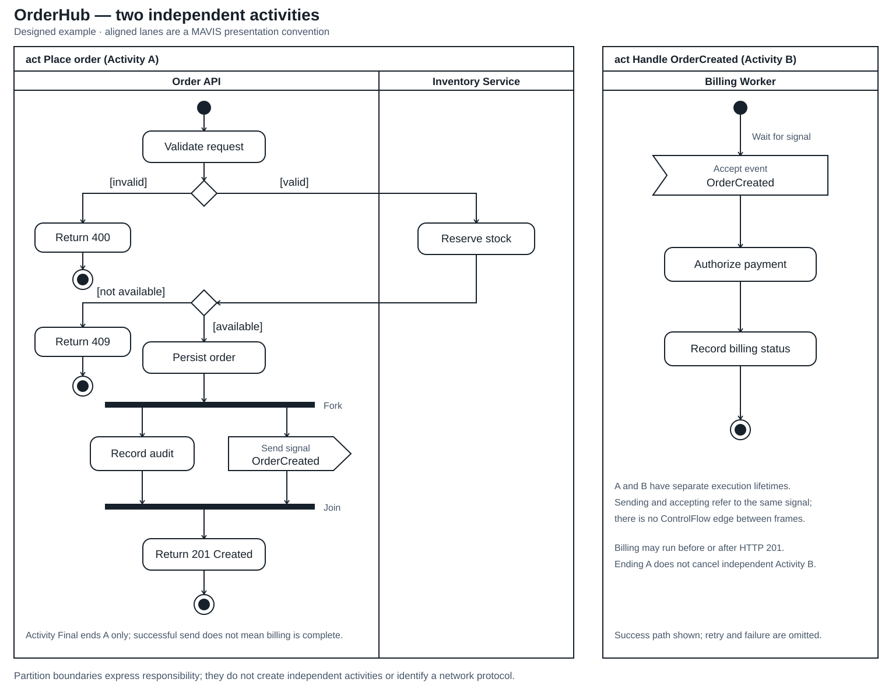

**Scope A — `act Place order`:** Order API và Inventory Service tham gia cùng một workflow tạo đơn. Sau khi lưu đơn, workflow này ghi audit và gửi signal `OrderCreated` qua hai nhánh Fork/Join. Giả định gửi signal ở đây hoàn tất khi chuyển giao sự kiện theo hợp đồng thiết kế, không đợi worker thanh toán. Activity Final sau HTTP 201 chỉ kết thúc Activity A.

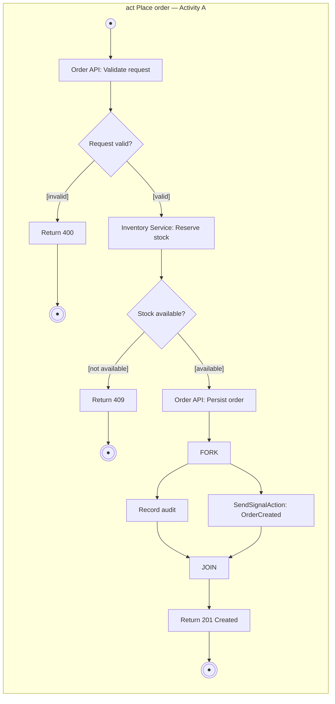

**Scope B — `act Handle OrderCreated`:** Đây là execution riêng của Billing Worker. `AcceptEventAction` chờ signal `OrderCreated` tương ứng trước khi cấp phép thanh toán; không có cạnh ControlFlow từ Fork của Activity A sang worker. Cơ chế truyền/giao lại sự kiện thuộc hợp đồng messaging và không được suy ra từ đường nối qua lane.

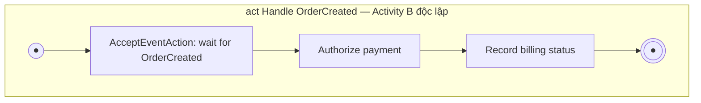

Activity A và B có thể chạy xen kẽ sau khi signal được gửi. HTTP 201 không xác nhận Billing đã xong và Activity Final của A không hủy B. Ví dụ giả định nhánh thanh toán thành công; lỗi gửi/giao sự kiện, retry, chống xử lý trùng và compensation cần được thiết kế riêng. Không vẽ ObjectFlow trực tiếp qua hai khung Activity để thay thế ngữ nghĩa truyền signal.

#### Minh họa 2: Bố cục MAVIS hai lane trong cùng Activity (`Order Service | Inventory Service` — `act Create order`)

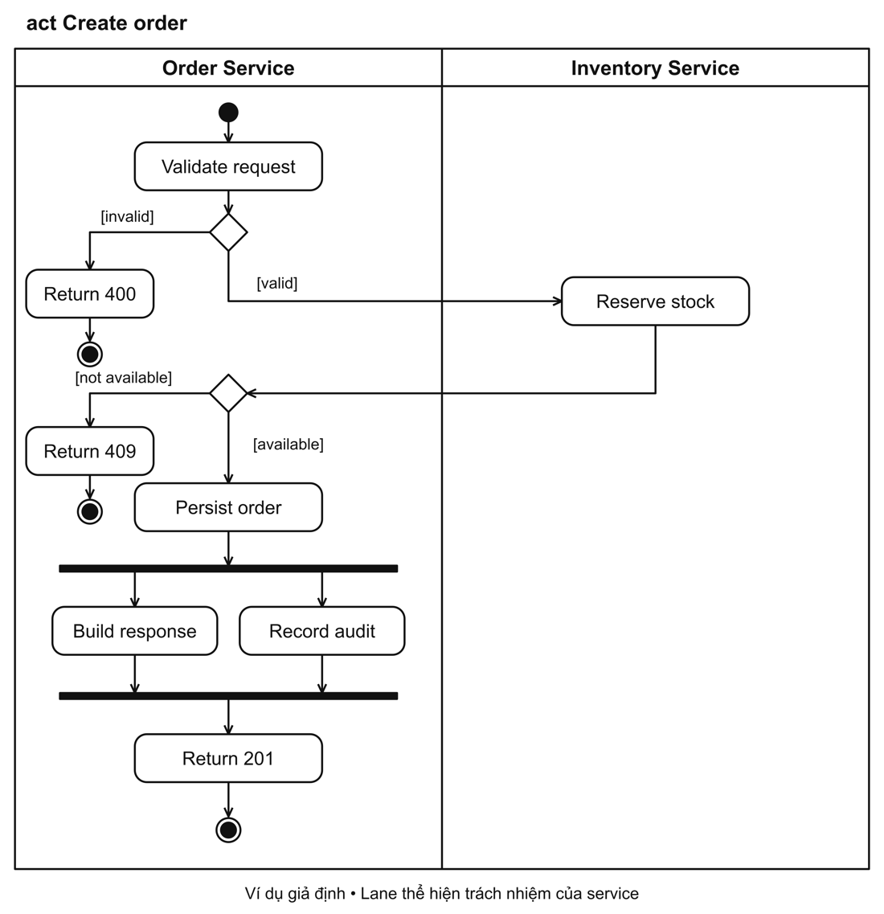

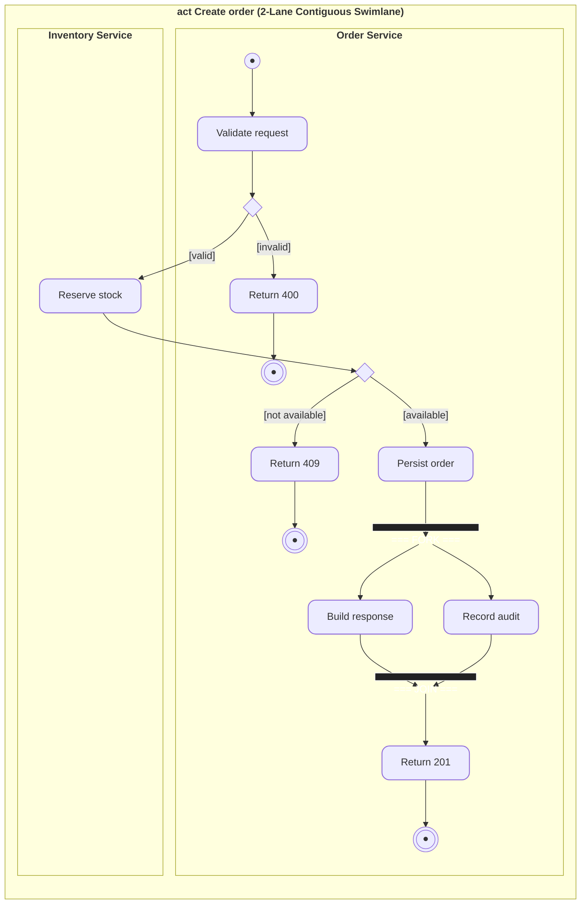

#### Minh họa 3: Ký hiệu cốt lõi và ví dụ bố cục partition

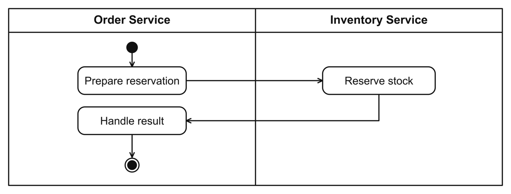

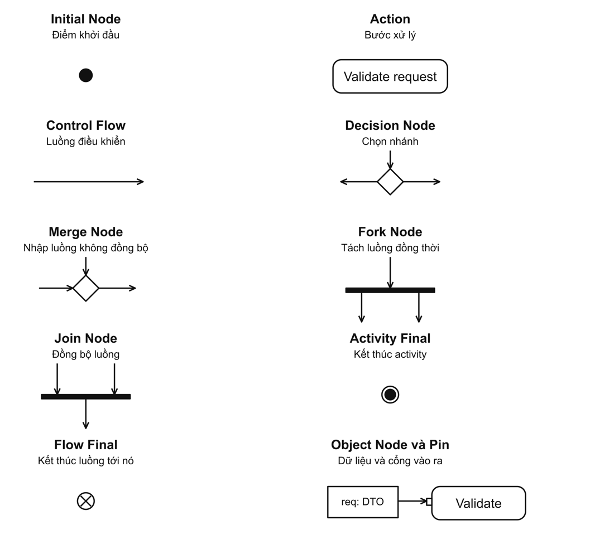

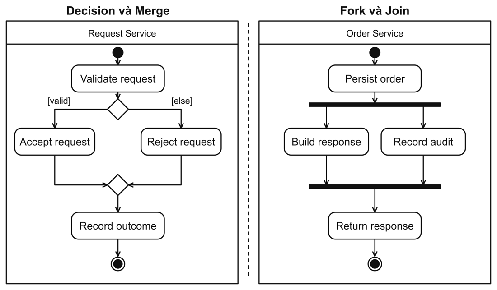

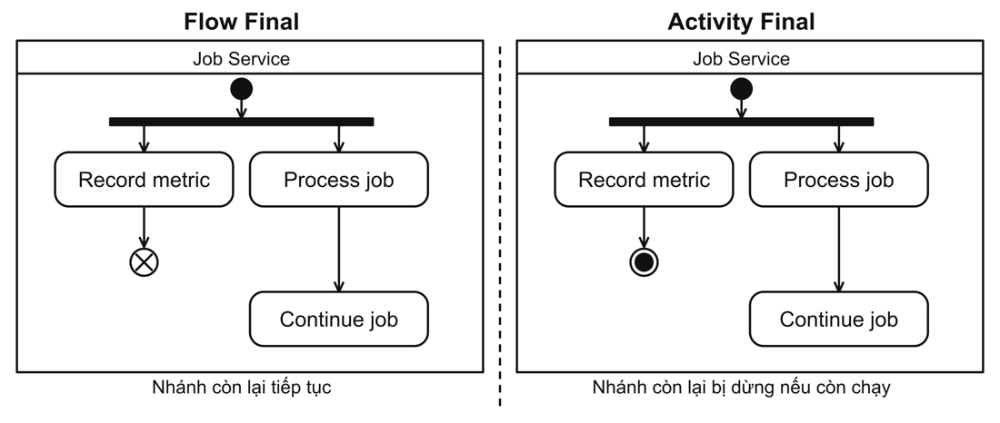

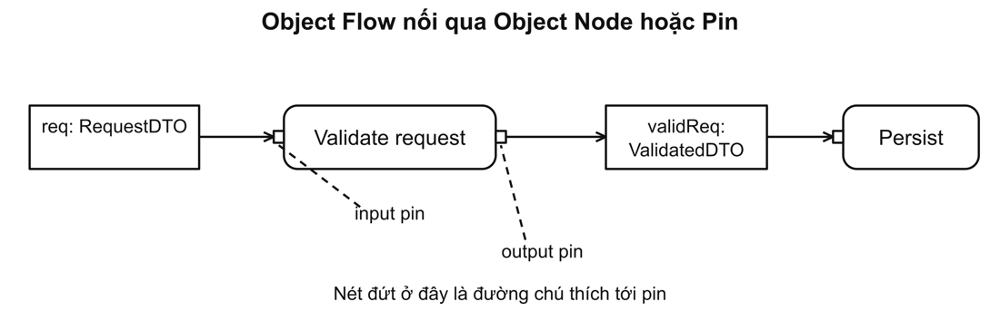

### 8.7. Trích dẫn & Tài liệu tham khảo
* **[S2]** Sparx Systems, [Activity Partition — trích OMG UML 2.5.1 trang 408](https://sparxsystems.com/enterprise_architect_user_guide/17.1/modeling_languages/activitypartition.html) và [Partition](https://sparxsystems.com/enterprise_architect_user_guide/17.1/modeling_languages/partition.html). Căn đều các lane là chính sách MAVIS; partition không tự thay đổi token flow.
* **[S1]** OMG, *UML 2.5.1 Specification* — Chương 15 (Activities: §15.2 Actions & Edges, §15.3 Control Nodes, §15.4 Object Nodes & Pins, §15.6 Activity Partitions; Hình 15.5, 15.27–15.33, 15.67 trang 380–409), `https://www.omg.org/spec/UML/2.5.1/`
* **[A1]** Giáo trình SWD392 — RDS Activity Diagrams với Swimlane (trang 23–24, Hình I-12 & I-13).
* **[T1]** Sparx Systems & Visual Paradigm Activity Diagram Guides, `https://sparxsystems.com/resources/tutorials/uml2/activity-diagram.html`

---

## 9. UML — State Machine Diagram

### 9.1. Tổng quan & Lý do sử dụng
* **Định nghĩa chuẩn:** Theo OMG UML 2.5.1 (Chương 14 — StateMachines), **Behavioral State Machine Diagram** mô tả vòng đời trạng thái (**States**) của **một thực thể/đối tượng cụ thể** (như `Order`, `Payment`, `AnalysisJob`) và cách đối tượng đó chuyển trạng thái (**Transitions**) để phản ứng lại các sự kiện (**Triggers/Events**) dưới các điều kiện (**Guards**) kèm hành vi hệ quả (**Effects**).
* **Vị trí trong 4+1 View Model:** Thuộc **Logical View / Process View** động — đặc tả các bất biến vòng đời của một thực thể có trạng thái (stateful entity).
* **Tại sao phải dùng & Chức năng chính:**
  * Ngăn chặn các phép chuyển trạng thái bất hợp lệ trong nghiệp vụ (ví dụ: đơn hàng đã `CANCELLED` không được chuyển sang `PAID`, hoặc `AnalysisJob` đã `COMPLETED` không bị ghi đè bởi callback cũ).
  * Làm rõ điều kiện `[guard]` nào bắt buộc phải thỏa mãn khi nhận một sự kiện trước khi đổi trạng thái.
* **Phạm vi & Giới hạn (Non-goals):**
  * Một State Machine mô tả vòng đời của **đúng một loại đối tượng**, **không** phải luồng công việc đi qua nhiều service (không dùng Swimlane của Activity Diagram cho State Machine).

### 9.2. Các phần tử cốt lõi & Ký pháp chuẩn

| Phần tử / Quan hệ | Ý nghĩa mô hình (Semantics) | Ký pháp trình bày chuẩn (OMG UML 2.5.1 §14.2) | Điều KHÔNG được suy diễn sai |
| :--- | :--- | :--- | :--- |
| **Simple / Composite State** | Tình huống trong vòng đời đối tượng mà tại đó một điều kiện bất biến được thỏa mãn. `Composite State` chứa một hoặc nhiều region trạng thái con bên trong. | Hình chữ nhật bo góc. Tên State là **Tính từ / Cụm danh từ tình huống** (ví dụ: `PendingPayment`, `Paid`, `Completed`). Có thể có ngăn ghi `entry / ...`, `do / ...`, `exit / ...`. | Không lấy tên hành động (`Process payment`) đặt làm tên State. Hành vi `do / activity` chạy khi đang ở trong state, **không** mặc định là vòng lặp vô hạn. |
| **Initial Pseudostate & Final State** | **Initial**: điểm bắt đầu của một Region. **Final State**: đánh dấu việc hoàn tất Region chứa nó. | **Initial**: hình tròn đặc đen (tối đa 1 Initial mỗi Region). **Final State**: chấm tròn đặc trong vòng tròn ngoài (bullseye), không có cạnh đi ra. | Chạm `Final State` nghĩa là vòng đời trạng thái trong Region đó hoàn tất, **không** mặc định là xóa bản ghi khỏi Database hay tắt toàn bộ microservice. |
| **Transition (`trigger [guard] / effect`)** | Sự chuyển đổi từ trạng thái nguồn sang trạng thái đích khi sự kiện xảy ra và guard đúng (§14.2.3.8). | Mũi tên nét liền đầu hở kèm nhãn `trigger [guard] / effect` (các thành phần không dùng có thể lược bỏ). Cạnh từ Initial không có trigger/guard. | Một cạnh đi ra từ State thường mà **không ghi trigger** là **Completion Transition** (tự kích hoạt ngay khi `entry` và `do` trong state đó hoàn tất), không phải là "nhận bất kỳ sự kiện nào". |
| **Internal vs External Self-Transition** | Phản ứng với sự kiện mà vẫn giữ nguyên trạng thái hiện tại. | **External self-transition**: mũi tên vòng ra ngoài rồi quay lại biên State $\rightarrow$ **có chạy lại** `exit` và `entry`. **Internal transition**: ghi bên trong ngăn của State $\rightarrow$ **không chạy** `exit`/`entry`. | Hai kiểu này khác nhau về việc có kích hoạt lại hành vi `entry`/`exit` hay không. |
| **Choice Pseudostate** | Điểm rẽ nhánh động đánh giá các `[guard]` sau khi hiệu ứng của phần chuyển đổi trước đã thực thi. | Hình thoi (diamond). Các cạnh đi ra chỉ gắn `[guard]` (và `/ effect`), **không** gắn thêm `trigger` mới lên cạnh ra của Choice. | Tránh thiết kế các `[guard]` trên các cạnh ra của Choice cùng đúng một lúc gây bất định. |

### 9.3. Quy trình dựng sơ đồ chuẩn
1. **Chọn đúng 1 đối tượng có trạng thái (Stateful Entity):** Ví dụ đối tượng `Order` hoặc `AnalysisJob` (ghi rõ tên đối tượng trong tiêu đề sơ đồ).
2. **Xác định tập các States hợp lệ:** Lấy từ enum trạng thái và đặc tả nghiệp vụ; đặt tên theo tình huống/trạng thái (`Created`, `PendingPayment`, `Paid`, `Cancelled`), không đặt tên theo hàm.
3. **Đặt Initial Pseudostate và các Final States:** Vẽ cạnh khởi tạo từ Initial vào trạng thái đầu tiên.
4. **Xác lập các Transitions có căn cứ:** Với mỗi cặp chuyển trạng thái hợp lệ, ghi rõ `trigger` (sự kiện/method kích hoạt), `[guard]` (điều kiện kiểm tra) và `/ effect` (hành động sinh ra như phát sự kiện).
5. **Rà soát các trạng thái kết thúc và bất biến:** Kiểm tra không có cạnh đi ra từ `Final State` và không bỏ sót nhánh hủy/lỗi quan trọng.

### 9.4. Bộ quy tắc sử dụng & Kiểm chứng
* **Quy tắc bắt buộc:**
  * **[N-STM-01]** Mỗi Region có tối đa **một** `Initial Pseudostate` và tối đa một cạnh đi ra từ nó; cạnh khởi tạo này không mang `trigger` hay `[guard]`.
  * **[N-STM-02]** `Final State` không được có bất kỳ cạnh đi ra nào.
  * **[N-STM-03]** Trên cạnh đi ra từ `Choice Pseudostate`, chỉ đặt `[guard] / effect`, tuyệt đối không đặt `trigger` sự kiện mới.
  * **[M-STM-04] (Quy ước MAVIS):** Một khai báo `enum OrderStatus` trong source code chỉ là bằng chứng về **danh sách tên các trạng thái**, chưa đủ bằng chứng để tự vẽ các mũi tên chuyển đổi (`Transition`). Mọi cạnh Transition phải có bằng chứng từ hàm chuyển trạng thái (state transition handler) hoặc xác nhận của người học.
* **Các lỗi thường gặp (Anti-patterns):**

| Lỗi phổ biến (Sai) | Cách hiểu & xử lý đúng (Chuẩn) |
| :--- | :--- |
| Chỉ thấy `enum Status { A, B, C }` trong code liền tự động nối `A -> B -> C` như một quy trình tuyến tính. | Enum chỉ cho biết các giá trị trạng thái; chiều chuyển đổi hợp lệ và `[guard]` phải lấy từ logic kiểm tra trạng thái trong method/domain model. |
| Bỏ trống tên `trigger` trên mọi mũi tên giữa các trạng thái vì nghĩ đó là mũi tên thứ tự thông thường. | Trong UML State Machine, cạnh không có trigger là *Completion Transition* (tự động chuyển ngay khi xong `do` activity). Nếu cần chờ sự kiện bên ngoài (như `PaymentSucceeded`), bắt buộc phải ghi tên trigger. |
| Kẻ các cột Swimlane của Service đè lên State Machine Diagram. | Swimlane thuộc Activity Diagram. State Machine xoay quanh vòng đời của **một** đối tượng duy nhất. |

* **Checklist nghiệm thu:**
  - [ ] Sơ đồ mô tả vòng đời của đúng 1 loại đối tượng xác định.
  - [ ] Tên các node là trạng thái (State), không phải tên hành động (Action).
  - [ ] Nhãn cạnh tuân thủ cú pháp `trigger [guard] / effect`; cạnh từ Initial không có trigger/guard.
  - [ ] Mọi Transition đều có căn cứ từ domain method/handler hoặc tài liệu quy tắc nghiệp vụ.

### 9.5. Ứng dụng & Cơ chế trích xuất trong MAVIS
* **Ánh xạ dữ kiện đầu vào:**
  * *Static AST:* Khai báo `enum` trạng thái + các phương thức domain thay đổi trường trạng thái (ví dụ `if (this.status == PENDING_PAYMENT) { this.status = PAID; }`) $\rightarrow$ trích xuất State + Transition kèm `[guard]` và vị trí dòng code (`Evidence`).
  * *Runtime Event/State Trace:* Bổ sung bằng chứng các phép chuyển trạng thái đã quan sát được trong kịch bản chạy, nhưng việc không thấy một transition trong trace không chứng minh phép chuyển đó bị cấm trong code.

### 9.6. Ví dụ minh họa chuẩn (Bài toán OrderHub — Vòng đời đối tượng `Order`)
Thao tác `createOrder()` tạo/khởi tạo đối tượng nằm trong ngữ cảnh bên ngoài State Machine này. Khi Region được vào qua khởi tạo mặc định, cạnh từ Initial chỉ có effect `/ emit OrderCreated`, không có trigger hay guard. Các nhãn trigger ở những cạnh tiếp theo là các sự kiện/operation theo giả định thiết kế của ví dụ.

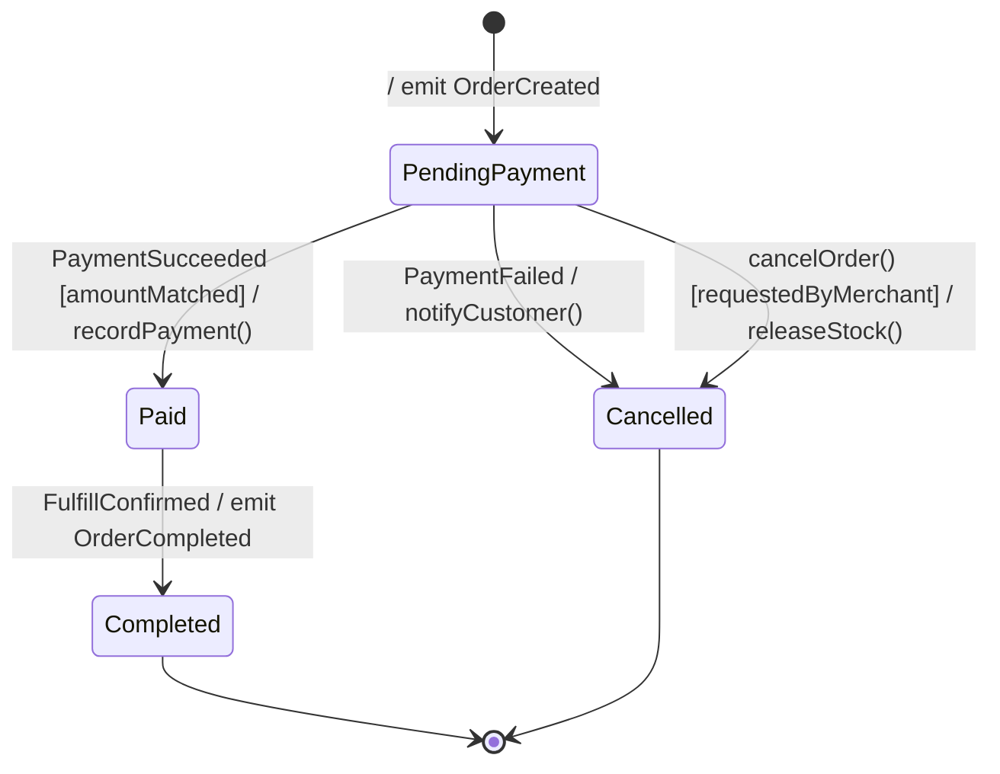

### 9.7. Trích dẫn & Tài liệu tham khảo
* **[S2]** Sparx Systems, [Initial — trích OMG UML 2.5.1 trang 312](https://sparxsystems.com/enterprise_architect_user_guide/17.1/modeling_languages/initial.html): tối đa một Initial trong Region; cạnh khởi tạo có thể có effect nhưng không có trigger/guard.
* **[S1]** OMG, *UML 2.5.1 Specification* — Chương 14 (StateMachines: §14.2 Behavior StateMachines, Transitions, Pseudostates), `https://www.omg.org/spec/UML/2.5.1/`
* **[A1]** Hassan Gomaa, *Software Modeling and Design* — Giáo trình SWD392 Ch09–11 Dynamic Modeling (slides 17–21: State, Event, Guard, Transition Action, Entry/Exit).
* **[T1]** Visual Paradigm & Mermaid State Diagram Guide, `https://www.visual-paradigm.com/guide/uml-unified-modeling-language/what-is-state-machine-diagram/`
