# MAVIS Standard Guide to Nine Architecture and Design Diagrams

**Version:** 2.1 — English edition

**Updated:** 25 October 2026

**Scope:** **MAVIS** — *AI-Assisted Microservices Architecture Visualization and Change Impact Analysis*

**Primary references:** The C4 Model and OMG UML 2.5.1 (`formal/2017-12-05`).

**Companion edition:** [Vietnamese master guide, version 2.1](MAVIS_9_DIAGRAMS_STANDARD_GUIDE.md). This edition preserves the nine diagram scopes, rule identifiers, worked examples, and technical corrections. Identifiers in code and diagram models are not translated. Shared reference figures retain their original artwork; their captions and the surrounding guidance below are in English.

> [!IMPORTANT]
> **Principles shared by all nine diagram types in MAVIS:**
> 1. **Separate the model from its visualization.** `Source / Configuration / Runtime Trace` → `Evidence-backed facts` → `Canonical Architecture Model with stable IDs` → `Scope-specific Diagram Projection` → `Layout and Rendering`. A parser or renderer producing a diagram does **not** prove that the model accurately describes the architecture or source code.
> 2. **Separate evidence sources, designed content, and confirmation.** The three source categories discussed here are **Static** (source code/AST), **Declared** (Docker Compose, OpenAPI, manifests), and **Observed** (trace/span evidence for a particular scenario and time window). **Designed** content is deliberately authored by a user and must not masquerade as extracted evidence. **User-confirmed** is separate review information that can apply to content from different sources; confirmation does not turn designed content into source extraction or a runtime observation. Runtime traces must not overwrite or erase static evidence.
> 3. **Fail closed when evidence is insufficient.** Do not invent a default actor, guess a technology/version, add a database to a stateless service, or reverse an edge for a cleaner layout. Unresolved elements and relationships must retain an appropriate `UNRESOLVED` / `NEEDS_REVIEW` status or explicitly state that they have not been established from the source.
> 4. **Use one coherent worked example.** All nine sections use the hypothetical **OrderHub** microservice system: `Merchant System`, `Support Operator`, `OrderHub`, `Order API`, `Orders DB`, the `order-events` topic, `Billing Worker`, `Billing DB`, and the external `Payment Provider`. These views are intended to describe the same underlying design.

**Standards versus conventions.** C4/UML semantics, readability recommendations, and MAVIS product policies are distinct. Requirements explicitly identified as **MAVIS conventions** are product choices, not universal constraints imposed by OMG or the C4 Model. The associations with the 4+1 View Model below are MAVIS's way of organizing viewpoints, not a mandatory one-to-one mapping between standards. OrderHub is a **hypothetical designed example**, not evidence that every illustrated capability has been implemented or accepted in the product.

**Mapping provenance to implementation contracts.** The conceptual source categories above are not one shared enum. The graph contract uses `originLayer` values such as `STATIC`, `CONFIG`, `DEPLOYMENT`, `RUNTIME`, and `STATIC_AND_RUNTIME`; the UML workspace uses `provenance` values `EXTRACTED`, `DESIGNED`, and `HYBRID`. Map declared configuration/deployment evidence according to the relevant producer contract. Observed content must retain lineage to runtime evidence. `EXTRACTED` still requires a concrete source/evidence basis, and `HYBRID` must distinguish extracted content from designed additions. Do not send explanatory labels such as `DECLARED`, `OBSERVED`, or `USER_CONFIRMED` into enum fields that do not support them, or add enum values merely to match the prose in this guide.

---

# PART 1. C4 ARCHITECTURE DIAGRAMS — C1 TO C3

> [!NOTE]
> **Why does MAVIS focus on C1–C3 rather than a separate C4 code-level view?**
> Simon Brown treats the code level as optional. It is rarely maintained manually because code changes frequently and detailed information is already available in the IDE. A **UML Class Diagram**, covered in Section 4, can provide a focused code-level view when a module needs deeper analysis.

| C4 level | Scope being opened | Main architectural question | Primary audience |
| :--- | :--- | :--- | :--- |
| **C1 — System Context** | One **Software System**, treated as a black box | What value does the system provide, who uses it, and which external systems does it interact with? | Business and technical readers: product owners, business analysts, instructors, developers, and architects. |
| **C2 — Container** | Inside the Software System selected at C1 | Which applications and data stores make up the system, and how do they communicate? | Developers, software architects, and operations/DevOps engineers. |
| **C3 — Component** | Inside **one Container** selected at C2 | How are responsibilities divided among components inside this container, and how do they collaborate? | Developers, technical leads, and learners studying internal service design. |

---

## 1. C4 — System Context Diagram (C1)

### 1.1. Overview and Purpose

* **Definition:** The System Context diagram places **one Software System** at the center as a black box and shows the **People** and **External Software Systems** that interact directly with it.
* **Relationship to 4+1:** Provides overall context connecting **Scenarios (+1)** with the outer boundary of the **Logical View**.
* **Why use it?**
  * Establish the system's responsibility boundary and business value before introducing internal technical details.
  * Identify human roles and external dependencies, including both inbound interactions and outbound calls.
* **Scope and non-goals:**
  * Do **not** expose internal microservices, database schemas, message brokers/topics, classes/controllers, or TCP ports.
* **C4 System Context versus a traditional context diagram:**

| Comparison | Traditional context diagram — DFD Level 0 / SRS | C4 System Context — Level 1 |
| :--- | :--- | :--- |
| **Origin and purpose** | Structured analysis, such as DeMarco/Yourdon DFDs and Wiegers-style requirements documentation: describes system inputs and outputs as **data flows**. | Simon Brown's architectural model: describes **software architecture context** and provides the first level for zooming into Container and Component views. |
| **System in the center** | A single process, commonly a circle/bubble labeled Process `0` in the notation illustrated here. | A box labeled `[Software System]` with the system name and a brief statement of responsibility/business value. |
| **External entities** | People, departments, sensors, and other systems use an **External Entity / Terminator** symbol; this notation does not require different human and software-system types. | Distinguishes `[Person]` from `[Software System]`, with each element's type and role stated explicitly. |
| **Arrows and labels** | **Data flows:** distinguish incoming and outgoing information; labels are usually noun phrases such as `Menu choices`, `Order confirmation`, or `Sales tax data`. | Each edge expresses one directed relationship. Its direction and label must agree about the dependency, interaction, or data flow being shown. A request/response interaction commonly points from caller to receiver and omits the return when understood. Prefer a concrete verb phrase, such as `Submits orders` or `Requests payment authorization`. |
| **Connection to lower levels** | Decomposes into DFD Levels 1, 2, and so on: processes and data stores. | Opens the central Software System into the C2 System Boundary, retaining relevant surrounding participants consistently. |

### 1.2. Core Elements and Notation

C4 is notation-independent. Boxes, colors, cylinders, Person icons, and boundary line styles in this guide are MAVIS presentation choices. Preserve the abstraction level, scope, element types, responsibilities, and relationship meaning. Explain the chosen notation in the legend.

| Element / relationship | Model semantics | Presentation | Do not infer |
| :--- | :--- | :--- | :--- |
| **Person** | A human role that uses the system. | A person icon or box with the **role name**, `[Person]`, and a short responsibility description. | A machine client, scheduled job, or external API caller is not automatically a Person. |
| **Target Software System** | The software system under consideration: a unit providing business value within a defined ownership/responsibility boundary. | Central box containing its **name**, `[Software System]`, and a description of its value. | A Software System is not necessarily equivalent to one Git repository or one microservice. |
| **External Software System** | A software system outside the selected system's boundary that interacts directly with it. | A supporting box, distinguished by labels or consistent styling, with its **name**, `[Software System]`, and interaction role. | External means outside the selected system's boundary, not necessarily owned by another company. |
| **Relationship** | A direct business/data interaction between the target system and a Person or external system. | A directed arrow with a concrete verb phrase, such as `Submits orders` or `Requests payment authorization`. | Direction must match the selected dependency, call initiation, or data-flow meaning. Request/response calls can imply their return; initiation is not a universal direction rule for every data or messaging edge. |

### 1.3. Construction Procedure

1. **Define the target system.** Select one Software System and describe its business value in one sentence. Represent it as one box and hide its internal structure.
2. **List supporting elements.** Identify People and external systems that interact directly with it, with supporting requirements, configuration, or source evidence.
3. **Establish relationship direction.** For a call-oriented relationship, point from initiator to receiver. An external system invoking an inbound webhook points into the target system.
4. **Label the semantics.** Use a concrete action and its object. Omit low-level protocol details at C1.
5. **Add the title and legend.** Use a title such as `System Context diagram for <System Name>` and explain shapes, colors, and evidence/status conventions.

### 1.4. Rules and Verification

* **Rules:**
  * **[N-C1-01]** Focus on exactly one target Software System. Supporting elements included in this scoped view must connect directly to it.
  * **[N-C1-02]** Do not expose internal Containers, such as API services, workers, databases, or queues, or internal Components at C1.
  * **[M-C1-03] — MAVIS convention:** Preserve Software System and external-system identities across C1 ↔ C2 ↔ C3. When aggregating C2 relationships into C1, retain the original `underlyingEdgeIds`.
* **Common mistakes:**

| Mistake | Correct interpretation or correction |
| :--- | :--- |
| Show every internal microservice and label the result System Context. | That is a Container-level view. At C1, the internal services belong inside one black-box Software System. |
| Generate a default `User` for a backend repository without evidence of a human role. | Show an evidence limitation/entrypoint notice, or include only an external system whose role has been established. |
| Label every relationship `Uses`, or force all arrows to point outward. | Use a specific business action. Inbound API/webhook calls point into the system when that is the interaction being described. |
| Reclassify an internal database as an external system merely to display it at C1. | Internal databases belong at C2. An independently owned external data service can appear as an external system when supported by the model. |

* **Acceptance checklist:**
  - [ ] One clearly identified target Software System and its business value.
  - [ ] No internal database, message queue, or service exposed in the context view.
  - [ ] Every relationship reads meaningfully from source to target; no generic `Uses` labels.
  - [ ] A self-contained title, scope, and legend.

### 1.5. MAVIS Inputs and Extraction Boundaries

* **Input mapping:**
  * *Static / Declared:* Outbound HTTP clients and configuration URLs can identify candidate external software systems. Inbound controllers/OpenAPI identify entrypoints.
  * *User confirmation / assignment brief:* Establish the target system's name, business purpose, human roles, and ownership boundary.
* **Insufficient evidence:** Source code without actor information must produce a scope notice, such as the number of detected entrypoints with unknown callers. Ask for confirmation rather than inventing a Person.

### 1.6. Worked Example — OrderHub

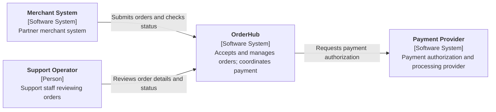

**Reading the example:** OrderHub is one black box. `Orders DB`, `Billing Worker`, and the `order-events` topic remain hidden inside it.

### 1.7. References

* **[S1]** Simon Brown, [C4 Model — System Context Diagram](https://c4model.com/diagrams/system-context).
* **[S2]** Simon Brown, [C4 Model — Software System abstraction](https://c4model.com/abstractions/software-system).
* **[S3]** Simon Brown, [Notation](https://c4model.com/diagrams/notation) and [Diagram Review Checklist](https://c4model.com/diagrams/checklist).
* **[T1]** [C4-PlantUML](https://plantuml-stdlib.github.io/C4-PlantUML/) and [Structurizr DSL language reference](https://docs.structurizr.com/dsl/language).
* **[R1]** Visual Paradigm, [C4 Context Diagram Guide](https://www.visual-paradigm.com/guide/c4-context-diagram-the-best-way-for-beginners-to-visualize-software-architecture/).

---

## 2. C4 — Container Diagram (C2)

### 2.1. Overview and Purpose

* **Definition:** The Container diagram zooms inside the Software System selected at C1 to show the applications and logical data stores that form it, their technologies, and how they communicate.
* **Relationship to 4+1:** Combines high-level aspects of the **Development View** and **Process View**: execution boundaries and inter-process communication.
* **Why use it?**
  * Explain which application processes exist (`API`, `Worker`, `SPA/Web App`), where data resides (`Database schema`, `Topic/Queue`, `Bucket`), and how the parts interact (`HTTPS/JSON`, `gRPC`, `JDBC`, `Kafka`).
  * Separate internal Containers from People and external systems outside the System Boundary.
* **Scope and non-goals:**
  * A C4 Container is **not** a Docker container, Pod, or physical VM. One logical application Container can have multiple deployed instances. Hosts and replicas belong in a deployment view.
  * Do not expose classes, interfaces, controllers, or methods inside the application; use C3 or UML Class for that detail.

### 2.2. Core Elements and Notation

| Element / relationship | Model semantics | Presentation | Do not infer |
| :--- | :--- | :--- | :--- |
| **System Boundary** | Encloses Containers belonging to the Software System in scope. | A frame labeled with the **system name** and `[Software System]`. MAVIS chooses a dashed border and explains it in the legend. | The boundary is not a firewall or a VPC/subnet security zone. |
| **Application Container** | An application with its own execution boundary: API service, background worker, web app, or CLI. | A box with **name**, `[Container: Technology]`, and a short responsibility statement. | A shared library/module such as `common-utils` is not automatically an independently executing Container. |
| **Data Store / Message Channel Container** | A logical store such as a database schema, cache, or bucket, or an architecturally relevant queue/topic. | A box, cylinder, or channel symbol with **name**, `[Container: Technology]`, and its stored data/event responsibility. | Two services sharing one PostgreSQL server can still use distinct logical stores with separate schemas or ownership. |
| **IPC / Data Access Relationship** | Inter-process communication, data access, or publishing/consuming events between Containers. | A directed arrow with an **action** and `[Technology / Protocol]` when supported by evidence. | `Reads/writes [JDBC]` does not imply one-way data transfer. Compose `depends_on` alone does not prove runtime HTTP communication. |

### 2.3. Construction Procedure

1. **Open the C1 system boundary.** Preserve the selected system scope and name.
2. **Identify internal Containers.** Place owned application Containers, data stores, and relevant topics inside the frame.
3. **Place supporting elements outside.** Keep People and external systems that directly interact with the Containers outside the System Boundary.
4. **Complete element labels.** Include the name, Container type/technology, and responsibility. State that technology is unknown if evidence is missing.
5. **Connect communication and data access.** Use verified action/protocol labels. State whether pub/sub arrows represent message flow (`Producer → Topic → Consumer`) or subscription dependency (`Consumer → Topic: Subscribes to`).

### 2.4. Rules and Verification

* **Rules:**
  * **[N-C2-01]** Internal Containers belong inside the System Boundary; People and external systems remain outside it.
  * **[N-C2-02]** Do not promote internal `Controller`, `Service`, `Repository`, or `DTO` classes to independent Containers.
  * **[N-C2-03]** For broker-based messaging, prefer architecturally meaningful queues/topics as intermediaries rather than one undifferentiated `Kafka` box that hides all event paths.
  * **[M-C2-04] — MAVIS convention:** Append `[protocol]`, such as `[JDBC]`, `[HTTP]`, or `[Kafka]`, only when supported by source evidence. Do not invent protocols or databases for stateless services.
* **Common mistakes:**

| Mistake | Correct interpretation or correction |
| :--- | :--- |
| Require every microservice to contain one API and one dedicated database. | A microservice can contain multiple Containers, such as API, worker, and database, or be stateless without its own database. |
| Turn Compose `depends_on` into an HTTP-call edge. | It declares startup/dependency behavior, not proof of an HTTP/IPC call. A descriptive startup-dependency label is not a license to invent a canonical relation type. |
| Mix message-flow arrows and subscription-dependency arrows without explanation. | Choose and document the convention in the legend; arrow direction must remain consistent with its action label. |

* **Acceptance checklist:**
  - [ ] A clear System Boundary separates internal and external elements.
  - [ ] No internal class, controller, or method appears as a C2 Container.
  - [ ] Relationships have clear action labels and evidence-backed protocol details when known.
  - [ ] C1 external interactions can be explained through specific Containers at C2.

### 2.5. MAVIS Inputs and Extraction Boundaries

* **Input mapping:**
  * *Entrypoints and build/deployment configuration:* `Dockerfile`, `pom.xml`, `.csproj`, and `docker-compose.yml` identify candidate application Containers. A Maven/Gradle submodule alone does not establish an independent process.
  * *Datasources, connection strings, queue/topic bindings:* Identify logical data stores, channels, and data-access/messaging relationships.
  * *HTTP clients and runtime OTLP spans:* Feign, RestTemplate, HttpClient, and observed spans provide evidence for inter-service calls. Use the actual canonical relationship vocabulary when serializing that evidence.
* **Insufficient evidence:** An HTTP destination that cannot be resolved to an internal service remains unresolved outside the boundary with a scope warning. Never attach it to the first available service merely to complete the drawing.

### 2.6. Worked Example — OrderHub

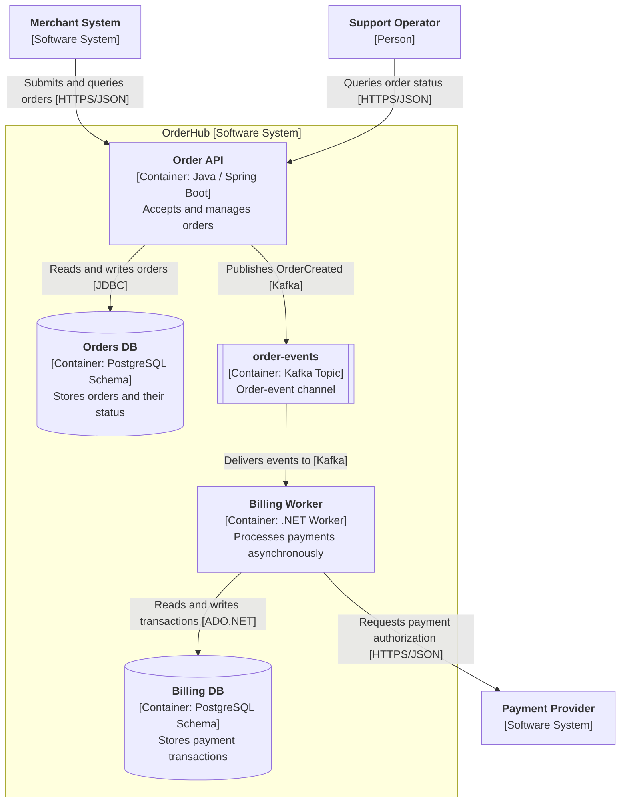

### 2.7. References

* **[S1]** Simon Brown, [Container Diagram](https://c4model.com/diagrams/container) and [Container abstraction](https://c4model.com/abstractions/container).
* **[S2]** Simon Brown, [Microservices](https://c4model.com/abstractions/microservices) and [Queues and Topics](https://c4model.com/abstractions/queues-and-topics).
* **[S3]** Simon Brown, [Diagram Review Checklist](https://c4model.com/diagrams/checklist).
* **[R1]** Visual Paradigm, [Comprehensive Guide to C4 Container Diagrams](https://www.visual-paradigm.com/guide/mastering-software-architecture-visualization-a-comprehensive-guide-to-c4-container-diagrams/).

---

## 3. C4 — Component Diagram (C3)

### 3.1. Overview and Purpose

* **Definition:** The Component diagram opens **one Container** selected at C2. It shows cohesive functional components behind well-defined interfaces, their responsibilities, and collaboration with each other and supporting Containers/systems.
* **Relationship to 4+1:** A **Logical / Development View** of the internal modules of one deployable application boundary.
* **Why use it?**
  * Explain internal responsibilities such as inbound interfaces, business coordination, persistence adapters, and message publishing without the detail of every class or line of code.
  * Use it when a Container's internal complexity justifies the view. It is optional and may add little value for a simple service or data store.
* **Scope and non-goals:**
  * Do not open every microservice's internals in the same C3 diagram.
  * A C4 Component is not an independently deployable application; that boundary belongs to the Container.
  * Do not equate C4 Components with UML Component ports or ball-and-socket notation.

### 3.2. Core Elements and Notation

| Element / relationship | Model semantics | Presentation | Do not infer |
| :--- | :--- | :--- | :--- |
| **Container Boundary** | The boundary of exactly one Container opened from C2. | Frame with the **Container name** and `[Container]`. A dashed border is a MAVIS presentation choice. | Other Containers and data stores do not belong inside this Container's component boundary. |
| **Component** | Cohesive functionality in the same Container, commonly implemented by one or more classes/interfaces. | Box with **name**, `[Component: Technology / Implementation type]`, and responsibility. | Not every class or `@Component` / `@Service` annotation automatically defines a separate architectural Component. |
| **Supporting Container / External System** | Other Containers, People, or external systems directly connected to the Components being examined. | Outside the selected Container Boundary; preserve their Container/system abstraction rather than opening their internals. | Other Containers without relevant direct connections can be omitted from this scoped view. |
| **In-process / Out-of-process Relationship** | Internal collaboration between Components, or communication from a Component to a supporting Container/system. | A directed arrow with an action. Add network/database protocol information only to out-of-process relationships. | A normal in-process Controller-to-Service call is not automatically HTTP. |

### 3.3. Construction Procedure

1. **Select one Container by ID.** Open its boundary, such as `Order API`, from C2.
2. **Group code into meaningful Components.** Group interfaces, implementations, and supporting helpers by architectural responsibility. For example, Controller plus mapper can form `Order HTTP Interface`; repository interface plus persistence adapter can form `Order Repository`.
3. **Place supporting elements outside.** Include People, Containers, and external systems directly connected to the internal Components.
4. **Draw internal and external relationships.** Distinguish in-process collaboration from database, topic, and external API communication.
5. **Reconcile with C2.** A newly discovered external relationship at C3 must have an evidence-backed model update and corresponding C2 interpretation.

### 3.4. Rules and Verification

* **Rules:**
  * **[N-C3-01]** Open exactly one Container; supporting Containers remain outside its boundary.
  * **[N-C3-02]** Do not create a separate box for every DTO, entity, or helper; also avoid one undifferentiated `Business Logic` box that hides the decomposition.
  * **[N-C3-03]** Do not draw a UML Port and label it with TCP port `8080` as if the concepts were equivalent. A UML Port is a classifier interaction point, not a network port.
  * **[M-C3-04] — MAVIS convention:** Retain the source code elements/files supporting each Component as `evidenceRefs`, so users can drill down to code.
* **Common mistakes:**

| Mistake | Correct interpretation or correction |
| :--- | :--- |
| Show `OrderService` and `OrderServiceImpl` as two separate architectural boxes solely because they are distinct code types. | That is class-level detail. At C3, group the interface and implementation when they implement one responsibility. |
| Label an ordinary in-process Controller-to-Service relationship `[HTTP/JSON]`. | Internal collaboration is normally an in-process call. Apply IPC/network protocol labels only where the modeled relationship actually crosses that boundary. |
| Include Billing Worker and Payment Provider in Order API's C3 view even though Order API only publishes to `order-events`. | Keep the directly connected Orders DB and topic. Omit indirectly connected Billing Worker and Payment Provider from this C3 scope. |

* **Acceptance checklist:**
  - [ ] Exactly one Container is opened and clearly bounded.
  - [ ] Each Component has an architectural responsibility, rather than simply mirroring every class/DTO.
  - [ ] In-process and out-of-process relationships are distinguished.
  - [ ] Identities and relationships remain consistent with C1 and C2.

### 3.5. MAVIS Inputs and Extraction Boundaries

* **Input mapping:**
  * *Static AST / packages / stereotypes and annotations:* `@RestController`, `@Service`, `@Repository`, and constructor injection identify candidate Components and structural code dependencies.
  * *Limitation:* Dependency injection establishes a static structural dependency; it does not prove that a call occurred in a particular runtime execution.
* **Cross-level consistency for the OrderHub example:**

| Element / relationship | C1 — System Context | C2 — Container | C3 — Open Order API |
| :--- | :--- | :--- | :--- |
| `OrderHub` | One Software System box | System Boundary | System context; the opened scope is Order API |
| `Order API` | Hidden inside OrderHub | Application Container | Container Boundary enclosing its Components |
| `Orders DB` and `order-events` | Hidden internal detail | Data-store/topic Containers | Supporting Containers outside Order API's boundary |
| `Billing Worker` | Hidden internal detail | Application Container | Omitted: no direct relationship to Order API's Components in this example |
| `Payment Provider` | External Software System | Outside the system boundary, connected to Billing Worker | Omitted: not directly connected to Order API |

### 3.6. Worked Example — Inside Order API

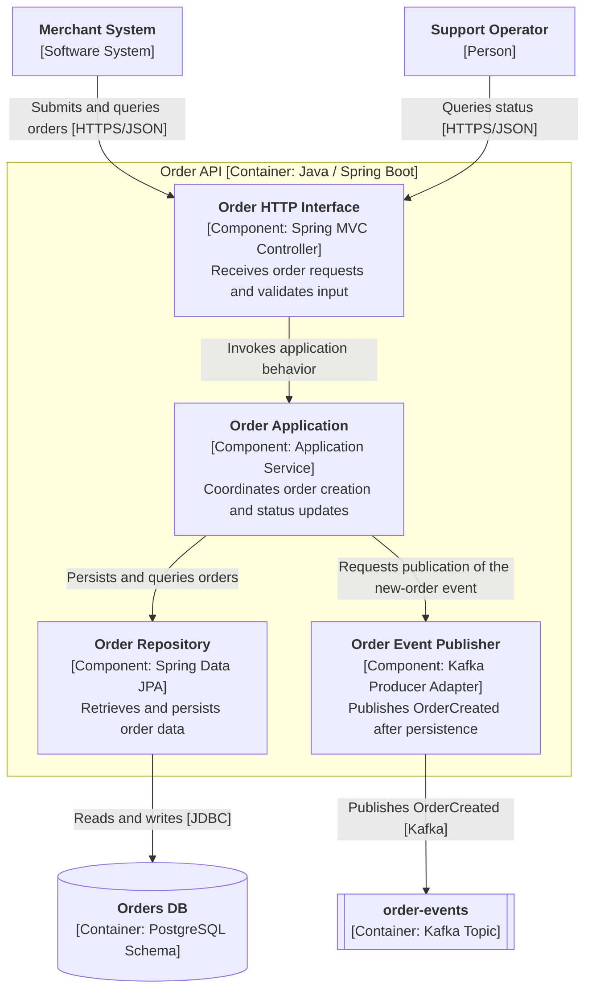

### 3.7. References

* **[S1]** Simon Brown, [Component Diagram](https://c4model.com/diagrams/component) and [Component abstraction](https://c4model.com/abstractions/component).
* **[S2]** OMG, [UML 2.5.1](https://www.omg.org/spec/UML/2.5.1/) — to distinguish C4 Components from UML Components and Ports.
* **[R1]** Visual Paradigm, [C4 Container versus Component Diagrams](https://www.visual-paradigm.com/guide/comprehensive-guide-c4-container-vs-component-diagrams/).

---

# PART 2. UML 2.5.1 STRUCTURAL AND BEHAVIORAL DIAGRAMS — DIAGRAMS 4 TO 9

---

## 4. UML — Class Diagram

### 4.1. Overview and Purpose

* **Definition:** A Class Diagram is a static structural view of Classifiers, such as Classes, Interfaces, and Enumerations, their attributes and operations, and their structural relationships. Relevant UML 2.5.1 areas include Classifiers, Classes, Properties, and Associations.
* **Relationship to 4+1:** Primarily the **Logical View**: domain modeling, entities, and object-oriented design. The empirical studies cited in the source edition, including Dobing and Parsons (2006) and Petre (2013), discuss the widespread industrial use of class diagrams. Usage percentages are background information, not conformance criteria.
* **Why use it?**
  * Define domain structures, service/repository interfaces, and relationship multiplicities before or during implementation.
  * Explain how code-level classes and interfaces realize a C3 Component.
* **Scope and non-goals:**
  * Do not use it to express temporal call order; use a Sequence Diagram.
  * Do not treat it as identical to the physical database ERD.
  * Scope it to a module or use case rather than displaying hundreds of unrelated repository classes.

### 4.2. Core Elements and Notation

| Element / relationship | Model semantics | UML notation | Do not infer |
| :--- | :--- | :--- | :--- |
| **Class** | A Classifier describing objects with shared features and relationships. | A rectangle commonly showing name, attributes, and operations. Italicize an abstract class name; compartments may be hidden when unnecessary. | Trivial getters/setters need not all be listed. An underlined `order1:Order` identifies an instance rather than a class declaration. |
| **Interface / Enumeration** | A behavioral contract or a finite set of named values. | A box with `«interface»` or `«enumeration»` above the name. | Class inheritance and interface realization are distinct relationships. |
| **Attribute / Operation** | Attribute: `visibility name: Type [multiplicity] = default {properties}`. Operation: `visibility name(parameter: Type): ReturnType`. | `+` public, `-` private, `#` protected, `~` package. Underline static features; prefix a derived property with `/`, such as `/total`. | Map visibility by language semantics: C# `internal` is not Java package-private merely because a renderer uses a similar symbol. |
| **Association** | A structural relationship between instances of Classifiers. | Solid line, optionally with role names and multiplicities at each end. An open arrowhead can express navigability. | Navigability is access to a referenced object, not runtime call direction. The absence of an arrowhead does not by itself establish bidirectional navigation. |
| **Dependency** | A client depends on a supplier; supplier changes can affect the client. | Dashed line with an open arrowhead from **client to supplier**. Parameter types and local-variable types can provide dependency evidence. | A dependency is not necessarily a state-retaining association. |
| **Generalization / Realization** | Inheritance between more-specific and more-general Classifiers, or realization of a contract. | Hollow triangle toward the superclass/general Classifier on a solid line, or toward the realized interface on a dashed line. | Do not attach association multiplicities to Generalization or Realization. |
| **Shared Aggregation / Composition** | Whole–part relationships: shared aggregation uses a hollow diamond; composition adds exclusive composite ownership and lifecycle constraints. | The diamond is always at the **whole** end. Deleting a composite deletes parts still owned by it. | Foreign keys and garbage collection alone do not prove composition. Use an ordinary association when whole–part semantics are not established. |

### 4.3. Construction Procedure

1. **Choose a focused scope.** Select a module, package, or design scenario, typically a manageable set of directly related Classifiers rather than an entire repository.
2. **Add the principal Classifiers.** Include relevant domain classes, services, repository interfaces, implementations, and enums.
3. **Add significant features.** Use correct UML attribute/operation syntax and evidence-backed derived, read-only, static, and abstract markings.
4. **Establish structural relationships, then dependencies.** Draw Generalization/Realization, whole–part/association relationships with end roles and multiplicities, then dependencies.
5. **Avoid double-counting the same property.** A `lines: OrderLine[1..*]` attribute and an association end named `lines` can describe the same property, not two independent relationships.

### 4.4. Rules and Verification

* **Rules:**
  * **[N-CLS-01]** Aggregation/composition diamonds belong at the Whole end, never the Part end.
  * **[N-CLS-02]** A Generalization/Realization triangle points to the superclass/general Classifier or realized interface.
  * **[N-CLS-03]** A composite Part belongs to at most one composite Whole at a time: the Whole end is at most `0..1` or `1` for this ownership constraint.
  * **[M-CLS-04] — MAVIS convention:** Do not infer a lower-bound multiplicity such as `1..*` merely from `List<T>`. Validate nullability, collection-size validation, and domain/schema constraints. Leave the constraint unconfirmed when evidence is insufficient.
* **Common mistakes:**

| Mistake | Correct interpretation or correction |
| :--- | :--- |
| Put a composition diamond next to OrderLine instead of Order. | Order is the Whole. The diamond belongs at Order, with OrderLine at the Part end. |
| Represent an inter-service HTTP call as inheritance or composition between services. | A REST interaction between separate processes is not evidence of code-level inheritance or whole–part ownership. |
| Use a solid line with a hollow triangle for a class implementing an interface. | Interface Realization uses a dashed line and hollow triangle. Generalization uses the solid line. |

* **Acceptance checklist:**
  - [ ] Relationship arrowheads, triangles, and diamonds are attached to the correct ends.
  - [ ] Association-end multiplicities reflect established domain constraints.
  - [ ] HTTP communication has not been converted into class inheritance or ownership.

### 4.5. MAVIS Inputs and Extraction Boundaries

* **Input mapping:**
  * *Java AST / C# Roslyn:* Class, interface, and enum declarations; inheritance/implementation relationships; field types; method signatures; and visibility modifiers.
  * *JPA / EF Core mapping and validation:* `@OneToMany`, `@ManyToOne`, cascade configuration, and nullability can provide supporting evidence for associations and multiplicity/lifecycle constraints. Review their actual meaning rather than treating one annotation as a universal composition proof.
* **Insufficient evidence:** A generic adapter without language-specific AST support must not invent a Class Diagram from filenames.

### 4.6. Worked Example — OrderHub Order Module

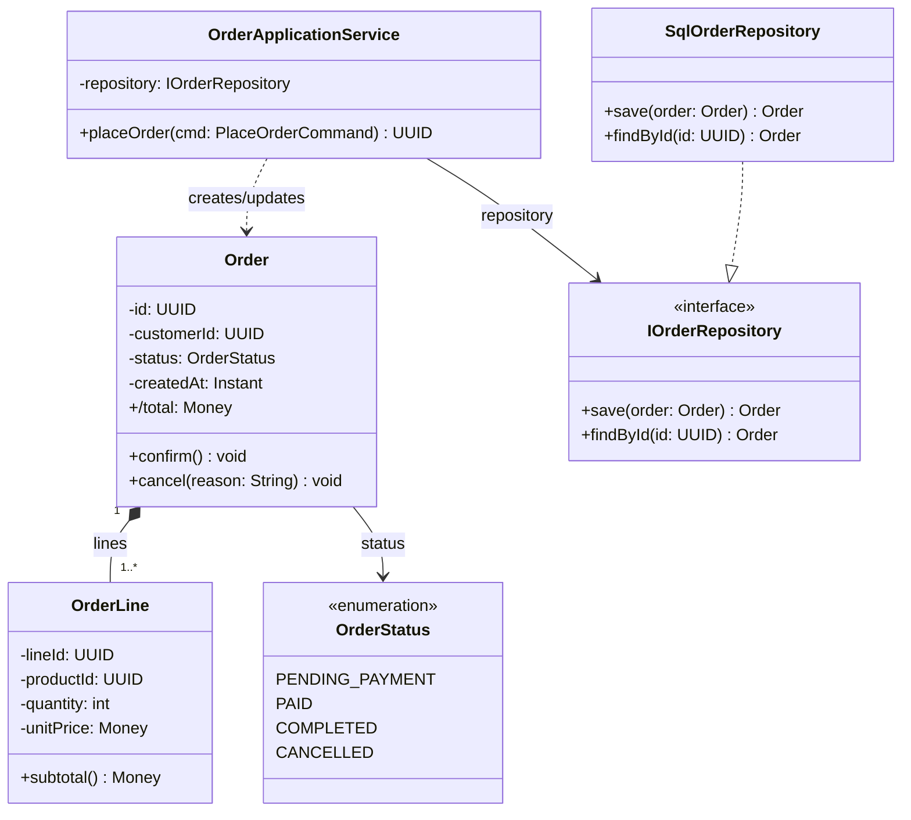

### 4.7. References

* **[S1]** OMG, [UML 2.5.1](https://www.omg.org/spec/UML/2.5.1/) — Multiplicity, Classifiers, Properties, Classes, and Associations.
* **[A1]** Hassan Gomaa, *Software Modeling and Design (COMET)* — SWD392 Static Modeling course materials, Chapter 7, slides 7–16.
* **[A2]** Martin Fowler, [UML Distilled, third edition](https://martinfowler.com/books/uml.html).
* **[T1]** Visual Paradigm, [Class Diagram Guide](https://www.visual-paradigm.com/guide/uml-unified-modeling-language/what-is-class-diagram/). The example uses Mermaid class-diagram syntax as its rendering format.

---

## 5. UML — Sequence Diagram

### 5.1. Overview and Purpose

* **Definition:** A Sequence Diagram describes message exchanges between Lifelines, arranged along the vertical event-order axis within the scope of a particular interaction/scenario. See UML 2.5.1, Chapter 17, Interactions.
* **Relationship to 4+1:** Connects **Scenarios (+1)** to the dynamic aspects of the **Logical / Process View**, showing how structural elements collaborate.
* **Why use it?**
  * Explain synchronous calls, asynchronous messages, replies, conditions, loops, and concurrent interaction fragments.
  * Visualize runtime trace evidence collected for a particular MAVIS scenario when valid lineage is available.
* **Scope and non-goals:**
  * A particular scenario/trace does not prove that every branch or lifecycle state has been covered.
  * A frontend/UI Lifeline is not required when the selected scope starts at a gateway or backend interface.

### 5.2. Core Elements and Notation

| Element / relationship | Model semantics | UML notation | Do not infer |
| :--- | :--- | :--- | :--- |
| **Lifeline** | An individual participant in the interaction. | A head labeled `role:Type` or `:Type` with a vertical dashed line. UML 2 Lifeline heads need not use the underlining convention of older instance notation. | Relative vertical positions on otherwise independent Lifelines do not establish a global temporal order by themselves. |
| **Execution Specification / Activation** | Execution of a behavior, including an interval during which a nested synchronous call may be awaited. | A narrow rectangle along the Lifeline, possibly nested for self-calls. | Its drawn height is not a measurement of CPU time or milliseconds of latency. |
| **Synchronous Call / Reply** | The caller invokes a behavior and waits for its completion according to the modeled contract. | Call: solid line, filled arrowhead. Reply: dashed line, open arrowhead toward the caller. | Omitting a reply from a diagram does not mean the operation hangs forever; returns may be implicit. |
| **Asynchronous Message** | A call/signal whose sender does not wait for receiver completion under synchronous-call semantics. | Solid line with an open arrowhead. | Do not infer `synchCall`, `asynchCall`, or `asynchSignal` solely from `async/await`, HTTP, or a library name. `await` can suspend a method without blocking a thread. Callbacks and signals do not require a broker. Retain `UNKNOWN`/a limitation when message-sort evidence is insufficient. |
| **Create / Destroy / Found / Lost** | Object creation, Lifeline destruction, or a message whose source/destination is outside the interaction's known scope. | Create: dashed open-arrow message to the new Lifeline head. Destroy: an X ending the Lifeline. Found/lost: a filled circle at the external end of the message. | Destroying an object is not equivalent to deleting a database row. A lost message does not necessarily mean a network packet was dropped. |
| **Combined Fragments / InteractionUse** | Interaction operators including `alt`, `opt`, `loop`, and `par`; `ref` denotes an InteractionUse referencing another interaction. | A frame with an operator at the upper left, dashed operand separators where applicable, and guards. | `par` allows interleaving, not guaranteed execution in the same CPU cycle. `critical` is not automatically a database transaction. |

### 5.3. Construction Procedure

1. **Select a scenario and abstraction level.** Choose service-to-service or internal Component/Class interactions, avoiding unexplained mixtures.
2. **Arrange Lifelines left to right.** A useful convention places the initiator on the left and supporting services/data stores to the right.
3. **Preserve causal event ordering.** Sending precedes receipt. Apply the correct call/message sort and arrowhead rather than guessing from layout.
4. **Use interaction fragments for conditions and repetition.** Represent branching and loops with the appropriate operator and guard, not an upward arrow pretending to be a loop.
5. **State limitations.** Identify assumptions or omitted retry, dead-letter handling, error paths, and compensation.

### 5.4. Rules and Verification

* **Rules:**
  * **[N-SEQ-01]** Layout must preserve Interaction ordering constraints: send before receive, and required ordering on Lifelines and within fragments. Relative positions on independent Lifelines do not impose a total order. MAVIS uses a dedicated Sequence layout; no layout algorithm may break these constraints.
  * **[N-SEQ-02]** Distinguish filled synchronous-call arrowheads from open asynchronous-message arrowheads. Replies use dashed lines and correspond to the appropriate call/Lifelines.
  * **[N-SEQ-03]** `alt` chooses an operand with a true guard; multiple true guards can introduce nondeterminism. MAVIS recommends mutually exclusive guards when a deterministic scenario is intended. `opt` contains one optional operand, not an additional `else` operand.
  * **[M-SEQ-04] — MAVIS convention:** Distinguish **Designed Sequence**, **Static-derived draft**, and **Observed Runtime Sequence**. Follow actual mode/provenance contracts, retain limitations and runtime lineage, and never present a designed scenario as an observed execution.
* **Common mistakes:**

| Mistake | Correct interpretation or correction |
| :--- | :--- |
| Draw a publish operation and conclude that its return proves consumer completion. | Distinguish producer-to-broker acknowledgment from asynchronous signal delivery and consumer processing. Select message sorts from the modeled contract. Broker acknowledgment is not proof that the consumer has finished. |
| Use a diagonal arrow going backward up the diagram to express retry. | Enclose the repeated interaction in a `loop` fragment with the appropriate bounds/guard. |
| Treat one successful runtime trace as proof that no error branches exist. | A trace demonstrates the observed scenario, not all possible executions. Do not erase unobserved static branches. |

* **Acceptance checklist:**
  - [ ] Lifelines have a coherent, stated abstraction level.
  - [ ] Calls, asynchronous messages, and replies use the intended notation.
  - [ ] Ordering follows causal relationships/call structure rather than timestamps alone across skewed clocks.
  - [ ] Conditions and repetition use the appropriate fragments and guards.

### 5.5. MAVIS Inputs and Extraction Boundaries

* **Input mapping:**
  * *Runtime traces:* Trace/span identifiers, parent relationships, service names, protocol attributes, and duration provide evidence for an Observed Sequence tied to a specific execution. Explicitly report missing spans or causal gaps.
  * *Static call graph plus scenario definition:* Can support a static-derived/design draft for a selected entrypoint. It does not establish that those interactions occurred at runtime.

### 5.6. Worked Example — Designed Order-Creation Scenario

Message sorts in this example are **explicit design assumptions**, not automatic conclusions from HTTP, JDBC, or Kafka. Invalid input is checked before saving. The success branch illustrates one permitted schedule: HTTP 201 is returned before worker delivery. Actual event delivery may occur earlier without waiting for the HTTP response.

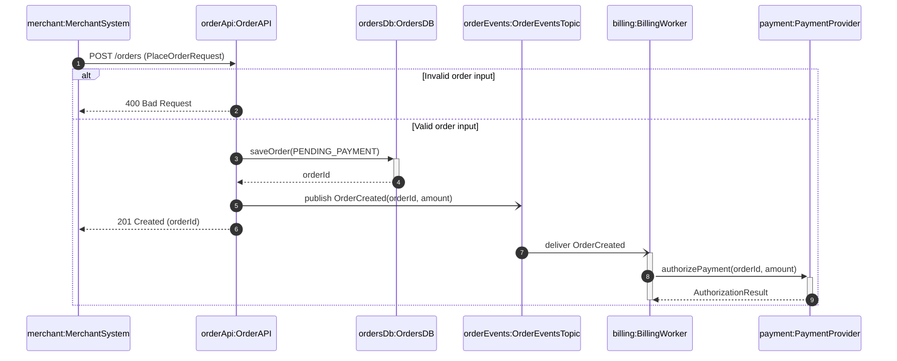

HTTP 201 confirms the order-creation request according to the API contract; it does not assert completed payment. Retry, database-write failures, publish failures, and compensation are outside this example.

### 5.7. References

* **[S1]** OMG, [UML 2.5.1](https://www.omg.org/spec/UML/2.5.1/) — Chapter 17, Interactions: Lifelines, Messages, and CombinedFragments.
* **[S2]** OpenTelemetry, [Traces, Spans, and Context Propagation](https://opentelemetry.io/docs/concepts/signals/traces/).
* **[S3]** Microsoft Learn, [The await operator](https://learn.microsoft.com/en-us/dotnet/csharp/language-reference/operators/await). This distinguishes asynchronous waiting from thread blocking; it is not a substitute for UML message semantics.
* **[A1]** Hassan Gomaa, *Software Modeling and Design* — SWD392 Dynamic Modeling materials, Chapters 9–11, slides 6–8 and 24–25.
* **[T1]** Visual Paradigm, [Sequence Diagram Guide](https://www.visual-paradigm.com/guide/uml-unified-modeling-language/what-is-sequence-diagram/). PlantUML is another notation/rendering reference used by the project.

---

## 6. UML — Package Diagram

### 6.1. Overview and Purpose

* **Definition:** A Package Diagram groups PackageableElements, such as Classes, Interfaces, Components, and nested Packages, into Namespaces and shows relationships between those Packages. See UML 2.5.1, Chapter 12.
* **Relationship to 4+1:** Primarily the **Development / Implementation View**: source organization, architectural layers, and permitted module dependencies.
* **Why use it?**
  * Check a declared layering policy. In the Clean/Hexagonal example, `api` and `infrastructure` depend inward on `application`/`domain`; `domain` must not depend outward on `infrastructure`.
  * Identify cyclic package/namespace dependencies.
* **Scope and non-goals:**
  * A UML Package is a model namespace, not automatically an independently deployed process.
  * A Package Diagram does not show temporal call order.

### 6.2. Core Elements and Notation

| Element / relationship | Model semantics | UML notation | Do not infer |
| :--- | :--- | :--- | :--- |
| **Package** | A Namespace owning model elements, such as `shop::orders::domain`. | A tabbed folder rectangle, with the name in the tab when contents are shown or in the body when they are not. | Nesting B inside A means containment/ownership, not an A-to-B dependency. |
| **Dependency** | One or more elements in the source Package depend on elements in the target Package. | Dashed line with an open arrowhead from client Package to supplier Package. | Static dependency direction need not match runtime call direction, particularly with dependency inversion. |
| **PackageImport (`«import»`)** | Imports public member names from another Package with public visibility into the importing Namespace. | Dashed open-arrow relationship labeled `«import»`. | A Java `import` or C# `using` statement does not automatically establish UML public import/re-export semantics. |
| **Private Import (`«access»`)** | Makes imported names privately available to the importing Namespace without re-exporting them. An ElementImport targets one element; a PackageImport imports eligible Package member names. | A dashed open-arrow import relationship labeled `«access»` for private visibility. | Access here concerns name visibility in a Namespace, not authentication, authorization, or database access. |
| **PackageMerge (`«merge»`)** | Combines definitions from a merged Package into a receiving Package according to UML metamodel rules. | Dashed open-arrow relationship from receiving Package to merged Package, labeled `«merge»`. | This is not Git merge or ordinary directory consolidation. PackageMerge relationships must not form a cycle. |

### 6.3. Construction Procedure

1. **Choose a Namespace mapping level.** Examples include `com.orderhub.order.api`, `.application`, `.domain`, and `.infrastructure`.
2. **Show containment.** Nest child Packages or list important public members such as `+ Order` and `+ IOrderRepository`.
3. **Aggregate dependencies from members.** If an infrastructure class realizes an application interface, the static dependency points from infrastructure to application.
4. **Use import/access/merge only with their UML meanings.** Ordinary source-code dependencies generally use plain Dependency, with traceable evidence.
5. **Check the declared architecture policy.** Verify layering direction and detect cycles.

### 6.4. Rules and Verification

* **Rules:**
  * **[N-PKG-01]** Do not use Class-association multiplicities, composition diamonds, or class-inheritance triangles for ordinary dependencies between Packages.
  * **[N-PKG-02]** Distinguish Namespace containment from a Dependency arrow.
  * **[N-PKG-03]** PackageMerge must be acyclic. Forbidding cycles in ordinary dependencies is an architectural policy, such as MAVIS `REL-01`, not a universal UML syntax restriction.
  * **[M-PKG-04] — MAVIS convention:** Trace each aggregated Package dependency to the underlying Type-to-Type relationships or actual type-using imports, retaining `underlyingEdgeIds` where applicable.
* **Common mistakes:**

| Mistake | Correct interpretation or correction |
| :--- | :--- |
| Draw application → infrastructure solely because application code invokes a SQL implementation at runtime. | With dependency inversion, `IOrderRepository` belongs to application/domain and the infrastructure implementation realizes it. The implementation's static dependency points inward. |
| Label every Java package dependency `«import»` because the source contains an import statement. | Use plain Dependency unless the intended UML Namespace import/access semantics have been established. |

* **Acceptance checklist:**
  - [ ] Package names and hierarchy are clear; containment is not confused with dependency.
  - [ ] Directions reflect static source dependencies, especially across interface/implementation boundaries.
  - [ ] Ordinary Package dependencies do not carry association multiplicities or composition diamonds.

### 6.5. MAVIS Inputs and Extraction Boundaries

* **Input mapping:**
  * *Static AST:* Java package declarations, C# namespaces, and actual type references support grouping and dependency aggregation. Use canonical relation types rather than assuming a descriptive `DEPENDS_ON` label is an API enum.
  * *Evaluation policy:* The declared layer-violation/cycle rules, including the relevant `REL-01` policy, identify prohibited dependencies such as domain → api/infrastructure in the chosen architecture.

### 6.6. Worked Example — Order API Packages

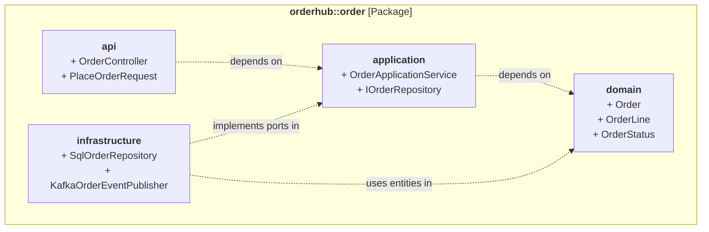

### 6.7. References

* **[S1]** OMG, [UML 2.5.1](https://www.omg.org/spec/UML/2.5.1/) — ElementImport, PackageImport, and Chapter 12 Packages/PackageMerge.
* **[T1]** Visual Paradigm, [Package Diagram and Namespace Guide](https://www.visual-paradigm.com/guide/uml-unified-modeling-language/what-is-package-diagram/).

---

## 7. UML — Deployment Diagram

> [!NOTE]
> The earlier Google Docs Deployment section ended partway through its backend example. This consolidated guide supplies the complete construction procedure, verification rules, MAVIS input mapping, and an OrderHub example, using UML 2.5.1 Chapter 19 as its reference.

### 7.1. Overview and Purpose

* **Definition:** A Deployment Diagram describes how deployable software **Artifacts** are allocated to computational **Nodes**, including Devices and ExecutionEnvironments, and the CommunicationPaths connecting deployment targets.
* **Relationship to 4+1:** Directly expresses Kruchten's **Physical / Deployment View**.
* **Why use it?**
  * Communicate between development and operations: which executable/image/configuration artifact is allocated to which environment, its declared connectivity, and any evidenced replicas.
  * Provide deployment information deliberately omitted from a logical C4 Container view.
* **Scope and non-goals:**
  * Do not substitute deployment topology for temporal processing flow or a list of domain classes.
  * A Node box alone does not establish a count of live physical machines. State type/descriptor versus instance scope and any declared multiplicity/replicas.

### 7.2. Core Elements and Notation

| Element / relationship | Model semantics | UML notation | Do not infer |
| :--- | :--- | :--- | :--- |
| **Node / Device / ExecutionEnvironment** | Computational resources hosting deployed software. Devices represent physical resources; ExecutionEnvironments represent software execution facilities such as an OS, JVM, CLR, container runtime, or DBMS. | A three-dimensional box, with `«device»` or `«executionEnvironment»` as appropriate. Underline an instance label such as `app01 : AppServer`. Nodes may be nested. | Do not classify every VM or Docker container as a physical Device. |
| **Artifact (`«artifact»`)** | A concrete information unit produced or used by development/deployment, such as a JAR, DLL, OCI image, SQL file, or configuration file. | A rectangle labeled `«artifact»`, optionally with the folded-corner document icon. | An Artifact is not the same thing as a logical Component. One file does not necessarily manifest one Component. |
| **DeploymentSpecification** | Parameters controlling how an Artifact is deployed/executed. | A `«deployment spec»` element associated with the Artifact or Deployment. | Not every arbitrary properties/JSON file is automatically a UML DeploymentSpecification. |
| **Deployment** | Allocation of an Artifact to a DeploymentTarget. | Show the Artifact inside its Node, or use the alternative dashed open-arrow `«deploy»` notation from Artifact to deployment target. | Node-in-Node nesting describes hosting; Artifact-in-Node presentation describes deployment. |
| **Manifestation (`«manifest»`)** | An Artifact embodies one or more logical model elements, such as Components or Packages. | Dashed open-arrow relationship from Artifact to the manifested PackageableElement, labeled `«manifest»`. | It is not a runtime call, and its direction must not be reversed. |
| **CommunicationPath** | An association between deployment targets through which signals/messages may be exchanged. | A solid connection between Nodes, with meaningful protocol/port information and multiplicity where established. | A topology path is not merely a request arrow copied from a Sequence Diagram. |

### 7.3. Construction Procedure

1. **Name the environment and modeling level.** For example, `Declared Compose Topology`, `Staging`, or `Production`; state descriptor/type versus instance scope.
2. **Identify Nodes and hosting.** Distinguish physical devices, hosts/VMs, and software execution environments rather than assuming one hardware category for all of them.
3. **Allocate evidenced Artifacts.** Place known files/images on their deployment targets. Include replica counts only where supported.
4. **Add Manifestations if needed.** Explain which physical Artifact embodies which logical Component/module; make any mapping from C4 elements explicit.
5. **Add CommunicationPaths.** Use evidenced protocols, ports, and connection multiplicities.

### 7.4. Rules and Verification

* **Rules:**
  * **[N-DEP-01]** Distinguish the execution resource (Node), deployed information unit (Artifact), and logical architectural element (Component/Container).
  * **[N-DEP-02]** `«manifest»` points from Artifact to the manifested logical element. In the alternative graphical `«deploy»` notation used here, the arrow points from Artifact to Node/deployment target.
  * **[M-DEP-03] — MAVIS convention:** A diagram derived from Compose/Kubernetes declarations is **DECLARED DEPLOYMENT** at the selected snapshot, not automatically a healthy **LIVE TOPOLOGY**.
* **Common mistakes:**

| Mistake | Correct interpretation or correction |
| :--- | :--- |
| Replace C4 Container boxes with cubes and call the result a UML Deployment Diagram. | Identify actual modeled execution resources and Artifacts, not only logical application units. |
| Draw Component → Artifact with a `«manifest»` label. | Reverse the direction: Artifact → manifested Component/logical element. |
| Infer several physical hosts merely because Compose defines several services. | Compose services do not prove multi-host placement. Show only the declared environment scope established by the configuration. |

* **Acceptance checklist:**
  - [ ] The title states the environment and whether evidence is Declared or Observed.
  - [ ] Nodes and Artifacts are distinguished, including Device versus ExecutionEnvironment.
  - [ ] CommunicationPaths have configuration-backed protocol/port information.
  - [ ] Manifestation arrows, if present, point from Artifact to the logical element.

### 7.5. MAVIS Inputs and Extraction Boundaries

* **Input mapping:**
  * *Declared deployment:* Compose, Dockerfiles, and Kubernetes manifests establish declared services, image/build references, runtime environments, and connectivity candidates.
  * *Build metadata:* `pom.xml`, `build.gradle`, and `.csproj` can establish output names such as `order-api.jar` or `Billing.Worker.dll` and support the mapping to a code module.
  * An image/build declaration or an exposed port is not permission to invent an executable filename or a communication path without the additional evidence required by the producer's contract.
* **Insufficient evidence:** Do not guess CPU/RAM, cloud region, physical placement, or replica counts absent from the evidence.

### 7.6. Worked Example — Declared OrderHub Deployment

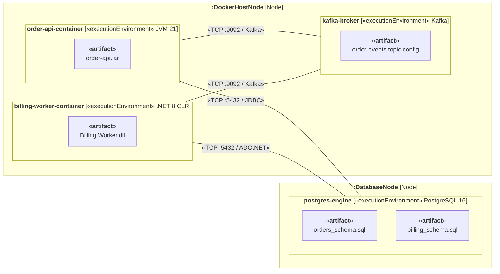

### 7.7. References

* **[S1]** OMG, [UML 2.5.1](https://www.omg.org/spec/UML/2.5.1/) — Chapter 19, Deployments, Artifacts, and Nodes.
* **[A1]** Philippe Kruchten, [Architectural Blueprints — The 4+1 View Model of Software Architecture](https://doi.org/10.1109/52.469759), *IEEE Software* 12(6), 1995.
* **[T1]** Visual Paradigm, [Deployment Diagram Guide](https://www.visual-paradigm.com/guide/uml-unified-modeling-language/what-is-deployment-diagram/), with Sparx Systems deployment-notation references used by the project.

---

## 8. UML — Activity Diagram

### 8.1. Overview and Purpose

* **Definition:** An Activity Diagram describes Control Flow and Object Flow among Actions, including alternatives and concurrency, using UML's token-flow semantics. See UML 2.5.1, Chapter 15, Activities.
* **Relationship to 4+1:** The **Process View** and **Scenarios (+1)**, supporting cross-service workflows or behavior inside an API handler.
* **Why use it?**
  * Distinguish decisions/merges from concurrency forks/joins.
  * Explain responsibility through ActivityPartitions, commonly presented as swimlanes.
* **Scope and non-goals:**
  * It does not replace Sequence when the goal is detailed message protocol or trace causality.
  * It does not replace State Machine when the goal is one entity's lifecycle.

### 8.2. Core Elements and Notation

| Element / relationship | Model semantics | UML notation | Do not infer |
| :--- | :--- | :--- | :--- |
| **Action** | A unit of behavior in an Activity. | A rounded rectangle with an action-oriented name such as `Validate request` or `Reserve stock`. | A static state name such as `Paid` or `Cancelled` is not an action description. |
| **Initial Node** | Introduces control tokens when the Activity begins. | Filled circle, no incoming edges, with outgoing Control Flows. | A single Initial Node is a MAVIS readability convention, not a universal UML limit. |
| **Activity Final / Flow Final** | Activity Final terminates the containing Activity execution. Flow Final consumes the arriving token without terminating other concurrent flows. | Activity Final: filled circle inside an outer circle. Flow Final: circle containing an X. Neither has outgoing flow. | Activity Final ends branches in every lane of the same Activity, but does not itself cancel a separate remote Activity execution. Flow Final is not inherently an error. |
| **Decision / Merge** | Decision selects one outgoing flow with a satisfied guard; Merge combines alternatives without synchronization. | Diamond. The common pattern has one Decision input and multiple guarded outputs, or multiple Merge inputs and one output. | A Decision does not duplicate a token across alternatives. Interpret edge roles, not the diamond shape alone. |
| **Fork / Join** | Fork offers tokens to concurrent outputs. Join synchronizes inputs according to its join specification; the usual default requires tokens from all incoming flows. | Thick horizontal/vertical bar; the usual Fork has one input and multiple outputs, and Join has multiple inputs and one output. | A missing required input can make Join wait indefinitely. Analyze token routes, `joinSpec`, and termination scope rather than declaring deadlock merely because a Decision appears upstream. Merge alternative paths before a shared Join input where appropriate. |
| **Control Flow / Object Flow / Pin** | Control Flow transfers control; Object Flow transfers data/object tokens through ObjectNodes or Pins on Actions. | Both use solid lines and open arrowheads. A Pin is a small square on an Action boundary. | A dashed line is not the default UML notation for Object Flow. |
| **ActivityPartition / Swimlane** | Groups nodes/edges by a shared characteristic or responsibility; partitions do not change token-flow semantics. | Commonly parallel horizontal/vertical boundaries with a partition name at one end. UML also supports hierarchical/multidimensional partitions and alternative membership notation. MAVIS defaults to aligned lanes in one frame. | Equal lane height, one shared frame, and service-based lanes are MAVIS presentation choices, not universal UML limits. A lane crossing does not identify HTTP/gRPC/Kafka or create an independent Activity execution. |

### 8.3. Construction Procedure

1. **Define the Activity execution scope and responsibilities.** Choose one workflow/API use case and state which branches belong to it. MAVIS defaults to aligned service lanes. A worker with an independent lifetime should use a separate Activity with explicit event sending/acceptance.
2. **Place Initial Nodes and Actions.** Name Actions with a verb and object, and assign the correct responsibility.
3. **Connect Control/Object Flows.** Cross a partition boundary only where behavior transfers responsibility; do not infer a protocol merely from that crossing.
4. **Model alternatives with Decision/Merge.** State guards and at most one `[else]`. Merge alternative paths before their common continuation where needed.
5. **Model concurrency with Fork/Join.** Use concurrent branches only when the behavior establishes them, and check token availability at each Join.
6. **Choose termination scope deliberately.** Flow Final ends its incoming flow; Activity Final ends the containing Activity execution.

### 8.4. Rules and Verification

* **Rules:**
  * **[N-ACT-01]** Do not use Fork for ordinary `if/else` alternatives or an AND Join to merge mutually exclusive Decision branches; use Merge for alternatives.
  * **[N-ACT-02]** Avoid unintentionally overlapping Decision guards and use at most one `[else]` edge.
  * **[N-ACT-03]** Alternative paths from a Decision that must contribute to one synchronized branch should be merged before that branch enters the Join.
  * **[M-ACT-04] — MAVIS presentation convention:** Prefer aligned, equal-height lanes within one frame when showing one Activity. Do not reject another valid UML presentation solely because its layout differs. Mark unknown responsibility explicitly, and do not merge independent executions merely to populate a chosen number of lanes.
* **Common mistakes:**

| Mistake | Correct interpretation or correction |
| :--- | :--- |
| Treat every Mermaid subgraph as a complete UML ActivityPartition, or call any different layout invalid UML. | Identify Mermaid flowcharts as explanatory approximations. Use an appropriate UML renderer for exact Activity notation. Aligned lane geometry is a MAVIS convention; independent Activities may have separate frames. |
| Connect `[valid]` and `[invalid]` branches directly to separate inputs of an AND Join. | Only one branch supplies a token, so the Join can wait indefinitely. Use a Merge for the alternatives. |
| Put an Activity Final at the end of an auxiliary logging branch within the same Activity as a still-running main branch. | That Final terminates the whole containing Activity. Use Flow Final when the intention is to end only the auxiliary flow. |
| Add Fork solely because source code contains `async`. | `async/await` is not proof of two independent concurrent branches. Require evidence of concurrent work, such as the applicable `Task.WhenAll` / `CompletableFuture.allOf` behavior or explicit independent asynchronous branches. |

* **Acceptance checklist:**
  - [ ] Activity scope and partition responsibilities are explicit; a lane is not mistaken for an independent execution.
  - [ ] Actions belong to the intended responsibilities and use action-oriented names.
  - [ ] Decision/Merge diamonds are distinguished from Fork/Join bars.
  - [ ] Joins have the required tokens, and termination does not accidentally end other branches.
  - [ ] Decision guards are legible and express the intended alternatives.

### 8.5. MAVIS Inputs and Extraction Boundaries

* **Input mapping:** Explicit workflow/use-case definitions and bounded control-flow analysis can identify actions, branches, and cross-service calls.
* **Limitation:** Statement-level CFGs can be too detailed for a business workflow. Any abstraction into business steps needs an explicit scope and an Assisted / Needs Review status where interpretation remains unresolved.

### 8.6. Worked Examples — Partitions and Independent Asynchronous Activities

> [!NOTE]
> The main illustration uses aligned swimlanes as a **MAVIS convention**, not as a universal UML requirement. Mermaid flowcharts below explain behavior; responsibility can be stated in labels rather than lane geometry. They do not claim full UML Activity notation or guaranteed swimlane layout.

#### Example 1: Order creation and Billing have separate Activity lifetimes

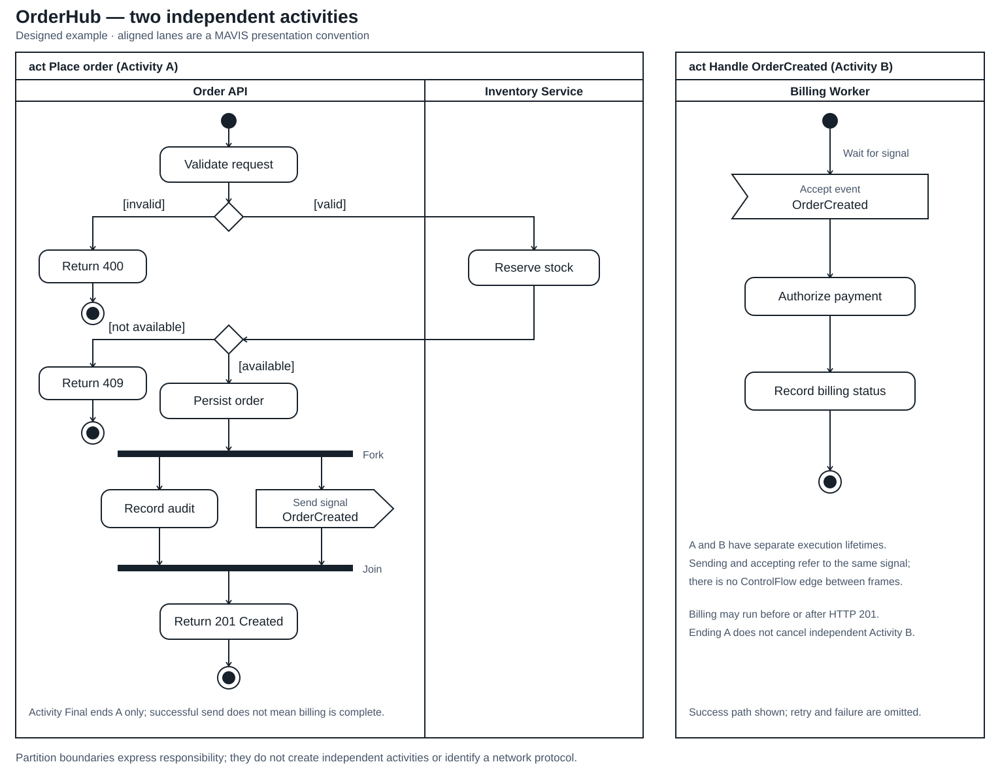

**Scope A — `act Place order`:** Order API and Inventory Service participate in one order-creation workflow. After persistence, the workflow forks into recording audit and sending `OrderCreated`, then joins those local branches. In this designed example, sending completes after handing off the event under the declared messaging contract; it does not wait for payment processing. The Activity Final following HTTP 201 ends Activity A only.

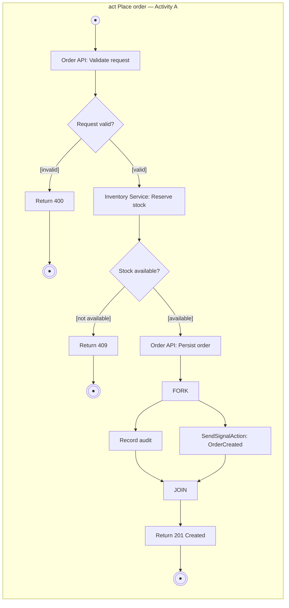

**Scope B — `act Handle OrderCreated`:** Billing Worker has an independent execution. Its AcceptEventAction waits for the corresponding `OrderCreated` signal before payment authorization. There is no ControlFlow edge from Activity A's Fork to the worker. Delivery/retry behavior belongs to the messaging contract, not to the geometry of a lane crossing.

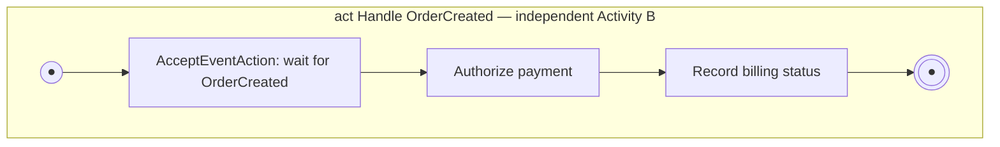

A and B can interleave after the signal is sent. HTTP 201 does not establish Billing completion, and A's Activity Final does not cancel B. The example shows successful payment; delivery failures, retry, deduplication, and compensation require separate design. Do not draw ObjectFlow across these independent Activity frames as a substitute for signal semantics.

#### Example 2: MAVIS Two-Lane Layout Within One Activity

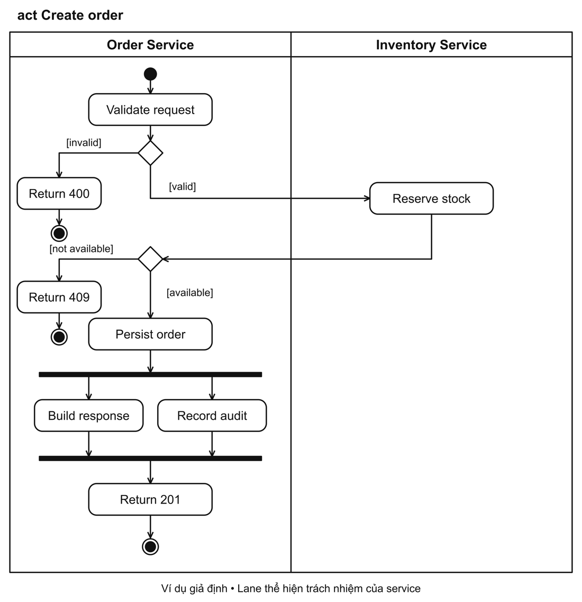

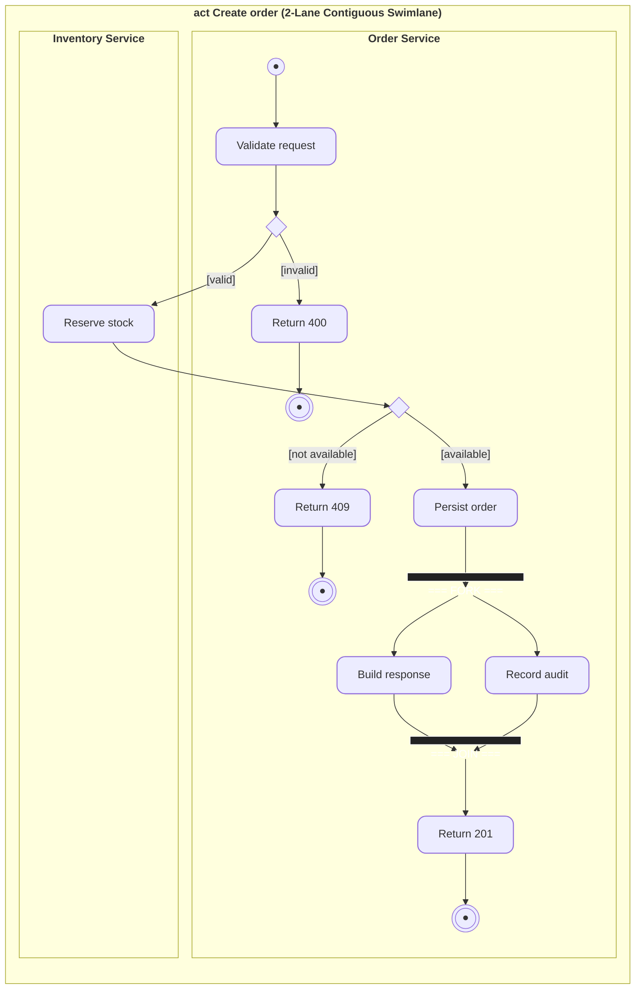

#### Example 3: Core Symbols and Partition Presentation

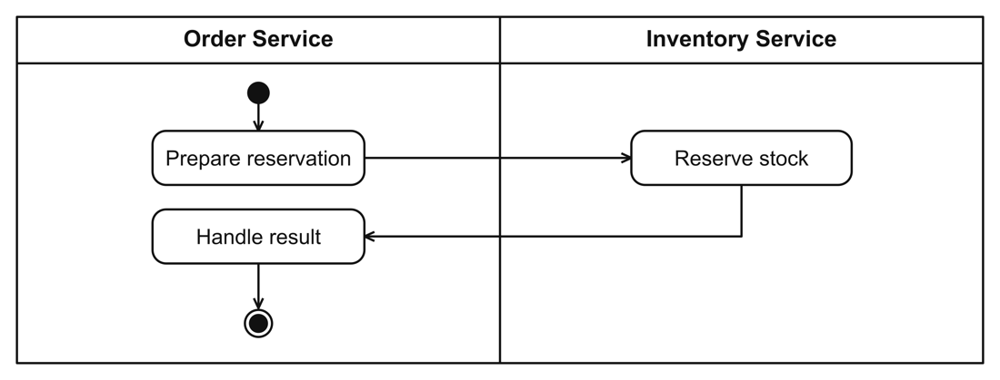

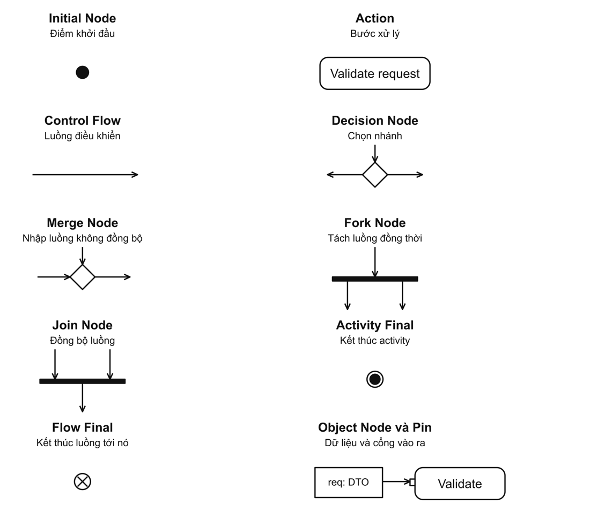

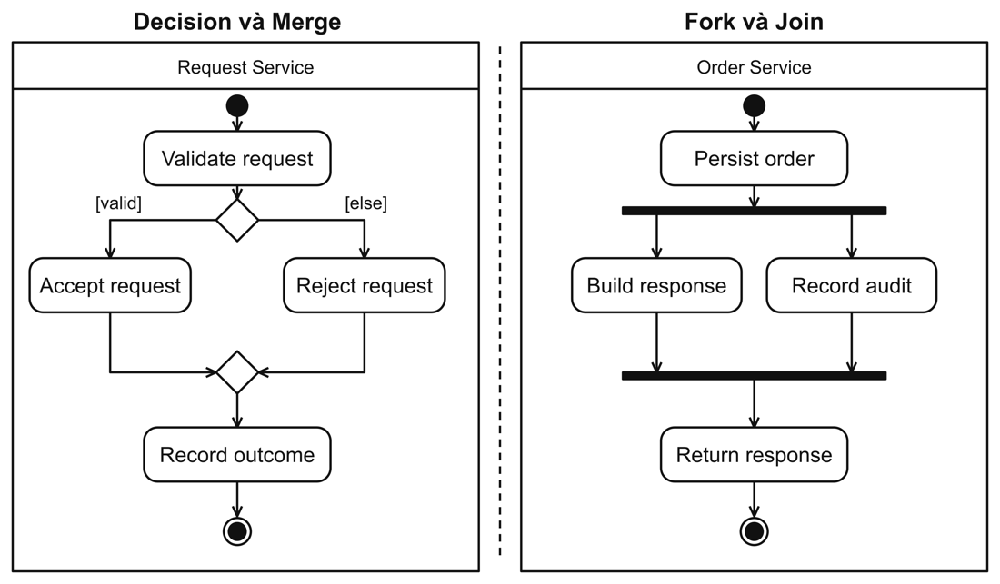

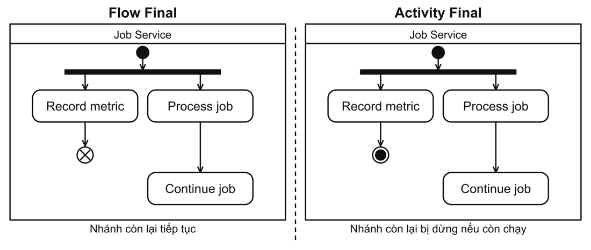

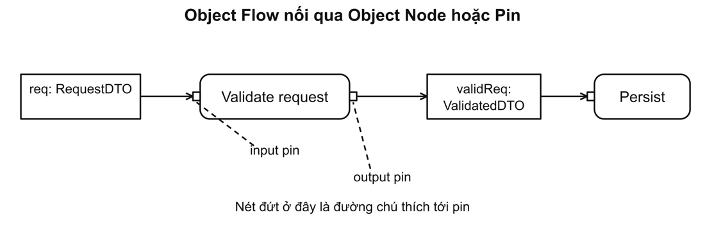

### 8.7. References

* **[S1]** OMG, [UML 2.5.1](https://www.omg.org/spec/UML/2.5.1/) — Activities and Actions, including control nodes, object nodes, Pins, and ActivityPartitions; the source edition references Figures 15.5, 15.27–15.33, and 15.67.
* **[S2]** Sparx Systems, [Activity Partition](https://sparxsystems.com/enterprise_architect_user_guide/17.1/modeling_languages/activitypartition.html), quoting UML 2.5.1 page 408, and [Partition](https://sparxsystems.com/enterprise_architect_user_guide/17.1/modeling_languages/partition.html). Lane alignment is a MAVIS policy; partition membership does not change token semantics.
* **[A1]** SWD392 course materials, *RDS Activity Diagrams with Swimlanes*, pages 23–24, Figures I-12 and I-13.
* **[T1]** Sparx Systems, [Activity Diagram Tutorial](https://sparxsystems.com/resources/tutorials/uml2/activity-diagram.html), together with Visual Paradigm Activity references used by the project.

---

## 9. UML — State Machine Diagram

### 9.1. Overview and Purpose

* **Definition:** A Behavioral State Machine describes the States of a stateful subject, such as Order, Payment, or AnalysisJob, and Transitions in response to events/triggers, guards, and effects. See UML 2.5.1, Chapter 14.
* **Relationship to 4+1:** Dynamic aspects of the **Logical / Process View**, especially lifecycle constraints for stateful entities.
* **Why use it?**
  * Make prohibited transitions explicit: for example, a cancelled Order cannot become Paid under the declared business policy, or a completed AnalysisJob must not be overwritten by an obsolete callback.
  * Explain the guards that must hold before a state-changing event is accepted.
* **Scope and non-goals:**
  * Focus this view on one stated lifecycle subject. A cross-service workflow is an Activity concern; service swimlanes are not a substitute for State Machine regions.

### 9.2. Core Elements and Notation

| Element / relationship | Model semantics | UML notation | Do not infer |
| :--- | :--- | :--- | :--- |
| **Simple / Composite State** | A situation in the subject's lifecycle. A Composite State contains one or more Regions. | Rounded rectangle with a state-oriented name such as PendingPayment, Paid, or Completed. Optional compartments can contain `entry / ...`, `do / ...`, and `exit / ...`. | An action name such as Process payment does not communicate the same meaning as a state. A doActivity is not necessarily an infinite loop. |
| **Initial Pseudostate / Final State** | Initial identifies default entry to a Region. Final State indicates completion of its containing Region. | Initial: filled circle, at most one per Region. Final: filled circle inside an outer circle, with no outgoing transition. | Completing a Region does not automatically delete a database row or stop the microservice. |
| **Transition — `trigger [guard] / effect`** | A state change governed by the applicable event/completion semantics, guard, and effect. | Solid line with an open arrowhead. Omit unused label parts. An outgoing Initial transition has no trigger or guard, but may have an effect. | A transition from an ordinary State with no trigger is a completion transition, not a wildcard for any event. Completion depends on the applicable State completion conditions, including entry/do behavior and any relevant contained Regions. |
| **Internal Transition / External Self-Transition** | An event can be handled without changing the active State, but the exit/entry behavior differs. | An external self-transition leaves and re-enters the State; an internal transition is listed inside the State. | External self-transition executes exit/entry behavior again. An internal transition does not. |
| **Choice Pseudostate** | Dynamic branching after preceding transition effects, based on outgoing guards. | Diamond with outgoing `[guard]` and optional `/ effect`; no new trigger on a Choice outgoing transition. | Overlapping true guards may introduce nondeterminism; avoid it when deterministic behavior is intended. |

### 9.3. Construction Procedure

1. **Choose a stateful lifecycle subject.** State its name, such as Order or AnalysisJob, in the title.
2. **Identify meaningful States.** Enum names and business rules can establish candidates such as Created, PendingPayment, Paid, and Cancelled. Do not simply use method names as state names.
3. **Establish initialization and completion.** Add the evidenced/designed Initial entry and appropriate Final States.
4. **Add supported Transitions.** Specify triggers, guards, and effects from transition logic or explicit design decisions.
5. **Review lifecycle invariants.** Check Final States, cancellation/error paths, and prohibited transitions.

### 9.4. Rules and Verification

* **Rules:**
  * **[N-STM-01]** Each Region has at most one Initial Pseudostate. It has at most one outgoing transition, with no trigger or guard.
  * **[N-STM-02]** Final States have no outgoing transitions.
  * **[N-STM-03]** Choice outgoing transitions may carry guards/effects but not a new event trigger.
  * **[M-STM-04] — MAVIS convention:** An enum such as OrderStatus establishes a set of values, not their transition graph. Every Transition requires transition-handler/domain-code evidence or an explicitly recorded designed decision/user confirmation with its original provenance retained.
* **Common mistakes:**

| Mistake | Correct interpretation or correction |
| :--- | :--- |
| Automatically connect enum values A → B → C in declaration order. | The enum establishes possible values, not legal transition order or guards. Read transition logic or obtain an explicit designed lifecycle. |
| Omit every trigger because arrows are assumed to mean simple temporal succession. | An unlabeled-trigger transition has completion semantics where applicable. Name the event when the State must wait for an external occurrence such as PaymentSucceeded. |
| Overlay service swimlanes as if the diagram were a multi-service workflow. | Use an Activity for responsibility-based workflows; retain State/Region semantics for the selected lifecycle. |

* **Acceptance checklist:**
  - [ ] One clearly identified lifecycle subject is in scope.
  - [ ] State labels describe situations, not merely actions.
  - [ ] Transition labels follow `trigger [guard] / effect`; Initial transitions have no trigger/guard.
  - [ ] Every Transition has domain-code evidence, a stated business rule, or explicit designed provenance.

### 9.5. MAVIS Inputs and Extraction Boundaries

* **Input mapping:**
  * *Static AST:* A state enum plus domain methods changing the state field can support State/Transition extraction. Preserve conditions and code locations, such as a checked PendingPayment → Paid assignment.
  * *Runtime event/state evidence:* May show observed transitions for one scenario. Failing to observe a transition does not prove it is prohibited by the source model.

### 9.6. Worked Example — Order Lifecycle

The `createOrder()` operation that creates/initializes the object belongs to the surrounding context. On default entry to this Region, the Initial transition contains only the effect `/ emit OrderCreated`, not a trigger or guard. Later trigger labels represent the events/operations explicitly assumed by the example's design.

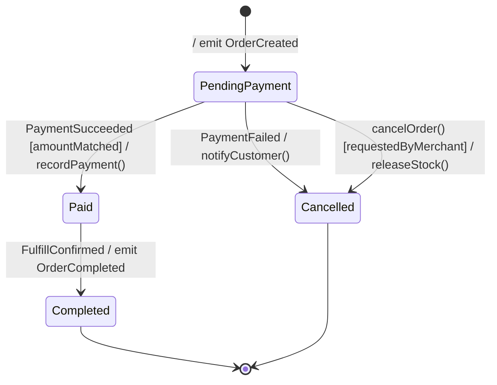

### 9.7. References

* **[S1]** OMG, [UML 2.5.1](https://www.omg.org/spec/UML/2.5.1/) — Chapter 14, StateMachines, including Transitions and Pseudostates.
* **[S2]** Sparx Systems, [Initial](https://sparxsystems.com/enterprise_architect_user_guide/17.1/modeling_languages/initial.html), quoting UML 2.5.1 page 312: at most one Initial per Region; the initial transition may have an effect but no trigger or guard.
* **[A1]** Hassan Gomaa, *Software Modeling and Design* — SWD392 Dynamic Modeling materials, Chapters 9–11, slides 17–21: States, Events, Guards, Transition Actions, and Entry/Exit behavior.
* **[T1]** Visual Paradigm, [State Machine Diagram Guide](https://www.visual-paradigm.com/guide/uml-unified-modeling-language/what-is-state-machine-diagram/). The example uses Mermaid state-diagram syntax for rendering.
