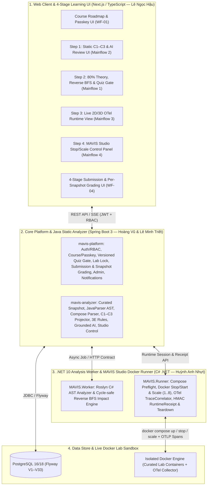

# TRƯỜNG ĐẠI HỌC FPT — HỒ SƠ ĐẶC TẢ SIÊU TỔNG QUAN TOÀN BỘ DỰ ÁN (ULTIMATE PROJECT MASTER CONTEXT & SPECIFICATION BIBLE)

> [!IMPORTANT]
> **Mục đích của tài liệu này (`Single Source of Truth — Post-Review 2 Final Baseline`):**
> Đây là **tài liệu gốc siêu tổng quan (Master Project Context Bible)** mở rộng từ *Phiếu Đăng ký Đề tài (`CAPSTONE PROJECT REGISTER`)* lên mức **đặc tả toàn diện nhất của toàn bộ dự án `MAVIS` (`FA26SE289`) sau Review 2**. Tài liệu này dùng làm:
> 1. **Ngữ cảnh chuẩn duy nhất (Master Context)** cho cả 4 thành viên trong nhóm (`Hoàng Vũ`, `Lê Minh Triết`, `Huỳnh Anh Nhựt`, `Lê Ngọc Hậu`) và cho mọi AI Agent khi lập trình, viết báo cáo (Report 1–5) hoặc chuẩn bị slide bảo vệ Review 3.
> 2. **Bản đặc tả chi tiết từ A–Z:** Bao phủ đầy đủ **Bối cảnh & Định vị sau Review 2**, **1 Kịch bản End-to-End (5 Mainflows / 4 Workflows `WF-01..WF-04`)**, **10 Business Rules (`BR-01..BR-10`)**, **12 Mandatory Features (`F-01..F-12`)**, **toàn bộ 85 Functional Requirements (`FR`)**, **49 Non-Functional Requirements (`NFR` & `N1..N6`)**, **Giáo trình 12 Chương Java Spring Cloud + 1 bài mẫu C# .NET (30 bài / 120 câu hỏi Quiz có phiên bản)**, **Kiến trúc kỹ thuật & Hệ thống Bảng Database (`Flyway V1–V33`)**, cùng **Ma trận 120 Test Cases Tự động (`WF-01..WF-04`) & 8 Kịch bản Demo**.

---

## PHẦN 1. THÔNG TIN ĐĂNG KÝ ĐỀ TÀI & PHÂN CÔNG NHÂN SỰ (PROJECT REGISTRATION HEADER)

- **Mã đề tài (Project Code):** `FA26SE289` — **Mã nhóm (Team):** `GFA26SE19` (Group 4)
- **Thời gian thực hiện (Duration):** `11/05/2026` – `31/08/2026` (Chốt Baseline sau Review 2: `08/11/2026`)
- **Chuyên ngành (Profession / Specialty):** Software Engineering — `Java Spring Boot 3 & Spring Cloud`, `C# / .NET 8`, `Next.js (React / TypeScript)`
- **Đối tượng đăng ký:** Giảng viên đề xuất (`Lecturer ☑`)

### 1.1. Giảng viên Hướng dẫn & Hội đồng Phản biện
| Vai trò | Họ và tên | Điện thoại | Email | Ghi chú |
| :--- | :--- | :--- | :--- | :--- |
| **Supervisor (GVHD)** | **Mr. Nguyễn Thế Hoàng** | `0986 628 525` | `hoangnt20@fe.edu.vn` | Định hướng kiến trúc, giáo trình 80/20 & `MAVIS Studio` |
| **Reviewer 1** | **Mr. Lâm Hữu Khánh Phương** (`PhuongLHK`) | — | — | Hội đồng Đánh giá Review 2 (`Hội đồng 1`) |
| **Reviewer 2** | **Hội đồng Đánh giá Review 2** | — | — | Phê duyệt chuyển đổi sang mô hình học thuật sau Review 2 |

### 1.2. Danh sách 4 Thành viên & Ma trận Trách nhiệm Đối xứng (`4 Workflows × 3 Features × 27 Tests`)
| STT | Họ và tên | MSSV | Điện thoại / Email | Vai trò & Phân hệ Kỹ thuật Phụ trách | Workflow & Tính năng Sở hữu |
| :---: | :--- | :---: | :--- | :--- | :--- |
| **1** | **Hoàng Vũ** | `SE180716` | `0379662470` `vuhse180716@fpt.edu.vn` | **Team Leader · Core Platform Backend (`V01–V18`):** Xác thực `Gmail/OTP`, `RBAC`, Quản lý Khóa học 12 Chương, cấp mã `Passkey`, mở khóa bài Lab tuần tự, lưu trữ bài nộp & Quản trị. | **`WF-01` (Đầu Mainflow 5)** Features: `F-01`, `F-09`, `F-10` Decisions: `D1` · NFRs: `N1`, `N2` Fixes: `RF-01`, `RF-05`, `RF-09` |
| **2** | **Lê Minh Triết** | `SE181979` | `0915672522` `trietlmse181979@fpt.edu.vn` | **Static Analyzer, C4 Model & AI (`T01–T18`):** Phân tích tĩnh `AST (JavaParser)` & cấu hình `Compose`, trích xuất sơ đồ cấu trúc `C1–C3 + Dependency Graph`, `3E Rule Engine`, `Evidence-Grounded AI`, và bộ `Automated Versioned Theory & Architecture Quiz Gate` ($\ge 70\%$). | **`WF-02` (Bước 1 MF2 & Bước 2 MF1)** Features: `F-02`, `F-03`, `F-06` Decisions: `D2`, `D4` · NFRs: `N3`, `N4` Fixes: `RF-02`, `RF-06`, `RF-10` |
| **3** | **Huỳnh Anh Nhựt** | `SE180710` | `0983958920` `nhuthase180710@fpt.edu.vn` | **`.NET Worker`, OTel Runtime & `MAVIS Studio` (`N01–N18`):** Phân tích `.NET Roslyn`, thuật toán `Cycle-safe Reverse BFS`, chạy `Docker` thật thu thập `OpenTelemetry` ở Bước 3, và điều khiển `Stop/Start Service` & `Scale Replicas (1..8)` trên `MAVIS Studio` ở Bước 4. | **`WF-03` (Bước 3 MF3 & Bước 4 MF4)** Features: `F-05`, `F-07`, `F-08` Decisions: `D3` · NFRs: `N5` Fixes: `RF-03`, `RF-07`, `RF-11` |
| **4** | **Lê Ngọc Hậu** | `SE181741` | `0378754283` `haulnse181741@fpt.edu.vn` | **Next.js Frontend & 4-Stage Coursera UX (`F01–F18`):** Luồng điều hướng 4 cấp kiểu `Coursera`, Khung bài Lab 4 Bước, xem sơ đồ tham chiếu `C1–C3`, đồ thị `2D/3D`, bảng điều khiển `MAVIS Studio`, đóng gói nộp bài 4 bước & màn hình Giảng viên chấm từng Snapshot (`> 5.0/10`). | **`WF-04` (Cuối Mainflow 5)** Features: `F-04`, `F-11`, `F-12` Decisions: `D5` · NFRs: `N6` Fixes: `RF-04`, `RF-08`, `RF-12` |

---

## PHẦN 2. TÊN ĐỀ TÀI, BỐI CẢNH, ĐỊNH VỊ SAU REVIEW 2 & GIẢI PHÁP ĐỀ XUẤT (SECTION 3.1 FULL EXPANSION)

### 2.1. Tên Đề tài (Capstone Project Name)
- **Tên tiếng Anh (English):** *AI-Assisted Microservices Architecture Visualization and Change Impact Analysis*
- **Tên tiếng Việt (Vietnamese):** *Hệ thống trực quan hóa kiến trúc Microservices và phân tích tác động thay đổi có hỗ trợ AI*
- **Tên viết tắt (Abbreviation):** **MAVIS**

### 2.2. A. Bối cảnh & Vấn đề Thực tiễn (Context & Problem Statement)
Các hệ thống **Microservices** chia nhỏ nghiệp vụ ứng dụng thành nhiều dịch vụ độc lập, giao tiếp với nhau qua giao thức mạng (`REST/HTTP`, `gRPC`, `Message Broker`) và quản lý cơ sở dữ liệu tách biệt (`Database-per-Service`). Để hiểu và làm chủ một kiến trúc như vậy, người kỹ sư phần mềm phải kết nối được **3 tầng thông tin vốn bị phân mảnh**:
1. **Tầng Mã nguồn & Cấu hình Tĩnh (`Static Source Code & Configuration`):** Các `Controllers`, `Endpoints`, `Feign/HTTP Clients`, `Entities` và cấu hình `Docker Compose / application.yml` nằm rải rác ở hàng chục thư mục dịch vụ khác nhau.
2. **Tầng Tư duy Mô hình hóa Kiến trúc (`Architectural Modeling — C4 Model`):** Khả năng trừu tượng hóa hệ thống theo đúng các tầng chuẩn của **C4 Model** (`C0 Context`, `C1 System Context`, `C2 Container`, `C3 Component`) và nhận diện các lỗi thiết kế (`Tight Coupling`, `Shared Database`, `Cyclic Dependency`).
3. **Tầng Vận hành & Tác động Hạ tầng Thực tế (`Live Runtime & Infrastructure Change Impact`):** Chuyện gì thực sự xảy ra trên đường truyền gói tin (`OpenTelemetry Traces/Spans`) khi các Container đang chạy thật trên `Docker`, và hệ thống phản ứng ra sao khi một dịch vụ bị sập (`Stop Service` $\rightarrow$ lỗi dây chuyền hay bật `Circuit Breaker`) hoặc khi tăng số bản sao (`Scale Replicas 1 → 4..8` $\rightarrow$ giảm độ trễ `p95 Latency`).

**Thực trạng và khoảng trống trong đào tạo Kỹ thuật Phần mềm (Software Engineering Education):**
- **Rủi ro khi để sinh viên tự tải Repo ngoài không kiểm soát:** Nếu hệ thống cho phép sinh viên tự dán bất kỳ link `GitHub` hay tải file `.zip` cá nhân từ bên ngoài vào, mã nguồn thường thiếu cấu hình chuẩn, không build được `Docker`, và quan trọng nhất là **không có bộ Đáp án chuẩn (`Ground Truth`)** để hệ thống chấm điểm tự động.
- **Hạn chế của công cụ vẽ tự do (`draw.io`):** Khi nhúng một trình vẽ tự do như `draw.io`, sinh viên có thể vẽ hình chữ nhật và gõ chữ tùy ý, dẫn đến việc hệ thống không thể kiểm tra quy tắc phân tầng `C4` hay chấm điểm ngữ nghĩa tự động.
- **Sự nhầm lẫn giữa Sơ đồ Cấu trúc Tĩnh và Sơ đồ Hành vi Nghiệp vụ:** Các sơ đồ `UML Sequence`, `Activity` và `State Diagram` biểu diễn luồng hành vi/nghiệp vụ thời gian thực chứ không phải cấu trúc kiến trúc tĩnh của mã nguồn.
- **Giới hạn của các công cụ Simulator giả lập trên trình duyệt (như `200Lab GonnaCrash`):** Các công cụ kiểu `GonnaCrash` của `200Lab` chỉ cho phép người dùng kéo-thả các cục dịch vụ giả lập trên web rồi dùng công thức toán học tính nhẩm thông số `RPS / Latency` giả định, chứ **không hề chạy `Docker Container` thật, không có gói tin `OpenTelemetry` thật và không tắt/nhân bản dịch vụ thật**.

### 2.3. B. Giải pháp Đề xuất & Bước Chuyển mình Chiến lược sau Review 2 (Proposed Solution)
**MAVIS** là **Nền tảng Học tập và Thực hành Kiến trúc Microservices tương tác có hỗ trợ AI (`Educational Architecture & Live Docker Runtime Lab Platform`)**, được thiết kế theo mô hình học phần trực tuyến chuẩn đại học (**Coursera / FPT FLM**).

#### Bảng Đối chiếu Chuyển đổi Phạm vi Trước vs. Sau Review 2 (Theo đúng Biên bản `BM03` & Chỉ đạo Hội đồng ở phút `12:18–36:18`)
| Hạng mục Phạm vi | Trước Review 2 (Bản cũ — Đã loại bỏ) | Sau Review 2 (Bản Chốt Chính thức — `v2.0 Final Baseline`) | Lý do Chuyển đổi (Theo Hội đồng Review 2) |
| :--- | :--- | :--- | :--- |
| **1. Định vị Hệ thống & Đầu vào Mã nguồn** | Cho phép người dùng tự tạo Project cá nhân và dán link `GitHub` hoặc upload file `.zip` bất kỳ từ bên ngoài. | **Khóa hoàn toàn tính năng sinh viên tự nạp `GitHub URL / ZIP` ngoài.** Hệ thống chuẩn bị sẵn **Giáo trình 12 Chương Java Spring Cloud + 1 bài mẫu C# .NET**; mỗi bài Lab gắn cố định với **Tài liệu lý thuyết + `Curated Repo` chuẩn + Sơ đồ tham chiếu `C1–C3` + Bộ câu hỏi Quiz có phiên bản**. | Đảm bảo 100% bài Lab chạy `Docker` ổn định và có chuẩn kiến trúc tham chiếu + Quiz tự động để kiểm tra đầu vào chính xác (`15:20–16:34`, `29:03–29:32`). |
| **2. Mô hình Truy cập Lớp học & Mở khóa Bài Lab** | Có khái niệm gói cước thương mại (`SaaS Subscription`) và không gian `Workspace` rời rạc. | Đăng nhập bằng **`Gmail/OTP`**, Giảng viên mở lớp và cấp mã **`Passkey` (`Enrollment Key`)**. Sinh viên nhập `Passkey` mở khóa `Lab 1`; **hoàn thành đủ 4 bước và được Giảng viên chấm đạt (`> 5.0/10` cho mọi Snapshot) ở `Lab N` mới tự động mở khóa `Lab N+1`**. | Phù hợp 100% với môi trường đào tạo đại học kiểu `Coursera / FLM` (`18:42–27:15`). |
| **3. Danh mục Sơ đồ ở Bước Phân tích Tĩnh (Bước 1)** | Cố gắng sinh tự động 9 loại sơ đồ tĩnh (bao gồm cả `UML Sequence`, `Activity`, `State Diagram`). | **Khóa danh mục sơ đồ tĩnh chỉ giữ `C4 Model (C1, C2, C3)` + `Service Dependency Graph`** (kèm cấu trúc `Class/Component` bổ trợ) và dùng **AI chỉ ra lỗi code tĩnh (`Coupling`, `Shared DB`, `Inheritance`, `Naming`)**. Bỏ hẳn `Sequence/Activity/State` tĩnh. | `Sequence/Activity/State` là luồng hành vi nghiệp vụ, không sinh từ phân tích cấu trúc tĩnh; luồng tương tác chỉ lấy từ `OpenTelemetry` khi chạy thật (`31:48–36:05`). |
| **4. Học Lý thuyết, `Reverse BFS` & Kiểm tra Kiến trúc ở Bước 2** | Nhúng trình vẽ tự do `draw.io` cho sinh viên tự vẽ. | **Gỡ bỏ `draw.io` tự do cho sinh viên.** Thay bằng **Học Lý thuyết 80% + Phân tích Tác động Phụ thuộc Tĩnh (`Cycle-safe Reverse BFS`) + Bài kiểm tra Kiến trúc có Phiên bản (`Automated Versioned Theory & Architecture Quiz Gate` $\ge 70\%$)** kết hợp **Chấm điểm Từng Bản chụp Minh chứng (`Per-Snapshot Grading > 5.0/10`)**. | Đảm bảo sinh viên nắm vững lý thuyết, hiểu vùng ảnh hưởng phụ thuộc (`Reverse BFS`) và vượt qua cổng kiểm tra tự động trước khi chạy `Docker` thật (`34:15–36:15`). |
| **5. Trực quan hóa Runtime (Bước 3) & Thực hành Hạ tầng `MAVIS Studio` (Bước 4)** | Chỉ tính `Reverse BFS` tĩnh và thu thập `Trace` thụ động. | - **Bước 3 (`Mainflow 3`):** Bật `Docker` thật chạy bộ `Curated Repo`, thu thập `OpenTelemetry (Traces, Spans, Metrics, Logs)` vẽ lên đồ thị `2D/3D`. - **Bước 4 (`Mainflow 4` — `MAVIS Studio`):** **Phiên bản CHẠY THẬT của `GonnaCrash (200Lab)`:** Ngay trên cụm `Docker` đang chạy, sinh viên bấm **`Stop Service`** (tắt thật container) và kéo **`Scale Replicas (1 → 4..8)`** (nhân bản thật container), đối chiếu `Before vs. After` và lưu biên nhận **`RuntimeReceipt`**. | Tạo giá trị thực tiễn vượt trội so với các simulator lý thuyết kiểu `200Lab` bằng khả năng điều khiển `Docker Container` thật (`16:58–21:35`). |

---

## PHẦN 3. KỊCH BẢN TỔNG THỂ END-TO-END, 5 MAINFLOWS (`36:18`), 4 CORE WORKFLOWS (`WF-01..WF-04`) & 10 BUSINESS RULES (`BR-01..BR-10`)

### 3.1. Bảng Tổng quan 1 Luồng End-to-End Duy Nhất (Ôm trọn 5 Mainflows & Phân công 4 Thành viên)
Toàn bộ dự án vận hành theo **1 kịch bản học tập khép kín từ lúc Giảng viên mở lớp cho tới khi Sinh viên hoàn thành Lab 1 để mở khóa Lab 2**:

| Thứ tự chạy thực tế | Tên Mainflow (Theo thầy chốt ở `36:18`) | Chuyện gì diễn ra ở bước này? (Chuẩn ngôn ngữ SE) | Ai phụ trách? (Mã Workflow) |
| :---: | :--- | :--- | :---: |
| **Mở đầu** | **Đầu `Mainflow 5`** *(Quản lý Môn học, Passkey & Mở khóa Lab)* | - Hệ thống đã chuẩn bị sẵn **12 Chương Java Spring Cloud + 1 bài mẫu C# .NET** (mỗi bài gắn sẵn Tài liệu lý thuyết + `Curated Repo` nhánh `main` + sơ đồ tham chiếu `C1–C3` + bộ câu hỏi Quiz). - `Lecturer` mở lớp, cấp mã `Passkey`. `Student` đăng nhập `Gmail`, nhập `Passkey` mở khóa `Lab 1` *(Khóa hẳn tính năng tự dán link GitHub/upload ZIP ngoài)*. | **Hoàng Vũ** (`WF-01`) |
| **Bước 1 trong Lab** | **`Mainflow 2`** *(Phân tích Mã nguồn Tĩnh với AI)* | - `Student` bấm quét bộ `Curated Repo` được gắn sẵn trong `Lab 1`. - Hệ thống phân tích `AST (JavaParser / Roslyn)` & `Compose` để vẽ ra sơ đồ cấu trúc **`C1–C3` + `Service Dependency Graph`** *(bỏ `Sequence/Activity/State` tĩnh)* và dùng **`Evidence-Grounded AI`** chỉ ra lỗi thiết kế tĩnh (`Tight Coupling`, `Shared DB`, `Cyclic Dependency`, `Inheritance`, `Naming`) kèm trích dẫn `File/Line Provenance`. | **Lê Minh Triết** (`WF-02` — Phần 1) |
| **Bước 2 trong Lab** | **`Mainflow 1`** *(Học Lý thuyết 80/20, `Reverse BFS` & Kiểm tra Kiến trúc Tự động)* | - `Student` đọc tài liệu lý thuyết (80% thời lượng) đối chiếu với sơ đồ tham chiếu `C1–C3`, xem vùng ảnh hưởng phụ thuộc lý thuyết trên đồ thị tĩnh (`Cycle-safe Reverse BFS`: nếu sửa 1 khối thì những khối nào gọi vào nó bị ảnh hưởng). - Thực hiện **Bài kiểm tra Kiến trúc Tự động có Phiên bản (`Automated Versioned Theory & Architecture Quiz`)**; hệ thống chấm tự động yêu cầu đạt **$\ge 70\%$ (`PASSED`, `BR-06`)** mới mở khóa Bước 3. | **Lê Minh Triết** (`WF-02` — Phần 2) |
| **Bước 3 trong Lab** | **`Mainflow 3`** *(Trực quan hóa Hệ thống Đang chạy — `Runtime View`)* | - Đạt bài kiểm tra lý thuyết & kiến trúc (`QUIZ_PASSED`), `Student` bấm bật **`Docker` thật** chạy bộ `Curated Repo` của `Lab 1` (sau khi qua bước kiểm tra an toàn `Compose Preflight`). - Hệ thống thu thập dữ liệu **`OpenTelemetry` (`Traces`, `Causal Spans`, `Metrics`, `Logs`)** và vẽ luồng gói tin đang chạy thật giữa các `Container` trên đồ thị `2D/3D`. | **Huỳnh Anh Nhựt** (`WF-03` — Phần 1) |
| **Bước 4 trong Lab** | **`Mainflow 4`** *(Thực hành Hạ tầng & Đánh giá Tác động Thực tế trên `MAVIS Studio`)* | - **Đây chính là `GonnaCrash (200Lab)` phiên bản CHẠY THẬT:** Thay vì làm simulator giả lập, ngay trên hệ thống `Docker` đang chạy ở Bước 3, `Student` mở **`MAVIS Studio`**:   1. Bấm nút **`Stop Service`** $\rightarrow$ Tắt thật container `payment-service` xem hệ thống bị lỗi dây chuyền hay tự bật `Resilience4j Circuit Breaker (OPEN)` thật.   2. Kéo thanh trượt **`Scale Replicas (1 → 4)`** $\rightarrow$ Nhân bản thật 4 container `order-service` xem độ trễ (`p95 Latency`) giảm xuống thật. - Hệ thống đối chiếu thông số **Trước vs. Sau khi chỉnh (`Before vs. After`)**, chụp `Studio Snapshot (PNG)` và đóng băng biên nhận **`RuntimeReceipt`** (`EVIDENCE_VERIFIED` có chữ ký `HMAC-SHA256`). | **Huỳnh Anh Nhựt** (`WF-03` — Phần 2) |
| **Kết thúc** | **Cuối `Mainflow 5`** *(Nộp bài, Chấm duyệt Từng Snapshot & Mở khóa Lab tiếp theo)* | - `Student` kiểm tra đủ kết quả của cả **4 Bước (`Bước 1` + `Bước 2` + `Bước 3` + `Bước 4`)** kèm giải trình cho từng Snapshot rồi bấm **Nộp bài (`Submit`)** để đóng băng gói minh chứng bằng mã băm `SHA-256`. - `Lecturer` mở màn hình chấm bài, chấm điểm từng Snapshot trên thang `0..10` (**tất cả Snapshot phải `> 5.0/10` mới đạt `PASSED`**; nếu có bất kỳ Snapshot nào `<= 5.0` thì chuyển `NEEDS_REVISION`), bấm hoàn tất chấm $\rightarrow$ Hệ thống **tự động Mở khóa `Lab 2`**! | **Lê Ngọc Hậu** (`WF-04`) |

---

### 3.2. Sơ đồ Máy Trạng thái (State Machines) của 7 Thực thể Nghiệp vụ Cốt lõi
1. **`Account` (Tài khoản người dùng):**
   `UNVERIFIED` $\xrightarrow{\text{Xác thực Gmail/OTP}}$ `ACTIVE` $\xrightarrow{\text{Admin khóa}}$ `LOCKED` (hoặc `ACTIVE` $\leftarrow$ mở khóa).
2. **`CourseEnrollment` (Ghi danh lớp học phần):**
   `LOCKED / NONE` $\xrightarrow{\text{Nhập Passkey hợp lệ (BR-02)}}$ `ENROLLED` $\xrightarrow{\text{Mở Lab 1}}$ `IN_PROGRESS` $\xrightarrow{\text{Hoàn thành 12 Labs}}$ `COMPLETED`.
3. **`LabAccess / LabAttempt` (Tiến độ 4 Bước của Sinh viên trong 1 Bài Lab):**
   `LOCKED` $\xrightarrow{\text{Passkey (Lab 1) hoặc Passed Lab N-1 (BR-03)}}$ `UNLOCKED` $\xrightarrow{\text{Quét tĩnh Bước 1}}$ `STATIC_ANALYZED` $\xrightarrow{\text{Chấm Quiz } \ge 70\% \text{ Bước 2 (BR-06)}}$ `QUIZ_PASSED` $\xrightarrow{\text{Bật Docker Bước 3 (BR-07)}}$ `RUNTIME_ACTIVE` $\xrightarrow{\text{Stop/Scale & Chốt Receipt Bước 4 (BR-08)}}$ `RUNTIME_VERIFIED` $\xrightarrow{\text{Nộp đủ 4 bước (BR-09)}}$ `SUBMITTED` $\xrightarrow{\text{Lecturer chấm từng Snapshot > 5.0 (BR-10)}}$ `PASSED` / `NEEDS_REVISION` *(nếu `NEEDS_REVISION` sinh viên sửa và nộp lại; nếu `PASSED` tự động mở khóa `Lab N+1`)*.
4. **`AnalysisJob` (Tiến trình phân tích mã nguồn tĩnh ở Bước 1):**
   `PENDING / QUEUED` $\xrightarrow{\text{Worker nhận Job}}$ `RUNNING` *(dẫn xuất tiến trình UI: `EXTRACTING` $\rightarrow$ `GRAPH_BUILDING` $\rightarrow$ `EVALUATING`)* $\xrightarrow{\text{Thành công}}$ `COMPLETED` (hoặc `FAILED` / `CANCELLED` — giữ nguyên mô hình hợp lệ gần nhất).
5. **`QuizAttempt` (Lần làm bài kiểm tra Lý thuyết & Kiến trúc có phiên bản ở Bước 2):**
   `IN_PROGRESS` $\xrightarrow{\text{Bấm Nộp bài Quiz}}$ `SUBMITTED` $\xrightarrow{\text{Điểm } \ge 70\% \text{ (BR-06)}}$ `PASSED` (hoặc $\xrightarrow{\text{Điểm } < 70\%}$ `NEEDS_RETRY`).
6. **`RuntimeLabSession` (Phiên chạy Docker thật & `MAVIS Studio` ở Bước 3 & 4):**
   `CREATED` $\xrightarrow{\text{Preflight Pass (BR-07)}}$ `RUNNING` $\xrightarrow{\text{Stop Service / Scale Replicas}}$ `MODIFIED` $\xrightarrow{\text{Capture RuntimeReceipt (BR-08) & Teardown}}$ `EVIDENCE_VERIFIED` *(nhánh lỗi: `PREFLIGHT_FAILED`, `STOPPED`, `TIMED_OUT` sau 300s)*.
7. **`ProjectSubmission` (Gói bài nộp 4 bước ở `WF-04`):**
   `INCOMPLETE` $\xrightarrow{\text{Đủ 4 bước & Đóng băng SHA-256 (BR-09)}}$ `SUBMITTED` $\xrightarrow{\text{Lecturer chấm mọi Snapshot > 5.0 (BR-10)}}$ `PASSED / GRADED` (hoặc `NEEDS_REVISION / RETURNED` kèm nhận xét bắt buộc).

---

### 3.3. Đặc tả Chi tiết 10 Quy tắc Nghiệp vụ Cốt lõi (`BR-01` đến `BR-10`)
| Mã BR | Tên Quy tắc Nghiệp vụ | Logic Kiểm tra & Ràng buộc Kỹ thuật | Mã lỗi HTTP / Phản hồi khi Vi phạm | Workflow & Tính năng Áp dụng |
| :---: | :--- | :--- | :--- | :---: |
| **`BR-01`** | **Xác thực Gmail/OTP & Cô lập Phân quyền RBAC** | Chỉ tài khoản đã xác thực qua `Google OAuth2 / OTP` mới được truy cập hệ thống. Mọi API kiểm tra chặt `Role` (`Student`, `Lecturer`, `Admin`) và quyền sở hữu theo lớp học (`Cohort/Workspace`). Không cho phép đọc/ghi chéo lớp học. | `HTTP 401 Unauthorized` / `HTTP 403 Forbidden` / `HTTP 404 Not Found` | `WF-01` (`F-01`, `N2`) |
| **`BR-02`** | **Kiểm tra Tính hợp lệ của Mã `Passkey` (`Enrollment Key`)** | Khi `Student` nhập `Passkey` để vào khóa học: mã phải tồn tại trong DB, thuộc đúng lớp học phần đang mở, chưa hết hạn (`expires_at > NOW()`), chưa vượt sĩ số tối đa và sinh viên chưa ghi danh trùng vào cùng lớp. | `HTTP 400/422 INVALID_OR_EXPIRED_PASSKEY` hoặc `HTTP 409 ALREADY_ENROLLED` | `WF-01` (`F-09`) |
| **`BR-03`** | **Khóa Tiên quyết Tuần tự Bài Lab & Khóa Đầu vào `Curated Repo`** | (1) `Lab 1` mở ngay khi nhập `Passkey` thành công; `Lab N+1` chỉ chuyển sang `UNLOCKED` khi bài nộp của `Lab N` đạt trạng thái `PASSED` (mọi Snapshot `> 5.0/10`). (2) Mỗi bài Lab gắn cứng với 1 `Curated GitHub Repo` chuẩn của hệ thống (khóa hẳn tính năng sinh viên tự nhập `GitHub URL` hoặc upload file `.zip` ngoài). | `HTTP 403 PREREQUISITE_LAB_LOCKED` / `HTTP 403 EXTERNAL_REPO_DISABLED` | `WF-01` (`F-10`) |
| **`BR-04`** | **Toàn vẹn `Curated Snapshot` & Giới hạn Sơ đồ Cấu trúc Tĩnh** | Bước 1 chỉ phân tích trên bản chụp `Curated Repo Snapshot` đã ghim cố định `Commit SHA` và mã băm `SHA-256`. Chế độ phân tích tĩnh chỉ trích xuất sơ đồ cấu trúc: **`C1 System Context`, `C2 Container`, `C3 Component` và `Service Dependency Graph`**. | `HTTP 409 SNAPSHOT_DIGEST_MISMATCH` | `WF-02` (`F-02`, `N4`) |
| **`BR-05`** | **Khóa Danh mục Sơ đồ Cấu trúc `C1–C3 + Dependency Graph` & Quy tắc `3E`** | Phân tích tĩnh ở Bước 1 & Bước 2 chỉ xuất các góc nhìn cấu trúc `C1, C2, C3` và `Service Dependency Graph` kèm `File/Line Provenance` và 5 quy tắc `3E` (`Tight Coupling`, `Shared DB`, `Cyclic Dependency`, `Inheritance`, `Naming` — `RULE-04` bắt buộc bằng chứng `CALL_SITE`). Từ chối mọi yêu cầu sinh sơ đồ hành vi tĩnh (`UML Sequence`, `Activity`, `State`). | `HTTP 400 UNSUPPORTED_STATIC_DIAGRAM` | `WF-02` (`F-03`, `F-06`) |
| **`BR-06`** | **Cổng Kiểm tra Lý thuyết & Kiến trúc Tự động (`Quiz Gate >= 70%`)** | Ở Bước 2 (`Theory & Architecture Quiz`), bài kiểm tra có phiên bản (`Versioned Quiz`) được chấm tự động; `QuizAttempt` phải đạt **$\ge 70\%$ (`PASSED`)** mới mở khóa Bước 3 (`Docker Runtime View`). AI chỉ trích dẫn bằng chứng trong `Allowlist` và ẩn mọi `Secret`. | Trạng thái `NEEDS_RETRY` và `HTTP 403 QUIZ_GATE_LOCKED` khi cố mở Bước 3 Runtime | `WF-02` (`F-06`, `N3`) |
| **`BR-07`** | **Kiểm tra An toàn `Compose Preflight` & Giới hạn `Sandbox`** | Trước khi chạy `Docker` thật ở Bước 3, `MAVIS.Runner` kiểm tra `Preflight`: từ chối mọi cấu hình chứa `privileged: true`, `network_mode: host`, gắn `Docker socket` hoặc mount thư mục nhạy cảm của máy chủ. Phiên chạy bị giới hạn `Timeout <= 300s` và số bản sao `Scale Replicas` từ `1..8 instances`. | `HTTP 422 PREFLIGHT_SECURITY_REJECTED` hoặc `HTTP 400 REPLICA_BOUNDS_EXCEEDED` | `WF-03` (`F-08`, `N5`) |
| **`BR-08`** | **Bắt buộc Thực nghiệm Hạ tầng Thật & Đóng băng `RuntimeReceipt`** | Hệ thống chỉ cho phép ký (`HMAC-SHA256`) và đóng băng biên nhận `RuntimeReceipt` ở Bước 4 khi: (1) có dữ liệu `OpenTelemetry Spans` thật từ Bước 3, và (2) sinh viên đã thực hiện **ít nhất 1 thao tác điều khiển hạ tầng thật trên `MAVIS Studio` (`Stop/Start Service` hoặc `Scale Replicas`)** kèm bảng đối chiếu `Before vs. After`. Kết thúc phiên phải dọn sạch `0 Orphaned Containers`. | `HTTP 422 INCOMPLETE_RUNTIME_SCENARIO` (Nhắc sinh viên bấm `Stop` hoặc `Scale` trước khi chốt biên nhận) | `WF-03` (`F-05`, `F-07`, `F-08`, `N5`) |
| **`BR-09`** | **Kiểm tra Đủ Minh chứng Cả 4 Bước & Đóng băng `SHA-256` khi Nộp bài** | Sinh viên chỉ bấm `Submit Project Evidence` thành công khi bài Lab đã hoàn tất đủ 4 minh chứng: Bước 1 (`STATIC_ANALYZED`), Bước 2 (`QUIZ_PASSED` $\ge 70\%$), Bước 3 (`Runtime View`), và Bước 4 (`RuntimeReceipt EVIDENCE_VERIFIED`) kèm giải trình `studentSnapshots[]`. Khi nộp, toàn bộ gói minh chứng được niêm phong bằng mã băm `SHA-256` (chặn ghi đè cũ với `HTTP 409`). | `HTTP 422 INCOMPLETE_4STAGE_EVIDENCE` / `HTTP 409 STALE_REVISION_CONFLICT` | `WF-04` (`F-04`, `F-11`, `N4`) |
| **`BR-10`** | **Chấm điểm Từng Snapshot (`> 5.0/10`), Bắt buộc Nhận xét & Tự động Mở khóa Lab Kế tiếp** | Chỉ `Lecturer` phụ trách lớp mới được chấm duyệt. Giảng viên chấm từng Snapshot trên thang `0..10` kèm nhận xét bắt buộc: **mọi Snapshot phải đạt `> 5.0/10` thì bài nộp mới đạt `PASSED` và tự động mở khóa bài Lab tiếp theo (`Lab N+1`: `LOCKED -> UNLOCKED`)**; nếu bất kỳ Snapshot nào `<= 5.0` thì chuyển sang `NEEDS_REVISION` (kể cả khi điểm trung bình `> 50/100`). | `HTTP 403 FORBIDDEN` (nếu Student tự gọi) / `HTTP 400 FEEDBACK_REQUIRED` (nếu thiếu nhận xét) | `WF-04` (`F-11`, `F-12`) |

---

## PHẦN 4. ĐẶC TẢ CHI TIẾT 12 NHÓM TÍNH NĂNG BẮT BUỘC (`F-01..F-12`) & TOÀN BỘ 85 YÊU CẦU CHỨC NĂNG (`FR`)

### 4.1. Nhóm `WF-01` — Phụ trách: Hoàng Vũ (`F-01`, `F-09`, `F-10` — 16 FRs)

#### 🔹 `F-01`: Xác thực Google/OTP & Phân quyền RBAC (`FR-AUTH-01` đến `FR-AUTH-07`)
- **`FR-AUTH-01` (Đăng ký & Xác thực tài khoản qua Gmail/OTP):** Hỗ trợ đăng nhập bằng `Google OAuth2 (Gmail)` hoặc xác thực mã `OTP` gửi qua email trường (`@fpt.edu.vn` / `@fe.edu.vn`); kích hoạt tài khoản sang trạng thái `ACTIVE`.
- **`FR-AUTH-02` (Đăng nhập & Cấp phát cặp Token JWT):** Phát hành `Access Token` ngắn hạn (15 phút) và `Refresh Token` (7 ngày) có gắn `Role` và danh sách `Cohort/Workspace` được phép truy cập.
- **`FR-AUTH-03` (Làm mới phiên & Đăng xuất thu hồi Token):** Cho phép làm mới `Access Token` qua `Refresh Token` hợp lệ và thu hồi (`Revoke/Blacklist`) Token ngay khi người dùng bấm `Sign Out`.
- **`FR-AUTH-04` (Quản lý hồ sơ cá nhân & Ngôn ngữ giao diện):** Cho phép người dùng cập nhật tên hiển thị, ảnh đại diện và tùy chọn ngôn ngữ giao diện (`Tiếng Việt / English`).
- **`FR-AUTH-05` (Phân quyền RBAC 4 vai trò):** Kiểm soát quyền truy cập ở cả tầng `Next.js Middleware` và `Spring Security Filter` cho 4 vai trò: `Guest` (chưa đăng nhập), `Student` (người học), `Lecturer` (giảng viên), và `Admin` (quản trị viên).
- **`FR-AUTH-06` (Cô lập dữ liệu theo Lớp học phần / Cohort Isolation):** Đảm bảo `Student` chỉ xem và thao tác được trên các bài Lab và gói bài nộp của chính mình trong lớp đã nhập `Passkey`; `Lecturer` chỉ chấm duyệt các lớp mình phụ trách (`BR-01`).
- **`FR-AUTH-07` (Chống tấn công Brute-force & Ghi nhận Audit xác thực):** Giới hạn tần suất nhập sai `OTP / Passkey` (`Rate Limiting`) và ghi nhận mọi sự kiện đăng nhập/đăng xuất vào bảng `audit_logs`.

#### 🔹 `F-09`: Lộ trình Khóa học & Ghi danh bằng `Passkey` (`FR-EDU-01`, `FR-EDU-02`, `FR-EDU-05`, `FR-EDU-06`)
- **`FR-EDU-01` (Quản lý danh mục Khóa học & Giáo trình 12 Chương):** Cung cấp sẵn cấu trúc khóa học chuẩn gồm `5 Modules / 12 Chapters` về `Java Spring Boot 3 & Spring Cloud` cộng với `1 bài Lab mẫu C# ASP.NET Core`.
- **`FR-EDU-02` (Khởi tạo Lớp học phần & Phát hành mã `Passkey`):** Cho phép `Lecturer` mở lớp học phần (`Course Cohort`) từ giáo trình chuẩn, thiết lập hạn sử dụng/sĩ số và sinh mã `Passkey` (`Enrollment Key`) cho lớp.
- **`FR-EDU-05` (Ghi danh vào Lớp học bằng `Passkey`):** Cho phép `Student` nhập mã `Passkey` để ghi danh vào lớp học phần (`CourseEnrollment = ENROLLED`) sau khi kiểm tra đầy đủ quy tắc `BR-02`.
- **`FR-EDU-06` (Theo dõi Tiến độ Học tập trên Lộ trình Khóa học):** Hiển thị trực quan tiến độ hoàn thành từng bài Lab (`LOCKED`, `UNLOCKED`, `IN_PROGRESS`, `SUBMITTED`, `APPROVED`) của từng sinh viên và thống kê tổng quan cho Giảng viên.

#### 🔹 `F-10`: Quản lý `Curated Lab Projects` & Khóa Tiên quyết Tuần tự (`FR-EDU-03`, `FR-EDU-04`)
- **`FR-EDU-03` (Gắn cố định Bài Lab với Tài liệu, `Curated Repo`, Sơ đồ Tham chiếu `C1–C3` và Bộ Quiz có Phiên bản):** Mỗi bài Lab được hệ thống gắn sẵn: (1) Tài liệu lý thuyết Markdown (80%), (2) `Curated GitHub Repository` đã khóa nhánh `main` và `Commit SHA`, (3) gói `.zip` mã nguồn mẫu để tải về xem, (4) hồ sơ `Docker Compose` đã kiểm duyệt, và (5) sơ đồ tham chiếu `C1–C3` cùng bộ câu hỏi `Versioned Theory & Architecture Quiz`.
- **`FR-EDU-04` (Thực thi Khóa Tiên quyết Tuần tự `Lab 1 → Lab 2 → ...`):** Tự động mở khóa `Lab 1` ngay khi sinh viên nhập đúng `Passkey`; khóa chặt `Lab N+1` (`HTTP 403 PREREQUISITE_LOCKED`) cho tới khi bài nộp 4 bước của `Lab N` được Giảng viên chấm đạt (`> 5.0/10` cho mọi Snapshot, `BR-03`).

---

### 4.2. Nhóm `WF-02` — Phụ trách: Lê Minh Triết (`F-02`, `F-03`, `F-06` — 32 FRs)

#### 🔹 `F-02`: Nạp `Curated Repository Snapshot` Bất biến (`FR-PROJ-01` đến `FR-PROJ-10`)
- **`FR-PROJ-01` (Khóa đầu vào chỉ dùng `Curated Repository` của Bài Lab):** Vô hiệu hóa hoàn toàn việc sinh viên tự nhập link `GitHub` hoặc tải file `.zip` tùy ý từ bên ngoài (`BR-03`).
- **`FR-PROJ-02` (Ghim cố định `Commit SHA` & Kiểm tra Mã băm `SHA-256`):** Mỗi `Curated Repo Snapshot` của bài Lab được ghim cứng `Commit SHA` và kiểm tra toàn vẹn bằng mã băm `SHA-256` trước khi phân tích (`BR-04`).
- **`FR-PROJ-03` (Tải gói Mã nguồn Mẫu `.zip` để Tham khảo):** Cho phép sinh viên tải gói `.zip` mã nguồn chuẩn của bài Lab về máy cá nhân để đọc code chi tiết nếu muốn.
- **`FR-PROJ-04` (Nhận diện Tự động Đa ngôn ngữ & Cấu trúc Đa Dịch vụ):** Tự động phát hiện các dịch vụ `Java (Maven/Gradle — Spring Boot/Cloud)` và `C# (.sln/.csproj — ASP.NET Core)` cùng tệp `docker-compose.yml` trong `Curated Repo`.
- **`FR-PROJ-05` (Tạo Tiến trình Phân tích Đảm bảo Tính `Idempotent`):** Nếu cùng một `Curated Repo Snapshot` (`SHA-256` không đổi) đã được phân tích hợp lệ, hệ thống tái sử dụng hoặc tạo `AnalysisJob` một cách `Idempotent` mà không sinh dữ liệu trùng lặp.
- **`FR-PROJ-06` (Theo dõi Trạng thái Tiến trình Phân tích Thời gian thực):** Cung cấp trạng thái `AnalysisJob` (`PENDING` $\rightarrow$ `RUNNING` $\rightarrow$ `COMPLETED / FAILED`) kèm giai đoạn chi tiết (`EXTRACTING`, `GRAPH_BUILDING`, `EVALUATING`).
- **`FR-PROJ-07` (Bảo toàn Mô hình Hợp lệ Gần nhất khi Job Lỗi):** Nếu một lần chạy phân tích mới bị lỗi hoặc hủy giữa chừng, hệ thống giữ nguyên phiên bản mô hình hợp lệ gần nhất (`Latest-Valid Model`) mà không làm hỏng dữ liệu đang hiển thị (`N4`).
- **`FR-PROJ-08` (Lọc bỏ Tệp Nhị phân, Thư mục Build & Thông tin Nhạy cảm):** Tự động bỏ qua `target/`, `bin/`, `obj/`, `node_modules/` và che giấu các biến môi trường chứa `Secret/Password` khi nạp Snapshot (`N3`).
- **`FR-PROJ-09` (Lưu trữ Lịch sử Phiên bản Snapshot Bất biến):** Lưu vết đầy đủ `Snapshot Version`, thời gian nạp và người kích hoạt trong cơ sở dữ liệu.
- **`FR-PROJ-10` (Hiển thị Metadata của Kho Mã nguồn Mẫu):** Hiển thị rõ tên nhánh (`main`), `Commit SHA`, số lượng dịch vụ, ngôn ngữ lập trình và danh sách tệp cấu hình của bài Lab.

#### 🔹 `F-03`: Phân tích Mã nguồn Tĩnh & Trích xuất Sơ đồ Cấu trúc `C4 (C1–C3)` (`FR-ANL-01` đến `FR-ANL-12`)
- **`FR-ANL-01` (Phân tích `AST` cho `Java Spring Boot & Spring Cloud`):** Sử dụng `JavaParser` và bộ đọc cấu hình `Spring` để trích xuất `@SpringBootApplication`, `@RestController`, `@Service`, `@Repository`, `@FeignClient`, `RestTemplate`, `WebClient`, `RabbitListener / KafkaListener`, và `JPA Entities`.
- **`FR-ANL-02` (Phân tích `AST` cho `C# / ASP.NET Core`):** Sử dụng `.NET Roslyn` trên `MAVIS.Worker` để trích xuất `Controllers`, `Minimal APIs`, `HttpClient`, `gRPC Clients`, `MassTransit/RabbitMQ Consumers`, và `EF Core DbContext`.
- **`FR-ANL-03` (Phân tích Cấu hình Hạ tầng `Docker Compose` & `application.yml`):** Đọc `docker-compose.yml`, `Dockerfile`, `application.yml` và `appsettings.json` để ánh xạ tên `Container`, cổng mạng (`Ports`), biến môi trường, `API Gateway Routes` và chuỗi kết nối `Database / Message Broker`.
- **`FR-ANL-04` (Hợp nhất thành Mô hình Chuẩn Có Phiên bản — `Versioned Canonical Model`):** Kết hợp kết quả phân tích `AST` và `Config` thành một đồ thị kiến trúc chuẩn duy nhất (`Nodes` và `Typed Edges`) có gắn mã phiên bản bất biến.
- **`FR-ANL-05` (Trích xuất Sơ đồ `C1 — System Context`):** Hiển thị bức tranh tổng quan giữa Người dùng (`Actors`), Hệ thống Microservices trung tâm và các Hệ thống bên ngoài (`External Systems`).
- **`FR-ANL-06` (Trích xuất Sơ đồ `C2 — Container View`):** Hiển thị toàn bộ các `Microservices`, `API Gateway`, `Discovery Server`, `Config Server`, `Message Broker` và các `Database Instances` cùng giao thức kết nối (`REST/HTTP`, `AMQP`, `JDBC`).
- **`FR-ANL-07` (Trích xuất Sơ đồ `C3 — Component / Hexagonal View`):** Đi sâu vào bên trong từng `Microservice` để hiển thị cấu trúc các tầng `Controller / Adapter`, `Application Service`, `Domain`, `Repository` và `External Client`.
- **`FR-ANL-08` (Trích xuất Đồ thị Phụ thuộc Dịch vụ — `Service Dependency Graph`):** Biểu diễn mạng lưới phụ thuộc chiều gọi giữa các dịch vụ và cơ sở dữ liệu (kèm cấu trúc `Class/Component` bổ trợ). **Loại bỏ hoàn toàn việc sinh sơ đồ hành vi `UML Sequence`, `Activity`, `State` từ phân tích tĩnh (`BR-04`).**
- **`FR-ANL-09` (Phân loại Kiểu Phụ thuộc — `Typed Dependency Edges`):** Phân biệt rõ trên sơ đồ: lời gọi `Synchronous HTTP`, giao tiếp `Asynchronous Messaging`, phụ thuộc mã nguồn nội bộ (`Code Call / Inheritance`), và truy cập `Shared vs. Isolated Database`.
- **`FR-ANL-10` (Gắn Bằng chứng Tệp & Dòng Code — `File/Line Provenance`):** Mọi `Node` và `Edge` trích xuất từ mã nguồn tĩnh đều lưu đường dẫn tệp (`File Path`) và số dòng (`Line Number`) chính xác để sinh viên nhấp chuột mở xem ngay ($\le 2$ clicks).
- **`FR-ANL-11` (Gắn Nhãn Minh bạch các Mối quan hệ Chưa đủ Bằng chứng):** Nếu một kết nối chỉ xuất hiện một phía trong tệp cấu hình mà không có điểm gọi hàm trong code (hoặc ngược lại), hệ thống gắn nhãn rõ trạng thái bằng chứng thay vì tự suy diễn.
- **`FR-ANL-12` (Xuất Dữ liệu Sơ đồ Chuẩn `JSON` phục vụ So sánh & Chấm điểm):** Chuẩn hóa đầu ra `C1–C3` và `Dependency Graph` dưới dạng cấu trúc `JSON` phân kiểu để đối chiếu với `Ground Truth`.

#### 🔹 `F-06`: Đánh giá Quy tắc Kiến trúc `3E`, Chấm điểm `Versioned Quiz Gate >= 70%` & `Evidence-Grounded AI` (`FR-EVAL-01..05` & `FR-AI-01..05`)
- **`FR-EVAL-01` (Phát hiện Lỗi Phụ thuộc Chặt & Phụ thuộc Vòng — `Tight Coupling & Cyclic Dependency`):** Tự động phát hiện các dịch vụ gọi chéo nhau tạo thành chu trình (`Cycle`) hoặc có bậc phụ thuộc (`Fan-in / Fan-out`) vượt ngưỡng an toàn.
- **`FR-EVAL-02` (Phát hiện Lỗi Dùng chung Cơ sở dữ liệu — `Shared Database Anti-pattern`):** Phát hiện và cảnh báo khi 2 hay nhiều `Microservices` cùng kết nối hoặc truy vấn chung một schema/bảng `Database`.
- **`FR-EVAL-03` (Phát hiện Lỗi Lạm dụng Kế thừa, Sai Chuẩn Đặt tên & Lệch Hợp đồng API — `Inheritance, Naming & Contract Drift`):** Kiểm tra các lỗi kế thừa sâu sai nguyên lý thiết kế, đặt tên `Controller/Service/Package` sai chuẩn và gọi `Endpoint` không khớp hợp đồng kèm bằng chứng tại điểm gọi hàm (`Call-site Provenance` cho `RULE-04`), đồng thời tách bạch `FindingStatus` khỏi `FindingSeverity`.
- **`FR-EVAL-04` (Kiểm tra Ranh giới Sơ đồ Cấu trúc Tĩnh `C1–C3 + Dependency Graph` — `BR-05`):** Tại Bước 1 & Bước 2, hệ thống khóa danh mục sơ đồ tĩnh chỉ giữ `C1 System Context`, `C2 Container`, `C3 Component` và `Service Dependency Graph`, từ chối mọi yêu cầu sinh sơ đồ hành vi tĩnh (`UML Sequence`, `Activity`, `State`) với `HTTP 400`.
- **`FR-EVAL-05` (Chấm điểm Tự động Bài kiểm tra Lý thuyết & Kiến trúc có Phiên bản — `Versioned Quiz Gate >= 70%`, `BR-06`):** Tại Bước 2 (`Mainflow 1`), sau khi học lý thuyết 80% và tra cứu vùng ảnh hưởng `Reverse BFS`, sinh viên làm bài kiểm tra kiến trúc có phiên bản (`Versioned Quiz`); đạt **$\ge 70\%$** sẽ chuyển sang `PASSED` và mở khóa Bước 3 (`Docker Runtime`), nếu $< 70\%$ chuyển sang `NEEDS_RETRY` và giữ khóa Bước 3.
- **`FR-AI-01` (Giải thích Lỗi Kiến trúc Tĩnh bằng `Evidence-Grounded AI` ở Bước 1):** Cung cấp lời giải thích tự nhiên, dễ hiểu bằng tiếng Việt/tiếng Anh chuyên ngành về nguyên nhân và cách khắc phục từng cảnh báo `Coupling`, `Shared DB`, `Inheritance`, `Naming`.
- **`FR-AI-02` (Giải thích Kiến trúc Tham chiếu `C1–C3` & Kết quả Quiz ở Bước 2):** Giải thích chi tiết kiến trúc tham chiếu `C1–C3`, vùng ảnh hưởng `Reverse BFS` và củng cố kiến thức lý thuyết 80% của chương học kèm trích dẫn bằng chứng thật.
- **`FR-AI-03` (Giải thích Luồng `OpenTelemetry Traces` & Tác động `Before/After` ở Bước 3 & 4):** Phân tích chuỗi `Spans` thực tế và giải thích vì sao việc tắt `payment-service` làm bật `Circuit Breaker` hoặc vì sao nhân bản `order-service (1 → 4)` giúp giảm độ trễ.
- **`FR-AI-04` (Ràng buộc Danh sách Trích dẫn Cho phép & Không Bịa đặt — `Citation Allowlist & Zero Hallucination`):** Mọi câu trả lời của AI chỉ được phép trích dẫn `File Path`, `Line Number`, `Rule ID` hoặc `Span ID` có thật trong `Allowlist` của phiên làm việc; nếu thiếu bằng chứng phải gắn nhãn `Missing Evidence` rõ ràng.
- **`FR-AI-05` (Tự động Lọc bỏ Thông tin Nhạy cảm trước khi Gửi sang LLM — `Secret Redaction`):** Quét và che giấu toàn bộ `API Keys`, `JWT Secrets`, mật khẩu và chuỗi kết nối nhạy cảm khỏi `Prompt` gửi sang AI (`0 Secret Leaks`, `N3`).

---

### 4.3. Nhóm `WF-03` — Phụ trách: Huỳnh Anh Nhựt (`F-05`, `F-07`, `F-08` — 17 FRs)

#### 🔹 `F-05`: Quản lý Phiên bản Đồ thị & So sánh `Before/After Runtime Impact` trên `MAVIS Studio` (`FR-GRAPH-06`, `FR-GRAPH-07`)
- **`FR-GRAPH-06` (Quản lý Phiên bản Mô hình & Lưu Bản chụp `Snapshot` Có Kiểm soát):** Cho phép sinh viên lưu bản chụp (`Snapshot`) trạng thái sơ đồ kiến trúc ở từng bước học tập với mã phiên bản bất biến.
- **`FR-GRAPH-07` (Đối chiếu Trực quan `Before vs. After` khi Can thiệp Hạ tầng trên `MAVIS Studio`):** Khi sinh viên thực hiện thao tác `Stop Service` hoặc `Scale Replicas` ở Bước 4, hệ thống hiển thị bảng và biểu đồ đối chiếu trực tiếp thông số **Trước khi chỉnh (`Before`)** và **Sau khi chỉnh (`After`)**: độ trễ `p95 Latency (ms)`, tỷ lệ lỗi `Error Rate (%)`, số bản sao `Active Replicas`, trạng thái `Circuit Breaker`, và sự thay đổi đường đi của chuỗi `OpenTelemetry Spans`.

#### 🔹 `F-07`: Phân tích Tác động Phụ thuộc (`Reverse BFS`) & Can thiệp Hạ tầng Docker Thực tế (`FR-IMP-01` đến `FR-IMP-06`)
- **`FR-IMP-01` (Truy vết Vùng Ảnh hưởng Ngược An toàn Chu trình — `Cycle-safe Reverse BFS`):** Khi người học chọn một `Service`, `Component` hoặc `Database` mục tiêu, thuật toán `Reverse BFS` trên `.NET Worker` tính toán chính xác danh sách các thành phần gọi phụ thuộc trực tiếp (`Direct Callers — Hop 1`) và gián tiếp (`Indirect Upstream Callers — Hop >= 2`) mà không bị treo khi đồ thị có chu trình (`Cycle`).
- **`FR-IMP-02` (Hiển thị Vùng Ảnh hưởng Lý thuyết ở Bước 2 & Vùng Ảnh hưởng Thực tế ở Bước 4):** Tô sáng trực quan (`Highlight Blast Radius`) các khối dịch vụ và đường truyền bị ảnh hưởng ngay trên đồ thị `2D/3D`.
- **`FR-IMP-03` (Thực thi Lệnh Tắt / Bật Dịch vụ Thật trên Docker — `Live Stop/Start Service`):** Trên bảng điều khiển `MAVIS Studio` ở Bước 4 (phiên bản chạy thật thay thế `200Lab GonnaCrash`), khi sinh viên bấm `Stop Service` (ví dụ trên `payment-service`), `MAVIS.Runner` thực thi lệnh `docker compose stop <service>` thật để kích hoạt lỗi dây chuyền hoặc cơ chế `Resilience4j Circuit Breaker (OPEN / FALLBACK)` thật.
- **`FR-IMP-04` (Thực thi Lệnh Nhân bản Container Thật trên Docker — `Live Scale Replicas 1..8`):** Khi sinh viên kéo thanh trượt `Scale Replicas` (ví dụ tăng `order-service` từ `1` lên `4` instances), `MAVIS.Runner` thực thi lệnh `docker compose up -d --scale <service>=4` thật để chia tải và giảm độ trễ thực tế.
- **`FR-IMP-05` (Mô phỏng Tải & Tiêm Lỗi Có Kiểm soát — `Controlled Load & Fault Injection`):** Tự động phát luồng request mẫu (`Workload Traffic Generator`) đi qua cụm `Docker` đang chạy ở Bước 3 & 4 để sinh dữ liệu `OpenTelemetry` thực tế phục vụ quan sát và đối chiếu `Before/After`.
- **`FR-IMP-06` (Xếp hạng Mức độ Nghiêm trọng của Tác động Thay đổi):** Phân loại mức độ ảnh hưởng (`Critical`, `High`, `Medium`, `Low`) dựa trên số lượng dịch vụ phụ thuộc thượng nguồn và tỷ lệ lỗi/độ trễ thực tế ghi nhận được.

#### 🔹 `F-08`: `MAVIS Studio` Real Docker Runtime & `Causal OpenTelemetry Tracing` (`FR-RT-01` đến `FR-RT-09`)
- **`FR-RT-01` (Kiểm tra An toàn Tự động trước khi Chạy — `Docker Compose Preflight Check`):** Kiểm tra cú pháp và chính sách bảo mật của tệp `docker-compose.yml` theo quy tắc `BR-07` (chặn `privileged`, `host-network`, `host-pid`, mount ổ đĩa hệ thống) trước khi cho phép khởi chạy.
- **`FR-RT-02` (Khởi chạy Phiên `Docker Runtime` Cô lập có Giới hạn Thời gian):** Khởi tạo mạng `Docker Network` cô lập cho phiên thực hành, dựng các `Containers` của bài Lab và áp đặt bộ đếm ngược `Timeout <= 300 giây`.
- **`FR-RT-03` (Thu thập Chuỗi Gọi Phân tán `OpenTelemetry` theo Quan hệ Nhân quả — `Causal Spans`):** Thu thập `Traces`, `Spans (traceId, spanId, parentSpanId)`, `Metrics` và `Container Logs` qua `OTLP Collector`; dựng lại thứ tự gọi dịch vụ dựa trên quan hệ nhân quả cha-con (`Parent-Child Span`) thay vì chỉ dựa vào đồng hồ hệ thống.
- **`FR-RT-04` (Đồng bộ Trạng thái Container & Chỉ số Tài nguyên Thời gian thực):** Thu thập trạng thái sống/chết của từng `Container` (`RUNNING`, `EXITED`, `UNHEALTHY`), mức sử dụng `CPU / RAM`, độ trễ `p95 Latency` và số lượng `Replicas` đang hoạt động để đẩy lên đồ thị `2D/3D` ở Bước 3 & 4.
- **`FR-RT-05` (Ánh xạ Luồng Gói tin `OpenTelemetry` lên Sơ đồ Kiến trúc):** Khớp nối chính xác tên dịch vụ trong `OpenTelemetry Resource Attributes` (`service.name`) với các khối `Container Node` trên đồ thị `2D/3D`, hiển thị hiệu ứng gói tin di chuyển trực quan.
- **`FR-RT-06` (Ghi nhận Nhật ký Thao tác Hạ tầng trên `MAVIS Studio`):** Ghi lại toàn bộ chuỗi hành động của sinh viên ở Bước 4 (thời điểm bấm `Stop Service`, thời điểm kéo `Scale Replicas 1 → 4`, kết quả lệnh `Docker` và dữ liệu `Spans` trước/sau).
- **`FR-RT-07` (Ký và Đóng băng Biên nhận Thực thi — `Signed RuntimeReceipt`):** Kiểm tra điều kiện `BR-08` (đã có `OTel Spans` thật và đã thực hiện ít nhất 1 thao tác `Stop` hoặc `Scale` ở Bước 4) rồi tạo biên nhận `RuntimeReceipt` bất biến có gắn mã băm `SHA-256`.
- **`FR-RT-08` (Tự động Dọn sạch Tài nguyên Docker sau khi Kết thúc Phiên — `Zero-Orphan Teardown`):** Ngay khi sinh viên hoàn tất Bước 4, bấm hủy phiên hoặc hết thời gian 300 giây, `MAVIS.Runner` tự động chạy `docker compose down -v --remove-orphans`, đảm bảo `0 Orphaned Containers/Networks` (`N5`).
- **`FR-RT-09` (Lưu giữ Nhật ký Chẩn đoán khi Container Gặp Sự cố):** Khi một `Container` bị dừng chủ động hoặc gặp lỗi khởi động, hệ thống giữ lại `Container Logs` và dữ liệu `Partial Traces` để sinh viên và Giảng viên kiểm tra nguyên nhân.

---

### 4.4. Nhóm `WF-04` — Phụ trách: Lê Ngọc Hậu (`F-04`, `F-11`, `F-12` — 20 FRs)

#### 🔹 `F-04`: Không gian Thực hành 4 Bước kiểu `Coursera` & Đồ thị Tương tác `2D/3D` (`FR-GRAPH-01..05`, `FR-GRAPH-08`)
- **`FR-GRAPH-01` (Luồng Điều hướng 4 Cấp kiểu `Coursera` & Khung Bài Lab 4 Bước):** Tổ chức giao diện học tập mạch lạc theo 4 cấp: `Danh mục Khóa học` $\rightarrow$ `Nhập Passkey mở khóa Lớp` $\rightarrow$ `Lộ trình Bài Lab tuần tự (Lab 1..12)` $\rightarrow$ `Không gian Thực hành 4 Bước (Bước 1 Static View + AI → Bước 2 Lý thuyết 80/20, Reverse BFS & Quiz Gate → Bước 3 Runtime OTel View → Bước 4 MAVIS Studio)`.
- **`FR-GRAPH-02` (Chuyển đổi Linh hoạt Đồ thị Kiến trúc `2D` và Không gian `3D`):** Hỗ trợ xem sơ đồ cấu trúc `C1–C3` và đồ thị `Runtime` ở cả chế độ mặt phẳng `2D` chuẩn và không gian `3D` trực quan với thao tác phóng to, thu nhỏ (`Zoom/Pan/Orbit`) và lọc theo tầng.
- **`FR-GRAPH-03` (Không gian Học Lý thuyết 80%, `Reverse BFS` & Kiểm tra Kiến trúc Tự động ở Bước 2):** Hiển thị song song bài giảng lý thuyết của chương học, sơ đồ tham chiếu `C1–C3`, công cụ tra cứu vùng ảnh hưởng `Cycle-safe Reverse BFS` và giao diện làm bài `Versioned Architecture Quiz` ($\ge 70\%$ để mở khóa Bước 3, thay thế hoàn toàn `draw.io` tự do).
- **`FR-GRAPH-04` (Bảng Điều khiển `MAVIS Studio` Trực quan ở Bước 4):** Tích hợp ngay trên giao diện đồ thị `2D/3D` ở Bước 4 các nút điều khiển hạ tầng thực tế: nút `Stop / Start Service`, thanh trượt `Scale Replicas (1..8)`, chụp ảnh `Before / After Studio Snapshot (PNG)`, và bảng so sánh `Before vs. After`.
- **`FR-GRAPH-05` (Điều hướng Tức thì từ Khối Sơ đồ tới Bằng chứng Mã nguồn / Trace — $\le 2$ Clicks):** Khi nhấp vào bất kỳ `Node` hoặc `Edge` nào trên đồ thị, ngăn kéo bên phải (`Evidence Drawer`) lập tức hiển thị tệp/dòng code thật (ở Bước 1 & 2) hoặc chi tiết `OpenTelemetry Span` (ở Bước 3 & 4) trong tối đa 2 cú nhấp chuột (`N6`).
- **`FR-GRAPH-08` (Tách biệt Trực quan Bằng chứng Tĩnh và Bằng chứng Runtime):** Sử dụng kiểu đường nét và màu sắc phân biệt rõ ràng giữa mối quan hệ suy ra từ mã nguồn tĩnh (Bước 1) với luồng gói tin thực tế thu thập từ `OpenTelemetry` (Bước 3 & 4).

#### 🔹 `F-11`: Đóng gói Minh chứng 4 Bước (`Evidence Package`) & Giảng viên Chấm duyệt Từng Snapshot (`FR-SUBM-01` đến `FR-SUBM-06`)
- **`FR-SUBM-01` (Bảng Kiểm tra Hoàn thành Đủ 4 Bước — `4-Stage Readiness Checklist`):** Hiển thị trạng thái hoàn thành của cả 4 bước trong bài Lab: `[✓] Bước 1: Static C1–C3 & AI`, `[✓] Bước 2: Theory & Architecture Quiz >= 70%`, `[✓] Bước 3: OTel Runtime View`, `[✓] Bước 4: MAVIS Studio RuntimeReceipt & Snapshots`; chặn nút nộp bài nếu còn thiếu bất kỳ bước nào (`BR-09`).
- **`FR-SUBM-02` (Đóng băng Gói Minh chứng bằng Mã băm `SHA-256`):** Khi sinh viên bấm `Submit Project Evidence`, hệ thống đóng gói toàn bộ `studentSnapshots[]` của 4 bước, bằng chứng `courseQuizEvidence`, ảnh chụp `Studio Evidence`, biên nhận `RuntimeReceipt` và giải trình của sinh viên thành một bản ghi bất biến có chữ ký `SHA-256`.
- **`FR-SUBM-03` (Màn hình Giảng viên Chấm duyệt Từng Snapshot — `Per-Snapshot Grading View`):** Giúp `Lecturer` quan sát trên cùng một màn hình toàn bộ các `Frozen Snapshots` của 4 bước kèm giải trình của sinh viên, ảnh chụp `Before vs. After` từ `MAVIS Studio` và biên nhận chạy Docker thật `RuntimeReceipt`.
- **`FR-SUBM-04` (Quy tắc Chấm Từng Snapshot `> 5.0/10` Tự động Mở khóa Bài Lab Kế tiếp hoặc Yêu cầu Sửa lại):** Giảng viên chấm điểm từng Snapshot trên thang `0..10` kèm nhận xét bắt buộc: **khi mọi Snapshot đều đạt `> 5.0/10`**, trạng thái bài nộp chuyển sang `PASSED` và **hệ thống tự động mở khóa Bài Lab tiếp theo (`Lab N+1`)** cho sinh viên; nếu có bất kỳ Snapshot nào `<= 5.0/10`, bài nộp chuyển sang `NEEDS_REVISION` (`BR-10`).
- **`FR-SUBM-05` (Lưu Lịch sử Các Lần Nộp & Chống Ghi đè Cũ — `Optimistic Locking`):** Bảo toàn lịch sử các lần nộp bài và từ chối mọi thao tác chấm đè trên phiên bản cũ với mã lỗi `HTTP 409 Conflict` (`N4`).
- **`FR-SUBM-06` (Xuất Báo cáo Điểm & Hồ sơ Minh chứng Học phần):** Cho phép `Lecturer` xuất bảng tổng hợp điểm và hồ sơ minh chứng 4 bước của cả lớp ra tệp `CSV / JSON / PDF` phục vụ lưu trữ học vụ.

#### 🔹 `F-12`: Quản trị Hệ thống, Nhật ký Kiểm toán & Thông báo Song ngữ `EN/VI` (`FR-ADM-01..04` & `FR-MON-01..04`)
- **`FR-ADM-01` (Quản lý Tài khoản Người dùng & Phân quyền RBAC):** Cho phép `Admin` xem danh sách người dùng, cấp/đổi vai trò (`Student`, `Lecturer`, `Admin`) và khóa/mở khóa tài khoản.
- **`FR-ADM-02` (Cấu hình Giới hạn Tài nguyên `Docker Sandbox` & Danh mục `Curated Repos`):** Cho phép `Admin` cấu hình thời gian chạy tối đa mỗi phiên (`<= 300s`), trần nhân bản (`1..8 Replicas`), và quản lý danh mục các `Curated Repositories` đã kiểm duyệt.
- **`FR-ADM-03` (Giám sát Phiên `Docker Runtime` Đang chạy & Cưỡng bức Dọn dẹp):** Cho phép `Admin` theo dõi các phiên `MAVIS Studio` đang hoạt động, kiểm tra sức khỏe `Runner / OTel Collector` và cưỡng bức dừng (`Force Stop / Teardown`) khi cần.
- **`FR-ADM-04` (Tra cứu Nhật ký Kiểm toán Bất biến — `Immutable Audit Trail`):** Ghi nhận và cho phép tra cứu đầy đủ mọi hành động quan trọng (đăng nhập, cấp `Passkey`, chạy `Docker`, bấm `Stop/Scale`, nộp bài, `Approve/Reject`).
- **`FR-MON-01` (Gửi Thông báo Kết quả Chấm duyệt & Mở khóa Bài Lab):** Tự động gửi thông báo trong ứng dụng (`In-App Notification`) cho sinh viên ngay khi Giảng viên `Approve` (kèm thông báo mở khóa `Lab N+1`) hoặc `Reject` bài nộp.
- **`FR-MON-02` (Đảm bảo Tính `Idempotent` & Đúng Người nhận của Thông báo):** Mỗi sự kiện chấm duyệt chỉ sinh đúng 1 thông báo cho đúng sinh viên sở hữu bài nộp; kiểm tra hợp lệ dữ liệu đầu vào với mã lỗi chuẩn (`HTTP 400/422`).
- **`FR-MON-03` (Theo dõi Trạng thái Đọc Thông báo — `UNREAD -> READ`):** Hỗ trợ đánh dấu đã đọc từng thông báo hoặc toàn bộ thông báo.
- **`FR-MON-04` (Đồng bộ 100% Giao diện Song ngữ `Tiếng Việt / Tiếng Anh` chuẩn SE):** Toàn bộ các màn hình từ Lộ trình Khóa học, Khung 4 Bước trong Lab, `Reverse BFS & Architecture Quiz`, `MAVIS Studio` tới màn hình Chấm duyệt từng Snapshot đều hỗ trợ chuyển đổi mượt mà giữa `VI` và `EN` (giữ nguyên các thuật ngữ chuyên ngành SE chuẩn).

---

## PHẦN 5. GIÁO TRÌNH HỌC THUẬT 12 CHƯƠNG JAVA SPRING CLOUD + 1 BÀI LAB MẪU C# .NET (CURATED CURRICULUM)

Hệ thống chuẩn bị sẵn **5 Modules / 12 Chapters bằng `Java Spring Boot 3 & Spring Cloud`** (dựa trên bộ mã nguồn mẫu chuẩn `mavis-commerce-seed` gồm `api-gateway`, `discovery-server`, `config-server`, `order-service`, `payment-service`, `inventory-service`, `notification-service`) cộng với **1 bài Lab mẫu đa ngôn ngữ bằng `C# / ASP.NET Core 8` (`mavis-OrderSystem`)** và bộ ngân hàng **30 bài / 120 câu hỏi Quiz (`java-csharp-v1.json`)**:

| Module | Bài Lab / Chương | Chủ đề Lý thuyết Trọng tâm (80% Theory) | Thực hành 4 Bước trong Lab (20% Practice: Bước 1 Static $\rightarrow$ Bước 2 `Reverse BFS & Quiz` $\rightarrow$ Bước 3 OTel $\rightarrow$ Bước 4 `MAVIS Studio`) |
| :--- | :--- | :--- | :--- |
| **Module 1: Nền tảng Kiến trúc & C4 Model** | **Lab 01 (Ch.1)** | Từ Monolith sang Microservices & Tư duy Phân tầng `C4 Model (C1–C3)` | **B1:** Quét `mavis-commerce-seed` xem `C1–C3`. **B2:** Học lý thuyết, tra cứu `Reverse BFS` & vượt qua `Architecture Quiz` ($\ge 70\%$). **B3:** Bật Docker xem luồng gọi qua `API Gateway`. **B4 (`MAVIS Studio`):** Tắt `inventory-service` xem tác động trực tiếp lên `order-service`. |
| **Module 1** | **Lab 02 (Ch.2)** | Ranh giới Dịch vụ (`Bounded Context`) & Lỗi Dùng chung Database (`Shared DB`) | **B1:** AI chỉ ra lỗi 2 dịch vụ trỏ chung bảng DB. **B2:** Xem `Reverse BFS` trên `Database` & làm Quiz `Database-per-Service` ($\ge 70\%$). **B3:** Xem `JDBC Spans` trên OTel. **B4:** `Stop` một dịch vụ để kiểm chứng tính cô lập dữ liệu. |
| **Module 1** | **Lab 03 (Ch.3)** | Cấu trúc Nội bộ Dịch vụ (`C3 Component / Hexagonal Architecture`) & Lỗi `Coupling` | **B1:** Quét tầng `C3` (`Controller → Service → Repository`) & phát hiện lỗi gọi tắt qua tầng. **B2:** Kiểm tra vùng ảnh hưởng tầng `C3` & vượt qua Quiz ($\ge 70\%$). **B3:** Xem `Internal Spans`. **B4:** `Scale order-service (1 → 3)` quan sát phân tải. |
| **Module 2: Giao tiếp & Điều phối Dịch vụ** | **Lab 04 (Ch.4)** | Giao tiếp Đồng bộ (`REST / OpenFeign`) & Đồ thị Phụ thuộc (`Dependency Graph`) | **B1:** Trích xuất `FeignClient` edges giữa `order`, `payment`, `inventory`. **B2:** Truy vết `Reverse BFS` và vượt qua Quiz giao tiếp đồng bộ ($\ge 70\%$). **B3:** Quan sát chuỗi `HTTP Spans` nối tiếp. **B4:** `Stop payment-service` xem lỗi `503` lan truyền ngược. |
| **Module 2** | **Lab 05 (Ch.5)** | Cơ chế Khám phá Dịch vụ (`Spring Cloud Eureka / Service Discovery`) | **B1:** Phân tích cấu hình `eureka-client` & `discovery-server`. **B2:** Phân tích tác động phụ thuộc `Discovery Server` & vượt qua Quiz ($\ge 70\%$). **B3:** Quan sát các instance đăng ký trên đồ thị 3D. **B4:** `Scale inventory-service (1 → 4)` xem Eureka tự động cân bằng tải. |
| **Module 2** | **Lab 06 (Ch.6)** | Cổng Định tuyến Tập trung (`Spring Cloud Gateway & Routing`) | **B1:** Phân tích tệp định tuyến `Gateway Routes`. **B2:** Xem vùng ảnh hưởng `API Gateway` & vượt qua Quiz ($\ge 70\%$). **B3:** Xem luồng gói tin từ Gateway tỏa vào các dịch vụ. **B4:** `Scale order-service (1 → 4)` đo độ trễ `p95 Latency` qua Gateway giảm xuống. |
| **Module 3: Khả năng Chịu lỗi & Bất đồng bộ** | **Lab 07 (Ch.7)** | Chống Lỗi Dây chuyền với `Resilience4j Circuit Breaker & Fallback` | **B1:** Kiểm tra cấu hình `@CircuitBreaker` trên `order-service`. **B2:** Phân tích nhánh `Fallback` trên `Reverse BFS` & vượt qua Quiz ($\ge 70\%$). **B3:** Xem trạng thái `CLOSED` khi bình thường. **B4 (`MAVIS Studio`):** Bấm **`Stop payment-service`** xem `Circuit Breaker` tự bật sang **`OPEN`** và trả về `Fallback` thật! |
| **Module 3** | **Lab 08 (Ch.8)** | Cơ chế Thử lại, Giới hạn Thời gian & Khoang chứa (`Retry, TimeLimiter & Bulkhead`) | **B1:** Phân tích chú thích `@Retry` và `@Bulkhead`. **B2:** Đánh giá vùng ảnh hưởng khi dịch vụ hạ nguồn bị chậm & vượt qua Quiz ($\ge 70\%$). **B3:** Xem các `Retry Spans` trên OTel. **B4:** Kết hợp `Stop` và `Scale (1 → 4)` để so sánh thời gian hồi phục. |
| **Module 3** | **Lab 09 (Ch.9)** | Giao tiếp Bất đồng bộ qua `Event-Driven Messaging (RabbitMQ / Kafka)` | **B1:** Nhận diện `Publisher / Consumer` bất đồng bộ trong code tĩnh. **B2:** Phân biệt cạnh `HTTP` đồng bộ và cạnh `AMQP` bất đồng bộ qua Quiz ($\ge 70\%$). **B3:** Xem `Messaging Spans` qua `RabbitMQ`. **B4:** `Stop notification-service` chứng minh `order-service` vẫn xử lý đơn hàng thành công mà không bị nghẽn! |
| **Module 4: Dữ liệu Phân tán & Bảo mật** | **Lab 10 (Ch.10)** | Giao dịch Phân tán & Mẫu thiết kế `Saga Pattern (Orchestration / Choreography)` | **B1:** Phân tích luồng `Order Saga` qua `order`, `payment`, `inventory`. **B2:** Kiểm tra phụ thuộc `Saga Orchestrator` & vượt qua Quiz ($\ge 70\%$). **B3:** Quan sát chuỗi `Compensating Spans`. **B4:** `Stop inventory-service` để quan sát giao dịch bù trừ (`Rollback/Compensation`) chạy thật. |
| **Module 4** | **Lab 11 (Ch.11)** | Cấu hình Tập trung (`Spring Cloud Config`) & Bảo mật Dịch vụ (`JWT / OAuth2`) | **B1:** Quét cấu hình `Config Server` và kiểm tra quy tắc không lộ `Secret` trong code. **B2:** Đánh giá phụ thuộc `Identity / Config Server` & vượt qua Quiz ($\ge 70\%$). **B3:** Quan sát luồng xác thực trên Runtime View. **B4:** `Scale` dịch vụ xác thực và kiểm tra biên nhận `RuntimeReceipt`. |
| **Module 5: Quan sát Hệ thống & Đa ngôn ngữ** | **Lab 12 (Ch.12)** | Quan sát Toàn diện (`OpenTelemetry Observability`) & Tổng kết Tác động Hạ tầng | **B1:** Tổng rà soát kiến trúc toàn hệ thống 7 dịch vụ với `3E Rules & AI`. **B2:** Truy vết `Reverse BFS` toàn hệ thống & vượt qua Quiz tổng kết ($\ge 70\%$). **B3:** Phân tích `Traces, Spans, Metrics, Logs` toàn trình. **B4:** Thực hiện kịch bản tổng hợp `Stop` + `Scale (1 → 8)` trên `MAVIS Studio` và nộp đồ án tổng kết khóa. |
| **Module 5 (Đa ngôn ngữ)** | **Lab 13 (Bonus C#)** | Kiến trúc Microservices Đa ngôn ngữ với `C# / ASP.NET Core 8 (mavis-OrderSystem)` | **B1:** Phân tích tĩnh bằng `.NET Roslyn Worker` dựng `C1–C3 + Dependency Graph` cho hệ thống `.NET 8`. **B2:** Tra cứu `Reverse BFS` & vượt qua Quiz `.NET` ($\ge 70\%$). **B3:** Bật Docker thật với `.NET OTel Auto-Instrumentation`. **B4:** Thực hành `Stop Service` & `Scale Replicas` trên `MAVIS Studio`. |

---

## PHẦN 6. ĐẶC TẢ CHI TIẾT CÁC YÊU CẦU PHI CHỨC NĂNG (`NFR-01..NFR-49` & 6 CHỈ TIÊU CAM KẾT `N1..N6`)

| Mã Cam kết (`BM01 / BM04`) | Nhóm Thuộc tính Chất lượng (Mã SRS `NFR`) | Chỉ số Đo lường & Ngưỡng Nghiệm thu Bắt buộc (Thresholds) | Phương pháp Kiểm chứng & Kịch bản Đo (`TC-N01..06`) | Phụ trách |
| :---: | :--- | :--- | :--- | :---: |
| **`N1`** | **Hiệu năng & Độ phản hồi** (`Responsiveness` — `NFR-28..33`) | - Độ trễ phản hồi các API chính của cổng học tập: **`p95 Latency <= 3.0 giây`**. - Thời gian render đồ thị kiến trúc `C4 2D/3D` lần đầu: **`<= 2.0 giây`** (quy mô tới `50 Nodes / 150 Edges`). - Thời gian chấm điểm tự động `Versioned Architecture Quiz`: **`<= 2.0 giây`**. | **`TC-N01`:** Chạy bài đo tải `Load Pilot` kéo dài 5 phút trên máy chủ Staging cấu hình `4 vCPU / 8 GB RAM`; thu thập `HTTP Timings` và `Browser Performance Trace`. | **Hoàng Vũ** |
| **`N2`** | **Bảo mật & Cô lập Truy cập Lớp học** (`Access & Cohort Isolation` — `NFR-15..24`) | - **`0 thao tác đọc/ghi trái phép thành công`** giữa các vai trò (`Student`, `Lecturer`, `Admin`) hoặc giữa các lớp học phần khác nhau (`100%` bị chặn với `HTTP 403 / 404`). - **`100%` khóa đầu vào `Curated Repo`** (chặn mọi nỗ lực gửi link GitHub/ZIP ngoài). - `Access Token` 15 phút, `Refresh Token` 7 ngày, thu hồi ngay khi `Sign Out`. | **`TC-N02`:** Thực thi ma trận kiểm thử âm tính (`Negative RBAC & Passkey Matrix`) giữa tài khoản `Student A`, `Student B`, `Lecturer` và `Admin` cùng `Passkey` hết hạn/sai lớp. | **Hoàng Vũ** |
| **`N3`** | **An toàn Bằng chứng AI & Bảo mật Secret** (`Evidence & Secret Safety` — `NFR-12, 25..27`) | - **`0 vụ lộ thông tin nhạy cảm (`0 Secret Leaks`)`** trong nhật ký Runtime, gói bài nộp hoặc `Prompt` gửi sang AI. - **`0 trích dẫn AI nằm ngoài `Allowlist`** (`100%` trích dẫn đúng `File/Line`, `Rule ID` hoặc `Span ID` có thật). - **`100%` gắn nhãn `Missing Evidence`** khi chỉ có Metadata mà không có điểm gọi hàm. | **`TC-N03`:** Kiểm thử với bộ `Fixture` có cài sẵn `API Key / JWT Secret` giả lập và bộ `Metadata-only Fixture`; kiểm tra cơ chế `Prompt Redaction` và bộ lọc `Citation Allowlist`. | **Lê Minh Triết** |
| **`N4`** | **Toàn vẹn Phiên bản & Gói Bài nộp** (`Snapshot & Version Integrity` — `NFR-37..39, 43..45`) | - **`0 Artifact đã ghim (`Curated Snapshot`, `Quiz Attempt`, `Studio Snapshot`, `RuntimeReceipt`, `Submission`) bị biến đổi`** sau khi đã đóng băng mã băm `SHA-256`. - **`100%` thao tác cập nhật trên phiên bản cũ (`Stale Revision`) bị từ chối** với mã `HTTP 409 Conflict`. - Giữ nguyên `Latest-Valid Model` khi một `AnalysisJob` mới gặp lỗi. | **`TC-N04`:** So sánh mã băm `SHA-256` và `Version ID` trước và sau 10 thao tác chỉnh sửa đồng thời (`Concurrent Edits`) kết hợp kịch bản `AnalysisJob` thất bại có chủ đích. | **Lê Minh Triết** |
| **`N5`** | **Giới hạn Runtime Sandbox & Dọn sạch Container** (`Sandbox Bounds & Cleanup` — `NFR-34..36, 40..42`) | - Thời gian chạy tối đa mỗi phiên `Docker Runtime`: **`Timeout <= 300 giây`**; giới hạn nhân bản: **`1..8 Replicas`**. - **`0 Orphaned Docker Containers hoặc Networks` còn sót lại** sau khi dừng phiên, hủy phiên hoặc hết giờ. - Từ chối `100%` cấu hình `Compose` nguy hiểm (`privileged`, `host-network`) ngay ở bước `Preflight`. | **`TC-N05`:** Thực thi 5 chu kỳ liên tiếp `Start → Stop Service → Scale Replicas (1..4) → Cancel / Timeout` trên `MAVIS Studio`; kiểm tra biên nhận `RuntimeReceipt` và lệnh `docker ps -a` / `docker network ls`. | **Huỳnh Anh Nhựt** |
| **`N6`** | **Trải nghiệm Sư phạm, Đồ thị 2D/3D & Song ngữ EN/VI** (`Pedagogical UX & Localization` — `NFR-01..11, 13..14, 46..49`) | - Mở bằng chứng mã nguồn (`File/Line`) hoặc `OpenTelemetry Span` trong **`tối đa <= 2 cú nhấp chuột`** từ khối sơ đồ. - **`0 lỗi cắt/tràn nút điều khiển (`0 Clipped Controls`)`** ở độ phân giải chuẩn `1366×768` trên `Chrome` và `Edge`. - **`100%` đồng bộ nhãn giao diện song ngữ `EN/VI`** xuyên suốt cả 4 bước trong Lab. | **`TC-N06`:** Kiểm thử tự động `End-to-End (Playwright/Browser)` đi qua toàn bộ 4 bước thực hành trên `Chrome` và `Edge` ở cả hai chế độ ngôn ngữ `Tiếng Việt` và `English`. | **Lê Ngọc Hậu** |

---

## PHẦN 7. KIẾN TRÚC KỸ THUẬT, TECH STACK, 5 QUYẾT ĐỊNH THIẾT KẾ (`D1..D5`) & CƠ SỞ DỮ LIỆU (`FLYWAY V1–V33`)

### 7.1. Kiến trúc Tổng thể Hệ thống (System Architecture Overview)
Hệ thống `MAVIS` được tổ chức thành **4 khối thực thi rõ ranh giới trách nhiệm**:

### 7.2. 5 Quyết định Thiết kế Kiến trúc Cốt lõi (`D1` đến `D5` trong `BM01`)
- **`D1` (Hoàng Vũ — Quản lý Giao dịch Tập trung trên `Spring Boot Modular Monolith + PostgreSQL`):** Giữ toàn bộ chính sách phân quyền `RBAC`, kiểm tra `Passkey`, mở khóa tuần tự bài Lab, lưu trữ phiên bản mô hình và gói bài nộp trong một cơ sở dữ liệu giao dịch thống nhất (`PostgreSQL`), giúp đảm bảo tính toàn vẹn `ACID` và tránh phân mảnh dữ liệu.
- **`D2` (Lê Minh Triết — Trích xuất Mô hình Phân kiểu Có Phiên bản từ `AST/Config` thay vì dùng LLM sinh sơ đồ tự do):** Dùng `JavaParser`, `.NET Roslyn` và `Compose Parser` để trích xuất chính xác các sơ đồ cấu trúc `C1, C2, C3` và `Dependency Graph` kèm `File/Line Provenance` (loại bỏ hoàn toàn `Sequence/Activity/State` tĩnh theo chỉ đạo Review 2).
- **`D3` (Huỳnh Anh Nhựt — Tách biệt `MAVIS.Runner` Chuyên dụng Điều khiển `Docker` thật & Chuỗi Gọi Nhân quả `Causal OTel Spans`):** Thay vì làm trình giả lập trên trình duyệt như `200Lab`, `MAVIS.Runner` kiểm tra `Preflight`, chạy `Docker` thật, dựng luồng gọi từ `Parent-Child Span ID` của `OpenTelemetry` ở Bước 3, và thực thi trực tiếp lệnh `Stop/Start Service` & `Scale Replicas (1..8)` ở Bước 4 kết hợp thuật toán `Cycle-safe Reverse BFS`.
- **`D4` (Lê Minh Triết — Cổng Kiểm tra Kiến trúc Tự động Có Phiên bản `Versioned Quiz Gate` & `Read-Only Grounded AI`):** Gỡ bỏ `draw.io` tự do và kết hợp học lý thuyết 80%, tra cứu vùng ảnh hưởng `Cycle-safe Reverse BFS` với cổng kiểm tra tự động `Versioned Theory & Architecture Quiz` ($\ge 70\%$, `BR-06`) trước khi mở khóa Bước 3; AI chỉ hoạt động ở chế độ đọc (`Read-only`), tự động ẩn `Secret` và chỉ trích dẫn bằng chứng trong `Allowlist`.
- **`D5` (Lê Ngọc Hậu — Ghim Phiên bản Artifact Xuyên suốt Không gian Học tập 4 Bước & Chấm điểm Từng Snapshot `> 5.0/10`):** Giao diện `Next.js` duy trì ngữ cảnh phiên bản xuyên suốt từ Bước 1 $\rightarrow$ Bước 2 $\rightarrow$ Bước 3 $\rightarrow$ Bước 4, đóng băng cả 4 minh chứng kèm giải trình bằng mã băm `SHA-256` khi sinh viên nộp bài, và yêu cầu Giảng viên chấm từng Snapshot đạt `> 5.0/10` mới mở khóa bài Lab kế tiếp.

### 7.3. Danh mục Bảng Thực thể Cơ sở Dữ liệu (`PostgreSQL 16/18` — `Flyway V1` đến `V33`)
1. **Nhóm Tài khoản, Phân quyền, Phiên Làm mới & Kiểm toán:** `users`, `roles`, `auth_rate_limits`, `revoked_access_tokens` (`V26`), `refresh_sessions` (`V31`), `audit_logs`.
2. **Nhóm Khóa học, `Passkey`, Bài Lab, Quiz & `Curated Repos`:** `workspaces` (courses), `workspace_members` (course_enrollments), `course_passkeys`, `assignments` (labs), `course_quizzes` & `course_quiz_attempts` (`V27`), `projects`, `source_snapshots`.
3. **Nhóm Phân tích Tĩnh, Mô hình `C4 (C1–C3)` & Bằng chứng:** `analysis_jobs`, `model_versions`, `model_elements`, `model_relationships`, `evidences`, `diagram_versions`, `architecture_documents`, `context_reviews`.
4. **Nhóm Quy tắc Kiến trúc `3E`, Đánh giá & Giải thích AI:** `evaluation_runs`, `evaluation_findings`, `impact_analyses`, `ai_explanations`.
5. **Nhóm Phiên Chạy `Docker Runtime`, `OpenTelemetry` & `MAVIS Studio`:** `runtime_sessions` (kèm `studio_control` JSONB ở `V32`), `runtime_trace_spans`, biên nhận `RuntimeReceipt` ký `HMAC-SHA256`.
6. **Nhóm Gói Bài nộp 4 Bước, Chấm Từng Snapshot & Thông báo:** `submissions`, `submission_snapshots` (kèm điểm từng snapshot `V28–V30` và `studio_evidence` ở `V33`), `submission_reviews`, `notifications`, `notification_health_states` (`V22`).

---

## PHẦN 8. MA TRẬN KIỂM THỬ (`120 ACCEPTANCE TEST CASES`), 8 KỊCH BẢN DEMO (`DS-01a/b..DS-04a/b`) & 12 HẠNG MỤC HOÀN THIỆN (`RF-01..RF-12`)

### 8.1. Tổng hợp Đối chiếu Cam kết Kiểm thử & Tự động hóa CI (`BM04 Section 8`)
| Mã Workflow | Thành viên Phụ trách | Tính năng Bắt buộc (`3 Features / WF`) | Kịch bản Demo (`1 Main + 1 Exception`) | Cam kết `BM04` | Số Test Tự động Thực tế trong Repo (`Wf01..04AcceptanceMatrixTest`) |
| :--- | :--- | :---: | :---: | :---: | :---: |
| **`WF-01` (Đầu MF5)** | **Hoàng Vũ** (`SE180716`) | `F-01`, `F-09`, `F-10` | `DS-01a` (Main) / `DS-01b` (Exception) | **27** (`>= 14` auto) | **30 / 30 PASS** (`100%` tự động) |
| **`WF-02` (Bước 1 & 2)** | **Lê Minh Triết** (`SE181979`) | `F-02`, `F-03`, `F-06` | `DS-02a` (Main) / `DS-02b` (Exception) | **27** (`>= 14` auto) | **29 / 29 PASS** (`100%` tự động) |
| **`WF-03` (Bước 3 & 4)** | **Huỳnh Anh Nhựt** (`SE180710`) | `F-05`, `F-07`, `F-08` | `DS-03a` (Main) / `DS-03b` (Exception) | **27** (`>= 14` auto) | **28 / 28 PASS** (`100%` tự động) |
| **`WF-04` (Cuối MF5)** | **Lê Ngọc Hậu** (`SE181741`) | `F-04`, `F-11`, `F-12` | `DS-04a` (Main) / `DS-04b` (Exception) | **27** (`>= 14` auto) | **33 / 33 PASS** (`100%` tự động) |
| **TỔNG CỘNG** | **4 Thành viên** | **12 Mandatory Features** | **8 Kịch bản Demo (4 Chính / 4 Lỗi)** | **108 Functional Test Cases** | **120 Automated Cases (`100% PASS`)** |

### 8.2. Danh sách 12 Hạng mục Hoàn thiện Bắt buộc Trước Bảo vệ Cuối (`RF-01` đến `RF-12` trong `BM04 Section 9`)
1. **`RF-01` (Hoàng Vũ — Hạn `12/11/2026`):** Chuyển đổi hoàn toàn sang luồng đăng nhập `Gmail`, nhập mã `Passkey` của Giảng viên để vào khóa học và mở khóa tuần tự từng bài Lab (`BR-01..03`).
2. **`RF-02` (Lê Minh Triết — Hạn `12/11/2026`):** Khóa danh mục sơ đồ phân tích tĩnh ở Bước 1 chỉ giữ `C4 Model (C1–C3)` + `Service Dependency Graph`; gỡ bỏ hoàn toàn `UML Sequence, Activity, State` tĩnh (`BR-04/05`).
3. **`RF-03` (Huỳnh Anh Nhựt — Hạn `14/11/2026`):** Nâng cấp `MAVIS Studio` (`MAVIS.Runner`) ở Bước 4 để thay thế simulator kiểu `200Lab GonnaCrash` bằng thao tác `Docker` thật: `Stop/Start Service` và `Scale Replicas (1..8)` (`BR-07/08`).
4. **`RF-04` (Lê Ngọc Hậu — Hạn `13/11/2026`):** Tái cấu trúc `Frontend` theo luồng 4 cấp kiểu `Coursera` (`Khóa học → Passkey → Bài Lab → Không gian 4 Bước`) và khóa đầu vào chỉ dùng `Curated Repo` chuẩn.
5. **`RF-05` (Hoàng Vũ — Hạn `14/11/2026`):** Đồng bộ vòng đời `JWT` khi đăng xuất (`V26`/`V31`), mã lỗi kiểm tra hợp lệ `Notification (400/422)` và cập nhật các bảng `Flyway V22–V33` vào tài liệu `SDD`.
6. **`RF-06` (Lê Minh Triết — Hạn `14/11/2026`):** Hiện thực cổng chấm tự động `Versioned Theory & Architecture Quiz Gate` ($\ge 70\%$, `BR-06`, `V27`) kết hợp `Cycle-safe Reverse BFS` ở Bước 2 và tích hợp giáo trình `12 Chương Java Spring Cloud + 1 bài mẫu C# .NET` (`30` bài / `120` câu hỏi).
7. **`RF-07` (Huỳnh Anh Nhựt — Hạn `13/11/2026`):** Bổ sung bảng đối chiếu `Metrics & Causal OpenTelemetry Spans Trước vs. Sau (Before/After)` và chụp ảnh `Studio Snapshot (PNG)` ở Bước 4 (`MAVIS Studio`) khi bấm `Stop` hoặc `Scale Container` thật.
8. **`RF-08` (Lê Ngọc Hậu — Hạn `14/11/2026`):** Gỡ bỏ trình vẽ `draw.io` tự do của sinh viên; thay bằng không gian học lý thuyết + `Reverse BFS` + `Versioned Quiz` ở Bước 2 và bảng điều khiển `MAVIS Studio 2D/3D` ở Bước 4.
9. **`RF-09` (Hoàng Vũ — Hạn `15/11/2026`):** Bổ sung bộ test nghiệm thu chấm/duyệt bài nộp (`TC-GR01–06`) và kịch bản đo lường `NFR` tự động (`TC-N01–06`) vào pipeline `CI`.
10. **`RF-10` (Lê Minh Triết — Hạn `15/11/2026`):** Siết chặt kiểm tra bằng chứng tại điểm gọi hàm (`Call-site Evidence`) trong `RULE-04` và giải thích AI; tách bạch `FindingStatus` khỏi `FindingSeverity` trong `SRS/SDD`.
11. **`RF-11` (Huỳnh Anh Nhựt — Hạn `15/11/2026`):** Hoàn tất xác minh biên nhận `RuntimeReceipt` ký `HMAC-SHA256`, tương quan chuỗi gọi `Causal OpenTelemetry Spans` và kiểm tra tự động dọn sạch `0 Orphaned Containers` sau khi kết thúc phiên.
12. **`RF-12` (Lê Ngọc Hậu — Hạn `15/11/2026`):** Ràng buộc kiểm tra đủ 4 bước trước khi nộp bài (`BR-09`), thực thi quy tắc chấm từng Snapshot `> 5.0/10` kèm nhận xét bắt buộc (`BR-10`), cập nhật sơ đồ ranh giới AI trên `Next.js Server` và hoàn thiện nhãn song ngữ `EN/VI`.

## Bổ sung đã được người dùng chấp thuận ngày 15/11/2026 cho Studio Live

Phạm vi mở rộng này bổ sung thao tác block và dây trên curated repo đã được chuẩn bị. Hợp đồng gốc FR-IMP-03/04, BR-07/08 tiếp tục áp dụng cho thực thi Docker, xác nhận Runner, giới hạn 1–8 replica và bằng chứng.

- Block Live ánh xạ tới service đã ghim trong Compose/profile. Thêm block kích hoạt bằng START. Gỡ block dừng bằng STOP. Định nghĩa service vẫn thuộc phiên đã chuẩn bị.
- Dây tương tác ánh xạ tới một service điều khiển tuyến riêng đã được repo chuẩn bị. Nối dây START tuyến, cắt dây STOP tuyến. Ứng dụng phải thực sự gọi qua tuyến này để thao tác có tác động runtime.
- Chỉ block được khai báo canScale mới cho SCALE. Các cặp kết nối ngoài danh mục bị từ chối.
- Cấu hình ban đầu có thể chỉ định block/tuyến dừng sau readiness để tạo bài thực hành thiếu dependency. Baseline và trace ghi nhận trạng thái đó.
- Đây là phần mở rộng được chấp thuận trong phiên làm việc, không phải nguyên văn quyết định Review 2. Thiết kế, cấu hình và giới hạn được ghi tại [Prepared Live Studio](PREPARED_LIVE_STUDIO.md).
