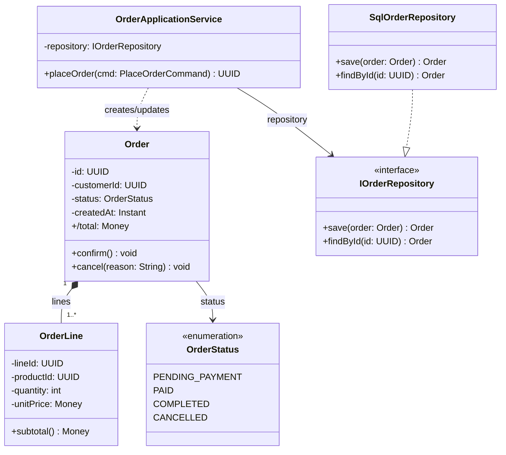

## 4. UML — Class Diagram

### 4.1. Tổng quan & Lý do sử dụng
* **Định nghĩa chuẩn:** Theo OMG UML 2.5.1 (§9.2, §11.4, §11.5), **Class Diagram** là sơ đồ cấu trúc tĩnh mô tả các loại phần tử (Class, Interface, Enumeration), cấu trúc nội bộ của chúng (Attributes, Operations) và các mối quan hệ tĩnh giữa các Classifier.
* **Vị trí trong 4+1 View Model:** Trọng tâm của **Logical View** (mô hình hóa miền nghiệp vụ, thực thể và thiết kế hướng đối tượng). Theo khảo sát thực nghiệm của Dobing & Parsons (2006) và Petre (2013), đây là biểu đồ UML được sử dụng phổ biến nhất (~73%) trong công nghiệp.
* **Tại sao phải dùng & Chức năng chính:**
  * Chốt cấu trúc thực thể miền (Domain Entities), hợp đồng dịch vụ (Interfaces, Services, Repositories) và bội số quan hệ (Multiplicity) trước hoặc trong khi lập trình.
  * Giải thích chi tiết cách một Component ở mức C3 được hiện thực hóa bằng các lớp và interface.
* **Phạm vi & Giới hạn (Non-goals):**
  * **Không** biểu diễn thứ tự gọi hàm theo thời gian (thuộc **UML Sequence Diagram**).
  * **Không** đồng nhất hoàn toàn với sơ đồ bảng vật lý ERD của cơ sở dữ liệu.
  * **Không** gom toàn bộ hàng trăm class của cả repository vào một hình duy nhất gây nhiễu (chỉ vẽ theo module/use case đang xét).

### 4.2. Các phần tử cốt lõi & Ký pháp chuẩn

| Phần tử / Quan hệ | Ý nghĩa mô hình (Semantics) | Ký pháp trình bày chuẩn (OMG UML 2.5.1) | Điều KHÔNG được suy diễn sai |
| :--- | :--- | :--- | :--- |
| **Class** | Classifier mô tả tập đối tượng chia sẻ thuộc tính, operation và quan hệ. | Hình chữ nhật chia tối đa 3 ngăn: **Tên Class** (in nghiêng nếu `abstract`), **Attributes**, **Operations**. Có thể ẩn ngăn chưa cần thiết. | Không bắt buộc liệt kê mọi getter/setter tầm thường. Tên gạch chân (`order1:Order`) là Instance thuộc Object Diagram, không phải Class. |
| **Interface & Enumeration** | Hợp đồng hành vi (`«interface»`) và tập giá trị hữu hạn (`«enumeration»`). | Hộp có từ khóa `«interface»` hoặc `«enumeration»` phía trên tên. | Không trộn lẫn kế thừa lớp (`Generalization`) với hiện thực hóa interface (`Realization`). |
| **Attribute & Operation** | Thuộc tính: `visibility name: Type [mult] = default {prop}`. Hành vi: `visibility name(param: Type): ReturnType`. | Visibility: `+` public, `-` private, `#` protected, `~` package. Thành viên `static` được **gạch chân**. Thuộc tính dẫn xuất có dấu `/total`. | `~` (package) cần ánh xạ cẩn thận theo ngôn ngữ (`internal` trong C# khác package-private trong Java). |
| **Association** | Quan hệ cấu trúc tĩnh giữa các instance của hai Classifier. | Đường **nét liền**; có thể gắn **Role name** và **Multiplicity** (`1`, `0..1`, `0..*`, `1..*`) ở mỗi đầu. Mũi tên hở thể hiện *navigability*. | Mũi tên navigability là khả năng truy cập tham chiếu hiệu quả, **không** phải chiều gọi hàm runtime. Không có mũi tên chưa chứng minh là truy cập 2 chiều. |
| **Dependency** | Quan hệ phụ thuộc client $\rightarrow$ supplier (thay đổi ở supplier có thể ảnh hưởng tới client). | Đường **nét đứt**, đầu mũi tên hở trỏ từ **Client** sang **Supplier** (VD: dùng kiểu ở tham số hàm hoặc biến cục bộ). | Không phải mọi Dependency đều là Association lưu giữ trạng thái. |
| **Generalization & Realization** | Kế thừa giữa lớp con – lớp cha (`Generalization`) và thực thi hợp đồng interface (`Realization`). | Tam giác rỗng luôn trỏ về **Superclass** (nét liền) hoặc **Interface** (nét đứt). | Không ghi Multiplicity (`1..*`) lên cạnh Generalization hay Realization. |
| **Shared Aggregation & Composition** | Quan hệ Whole–Part chia sẻ được (`Aggregation` - thoi rỗng) hoặc sở hữu độc점 kèm ràng buộc vòng đời (`Composition` - thoi đặc). | **Hình thoi (rỗng hoặc đặc) luôn đặt ở đầu Whole (tổng thể)**, nối tới Part (bộ phận). Với Composition, xóa Whole kéo theo xóa các Part còn thuộc nó. | Không tự suy ra Composition chỉ từ khóa ngoại (FK) hoặc Garbage Collector; khi chưa rõ nghĩa Whole–Part thì dùng Association thường. |

### 4.3. Quy trình dựng sơ đồ chuẩn
1. **Xác định phạm vi (Scope):** Chọn 1 module, package hoặc kịch bản thiết kế cụ thể (khoảng 5–15 classifier liên quan trực tiếp).
2. **Đưa các Classifier chính lên sơ đồ:** Xác định các Domain Class, Service, Repository Interface, Implementation và Enum cốt lõi.
3. **Điền Attributes & Operations trọng tâm:** Ghi đúng cú pháp UML (`visibility name: Type`), đánh dấu `/derived`, `{readOnly}`, `static` (gạch chân) hoặc `abstract` khi có căn cứ.
4. **Thiết lập quan hệ cấu trúc trước, phụ thuộc sau:** Vẽ Generalization/Realization $\rightarrow$ Composition/Aggregation/Association (kèm Role name & Multiplicity ở hai đầu) $\rightarrow$ Dependency.
5. **Kiểm tra trùng lặp biểu diễn:** Nếu một thuộc tính (ví dụ `- lines: OrderLine[1..*]`) đã được vẽ thành đường Association có role name `lines`, tránh hiểu nhầm thành hai mối quan hệ độc lập.

### 4.4. Bộ quy tắc sử dụng & Kiểm chứng
* **Quy tắc bắt buộc:**
  * **[N-CLS-01]** Hình thoi của Aggregation/Composition **bắt buộc** đặt ở phía `Whole`, tuyệt đối không đặt ở phía `Part`.
  * **[N-CLS-02]** Tam giác rỗng của Generalization/Realization **bắt buộc** đặt ở phía `Superclass` / `Interface`.
  * **[N-CLS-03]** Một Part trong `Composition` chỉ thuộc tối đa **một** Composite (Whole) tại một thời điểm (`0..1` hoặc `1` ở đầu Whole).
  * **[M-CLS-04] (Quy ước MAVIS):** Không tự đoán Multiplicity (`1..*` hay `0..*`) chỉ từ kiểu `List<T>` trong code nếu chưa có bằng chứng ràng buộc nullability/validation (`@NotEmpty`, schema constraint); giữ trống hoặc đánh dấu cần xác nhận khi chưa rõ.
* **Các lỗi thường gặp (Anti-patterns):**

| Lỗi phổ biến (Sai) | Cách hiểu & xử lý đúng (Chuẩn) |
| :--- | :--- |
| Đặt hình thoi đặc (Composition) ở phía `OrderLine` thay vì phía `Order`. | Hình thoi luôn nằm ở đầu `Order` (Whole). Đọc là: `Order` chứa các `OrderLine`. |
| Vẽ mũi tên kế thừa hoặc sở hữu lớp cho một lời gọi HTTP giữa hai microservice. | Hai microservice thuộc hai tiến trình khác nhau (mức C2); không dùng quan hệ kế thừa/composition xuyên tiến trình nếu chúng chỉ gọi REST API. |
| Vẽ nét liền tam giác rỗng khi Class `implements` một Interface. | Hiện thực hóa Interface (`Realization`) phải dùng **nét đứt** + tam giác rỗng; nét liền chỉ dùng cho kế thừa cùng loại (`extends`). |

* **Checklist nghiệm thu:**
  - [ ] Đúng đầu mũi tên / tam giác rỗng / hình thoi cho cả 6 loại quan hệ lớp.
  - [ ] Multiplicity ở hai đầu Association phản ánh đúng ràng buộc nghiệp vụ đã xác nhận.
  - [ ] Không biến HTTP call liên service thành quan hệ kế thừa hoặc sở hữu lớp.

### 4.5. Ứng dụng & Cơ chế trích xuất trong MAVIS
* **Ánh xạ dữ kiện đầu vào:**
  * *Static AST (Java Parser / C# Roslyn):* Trích xuất chính xác `class`, `interface`, `enum`, `extends`, `implements`, kiểu trường (field types), chữ ký phương thức (method signatures) và visibility modifiers.
  * *JPA / EF Core Annotations (`@OneToMany`, `@ManyToOne`, `cascade`, `@NotNull`):* Cung cấp bằng chứng bổ trợ cho Association, Multiplicity và Composition.
* **Xử lý thiếu dữ kiện:** Nếu hệ thống chỉ chạy ở mức Generic Adapter (chưa có AST sâu cho ngôn ngữ đó), MAVIS không tự sinh UML Class Diagram giả tạo từ tên file.

### 4.6. Ví dụ minh họa chuẩn (Bài toán OrderHub — Module `Order`)

### 4.7. Trích dẫn & Tài liệu tham khảo
* **[S1]** OMG, *UML 2.5.1 Specification* — §7.5 (Multiplicity), §9.2 (Classifiers), §9.5 (Properties), §11.4 (Classes), §11.5 (Associations), `https://www.omg.org/spec/UML/2.5.1/`
* **[A1]** Hassan Gomaa, *Software Modeling and Design (COMET)* — Giáo trình SWD392 Ch07 Static Modeling (slides 7–16).
* **[A2]** Martin Fowler, *UML Distilled (3rd Ed.)*, `https://martinfowler.com/books/uml.html`
* **[T1]** Visual Paradigm & Mermaid Class Diagram Reference, `https://www.visual-paradigm.com/guide/uml-unified-modeling-language/what-is-class-diagram/`

---
