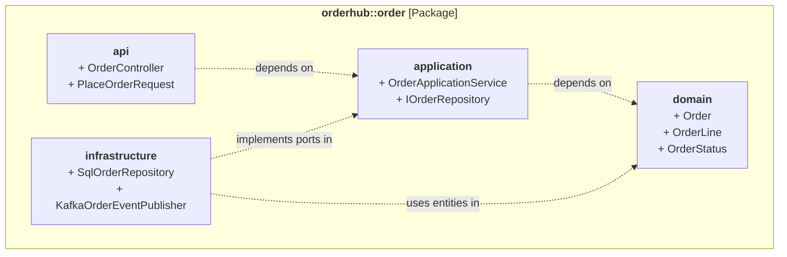

## 6. UML — Package Diagram

### 6.1. Tổng quan & Lý do sử dụng
* **Định nghĩa chuẩn:** Theo OMG UML 2.5.1 (Chương 12 — Packages), **Package Diagram** là sơ đồ cấu trúc tĩnh dùng để gom nhóm các `PackageableElement` (Class, Interface, Component, Package con) thành các không gian tên (**Namespaces**) và biểu diễn sự phụ thuộc giữa các gói đó.
* **Vị trí trong 4+1 View Model:** Trung tâm của **Development View (Implementation View)** — phản ánh cách tổ chức cấu trúc mã nguồn, phân tầng kiến trúc (Layered / Clean / Hexagonal Architecture) và quy tắc phụ thuộc giữa các gói.
* **Tại sao phải dùng & Chức năng chính:**
  * Kiểm soát kiến trúc phân tầng (ví dụ: tầng `api` và `infrastructure` được phép phụ thuộc vào `application`/`domain`, nhưng `domain` tuyệt đối không được phụ thuộc ngược ra `infrastructure`).
  * Phát hiện sớm các **phụ thuộc vòng (Cyclic Dependencies)** giữa các package/namespace lớn.
* **Phạm vi & Giới hạn (Non-goals):**
  * Một UML Package là đơn vị tổ chức namespace trong mô hình, **không** mặc định là một tiến trình triển khai độc lập (như C4 Container).
  * Không dùng để biểu diễn luồng gọi hàm theo thời gian.

### 6.2. Các phần tử cốt lõi & Ký pháp chuẩn

| Phần tử / Quan hệ | Ý nghĩa mô hình (Semantics) | Ký pháp trình bày chuẩn (OMG UML 2.5.1) | Điều KHÔNG được suy diễn sai |
| :--- | :--- | :--- | :--- |
| **Package** | Namespace sở hữu các phần tử mô hình (`shop::orders::domain`). | Hình thư mục có tai (tab) ở góc trên trái. Khi mở ruột: tên ghi ở tai; khi đóng ruột: tên ghi ở thân hộp. | Vẽ Package B nằm lồng bên trong Package A biểu diễn **Containment/Ownership** (A sở hữu B), **không** phải A phụ thuộc B. |
| **Dependency** | Một hoặc nhiều phần tử trong Package nguồn phụ thuộc vào phần tử trong Package đích. | Đường **nét đứt, đầu mũi tên hở** từ Package phụ thuộc tới Package được dùng. | Chiều mũi tên là chiều **phụ thuộc biên dịch/mô hình**, không bắt buộc trùng chiều luồng gọi runtime (nhờ Dependency Inversion). |
| **PackageImport (`«import»`)** | Đưa tên các member `public` của package đích vào namespace nguồn với visibility `public` (§7.4.3.3). | Cạnh nét đứt mũi tên hở kèm nhãn từ khóa `«import»`. | Một câu lệnh `import` trong Java hay `using` trong C# ở đầu file code **không** tự động mang nghĩa tái xuất public (`«import»`) của UML. |
| **ElementImport / Private Import (`«access»`)** | Nhập tên member từ package đích vào namespace nguồn với visibility `private` (không tái xuất tiếp). | Cạnh nét đứt mũi tên hở kèm nhãn từ khóa `«access»`. | `«access»` trong UML Package là phạm vi hiển thị tên trong namespace, **không** mang nghĩa quyền đăng nhập (authentication/authorization) hay truy cập DB. |
| **PackageMerge (`«merge»`)** | Kết hợp định nghĩa của package được merge vào receiving package theo quy tắc metamodel UML (§12.2.3). | Cạnh nét đứt mũi tên hở kèm nhãn `«merge»` từ receiving package tới merged package. | Không phải thao tác `git merge` hay gộp thư mục code thông thường; `«merge»` tuyệt đối không được có chu trình. |

### 6.3. Quy trình dựng sơ đồ chuẩn
1. **Xác định quy ước ánh xạ Namespace:** Chốt mức package/namespace cần biểu diễn (ví dụ `com.orderhub.order.api`, `.application`, `.domain`, `.infrastructure`).
2. **Vẽ cấu trúc Containment (Sở hữu):** Nhóm các package con vào package cha hoặc liệt kê các member public (`+ Order`, `+ IOrderRepository`) tiêu biểu bên trong.
3. **Tổng hợp các cạnh Dependency từ phần tử con:** Nếu một class trong package `infrastructure` hiện thực hóa interface trong `application`, vẽ cạnh phụ thuộc từ `infrastructure` $\rightarrow$ `application`.
4. **Chỉ dùng `«import»` / `«access»` / `«merge»` khi có đúng ngữ nghĩa UML:** Với phụ thuộc mã nguồn thông thường, sử dụng đường `Dependency` chuẩn kèm bằng chứng truy nguyên.
5. **Kiểm tra quy tắc kiến trúc phân tầng:** Rà soát chiều mũi tên giữa các tầng và phát hiện chu trình phụ thuộc.

### 6.4. Bộ quy tắc sử dụng & Kiểm chứng
* **Quy tắc bắt buộc:**
  * **[N-PKG-01]** Không dùng ký hiệu của Class Diagram (như Multiplicity `1..*`, hình thoi Composition hay tam giác Generalization) cho các cạnh nối giữa hai Package.
  * **[N-PKG-02]** Phân biệt rõ **Containment** (lồng hộp = sở hữu namespace) và **Dependency** (mũi tên nét đứt = phụ thuộc).
  * **[N-PKG-03]** Quan hệ `«merge»` bắt buộc không có chu trình (acyclic). Việc cấm chu trình trên `Dependency` thông thường là quy tắc kiến trúc tốt (Rule `REL-01` trong MAVIS), không phải ràng buộc cú pháp cứng của mọi mô hình UML.
  * **[M-PKG-04] (Quy ước MAVIS):** Mỗi cạnh phụ thuộc giữa 2 Package phải truy ngược được về danh sách các cặp `Type -> Type` (hoặc `import`/`using` thực sự sử dụng kiểu) làm bằng chứng (`underlyingEdgeIds`).
* **Các lỗi thường gặp (Anti-patterns):**

| Lỗi phổ biến (Sai) | Cách hiểu & xử lý đúng (Chuẩn) |
| :--- | :--- |
| Vẽ mũi tên `application -> infrastructure` vì lúc chạy hàm ở `application` gọi xuống `SqlOrderRepository`. | Trong Clean/Hexagonal Architecture, `IOrderRepository` nằm ở `application`/`domain`, còn `SqlOrderRepository` nằm ở `infrastructure` và `implements` interface đó $\rightarrow$ chiều phụ thuộc tĩnh phải là `infrastructure -> application`. |
| Gắn nhãn `«import»` cho mọi cạnh nối giữa các package Java chỉ vì thấy từ khóa `import`. | Dùng cạnh `Dependency` nét đứt chuẩn; chỉ ghi `«import»` hoặc `«access»` khi mô tả cơ chế nhập và tái xuất namespace theo đúng §7.4 UML. |

* **Checklist nghiệm thu:**
  - [ ] Tên các Package rõ ràng theo phân cấp namespace; không nhầm lẫn lồng hộp (ownership) với phụ thuộc (dependency).
  - [ ] Chiều mũi tên phản ánh đúng phụ thuộc tĩnh của mã nguồn (đặc biệt tại ranh giới interface/implementation).
  - [ ] Không xuất hiện multiplicity hay hình thoi composition trên cạnh nối Package.

### 6.5. Ứng dụng & Cơ chế trích xuất trong MAVIS
* **Ánh xạ dữ kiện đầu vào:**
  * *Static AST (`package` declarations в Java, `namespace` trong C#, type references):* Gom nhóm các `Type` theo package/namespace và tổng hợp cạnh `DEPENDS_ON` từ các tham chiếu kiểu thực tế.
  * *Evaluation Rule (`REL-01` - Layer Violation & Cycle Detection):* MAVIS sử dụng sơ đồ này để kiểm tra vi phạm phụ thuộc tầng (ví dụ: `domain` phụ thuộc ngược lên `api` hoặc `infrastructure`).

### 6.6. Ví dụ minh họa chuẩn (Bài toán OrderHub — Cấu trúc Package của `Order API`)

### 6.7. Trích dẫn & Tài liệu tham khảo
* **[S1]** OMG, *UML 2.5.1 Specification* — §7.4.3.3 & §7.4.4.3 (ElementImport & PackageImport), Chương 12 (Packages: §12.2.3 PackageMerge, §12.2.4 Notation), `https://www.omg.org/spec/UML/2.5.1/`
* **[T1]** Visual Paradigm, *UML Package Diagram & Namespace Guide*, `https://www.visual-paradigm.com/guide/uml-unified-modeling-language/what-is-package-diagram/`

---
