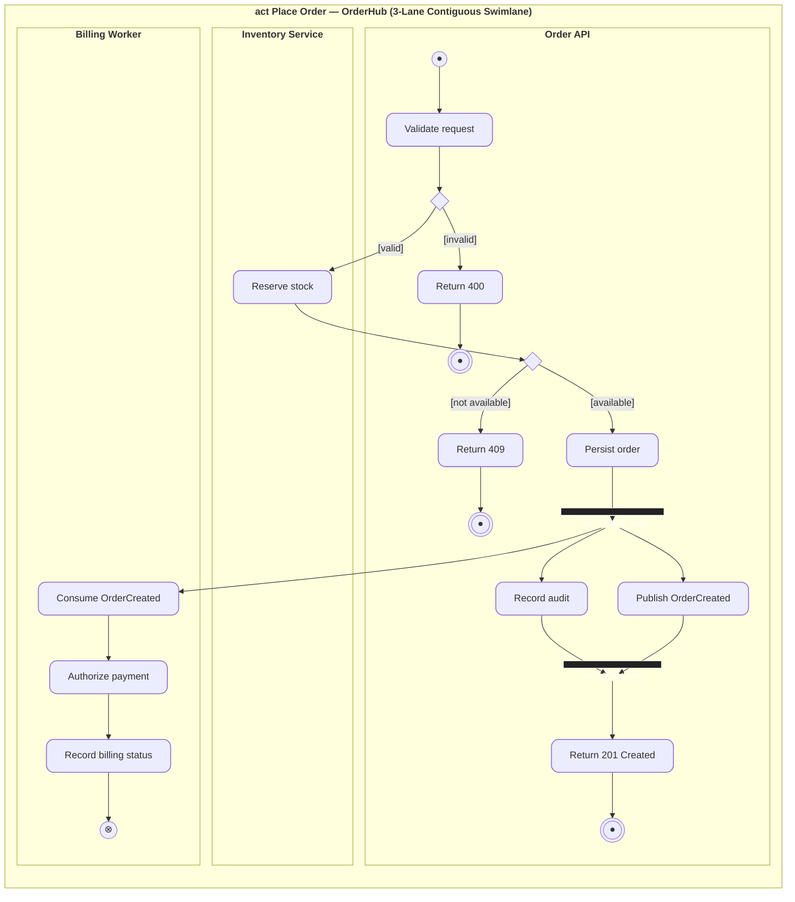
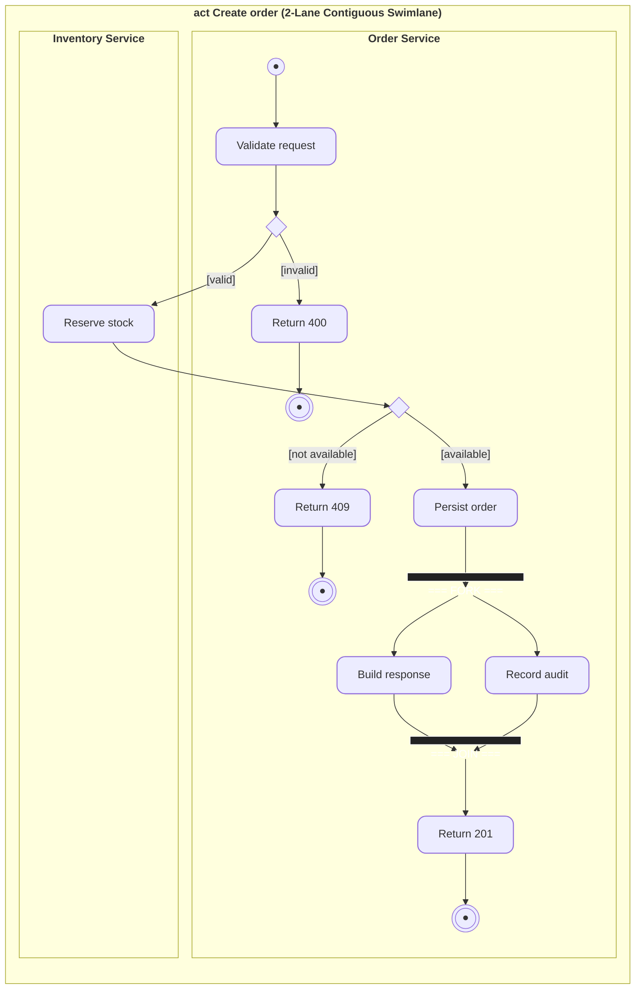

## 8. UML — Activity Diagram

### 8.1. Tổng quan & Lý do sử dụng
* **Định nghĩa chuẩn:** Theo OMG UML 2.5.1 (Chương 15 — Activities), **Activity Diagram** là sơ đồ hành vi mô tả luồng điều khiển (**Control Flow**) và luồng dữ liệu (**Object Flow**) giữa các bước xử lý (**Actions**), hỗ trợ biểu diễn rẽ nhánh điều kiện, hợp luồng và thực thi đồng thời dựa trên ngữ nghĩa dòng chảy token (Petri-net like token flow).
* **Vị trí trong 4+1 View Model:** Thuộc **Process View** và **Scenarios (+1)** — đặc tả quy trình nghiệp vụ liên dịch vụ hoặc thuật toán/workflow bên trong một API handler.
* **Tại sao phải dùng & Chức năng chính:**
  * Trực quan hóa rõ các nhánh điều kiện (`Decision`/`Merge`) tách biệt hoàn toàn với các nhánh xử lý đồng thời (`Fork`/`Join`).
  * Phân định rõ trách nhiệm thực hiện từng bước hành động giữa các dịch vụ/thành phần thông qua các làn bơi (**Swimlanes / Activity Partitions**).
* **Phạm vi & Giới hạn (Non-goals):**
  * **Không** thay thế Sequence Diagram khi mục tiêu chính là kiểm tra chi tiết giao thức trao đổi thông điệp và chuỗi span theo thời gian.
  * **Không** thay thế State Machine Diagram khi mục tiêu là mô tả vòng đời trạng thái của một thực thể dữ liệu.

### 8.2. Các phần tử cốt lõi & Ký pháp chuẩn

| Phần tử / Quan hệ | Ý nghĩa mô hình (Semantics) | Ký pháp trình bày chuẩn (OMG UML 2.5.1 §15.2–15.6) | Điều KHÔNG được suy diễn sai |
| :--- | :--- | :--- | :--- |
| **Action** | Một bước xử lý cơ sở trong Activity. | Hình chữ nhật bo góc, tên theo cấu trúc **Động từ + Tân ngữ** (ví dụ: `Validate request`, `Reserve stock`). | Không ghi tên trạng thái tĩnh (như `Paid`, `Cancelled`) vào hộp Action (đó là State Machine). |
| **Initial Node** | Điểm khởi phát token điều khiển khi Activity được gọi (§15.3.3.1). | Hình tròn đặc màu đen; **không có cạnh đi vào**, chỉ có cạnh `Control Flow` đi ra. | Quy ước dùng 1 Initial Node cho dễ đọc là lựa chọn của MAVIS, không phải giới hạn cấm của chuẩn UML. |
| **Activity Final vs Flow Final** | **Activity Final** (§15.3.3.2): kết thúc toàn bộ Activity chứa nó. **Flow Final**: chỉ tiêu thụ token của nhánh đi vào nó, các nhánh đồng thời khác vẫn chạy tiếp. | **Activity Final**: chấm tròn đặc nằm trong vòng tròn ngoài (bullseye). **Flow Final**: vòng tròn có dấu **X** bên trong. Cả hai đều không có cạnh đi ra. | `Activity Final` trong một service không tự động hủy một tác vụ từ xa đã được gọi bất đồng bộ trước đó. `Flow Final` không đồng nghĩa với lỗi hệ thống. |
| **Decision & Merge Node** | **Decision**: chọn **một** cạnh ra thỏa `[guard]`. **Merge**: gom các nhánh thay thế lại mà không chờ đồng bộ (§15.3.3.5–6). | Hình thoi (diamond). **Decision**: 1 cạnh vào, $\ge 2$ cạnh ra kèm `[guard]`. **Merge**: $\ge 2$ cạnh vào, 1 cạnh ra. | Decision **không** nhân bản token ra nhiều nhánh. Không phân loại Decision hay Merge chỉ bằng hình thoi mà phải nhìn số cạnh vào/ra. |
| **Fork & Join Node** | **Fork**: tách 1 token thành nhiều token đồng thời trên mọi cạnh ra. **Join**: đồng bộ chờ đủ token trên tất cả cạnh vào (mặc định `joinSpec = AND`) (§15.3.3.3–4). | Thanh đậm (bar) ngang hoặc dọc. **Fork**: 1 cạnh vào, $\ge 2$ cạnh ra. **Join**: $\ge 2$ cạnh vào, 1 cạnh ra. | Nếu sau `Fork` có một nhánh rẽ `Decision` mà một đường của Decision không đi về `Join` (hoặc chưa qua `Merge`), `Join` mặc định sẽ **bị kẹt vĩnh viễn (deadlock)**. |
| **Control Flow & Object Flow / Pin** | **Control Flow**: truyền quyền điều khiển. **Object Flow**: truyền dữ liệu qua `Object Node` hoặc `Pin` gắn trên biên Action (§15.2.4, §15.4). | Cả hai đều dùng đường **nét liền, đầu mũi tên hở** trong chuẩn UML 2.5.1. `Pin` là ô vuông nhỏ gắn trên cạnh của Action. | Không dùng đường nét đứt làm ký hiệu mặc định cho `Object Flow` (một số hướng dẫn công cụ vẽ sai chuẩn OMG). |
| **Activity Partition (Swimlane)** | Phân nhóm các Action theo chủ thể/dịch vụ chịu trách nhiệm thực hiện (§15.6). | **Khung chia làn liền mạch (Contiguous Swimlanes):** Tất cả các làn là các cột (hoặc hàng) **đồng cấp, có chiều cao bằng nhau nằm chung trong một khung chữ nhật duy nhất**, ngăn cách bởi các đường vách ngăn thẳng đứng; các mũi tên đi xuyên qua lại giữa các vách ngăn. | **Tuyệt đối không** vẽ các Swimlane thành các hộp rời rạc đứng tách biệt hoặc xếp chồng lệch nhau (như hạn chế của Mermaid `subgraph`). Mũi tên qua vách ngăn chỉ mô tả chuyển giao bước xử lý, chưa tự xác định giao thức là HTTP, gRPC hay Kafka. |

### 8.3. Quy trình dựng sơ đồ chuẩn
1. **Chốt phạm vi hành vi & kẻ khung Swimlane liền mạch:** Chọn 1 workflow hoặc API use case cụ thể; kẻ **một khung lớn duy nhất** chia thành các cột đồng cấp (chiều cao bằng nhau) theo từng Service chịu trách nhiệm (theo quy ước MAVIS, ngay cả workflow 1 service cũng đặt trong 1 lane mang tên service đó).
2. **Đặt Initial Node và liệt kê các Actions:** Viết tên Action dạng `Động từ + Đối tượng` và đặt vào đúng cột làn sở hữu.
3. **Nối Control Flow / Object Flow xuyên làn:** Khi bước xử lý chuyển từ Service A sang Service B, vẽ mũi tên đi ngang/vuông góc **xuyên qua vách ngăn giữa 2 cột** sang Action thuộc làn B (và đi ngược lại nếu trả kết quả đồng bộ).
4. **Mô hình hóa rẽ nhánh bằng `Decision` / `Merge`:** Đặt `[guard]` không chồng lấn trên các cạnh ra của Decision (tối đa một nhánh `[else]`); hợp các nhánh thay thế qua `Merge` trước khi vào bước chung tiếp theo.
5. **Mô hình hóa xử lý đồng thời bằng `Fork` / `Join`:** Chỉ dùng `Fork` khi các nhánh thực sự độc lập/đồng thời; kiểm tra bảo toàn token tại mọi `Join` (tránh deadlock).
6. **Chọn đúng loại Node kết thúc:** Dùng `Flow Final` ($\otimes$) cho nhánh phụ/bất đồng bộ kết thúc riêng lẻ và `Activity Final` ($\odot$) cho điểm kết thúc toàn bộ Activity.

### 8.4. Bộ quy tắc sử dụng & Kiểm chứng
* **Quy tắc bắt buộc:**
  * **[N-ACT-01]** Tuyệt đối không dùng `Fork` để biểu diễn câu lệnh `if/else` và không dùng `Join` để gộp hai nhánh loại trừ nhau của `Decision` (phải dùng `Merge`).
  * **[N-ACT-02]** Các `[guard]` đi ra từ một `Decision` không được chồng lấn điều kiện ngoài ý muốn; mỗi `Decision` có tối đa một `[else]`.
  * **[N-ACT-03]** Nếu một nhánh sau `Fork` rẽ qua `Decision`, các đường thay thế muốn quay lại đồng bộ ở `Join` phải được gom qua `Merge` trước khi nối vào `Join`.
  * **[M-ACT-04] (Quy ước MAVIS — Khung Swimlane đồng cấp):** Mặc định trình bày Activity Diagram dưới dạng **bảng phân làn liền mạch (Contiguous Swimlanes)** có các cột cao bằng nhau trong cùng một khung viền; khi chưa rõ service sở hữu thì ghi rõ `"Chưa xác định"`, không tự bịa tên service.
* **Các lỗi thường gặp (Anti-patterns):**

| Lỗi phổ biến (Sai) | Cách hiểu & xử lý đúng (Chuẩn) |
| :--- | :--- |
| Vẽ mỗi Swimlane thành một hộp `subgraph` tách rời nhau, xếp lệch trên–dưới. | Sai ký pháp UML Swimlane. Các Swimlane bắt buộc phải đứng cạnh nhau, **chung đường viền trên/dưới và chung vách ngăn dọc** để thấy rõ luồng đi qua đi lại giữa các làn. |
| Đưa 2 nhánh `[valid]` và `[invalid]` của một `Decision` đi thẳng vào một thanh `Join` (AND). | Thanh `Join` chờ cả 2 nhánh cùng có token nên sẽ deadlock mãi mãi. Phải dùng hình thoi `Merge` nếu muốn gộp 2 nhánh thay thế. |
| Dùng `Activity Final` (bullseye) ở cuối một nhánh ghi log phụ chạy song song sau `Fork`. | Token chạm `Activity Final` sẽ hủy luôn cả các nhánh chính đang chạy! Nhánh phụ kết thúc độc lập phải dùng `Flow Final` (vòng tròn chữ X). |
| Thấy từ khóa `async` trong code liền vẽ `Fork` chạy song song. | `async/await` tuần tự không phải là concurrency hai nhánh độc lập; chỉ vẽ `Fork` khi thực sự khởi chạy các tác vụ đồng thời (`Task.WhenAll`, `CompletableFuture.allOf`, hoặc nhánh bất đồng bộ độc lập). |

* **Checklist nghiệm thu:**
  - [ ] Tất cả các Swimlane nằm chung trong một khung liền mạch, chiều cao bằng nhau, tên cột ghi đúng tên Service.
  - [ ] Mọi Action đều nằm trong Swimlane tương ứng và đặt tên theo chuẩn `Động từ + Đối tượng`.
  - [ ] Phân biệt đúng `Decision`/`Merge` (hình thoi) với `Fork`/`Join` (thanh ngang/dọc).
  - [ ] Không có lỗi deadlock tại `Join` hoặc kết thúc sớm ngoài ý muốn tại `Activity Final`.
  - [ ] Các `[guard]` đặt trong ngoặc vuông trên cạnh ra của `Decision`, không chồng lấn.

### 8.5. Ứng dụng & Cơ chế trích xuất trong MAVIS
* **Ánh xạ dữ kiện đầu vào:**
  * *Explicit Workflow / Use Case Spec & Bounded Control-Flow Analysis:* Trích xuất các bước hành động chính, nhánh điều kiện và lời gọi sang service khác.
  * *Giới hạn:* Control-Flow Graph (CFG) mức câu lệnh trong source code thường quá chi tiết; MAVIS yêu cầu nâng mức trừu tượng lên các bước nghiệp vụ có ý nghĩa và giữ trạng thái `Assisted / Needs Review` cho người học duyệt.

### 8.6. Ví dụ minh họa chuẩn (Swimlane liền mạch chuẩn UML 2.5.1)

> [!TIP]
> **Nguyên tắc hiển thị Swimlane chuẩn UML 2.5.1:** Tất cả các làn (`Order API`, `Inventory Service`, `Billing Worker`) phải là **các cột đồng cấp, có chiều cao bằng nhau nằm chung trong một khung liền mạch duy nhất (`act Place Order`)**, và các mũi tên đi xuyên qua lại giữa vách ngăn của các làn. Dưới đây là cả **hình vẽ chuẩn UML 2.5.1** và **sơ đồ Mermaid đã căn chỉnh đồng cấp chiều cao 3 làn trong cùng 1 khung**:

#### Minh họa 1: Sơ đồ Swimlane 3 làn đồng cấp liền mạch — Bài toán OrderHub (`Order API | Inventory Service | Billing Worker`)

#### Minh họa 2: Sơ đồ Swimlane 2 làn đồng cấp liền mạch (`Order Service | Inventory Service` — `act Create order`)

#### Minh họa 3: Quy ước Ký hiệu Cốt lõi & Cấu trúc Vách ngăn Swimlane (OMG UML 2.5.1)

### 8.7. Trích dẫn & Tài liệu tham khảo
* **[S1]** OMG, *UML 2.5.1 Specification* — Chương 15 (Activities: §15.2 Actions & Edges, §15.3 Control Nodes, §15.4 Object Nodes & Pins, §15.6 Activity Partitions; Hình 15.5, 15.27–15.33, 15.67 trang 380–409), `https://www.omg.org/spec/UML/2.5.1/`
* **[A1]** Giáo trình SWD392 — RDS Activity Diagrams với Swimlane (trang 23–24, Hình I-12 & I-13).
* **[T1]** Sparx Systems & Visual Paradigm Activity Diagram Guides, `https://sparxsystems.com/resources/tutorials/uml2/activity-diagram.html`

---
