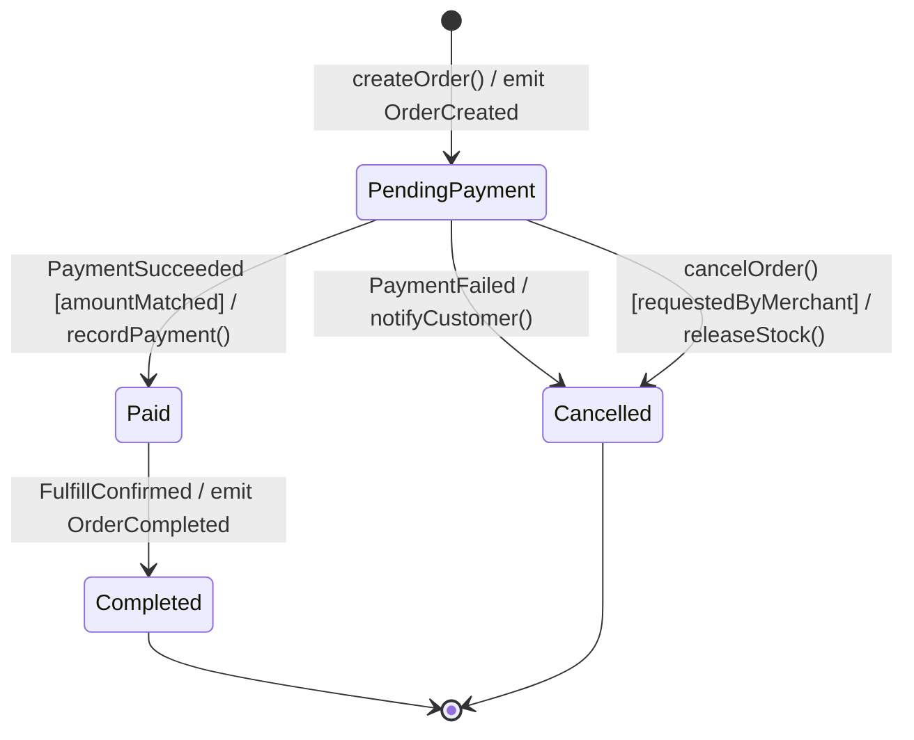

## 9. UML — State Machine Diagram

### 9.1. Tổng quan & Lý do sử dụng
* **Định nghĩa chuẩn:** Theo OMG UML 2.5.1 (Chương 14 — StateMachines), **Behavioral State Machine Diagram** mô tả vòng đời trạng thái (**States**) của **một thực thể/đối tượng cụ thể** (như `Order`, `Payment`, `AnalysisJob`) và cách đối tượng đó chuyển trạng thái (**Transitions**) để phản ứng lại các sự kiện (**Triggers/Events**) dưới các điều kiện (**Guards**) kèm hành vi hệ quả (**Effects**).
* **Vị trí trong 4+1 View Model:** Thuộc **Logical View / Process View** động — đặc tả các bất biến vòng đời của một thực thể có trạng thái (stateful entity).
* **Tại sao phải dùng & Chức năng chính:**
  * Ngăn chặn các phép chuyển trạng thái bất hợp lệ trong nghiệp vụ (ví dụ: đơn hàng đã `CANCELLED` không được chuyển sang `PAID`, hoặc `AnalysisJob` đã `COMPLETED` không bị ghi đè bởi callback cũ).
  * Làm rõ điều kiện `[guard]` nào bắt buộc phải thỏa mãn khi nhận một sự kiện trước khi đổi trạng thái.
* **Phạm vi & Giới hạn (Non-goals):**
  * Một State Machine mô tả vòng đời của **đúng một loại đối tượng**, **không** phải luồng công việc đi qua nhiều service (không dùng Swimlane của Activity Diagram cho State Machine).

### 9.2. Các phần tử cốt lõi & Ký pháp chuẩn

| Phần tử / Quan hệ | Ý nghĩa mô hình (Semantics) | Ký pháp trình bày chuẩn (OMG UML 2.5.1 §14.2) | Điều KHÔNG được suy diễn sai |
| :--- | :--- | :--- | :--- |
| **Simple / Composite State** | Tình huống trong vòng đời đối tượng mà tại đó một điều kiện bất biến được thỏa mãn. `Composite State` chứa một hoặc nhiều region trạng thái con bên trong. | Hình chữ nhật bo góc. Tên State là **Tính từ / Cụm danh từ tình huống** (ví dụ: `PendingPayment`, `Paid`, `Completed`). Có thể có ngăn ghi `entry / ...`, `do / ...`, `exit / ...`. | Không lấy tên hành động (`Process payment`) đặt làm tên State. Hành vi `do / activity` chạy khi đang ở trong state, **không** mặc định là vòng lặp vô hạn. |
| **Initial Pseudostate & Final State** | **Initial**: điểm bắt đầu của một Region. **Final State**: đánh dấu việc hoàn tất Region chứa nó. | **Initial**: hình tròn đặc đen (tối đa 1 Initial mỗi Region). **Final State**: chấm tròn đặc trong vòng tròn ngoài (bullseye), không có cạnh đi ra. | Chạm `Final State` nghĩa là vòng đời trạng thái trong Region đó hoàn tất, **không** mặc định là xóa bản ghi khỏi Database hay tắt toàn bộ microservice. |
| **Transition (`trigger [guard] / effect`)** | Sự chuyển đổi từ trạng thái nguồn sang trạng thái đích khi sự kiện xảy ra và guard đúng (§14.2.3.8). | Mũi tên nét liền đầu hở kèm nhãn `trigger [guard] / effect` (các thành phần không dùng có thể lược bỏ). Cạnh từ Initial không có trigger/guard. | Một cạnh đi ra từ State thường mà **không ghi trigger** là **Completion Transition** (tự kích hoạt ngay khi `entry` và `do` trong state đó hoàn tất), không phải là "nhận bất kỳ sự kiện nào". |
| **Internal vs External Self-Transition** | Phản ứng với sự kiện mà vẫn giữ nguyên trạng thái hiện tại. | **External self-transition**: mũi tên vòng ra ngoài rồi quay lại biên State $\rightarrow$ **có chạy lại** `exit` và `entry`. **Internal transition**: ghi bên trong ngăn của State $\rightarrow$ **không chạy** `exit`/`entry`. | Hai kiểu này khác nhau về việc có kích hoạt lại hành vi `entry`/`exit` hay không. |
| **Choice Pseudostate** | Điểm rẽ nhánh động đánh giá các `[guard]` sau khi hiệu ứng của phần chuyển đổi trước đã thực thi. | Hình thoi (diamond). Các cạnh đi ra chỉ gắn `[guard]` (và `/ effect`), **không** gắn thêm `trigger` mới lên cạnh ra của Choice. | Tránh thiết kế các `[guard]` trên các cạnh ra của Choice cùng đúng một lúc gây bất định. |

### 9.3. Quy trình dựng sơ đồ chuẩn
1. **Chọn đúng 1 đối tượng có trạng thái (Stateful Entity):** Ví dụ đối tượng `Order` hoặc `AnalysisJob` (ghi rõ tên đối tượng trong tiêu đề sơ đồ).
2. **Xác định tập các States hợp lệ:** Lấy từ enum trạng thái và đặc tả nghiệp vụ; đặt tên theo tình huống/trạng thái (`Created`, `PendingPayment`, `Paid`, `Cancelled`), không đặt tên theo hàm.
3. **Đặt Initial Pseudostate và các Final States:** Vẽ cạnh khởi tạo từ Initial vào trạng thái đầu tiên.
4. **Xác lập các Transitions có căn cứ:** Với mỗi cặp chuyển trạng thái hợp lệ, ghi rõ `trigger` (sự kiện/method kích hoạt), `[guard]` (điều kiện kiểm tra) và `/ effect` (hành động sinh ra như phát sự kiện).
5. **Rà soát các trạng thái kết thúc và bất biến:** Kiểm tra không có cạnh đi ra từ `Final State` và không bỏ sót nhánh hủy/lỗi quan trọng.

### 9.4. Bộ quy tắc sử dụng & Kiểm chứng
* **Quy tắc bắt buộc:**
  * **[N-STM-01]** Mỗi Region có tối đa **một** `Initial Pseudostate` và tối đa một cạnh đi ra từ nó; cạnh khởi tạo này không mang `trigger` hay `[guard]`.
  * **[N-STM-02]** `Final State` không được có bất kỳ cạnh đi ra nào.
  * **[N-STM-03]** Trên cạnh đi ra từ `Choice Pseudostate`, chỉ đặt `[guard] / effect`, tuyệt đối không đặt `trigger` sự kiện mới.
  * **[M-STM-04] (Quy ước MAVIS):** Một khai báo `enum OrderStatus` trong source code chỉ là bằng chứng về **danh sách tên các trạng thái**, chưa đủ bằng chứng để tự vẽ các mũi tên chuyển đổi (`Transition`). Mọi cạnh Transition phải có bằng chứng từ hàm chuyển trạng thái (state transition handler) hoặc xác nhận của người học.
* **Các lỗi thường gặp (Anti-patterns):**

| Lỗi phổ biến (Sai) | Cách hiểu & xử lý đúng (Chuẩn) |
| :--- | :--- |
| Chỉ thấy `enum Status { A, B, C }` trong code liền tự động nối `A -> B -> C` như một quy trình tuyến tính. | Enum chỉ cho biết các giá trị trạng thái; chiều chuyển đổi hợp lệ và `[guard]` phải lấy từ logic kiểm tra trạng thái trong method/domain model. |
| Bỏ trống tên `trigger` trên mọi mũi tên giữa các trạng thái vì nghĩ đó là mũi tên thứ tự thông thường. | Trong UML State Machine, cạnh không có trigger là *Completion Transition* (tự động chuyển ngay khi xong `do` activity). Nếu cần chờ sự kiện bên ngoài (như `PaymentSucceeded`), bắt buộc phải ghi tên trigger. |
| Kẻ các cột Swimlane của Service đè lên State Machine Diagram. | Swimlane thuộc Activity Diagram. State Machine xoay quanh vòng đời của **một** đối tượng duy nhất. |

* **Checklist nghiệm thu:**
  - [ ] Sơ đồ mô tả vòng đời của đúng 1 loại đối tượng xác định.
  - [ ] Tên các node là trạng thái (State), không phải tên hành động (Action).
  - [ ] Nhãn cạnh tuân thủ cú pháp `trigger [guard] / effect`; cạnh từ Initial không có trigger/guard.
  - [ ] Mọi Transition đều có căn cứ từ domain method/handler hoặc tài liệu quy tắc nghiệp vụ.

### 9.5. Ứng dụng & Cơ chế trích xuất trong MAVIS
* **Ánh xạ dữ kiện đầu vào:**
  * *Static AST:* Khai báo `enum` trạng thái + các phương thức domain thay đổi trường trạng thái (ví dụ `if (this.status == PENDING_PAYMENT) { this.status = PAID; }`) $\rightarrow$ trích xuất State + Transition kèm `[guard]` và vị trí dòng code (`Evidence`).
  * *Runtime Event/State Trace:* Bổ sung bằng chứng các phép chuyển trạng thái đã quan sát được trong kịch bản chạy, nhưng việc không thấy một transition trong trace không chứng minh phép chuyển đó bị cấm trong code.

### 9.6. Ví dụ minh họa chuẩn (Bài toán OrderHub — Vòng đời đối tượng `Order`)

### 9.7. Trích dẫn & Tài liệu tham khảo
* **[S1]** OMG, *UML 2.5.1 Specification* — Chương 14 (StateMachines: §14.2 Behavior StateMachines, Transitions, Pseudostates), `https://www.omg.org/spec/UML/2.5.1/`
* **[A1]** Hassan Gomaa, *Software Modeling and Design* — Giáo trình SWD392 Ch09–11 Dynamic Modeling (slides 17–21: State, Event, Guard, Transition Action, Entry/Exit).
* **[T1]** Visual Paradigm & Mermaid State Diagram Guide, `https://www.visual-paradigm.com/guide/uml-unified-modeling-language/what-is-state-machine-diagram/`
