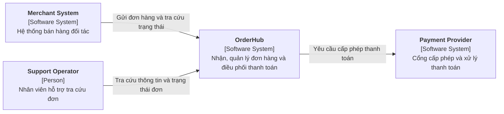

## 1. C4 — System Context Diagram (C1)

### 1.1. Tổng quan & Lý do sử dụng
* **Định nghĩa chuẩn:** Sơ đồ Ngữ cảnh Hệ thống (C1) là góc nhìn cấp cao nhất của mô hình C4, đặt **một Software System** vào trung tâm như một hộp đen (black box) và hiển thị các **Person** (người dùng/vai trò) cùng các **External Software Systems** tương tác trực tiếp với nó.
* **Vị trí trong 4+1 View Model:** Đóng vai trò khung ngữ cảnh tổng thể kết nối **Scenarios (+1)** với biên ngoài của **Logical View**.
* **Tại sao phải dùng & Chức năng chính:**
  * Xác lập rõ **ranh giới trách nhiệm (System Boundary)** và giá trị nghiệp vụ cốt lõi của hệ thống trước khi đi vào chi tiết kỹ thuật.
  * Nhận diện đầy đủ các tác nhân con người và các hệ thống phụ thuộc bên ngoài (cả chiều gọi vào inbound lẫn chiều hệ thống gọi ra outbound).
* **Phạm vi & Giới hạn (Non-goals):**
  * **Không** mở danh sách microservice nội bộ, database/schema nội bộ, message broker/topic nội bộ, class/controller hay cổng mạng (TCP port).

### 1.2. Các phần tử cốt lõi & Ký pháp chuẩn

| Phần tử / Quan hệ | Ý nghĩa mô hình (Semantics) | Ký pháp trình bày chuẩn | Điều KHÔNG được suy diễn sai |
| :--- | :--- | :--- | :--- |
| **Person** | Vai trò con người sử dụng hệ thống. | Hộp/biểu tượng người: **Tên vai trò**, nhãn `[Person]`, mô tả trách nhiệm ngắn. | Client máy, cronjob hoặc API bên ngoài gọi vào **không** phải là `Person`. |
| **Target Software System** | Hệ thống phần mềm đang xét; đơn vị cung cấp giá trị nghiệp vụ thuộc quyền sở hữu của nhóm/tổ chức. | Hộp trung tâm: **Tên hệ thống**, nhãn `[Software System]`, câu mô tả giá trị nghiệp vụ. | Một Software System không đồng nhất 1-1 với một Git repository hay một microservice đơn lẻ. |
| **External Software System** | Hệ thống phần mềm nằm ngoài ranh giới hệ thống đang xét nhưng có tương tác trực tiếp. | Hộp phụ trợ (thường phân biệt tông màu/nhãn): **Tên**, `[Software System]`, vai trò tương tác. | "External" là ngoài ranh giới của system đang xét, không nhất thiết phải thuộc công ty khác. |
| **Relationship** | Tương tác nghiệp vụ/dữ liệu trực tiếp giữa Person/External System với Target System. | Mũi tên một chiều kèm **cụm động từ cụ thể** (VD: *"Gửi đơn hàng"*, *"Yêu cầu cấp phép thanh toán"*). | Chiều mũi tên là chiều khởi tạo hành động; không có nghĩa dữ liệu chỉ chảy một chiều (response được ngầm hiểu). |

### 1.3. Quy trình dựng sơ đồ chuẩn
1. **Chốt System đích:** Chọn đúng 1 `Software System` và viết 1 câu mô tả giá trị nghiệp vụ; đại diện bằng 1 hộp duy nhất, ẩn toàn bộ cấu trúc nội bộ.
2. **Liệt kê Supporting Elements:** Xác định các `Person` và `External Software System` có tương tác trực tiếp với hệ thống đích (kèm căn cứ từ đề bài, cấu hình hoặc mã nguồn).
3. **Xác lập chiều quan hệ:** Vẽ mũi tên theo chiều chủ thể khởi tạo tương tác (hệ thống ngoài gọi webhook/callback vào thì mũi tên đi từ ngoài vào trong).
4. **Đặt nhãn ngữ nghĩa:** Ghi động từ + đối tượng trao đổi trên từng mũi tên; lược bỏ chi tiết giao thức cấp thấp ở C1.
5. **Kiểm tra Tiêu đề & Legend:** Ghi rõ `System Context diagram for <System Name>`, bổ sung bảng chú giải (Legend) giải thích hình khối, màu sắc và trạng thái dữ kiện.

### 1.4. Bộ quy tắc sử dụng & Kiểm chứng
* **Quy tắc bắt buộc:**
  * **[N-C1-01]** Chỉ có đúng một hệ thống đích được xét làm trung tâm ngữ cảnh; mọi phần tử phụ trợ trên hình phải có ít nhất một cạnh nối trực tiếp với hệ thống đích.
  * **[N-C1-02]** Không để lộ Container (API service, worker, DB, queue) hoặc Component nội bộ lên C1.
  * **[M-C1-03] (Quy ước MAVIS):** Giữ nguyên ID của `Software System` và `External System` xuyên suốt C1 $\leftrightarrow$ C2 $\leftrightarrow$ C3. Khi gộp nhiều cạnh cấp C2 lên thành một cạnh ở C1, phải lưu danh sách `underlyingEdgeIds` gốc.
* **Các lỗi thường gặp (Anti-patterns):**

| Lỗi phổ biến (Sai) | Cách hiểu & xử lý đúng (Chuẩn) |
| :--- | :--- |
| Vẽ toàn bộ các microservice nội bộ rồi đặt tên là System Context. | Đó là mức Container (C2). Ở C1, toàn bộ các microservice thuộc hệ thống phải gộp trong 1 hộp `Software System` duy nhất. |
| Tự sinh hộp `User` mặc định khi phân tích repo backend thuần không có dữ kiện người dùng. | Giữ trạng thái thiếu dữ kiện / thông báo số lượng entrypoint chưa rõ caller, hoặc chỉ vẽ `External System` đã xác minh. |
| Dùng nhãn `"Uses"` cho tất cả các mũi tên hoặc ép mọi mũi tên đi từ System ra ngoài. | Ghi rõ động từ nghiệp vụ; nếu hệ thống ngoài chủ động gọi vào (inbound API/webhook), mũi tên phải đi vào System. |
| Biến Database nội bộ thành External System để vẽ lên C1. | Database nội bộ thuộc C2; chỉ vẽ External System khi kho dữ liệu đó thuộc quyền sở hữu của một hệ thống ngoài độc lập. |

* **Checklist nghiệm thu:**
  - [ ] Có 1 hộp `Software System` đích rõ ràng kèm mô tả giá trị nghiệp vụ.
  - [ ] Không xuất hiện bất kỳ database, message queue hay service nội bộ nào trên hình.
  - [ ] Mọi mũi tên đọc thành câu có nghĩa từ nguồn tới đích; không có nhãn `"Uses"` chung chung.
  - [ ] Có đầy đủ Title, Scope và Legend độc lập.

### 1.5. Ứng dụng & Cơ chế trích xuất trong MAVIS
* **Ánh xạ dữ kiện đầu vào:**
  * *Static / Declared:* Các outbound HTTP client, URL config trỏ ra domain ngoài gợi ý ứng viên `External Software System`; các inbound HTTP controller/OpenAPI gợi ý điểm vào (entrypoints).
  * *User Confirmed / Assignment Brief:* Tên hệ thống đích, mục đích nghiệp vụ, danh sách `Person` (Actor) và xác nhận ranh giới sở hữu.
* **Xử lý thiếu dữ kiện:** Nếu chỉ có source code mà chưa có thông tin Actor, MAVIS hiển thị cảnh báo phạm vi (*Scope Warning*: số lượng entrypoint phát hiện được nhưng chưa xác định caller) và yêu cầu người học xác nhận thay vì tự bịa `Person`.

### 1.6. Ví dụ minh họa chuẩn (Bài toán OrderHub)

* **Giải thích mẫu:** `OrderHub` là một hộp đen duy nhất. `Orders DB`, `Billing Worker` và topic `order-events` hoàn toàn ẩn bên trong `OrderHub`.

### 1.7. Trích dẫn & Tài liệu tham khảo
* **[S1]** Simon Brown, *C4 Model — System Context Diagram*, `https://c4model.com/diagrams/system-context`
* **[S2]** Simon Brown, *C4 Model — Abstractions (Software System & Person)*, `https://c4model.com/abstractions/software-system`
* **[S3]** Simon Brown, *C4 Model — Notation & Diagram Review Checklist*, `https://c4model.com/diagrams/notation`, `https://c4model.com/diagrams/checklist`
* **[T1]** C4-PlantUML & Structurizr DSL Reference, `https://plantuml-stdlib.github.io/C4-PlantUML/`, `https://docs.structurizr.com/dsl/language`
* **[R1]** Visual Paradigm, *C4 Context Diagram Guide*, `https://www.visual-paradigm.com/guide/c4-context-diagram-the-best-way-for-beginners-to-visualize-software-architecture/`

---
