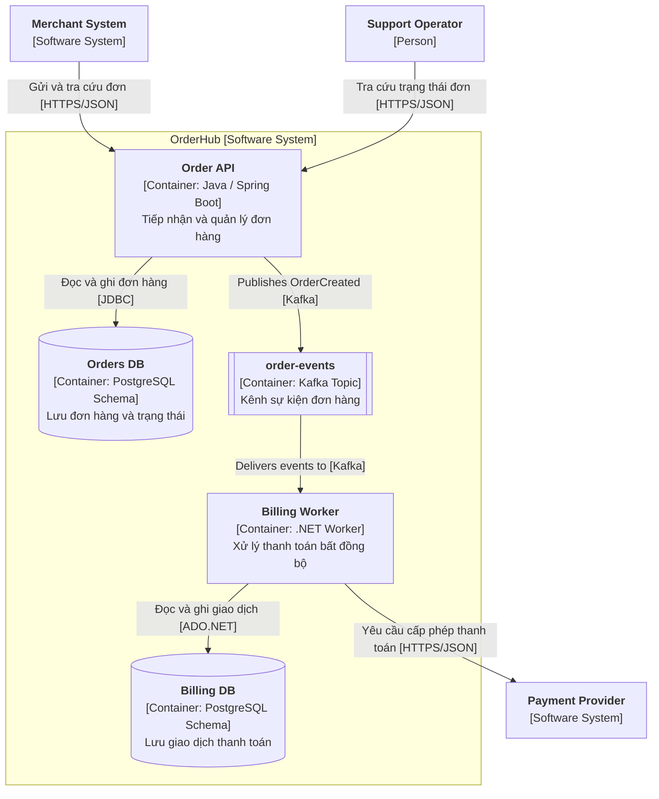

## 2. C4 — Container Diagram (C2)

### 2.1. Tổng quan & Lý do sử dụng
* **Định nghĩa chuẩn:** Sơ đồ Container (C2) phóng to (zoom-in) vào bên trong **Software System** đã chọn ở C1 để hiển thị các **Container** (ứng dụng thực thi độc lập và các kho lưu trữ dữ liệu logic) hợp thành hệ thống đó, cùng công nghệ và cơ chế giao tiếp giữa chúng.
* **Vị trí trong 4+1 View Model:** Kết hợp mức cao của **Development View / Process View** (các đơn vị chạy và kênh giao tiếp liên tiến trình - IPC).
* **Tại sao phải dùng & Chức năng chính:**
  * Trả lời hệ thống gồm những tiến trình ứng dụng nào (`API`, `Worker`, `SPA/Web App`), dữ liệu nằm ở đâu (`Database schema`, `Topic/Queue`, `Bucket`), và chúng gọi nhau qua giao thức gì (`HTTPS/JSON`, `gRPC`, `JDBC`, `Kafka`).
  * Phân định rõ các thành phần nằm **trong** `System Boundary` và các tác nhân/hệ thống ngoài nằm **ngoài** `System Boundary`.
* **Phạm vi & Giới hạn (Non-goals):**
  * **Không** đồng nhất C4 Container với Docker container hay Pod/VM vật lý (một C4 Application Container có thể chạy thành nhiều Docker instance trên thực tế; số replica/host thuộc **UML Deployment Diagram**).
  * **Không** mở sâu vào các class/interface/controller bên trong một ứng dụng (phần đó thuộc C3 hoặc UML Class).

### 2.2. Các phần tử cốt lõi & Ký pháp chuẩn

| Phần tử / Quan hệ | Ý nghĩa mô hình (Semantics) | Ký pháp trình bày chuẩn | Điều KHÔNG được suy diễn sai |
| :--- | :--- | :--- | :--- |
| **System Boundary** | Khung ranh giới bao quanh các Container thuộc quyền sở hữu của Software System đang xét. | Khung nét đứt ghi **Tên System** và nhãn `[Software System]`. | Không phải là firewall hay network security zone (VPC/Subnet). |
| **Application Container** | Đơn vị ứng dụng có ranh giới thực thi riêng (API service, background worker, web app, CLI). | Hộp: **Tên**, `[Container: Công nghệ]`, mô tả trách nhiệm ngắn. | Một module/package thư viện dùng chung (`common-utils`) không phải là một Container độc lập. |
| **Data Store / Message Channel Container** | Kho lưu trữ dữ liệu logic (DB schema, cache, bucket) hoặc kênh truyền thông điệp (queue/topic). | Hộp hoặc hình trụ/ống: **Tên**, `[Container: Công nghệ]`, mô tả dữ liệu/sự kiện lưu trữ. | Hai service dùng chung một PostgreSQL server nhưng khác schema/ownership vẫn là hai Data Store logic riêng. |
| **IPC / Data Access Relationship** | Giao tiếp liên tiến trình, đọc/ghi dữ liệu, hoặc publish/consume sự kiện giữa các Container. | Mũi tên một chiều kèm **Động từ + `[Công nghệ / Giao thức]`** (khi có bằng chứng). | `Order API -> Orders DB: Reads/writes [JDBC]` không có nghĩa dữ liệu chỉ đi 1 chiều; `depends_on` trong Compose không tự chứng minh có lời gọi HTTP runtime. |

### 2.3. Quy trình dựng sơ đồ chuẩn
1. **Mở System Boundary từ C1:** Giữ nguyên phạm vi hệ thống đã chốt ở C1, vẽ khung `System Boundary` mang tên hệ thống.
2. **Xác định các Container nội bộ:** Liệt kê các Application Container và Data Store / Topic thuộc sở hữu của hệ thống và đặt vào trong khung Boundary.
3. **Đặt Supporting Elements bên ngoài:** Giữ các `Person` và `External Software System` có tương tác trực tiếp ở bên ngoài khung Boundary.
4. **Ghi nhãn hộp đầy đủ 3 thành phần:** `Tên Container` $\rightarrow$ `[Container: Công nghệ]` (hoặc ghi chưa xác định nếu thiếu bằng chứng) $\rightarrow$ `Mô tả trách nhiệm`.
5. **Nối quan hệ IPC & truy cập dữ liệu:** Vẽ mũi tên kèm hành động và `[Giao thức/Công nghệ]` đã xác minh; thống nhất quy ước chiều cho pub/sub (luồng message `Producer -> Topic -> Consumer` hoặc phụ thuộc đăng ký `Consumer -> Topic: Subscribes to`).

### 2.4. Bộ quy tắc sử dụng & Kiểm chứng
* **Quy tắc bắt buộc:**
  * **[N-C2-01]** Mọi Container nội bộ phải nằm trong `System Boundary`; mọi `Person` và `External System` phải nằm ngoài `System Boundary`.
  * **[N-C2-02]** Không nâng các lớp nội bộ (`Controller`, `Service`, `Repository`, `DTO`) thành Container.
  * **[N-C2-03]** Với giao tiếp qua Message Broker (Kafka/RabbitMQ), ưu tiên mô hình hóa từng **Queue/Topic có ý nghĩa kiến trúc** làm Container trung gian thay vì vẽ một hộp "Kafka" duy nhất nối tất cả mọi service làm che khuất luồng sự kiện.
  * **[M-C2-04] (Quy ước MAVIS):** Chỉ gắn `[protocol]` (như `[JDBC]`, `[HTTP]`, `[Kafka]`) lên nhãn cạnh khi có bằng chứng nguồn; không tự bịa giao thức hoặc tự tạo Database cho các service stateless.
* **Các lỗi thường gặp (Anti-patterns):**

| Lỗi phổ biến (Sai) | Cách hiểu & xử lý đúng (Chuẩn) |
| :--- | :--- |
| Áp đặt quy tắc "Mỗi microservice bắt buộc phải có 1 API và 1 Database riêng". | Một microservice có thể gồm nhiều container (API + Worker + DB) hoặc là một stateless service không có DB riêng. |
| Biến thuộc tính `depends_on` trong `docker-compose.yml` thành mũi tên gọi API HTTP. | `depends_on` chỉ là thứ tự khởi động container (`STARTUP_DEPENDENCY`), không phải bằng chứng gọi HTTP/IPC. |
| Trộn lẫn chiều *Message Flow* (`Topic -> Consumer: Delivers to`) và *Dependency* (`Consumer -> Topic: Subscribes to`) không chú giải. | Phải thống nhất và ghi rõ trong Legend (trong MAVIS cần giữ đúng chiều ngữ nghĩa với nhãn hành động tương ứng). |

* **Checklist nghiệm thu:**
  - [ ] Có khung `System Boundary` rõ ràng; phân tách đúng phần tử nội bộ và bên ngoài.
  - [ ] Không có class/controller/method lọt vào sơ đồ C2.
  - [ ] Nhãn cạnh giữa các Container có động từ rõ ràng và `[Giao thức]` có bằng chứng.
  - [ ] Nhất quán danh tính với C1: mọi luồng ra/vào External System ở C1 đều giải thích được qua Container cụ thể ở C2.

### 2.5. Ứng dụng & Cơ chế trích xuất trong MAVIS
* **Ánh xạ dữ kiện đầu vào:**
  * *Entrypoint, build/deploy config (`Dockerfile`, `pom.xml`, `.csproj`, `docker-compose.yml`):* Phát hiện ứng viên `Application Container` (nhưng một module Maven/Gradle con chưa đủ kết luận là tiến trình độc lập).
  * *Datasource, connection string, queue/topic binding:* Phát hiện `Data Store` và `Message Channel` cùng cạnh truy cập dữ liệu/messaging.
  * *HTTP Client / Feign / RestTemplate / HttpClient & Runtime OTLP Spans:* Xác lập quan hệ gọi liên service (`HTTP_CALL`).
* **Xử lý thiếu dữ kiện:** Đích gọi HTTP chưa phân giải được tới service nội bộ thì giữ trạng thái `UNRESOLVED` ngoài boundary (kèm cảnh báo), tuyệt đối không ép nối vào service đầu tiên tìm thấy.

### 2.6. Ví dụ minh họa chuẩn (Bài toán OrderHub)

### 2.7. Trích dẫn & Tài liệu tham khảo
* **[S1]** Simon Brown, *C4 Model — Container Diagram & Abstraction*, `https://c4model.com/diagrams/container`, `https://c4model.com/abstractions/container`
* **[S2]** Simon Brown, *C4 Model — Microservices & Queues/Topics*, `https://c4model.com/abstractions/microservices`, `https://c4model.com/abstractions/queues-and-topics`
* **[S3]** Simon Brown, *C4 Model — Review Checklist*, `https://c4model.com/diagrams/checklist`
* **[R1]** Visual Paradigm, *Comprehensive Guide to C4 Container Diagrams*, `https://www.visual-paradigm.com/guide/mastering-software-architecture-visualization-a-comprehensive-guide-to-c4-container-diagrams/`

---
