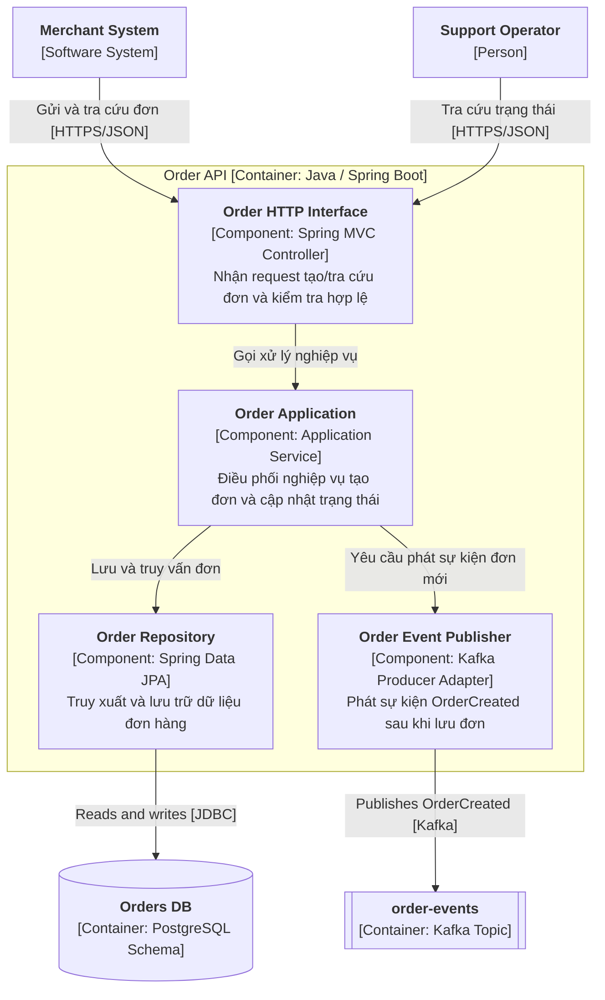

## 3. C4 — Component Diagram (C3)

### 3.1. Tổng quan & Lý do sử dụng
* **Định nghĩa chuẩn:** Sơ đồ Component (C3) phóng to vào bên trong **một Container đơn lẻ** đã chọn ở C2 để hiển thị các **Component** (nhóm chức năng có liên quan chặt chẽ nằm sau một interface rõ ràng) cùng sự cộng tác giữa chúng và với các Container/System bên ngoài.
* **Vị trí trong 4+1 View Model:** Thuộc **Logical View / Development View** ở mức cấu trúc mô-đun bên trong một đơn vị khả triển.
* **Tại sao phải dùng & Chức năng chính:**
  * Giải thích cách một ứng dụng phân chia trách nhiệm nội bộ (inbound boundary, nghiệp vụ, persistence adapter, messaging publisher) mà chưa bị ngập trong chi tiết từng dòng lệnh của Class Diagram.
  * Chỉ cần vẽ cho những Container có độ phức tạp nội bộ đáng kể (C4 gốc khuyến nghị không bắt buộc vẽ C3 cho các data store hoặc service quá nhỏ).
* **Phạm vi & Giới hạn (Non-goals):**
  * **Không** mở đồng thời nội bộ của tất cả các microservice trên cùng một hình C3.
  * **Không** coi C4 Component là một đơn vị triển khai độc lập (ranh giới triển khai là Container).
  * **Không** đồng nhất C4 Component với ký hiệu ball-and-socket / port của UML Component Diagram.

### 3.2. Các phần tử cốt lõi & Ký pháp chuẩn

| Phần tử / Quan hệ | Ý nghĩa mô hình (Semantics) | Ký pháp trình bày chuẩn | Điều KHÔNG được suy diễn sai |
| :--- | :--- | :--- | :--- |
| **Container Boundary** | Khung ranh giới của đúng **1 Container** đang được mở từ C2. | Khung nét đứt ghi **Tên Container** và nhãn `[Container]`. | Không đặt các Data Store hay Container khác vào bên trong khung này. |
| **Component** | Nhóm chức năng liên quan nằm trong cùng tiến trình Container, thường được cài đặt bởi một hoặc nhiều class/interface. | Hộp: **Tên Component**, `[Component: Công nghệ / Kiểu cài đặt]`, mô tả trách nhiệm. | Không phải mọi class hay mọi annotation `@Component`/`@Service` đều tự động là một hộp C4 Component riêng lẻ. |
| **Supporting Container / External System** | Các Container khác (DB, Topic, Service khác) hoặc Person/External System có tương tác **trực tiếp** với các Component đang xét. | Đặt **bên ngoài** `Container Boundary`, giữ nguyên mức trừu tượng Container/System (không mở ruột). | Các Container trong cùng hệ thống nhưng **không** có kết nối trực tiếp với Container đang mở thì được lược bỏ khỏi C3 này. |
| **In-process & Out-of-process Relationship** | Lời gọi hàm nội bộ giữa các Component hoặc lời gọi IPC từ Component ra Container ngoài. | Mũi tên một chiều kèm động từ. Chỉ gắn `[Giao thức mạng/DB]` cho cạnh đi ra ngoài Container. | Cạnh nối giữa 2 Component trong cùng 1 Container là lời gọi trong bộ nhớ (method call), không gán `[HTTP]` cho nó. |

### 3.3. Quy trình dựng sơ đồ chuẩn
1. **Chọn 1 Container đích theo ID từ C2:** Vẽ khung `Container Boundary` cho đúng Container đó (ví dụ `Order API`).
2. **Gom nhóm mã nguồn thành Component có nghĩa (Grouping):** Nhóm các interface + implementation + mapper/helper phục vụ chung một trách nhiệm kiến trúc thành một Component (ví dụ `OrderController` + mapper $\rightarrow$ `Order HTTP Interface`; `OrderRepository` + JPA adapter $\rightarrow$ `Order Repository`).
3. **Đặt Supporting Elements bên ngoài Boundary:** Chỉ đưa vào các Person/Container/External System có cạnh nối trực tiếp với các Component bên trong.
4. **Vẽ quan hệ nội bộ và ngoại vi:** Phân biệt rõ lời gọi nội bộ (in-process) với lời gọi ra DB/Topic/External API.
5. **Đối chiếu tính nhất quán với C2:** Đảm bảo không làm phát sinh quan hệ với Container/External System mới ở C3 mà chưa hề tồn tại ở C2 (trừ khi cập nhật lại model có bằng chứng).

### 3.4. Bộ quy tắc sử dụng & Kiểm chứng
* **Quy tắc bắt buộc:**
  * **[N-C3-01]** Mỗi sơ đồ C3 chỉ mở duy nhất **một** Container; các Container phụ trợ đứng ngoài khung Boundary.
  * **[N-C3-02]** Không vẽ tràn lan mọi DTO, Entity, Helper thành các hộp riêng biệt (code noise), nhưng cũng không gom tất cả vào một hộp duy nhất tên `"Business Logic"` làm mất ý nghĩa phân rã.
  * **[N-C3-03]** Không tự gắn ký hiệu UML Port (hình vuông trên cạnh) rồi ghi cổng TCP `8080` vào C4 Component (UML Port là interaction point của classifier, không phải network port).
  * **[M-C3-04] (Quy ước MAVIS):** Mỗi Component lưu danh sách code elements/files làm bằng chứng (`evidenceRefs`), bảo toàn khả năng drill-down về mã nguồn.
* **Các lỗi thường gặp (Anti-patterns):**

| Lỗi phổ biến (Sai) | Cách hiểu & xử lý đúng (Chuẩn) |
| :--- | :--- |
| Tách rời `OrderService` (interface) và `OrderServiceImpl` (class) thành 2 hộp Component riêng. | Đó là mức UML Class Diagram. Ở C3, interface và implementation cùng thực hiện một trách nhiệm nên được gom chung thành 1 Component. |
| Ghi nhãn `[HTTP/JSON]` lên mũi tên gọi từ `Controller Component` sang `Service Component` trong cùng một tiến trình. | Giao tiếp nội bộ trong cùng một Container là method call/in-process; chỉ giao tiếp vượt qua biên Container mới dùng giao thức IPC/mạng. |
| Đưa cả `Billing Worker` và `Payment Provider` vào C3 của `Order API` dù `Order API` chỉ gửi sự kiện vào `order-events`. | Ở C3 của `Order API`, chỉ giữ `Orders DB` và `order-events` vì có kết nối trực tiếp; ẩn `Billing Worker` và `Payment Provider`. |

* **Checklist nghiệm thu:**
  - [ ] Scope mở đúng 1 Container từ C2; có khung `Container Boundary` rõ ràng.
  - [ ] Mỗi Component đại diện cho một trách nhiệm kiến trúc rõ ràng, không phải bản sao 1-1 của từng class/DTO.
  - [ ] Phân biệt đúng lời gọi nội bộ (in-process) và giao tiếp ra ngoài biên Container.
  - [ ] Nhất quán hoàn toàn với C1 và C2 theo bảng ánh xạ đối tượng.

### 3.5. Ứng dụng & Cơ chế trích xuất trong MAVIS
* **Ánh xạ dữ kiện đầu vào:**
  * *Static AST / Package / Stereotype Annotations (`@RestController`, `@Service`, `@Repository`, DI Constructor Injection):* Phát hiện các ứng viên Component và quan hệ phụ thuộc code (`CODE_DEPENDENCY`, `CALLS`).
  * *Lưu ý giới hạn:* Dependency Injection (DI) chứng minh phụ thuộc cấu trúc tĩnh, chưa tự chứng minh lời gọi đã xảy ra ở một lần chạy runtime cụ thể.
* **Bảng đối chiếu tính nhất quán C1 – C2 – C3 (chuẩn MAVIS):**

| Đối tượng / Quan hệ | Ở C1 (System Context) | Ở C2 (Container) | Ở C3 (Mở `Order API`) |
| :--- | :--- | :--- | :--- |
| `OrderHub` | 1 hộp `Software System` | Khung `System Boundary` | Ngữ cảnh hệ thống (scope đang mở là `Order API`) |
| `Order API` | Ẩn bên trong `OrderHub` | 1 `Application Container` | Khung `Container Boundary` chứa các Component |
| `Orders DB` & `order-events` | Ẩn nội bộ | Các Container lưu trữ / topic | Supporting Containers nằm ngoài khung `Order API` |
| `Billing Worker` | Ẩn nội bộ | 1 `Application Container` | Ẩn (vì không nối trực tiếp với Component của `Order API`) |
| `Payment Provider` | `External Software System` | Ngoài boundary, nối với `Billing Worker` | Ẩn (không nối trực tiếp với `Order API`) |

### 3.6. Ví dụ minh họa chuẩn (Bài toán OrderHub — Mở `Order API`)

### 3.7. Trích dẫn & Tài liệu tham khảo
* **[S1]** Simon Brown, *C4 Model — Component Diagram & Abstraction*, `https://c4model.com/diagrams/component`, `https://c4model.com/abstractions/component`
* **[S2]** OMG, *Unified Modeling Language (UML) Specification Version 2.5.1* (để phân biệt C4 Component với UML Component & Port), `https://www.omg.org/spec/UML/2.5.1/`
* **[R1]** Visual Paradigm, *C4 Container vs Component Diagrams*, `https://www.visual-paradigm.com/guide/comprehensive-guide-c4-container-vs-component-diagrams/`

---

# PHẦN 2. NHÓM SƠ ĐỒ CẤU TRÚC & HÀNH VI UML 2.5.1 (DIAGRAM 4 – 9)

---
