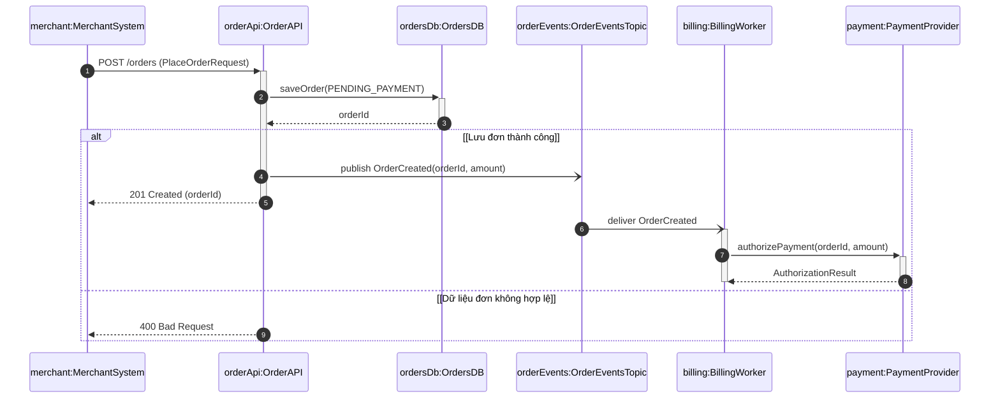

## 5. UML — Sequence Diagram

### 5.1. Tổng quan & Lý do sử dụng
* **Định nghĩa chuẩn:** Theo OMG UML 2.5.1 (Chương 17 — Interactions), **Sequence Diagram** là sơ đồ tương tác mô tả trật tự trao đổi thông điệp (Messages) giữa các **Lifelines** (đối tượng, thành phần, hoặc dịch vụ) dọc theo trục dọc trong phạm vi **một kịch bản (Scenario) cụ thể**.
* **Vị trí trong 4+1 View Model:** Trục **Scenarios (+1)** và **Process/Logical View** động; dùng để xác thực cách các phần tử tĩnh phối hợp thực thi một nghiệp vụ.
* **Tại sao phải dùng & Chức năng chính:**
  * Làm rõ luồng gọi đồng bộ (`Synchronous call`), gửi sự kiện bất đồng bộ (`Asynchronous message`), phản hồi (`Reply`) và các nhánh điều kiện/vòng lặp (`alt`, `opt`, `loop`, `par`).
  * Trong MAVIS, Sequence Diagram còn là góc nhìn trực quan hóa trực tiếp các **OpenTelemetry Runtime Traces** thu được từ một kịch bản kiểm thử.
* **Phạm vi & Giới hạn (Non-goals):**
  * Một Sequence Diagram chỉ mô tả **một kịch bản cụ thể**, không chứng minh toàn bộ các nhánh rẽ hoặc vòng đời trạng thái của hệ thống đã được bao phủ.
  * Không bắt buộc phải có Frontend/UI lifeline nếu phạm vi kịch bản chỉ xét từ API Gateway/Backend trở vào.

### 5.2. Các phần tử cốt lõi & Ký pháp chuẩn

| Phần tử / Quan hệ | Ý nghĩa mô hình (Semantics) | Ký pháp trình bày chuẩn (OMG UML 2.5.1) | Điều KHÔNG được suy diễn sai |
| :--- | :--- | :--- | :--- |
| **Lifeline** | Đại diện cho một cá thể tham gia (Participant) trong tương tác (§17.3). | Đầu hình chữ nhật ghi `role:Type` hoặc `:Type` (không bắt buộc gạch chân như UML 1.x), nối với đường dọc nét đứt bên dưới. | Hai lifeline độc lập không có message nối với nhau thì không tự suy ra thứ tự thời gian tuyệt đối từ vị trí cao/thấp bằng mắt. |
| **Execution Specification (Activation)** | Khoảng thời gian một lifeline đang thực thi hành vi hoặc chờ lời gọi con hoàn tất. | Thanh hình chữ nhật mảnh đè lên đường nét đứt của Lifeline; có thể lồng nhau khi gọi `self-message`. | Độ dài hình học của thanh activation trên giấy vẽ **không** đo chính xác số mili-giây CPU hay latency thực tế. |
| **Synchronous Call & Reply Message** | Bên gửi gọi và **chờ** bên nhận hoàn tất xử lý trước khi tiếp tục (§17.4). | Call: Đường **nét liền, đầu mũi tên đặc (filled arrowhead)**. Reply: Đường **nét đứt, đầu mũi tên hở** quay về bên gọi. | Không vẽ đường Reply không có nghĩa là hàm bị treo vĩnh viễn (Reply có thể được lược bỏ khi ngữ cảnh đã rõ). |
| **Asynchronous Message** | Bên gửi phát thông điệp đi và tiếp tục luồng của mình mà không chờ bên nhận xử lý xong theo cơ chế gọi đồng bộ. | Đường **nét liền, đầu mũi tên hở (open arrowhead)**. | Từ khóa `async/await` trong C#/JS nếu bên gọi vẫn `await` kết quả trả về ngay tại chỗ thì về ngữ nghĩa tương tác liên dịch vụ vẫn là chờ phản hồi đồng bộ; ngược lại, gửi message vào Broker mới là bất đồng bộ thực sự. |
| **Create / Destroy & Found / Lost** | Tạo mới đối tượng (`create`), hủy lifeline (`destroy`), hoặc message không rõ nguồn/đích trong scope (`found`/`lost`). | `create`: nét đứt đầu hở trỏ vào hộp đầu lifeline mới. `destroy`: dấu **X** lớn cuối lifeline. `found`/`lost`: chấm tròn đen ở đầu ngoài phạm vi. | Dấu `X` (destroy lifeline trong bộ nhớ) **không** đồng nghĩa với lệnh `DELETE` xóa một bản ghi trong Database. `Lost message` không mặc định là rớt gói tin mạng. |
| **Combined Fragments (`alt`, `opt`, `loop`, `par`, `ref`)** | Các khung toán tử điều khiển luồng tương tác (§17.6). | Khung chữ nhật có nhãn toán tử ở góc trái trên (`alt`, `opt`, `loop`, `par`), các nhánh ngăn cách bởi đường ngang nét đứt và guard `[condition]`. `ref` là `InteractionUse` tham chiếu sơ đồ khác. | `par` cho phép xen kẽ (interleaving) các sự kiện giữa các operand, không khẳng định chạy song song cùng một xung nhịp CPU vật lý. `critical` không tự động là DB transaction. |

### 5.3. Quy trình dựng sơ đồ chuẩn
1. **Chọn đúng 1 kịch bản (Scenario) & mức trừu tượng:** Quyết định vẽ ở mức Service-to-Service (Microservices) hay mức Component/Class bên trong một Service (không trộn lẫn lộn xộn).
2. **Sắp xếp các Lifelines từ trái sang phải:** Thường đặt bên khởi tạo kịch bản ở bên trái, các dịch vụ/thành phần trung gian ở giữa và kho dữ liệu/kênh sự kiện/hệ thống ngoài ở bên phải.
3. **Vẽ các Messages theo ràng buộc nhân quả (Causal Ordering):** Sự kiện gửi (`sendEvent`) luôn đứng trước sự kiện nhận (`receiveEvent`); phân biệt đúng đầu mũi tên đặc (Sync) và đầu hở (Async).
4. **Đóng khung điều kiện bằng Combined Fragments:** Đặt `[guard]` trong ngoặc vuông cho `alt`, `opt`, `loop`; tuyệt đối không vẽ mũi tên vòng ngược từ dưới lên trên để thay cho khung `loop`.
5. **Kiểm tra giới hạn kịch bản:** Ghi rõ những gì kịch bản đang giả định hoặc lược bỏ (ví dụ: retry, dead-letter queue, compensation).

### 5.4. Bộ quy tắc sử dụng & Kiểm chứng
* **Quy tắc bắt buộc:**
  * **[N-SEQ-01]** Tuyệt đối không dùng thuật toán layout đồ thị tổng quát (như force-directed layout) để sắp xếp Sequence Diagram; trục ngang là các Lifelines, trục dọc là thứ tự sự kiện.
  * **[N-SEQ-02]** Phân biệt rạch ròi đầu mũi tên **đặc** (`Synchronous`) và đầu mũi tên **hở** (`Asynchronous`); đường `Reply` phải là nét đứt và khớp đúng lifeline đã gọi.
  * **[N-SEQ-03]** Các `[guard]` trong cùng một khung `alt` cần được thiết kế loại trừ nhau để tránh mơ hồ; không tạo nhánh `else` rỗng cho khung `opt`.
  * **[M-SEQ-04] (Quy ước MAVIS):** Phải gắn nhãn phân biệt rõ **Designed/Static Sequence** (suy từ kịch bản thiết kế hoặc phân tích tĩnh) với **Observed Runtime Sequence** (dựng từ OpenTelemetry spans thực tế trong một `timeWindow`).
* **Các lỗi thường gặp (Anti-patterns):**

| Lỗi phổ biến (Sai) | Cách hiểu & xử lý đúng (Chuẩn) |
| :--- | :--- |
| Vẽ mũi tên nét liền đầu đặc khi publish sự kiện vào Kafka Topic rồi kết luận Consumer đã xử lý xong. | Publish sự kiện bất đồng bộ dùng đầu mũi tên hở; việc Broker nhận event chưa chứng minh Consumer đã xử lý thành công trừ khi có span/message tiếp theo. |
| Dùng mũi tên chéo quay ngược lên trên để biểu diễn vòng lặp retry. | Phải bọc đoạn thông điệp lặp vào trong khung Combined Fragment `loop [min..max, guard]`. |
| Lấy một trace chạy thành công (Happy Path) rồi tuyên bố hệ thống không có nhánh lỗi. | Một runtime trace chỉ chứng minh kịch bản đã quan sát trong lần chạy đó; các nhánh chưa chạy không được xóa khỏi mô hình tĩnh. |

* **Checklist nghiệm thu:**
  - [ ] Mọi Lifeline thuộc cùng một mức trừu tượng rõ ràng.
  - [ ] Đúng kiểu nét và đầu mũi tên cho `Sync`, `Async` và `Reply`.
  - [ ] Thứ tự gọi tuân thủ quan hệ nhân quả (`parentSpanId` / call stack), không chỉ dựa vào đồng hồ lệch giữa các máy.
  - [ ] Các nhánh điều kiện/lặp dùng đúng khung `alt`/`opt`/`loop` kèm `[guard]`.

### 5.5. Ứng dụng & Cơ chế trích xuất trong MAVIS
* **Ánh xạ dữ kiện đầu vào:**
  * *Runtime OpenTelemetry Traces (Ưu tiên cao nhất cho kịch bản thực thi):* `traceId`, `spanId`, `parentSpanId`, `service.name`, `http.method`, `http.status_code`, `duration` $\rightarrow$ dựng `Observed Sequence Diagram`. Nếu thiếu server span hoặc đứt chuỗi `parentSpanId`, MAVIS hiển thị rõ cảnh báo **Missing Span / Gap**.
  * *Static Call Graph + Scenario Definition:* Hỗ trợ dựng bản nháp `Designed/Static Sequence` cho một entrypoint được chọn.

### 5.6. Ví dụ minh họa chuẩn (Bài toán OrderHub — Kịch bản Tạo đơn hàng)

### 5.7. Trích dẫn & Tài liệu tham khảo
* **[S1]** OMG, *UML 2.5.1 Specification* — Chương 17 (Interactions: §17.3 Lifelines, §17.4 Messages, §17.6 CombinedFragments), `https://www.omg.org/spec/UML/2.5.1/`
* **[S2]** OpenTelemetry Specification — *Traces, Spans & Context Propagation*, `https://opentelemetry.io/docs/concepts/signals/traces/`
* **[A1]** Hassan Gomaa, *Software Modeling and Design* — Giáo trình SWD392 Ch09–11 Dynamic Modeling (slides 6–8, 24–25).
* **[T1]** PlantUML & Visual Paradigm Sequence Diagram Guide, `https://www.visual-paradigm.com/guide/uml-unified-modeling-language/what-is-sequence-diagram/`

---
