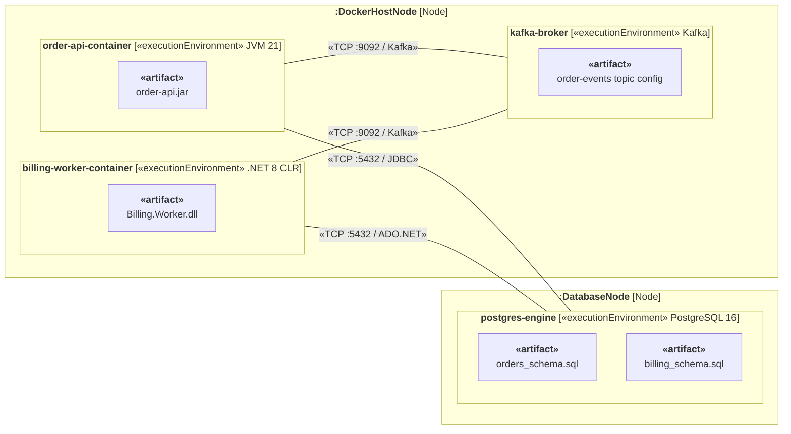

## 7. UML — Deployment Diagram

> [!TIP]
> **Điểm cập nhật quan trọng:** Trong tài liệu gốc trên Google Docs, tab `UML Deployment Diagram` bị đứt ngang ở dòng *"Mẫu triển khai backend microservice"*. Bản chuẩn hóa dưới đây đã khôi phục đầy đủ quy trình, bộ quy tắc kiểm chứng, ánh xạ MAVIS, ví dụ minh họa hoàn chỉnh cho `OrderHub` và trích dẫn chuẩn OMG UML 2.5.1 Chương 19.

### 7.1. Tổng quan & Lý do sử dụng
* **Định nghĩa chuẩn:** Theo OMG UML 2.5.1 (Chương 19 — Deployments), **Deployment Diagram** là sơ đồ cấu trúc mô tả cách các tài sản phần mềm vật lý (**Artifacts**) được phân bổ và triển khai lên các tài nguyên tính toán (**Nodes**: `Device` hoặc `ExecutionEnvironment`) cùng các đường truyền thông kết nối giữa các Node (**CommunicationPaths**).
* **Vị trí trong 4+1 View Model:** Trực tiếp thể hiện **Physical View (Deployment View)** của Kruchten (1995).
* **Tại sao phải dùng & Chức năng chính:**
  * Chuyển giao thiết kế giữa đội phát triển và DevOps/SRE: chỉ rõ file thực thi nào (`.jar`, `.dll`, container image, config file) chạy trên môi trường nào (`JVM`, `.NET Runtime`, `PostgreSQL Engine`, Linux Host/VM), qua cổng mạng/giao thức nào và có bao nhiêu bản sao (replicas) trong một môi trường xác định (`Production`, `Staging`, `Pilot Lab`).
  * Bổ sung góc nhìn vật lý mà **C4 Container Diagram (C2)** cố ý lược bỏ.
* **Phạm vi & Giới hạn (Non-goals):**
  * **Không** biểu diễn luồng xử lý theo thời gian (thuộc Sequence/Activity) hay danh sách các lớp nghiệp vụ (thuộc Class Diagram).
  * Một hộp Node đơn lẻ không tự chứng minh số lượng máy chủ vật lý thực tế đang chạy nếu chưa ghi rõ mức mô hình (Descriptor vs Instance level) hoặc multiplicity/replicas.

### 7.2. Các phần tử cốt lõi & Ký pháp chuẩn

| Phần tử / Quan hệ | Ý nghĩa mô hình (Semantics) | Ký pháp trình bày chuẩn (OMG UML 2.5.1 §19.2–19.5) | Điều KHÔNG được suy diễn sai |
| :--- | :--- | :--- | :--- |
| **Node (`Device` & `ExecutionEnvironment`)** | Tài nguyên tính toán có khả năng host phần mềm. `«device»`: phần cứng/máy chủ; `«executionEnvironment»`: môi trường phần mềm như OS, Docker Engine, JVM, CLR, DBMS. | Hình khối hộp 3D (cube). Nếu là instance cụ thể thì ghi `app01 : AppServer` và **gạch chân**. Các Node có thể lồng nhau để thể hiện cấu trúc hosting. | Không mặc định gọi mọi Virtual Machine hay Docker Container là một `«device»` vật lý. |
| **Artifact (`«artifact»`)** | Đơn vị thông tin vật lý cụ thể sinh ra từ quá trình build hoặc cấu hình (`.jar`, `.dll`, OCI image, `.sql`, `.yml`). | Hình chữ nhật có từ khóa `«artifact»` hoặc biểu tượng tài liệu gấp góc (ví dụ `order-api.jar`). | `Artifact` là file/image vật lý; `Component` là phần tử logic. Không mặc định 1 file bằng 1 Component. |
| **DeploymentSpecification** | Tập các tham số cấu hình điều khiển cách một Artifact được triển khai lên Node (`«deployment spec»`). | Hộp có nhãn `«deployment spec»` gắn kèm Artifact hoặc quan hệ Deployment. | Không phải mọi file `.properties`/`.json` bất kỳ đều tự động là `DeploymentSpecification` của UML. |
| **Deployment (Triển khai)** | Việc gán một Artifact vào một DeploymentTarget (Node). | Đặt hộp `«artifact»` nằm **bên trong** khối 3D của Node, hoặc vẽ mũi tên nét đứt đầu hở kèm nhãn `«deploy»` từ Artifact tới Node. | Lồng Node vào Node là **Hosting/Containment**; lồng Artifact vào Node là **Deployment**. |
| **Manifestation (`«manifest»`)** | Quan hệ chỉ rõ một Artifact vật lý hiện thực hóa (đóng gói) một hoặc nhiều phần tử mô hình logic (như Component/Package). | Đường **nét đứt, đầu mũi tên hở** đi từ **Artifact** trỏ tới **Component / PackageableElement**, nhãn `«manifest»`. | Chiều `«manifest»` luôn đi từ `Artifact` $\rightarrow$ `Component`, **không** phải đường gọi hàm runtime. |
| **CommunicationPath** | Đường truyền thông vật lý/mạng giữa hai DeploymentTarget (Nodes) cho phép trao đổi tín hiệu/thông điệp. | Đường **nét liền** nối hai khối Node, thường kèm nhãn giao thức/cổng (ví dụ `«TCP/HTTPS :8443»`, `«TCP :5432»`) và multiplicity ở hai đầu. | Không lấy nguyên mũi tên request một chiều của Sequence Diagram để thay cho đường truyền topology giữa các Node. |

### 7.3. Quy trình dựng sơ đồ chuẩn
1. **Chọn rõ môi trường mục tiêu và mức biểu diễn:** Nêu rõ trên tiêu đề đây là môi trường nào (`Declared Compose Topology`, `Staging`, hay `Production`) và đang vẽ ở mức loại (Type/Descriptor) hay mức cá thể (Instance).
2. **Xác định các Nodes và cấu trúc Hosting:** Vẽ các `«device»` / Host / VM bên ngoài và lồng các `«executionEnvironment»` (Docker Engine, JVM, .NET Runtime, PostgreSQL DBMS) vào bên trong.
3. **Đặt các Artifacts vào đúng Deployment Target:** Đưa các file build/image (`order-api.jar`, `billing-worker.dll`) vào đúng Node thực thi và ghi số lượng replica nếu đã xác nhận.
4. **Nối quan hệ `«manifest»` (khi cần liên kết với C2/C3):** Chỉ rõ Artifact nào đóng gói Component/Container logic nào.
5. **Vẽ các `CommunicationPath` giữa các Nodes:** Ghi rõ giao thức mạng, port khai báo và bội số kết nối có bằng chứng từ cấu hình.

### 7.4. Bộ quy tắc sử dụng & Kiểm chứng
* **Quy tắc bắt buộc:**
  * **[N-DEP-01]** Phân biệt rõ 3 khái niệm: **Node** (nơi chạy), **Artifact** (file/image được triển khai), và **Component/Container** (phần tử kiến trúc logic).
  * **[N-DEP-02]** Quan hệ `«manifest»` phải đi từ `Artifact` sang `Component`; quan hệ `«deploy»` (nếu vẽ bằng mũi tên thay vì lồng hộp) đi từ `Artifact` sang `Node`.
  * **[M-DEP-03] (Quy ước MAVIS):** Khi dựng sơ đồ từ `docker-compose.yml` hoặc Kubernetes manifest, sơ đồ phải được gắn nhãn **`DECLARED DEPLOYMENT`** (cấu hình khai báo tại snapshot), không tự tuyên bố là **`LIVE TOPOLOGY`** đang chạy khỏe mạnh nếu không có dữ kiện môi trường thực thi trực tiếp.
* **Các lỗi thường gặp (Anti-patterns):**

| Lỗi phổ biến (Sai) | Cách hiểu & xử lý đúng (Chuẩn) |
| :--- | :--- |
| Lấy nguyên sơ đồ C4 Container đổi hình hộp thành khối 3D rồi gọi là UML Deployment Diagram. | C4 Container mô tả các đơn vị logic; UML Deployment phải chỉ rõ **Node** (môi trường tính toán) và **Artifact** (`«artifact»` file/image) được triển khai lên Node đó. |
| Vẽ mũi tên `Component A -> Artifact B` với nhãn `«manifest»`. | Bị ngược chiều chuẩn UML: **Artifact** mới là bên hiện thực hóa (**manifests**) phần tử logic (`Artifact -> Component`). |
| Thấy khai báo service trong `docker-compose.yml` liền kết luận hệ thống thực tế chạy 3 máy chủ vật lý riêng biệt. | `docker-compose.yml` chỉ khai báo các container/service trên môi trường Compose; nếu không có bằng chứng phân bổ đa host, chỉ mô hình hóa đúng phạm vi declared environment. |

* **Checklist nghiệm thu:**
  - [ ] Tiêu đề nêu rõ môi trường triển khai và nguồn dữ kiện (`Declared` vs `Observed`).
  - [ ] Phân biệt đúng ký hiệu khối 3D cho `Node` (`«device»` / `«executionEnvironment»`) và hộp `«artifact»`.
  - [ ] Các đường `CommunicationPath` nối giữa các `Node` có giao thức/cổng dựa trên cấu hình thực tế.
  - [ ] Nếu có vẽ `«manifest»`, mũi tên nét đứt đi đúng chiều từ `Artifact` tới `Component`.

### 7.5. Ứng dụng & Cơ chế trích xuất trong MAVIS
* **Ánh xạ dữ kiện đầu vào:**
  * *Declared Deployment (`docker-compose.yml`, `Dockerfile`, K8s manifests):* Trích xuất danh sách services, `image`/`build` context ($\rightarrow$ `«artifact»`), runtime base image ($\rightarrow$ `«executionEnvironment»`), `ports`/`expose`/`networks` ($\rightarrow$ `CommunicationPath`).
  * *Build Artifacts (`pom.xml`, `build.gradle`, `.csproj`):* Xác định tên gói đầu ra (`order-api.jar`, `Billing.Worker.dll`) và liên kết `«manifest»` với module code.
* **Xử lý thiếu dữ kiện:** Không tự đoán cấu hình phần cứng vật lý (CPU/RAM/Cloud Region) hoặc số lượng replica khi file manifest trong repo không khai báo.

### 7.6. Ví dụ minh họa chuẩn (Bài toán OrderHub — Môi trường Declared Docker Compose)

### 7.7. Trích dẫn & Tài liệu tham khảo
* **[S1]** OMG, *UML 2.5.1 Specification* — Chương 19 (Deployments: §19.2 Deployments, §19.3 Artifacts, §19.4 Nodes, §19.5 Notation), `https://www.omg.org/spec/UML/2.5.1/`
* **[A1]** Philippe Kruchten, *Architectural Blueprints—The “4+1” View Model of Software Architecture*, IEEE Software 12(6), 1995 (Physical View), `https://doi.org/10.1109/52.469759`
* **[T1]** Visual Paradigm & Sparx Systems, *UML Deployment Diagram Guide*, `https://www.visual-paradigm.com/guide/uml-unified-modeling-language/what-is-deployment-diagram/`

---
